# Nemo · ReefTrace

**Investigate where floating pollution could have entered the water, predict where it may travel, and compare collection plans worth testing.**

Nemo connects camera observations, transparent transport models and an evidence-bound AI investigator. Source tracing is the main question; interception is the next decision. The project combines a small physical tank prototype, reproducible synthetic experiments and separate studies of historical ocean buoy movement.

**Nemo** is the product name. **ReefTrace** remains the repository, package and API name. A green bottle cap is our controlled stand-in for floating trash. **A, B and C are possible entry regions in the tank**, not detected chemicals, pollution categories or named polluters. The live detector recognizes that declared green marker; it is not a general plastic classifier.

[Open the hosted Nemo demo](https://nemo-software-demo.onrender.com/) · [Project story](https://devpost.com/software/nemo-i69rus) · [GitHub checks](https://github.com/Jose-Gael-Cruz-Lopez/reeftrace/actions) · [Product handbook](docs/tideward-product-guide.md) · [Scientific contract audit](docs/algorithm-contract-audit.md)

This README describes the implementation at code baseline **`c6365f7`**, verified **18 October 2026**. Screenshots and live checks are dated observations. Historical protocols, results and implementation pins keep their original identities; a documentation update does not refit a model, refresh ocean conditions or create physical validation.

## Contents

- [What works and what the evidence means](#what-works-and-what-the-evidence-means)
- [Screenshots and the visible workflow](#screenshots-and-the-visible-workflow)
- [Run the software demo](#three-part-software-demo)
- [Install and start locally](#start-locally)
- [Architecture and repository map](#architecture-and-repository-map)
- [Camera, saved calibration and the real rig](#camera-saved-calibration-and-the-real-rig)
- [Chalk, Photon and Grok](#chalk-photon-and-grok)
- [Datasets and frozen results](#datasets-what-nemo-actually-uses)
- [All implemented math and physics: F1–F17](#scientific-formulas-explained-through-the-tank-experiment)
- [Real tank experiment sequence](#turn-the-formulas-into-the-real-tank-experiment)
- [States, transitions, evidence and export contracts](#application-states-and-evidence-freshness)
- [Deployment and private configuration](#deployment-and-private-configuration)
- [Verification and reproducible checks](#verification-and-reproducible-checks)
- [Team contributions and remaining work](#team-contributions-and-remaining-work)
- [Full documentation map](#full-documentation-map)

## What works and what the evidence means

The project has **three separate evidence streams**. Keeping them separate is part of the implementation.

| Stream | Implemented behavior | What it establishes | What remains unproven |
| --- | --- | --- | --- |
| Real camera / physical rig | Local C270 preview, green-marker detection, estimated grid, private saved-calibration import, checked-mapping and recording workflows, saved-footage detector replay | The cap is visible and its pixels can be tracked; measured tray dimensions and historical references exist | Current centimetre accuracy without independent alignment checks; measured flow, blind source accuracy and physical collection performance |
| Synthetic tank experiments | Forward-particle candidate comparison, Ranked/Unknown/Invalid, sensitivity gates, two-layout prevention, trial accounting, exports and 3D replay | End-to-end numerical and application behavior for declared fixtures | Real cap source identification, real reef protection or a physically validated digital twin |
| Historical ocean research | Archived NOAA positions; position baselines, ridge AR(1), causal Kalman filtering, PacIOOS/HYCOM advection, matched-current comparisons and backward/forward hypotheses | Reproducible motion errors on the stated historical cohorts and hypothetical interception outcomes | A validated system finding the release origin of pollution anywhere in the ocean |

**Results we preserve:** the fresh six-group study favors the simple last-drift baseline on average. The six-hour reverse-current experiment is worse than last-drift extrapolation. The ocean layout example favors A for its chosen scenario, but uses ideal capture and a hypothetical receiving area. No independently validated physical source or interception result has been established.

### Features at a glance

| Workspace / capability | What a first-time user does | Main contract |
| --- | --- | --- |
| Landing / Overview | Enter the silent ocean journey or open the workspace; follow three demo steps | Nemo name, light-blue scientific interface, square components; decorative motion is not data |
| Investigations — tank | Choose a saved observation, inspect A/B/C support, challenge assumptions, ask Chalk | Candidate support is conditional; Unknown and Invalid are preserved |
| Investigations — ocean | Reveal scattered fixes → connected path → Kalman estimate → motion formula → both directions | Observed positions, filtered states and modeled hypotheses remain labeled separately |
| Prevention — ocean | Compare both layouts on one graph; toggle paths, interceptors, current arrows and reef proxy | Same releases, forcing, scale and denominator across layouts |
| Prevention — tank | Load a separate synthetic comparison, inspect the trial ledger, open 3D and export evidence | Synthetic, reported physical and missing outcomes remain distinct |
| Camera | Start the local preview explicitly; inspect pixels or the estimated grid; use measured workflows when eligible | Frames remain on the capture laptop; a cloud server cannot open its USB device |
| Data Lab | Inspect archived data, five-model scores, current studies, motion/error vectors and uncertainty | Read-only saved studies are not new acquisitions or retraining |
| Chalk | Ask about the selected numerical report and inspect citations/tool trace | Python calculates; a live model explains permitted evidence |
| Photon | Ask the same investigator through the authorized, pinned iMessage route | Local worker, exact allowlist and durable messaging; hosted verification is read-only |
| Settings / operator access | Check readiness, enter the operator token privately, explicitly verify integrations | No sponsor key is entered into the browser; readiness is not a live-call success |

## Screenshots and the visible workflow

These are **static captures of actual screens**, not a live feed. The [media manifest](docs/assets/nemo/manifest.json) records their bytes and evidence scope.

### Fresh hosted Ask Chalk check

On **18 October 2026**, a fresh question in the deployed app returned **REPORT / Live Chalk explanation** in about **7 seconds**. Its `get_case` and `get_source_evidence` trace cited `estimate-1c8ef28f8870445e`, matching the selected saved synthetic report. The result explained why C fit best and why that was not a proven geographic origin. This proves one real integration turn, not physical source accuracy or guaranteed response time. [Verification receipt](docs/research-evidence/nemo-live-integration-verification-20261018.json).

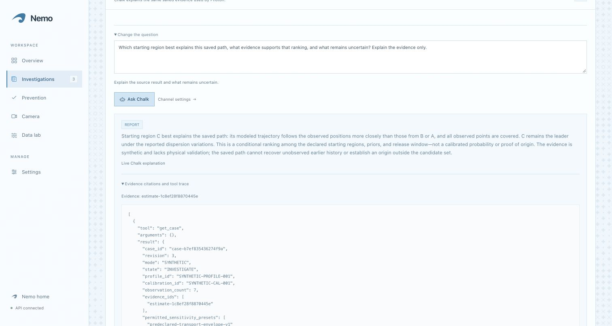

<details>
<summary>Open the complete visual walkthrough: camera, source, NOAA, layouts, 3D and Photon</summary>

**Real rig.** The tray, pump, tubing and mesh exist; this photograph is not a completed accuracy trial.

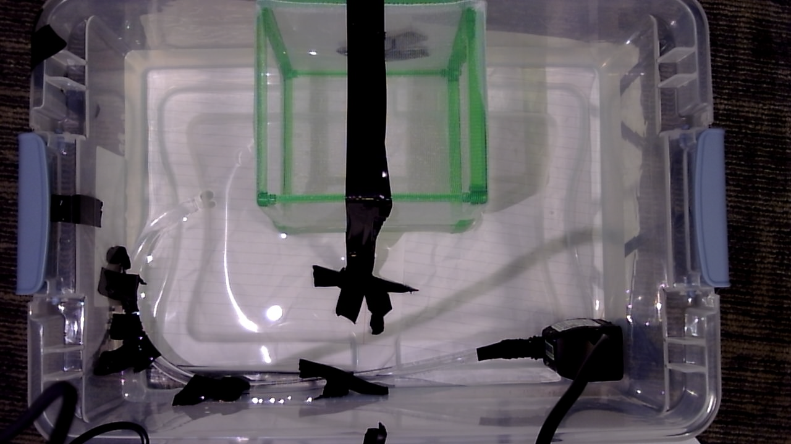

**Real marker, estimated grid.** Green-cap pixels are observed. The displayed centimetres are approximate until present alignment is independently checked.

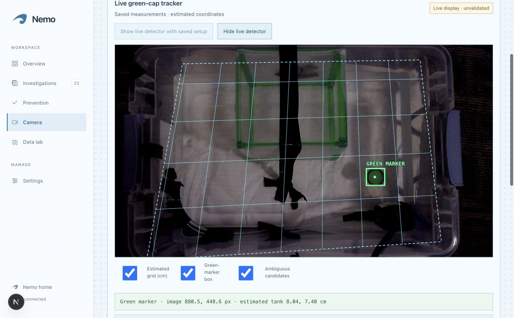

**Separate synthetic source case.** A, B and C are declared entry regions. C best matches this saved path under the frozen model; its bar is not a geographic probability.

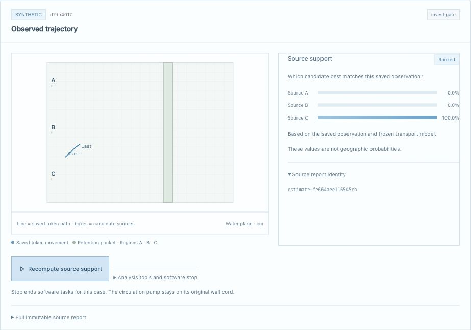

**Historical NOAA observations.** The dots are processed buoy positions. Movement between them is not directly observed.

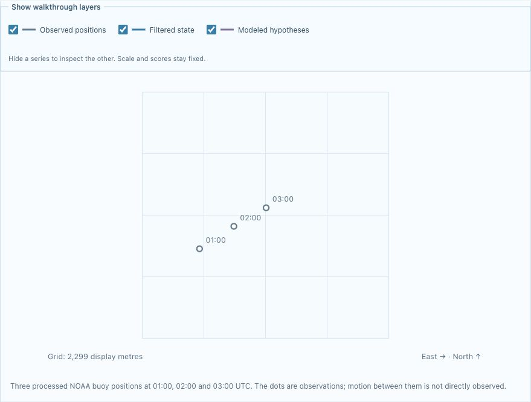

**Causal Kalman filtering.** The filter combines a motion estimate with permitted position observations. It is not a newly trained neural model or a smoother using withheld future positions.

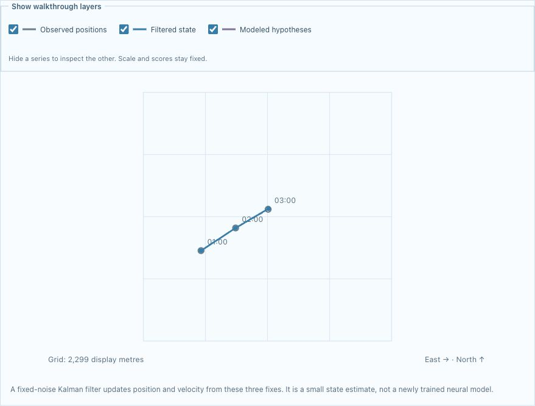

**Both directions.** Purple explores earlier locations; teal projects later motion through the current-plus-offset rule. Neither branch proves a pollution release.

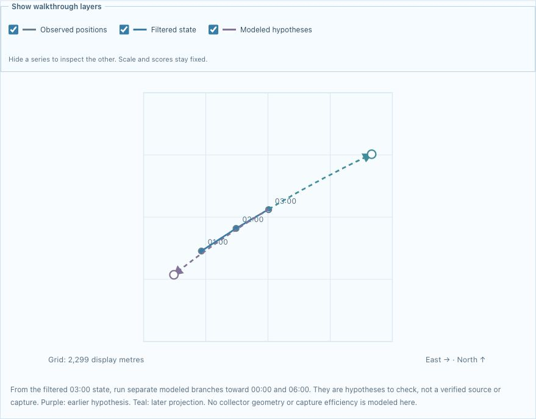

**Forecast versus observation.** This separate position-only benchmark shows a six-hour prediction miss; its models do not use the current forcing of the walkthrough.

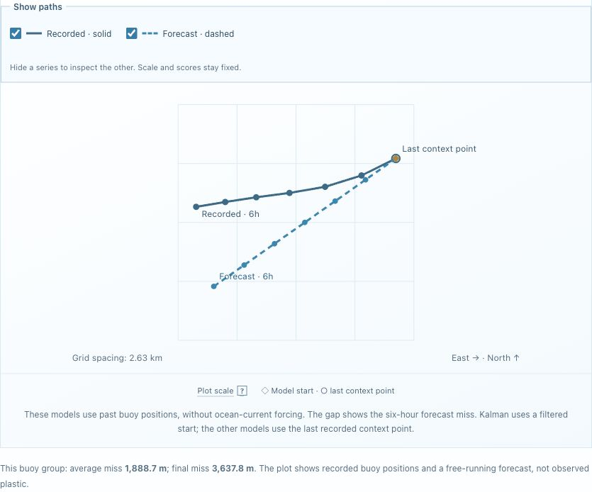

**Compare models honestly.** The simpler last-drift baseline has the lowest mean miss in this six-group study.

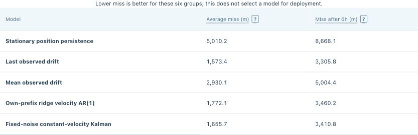

**Ocean prevention what-if.** Six modeled entries without interception, two with A and four with B; idealized interception and a hypothetical reef proxy.

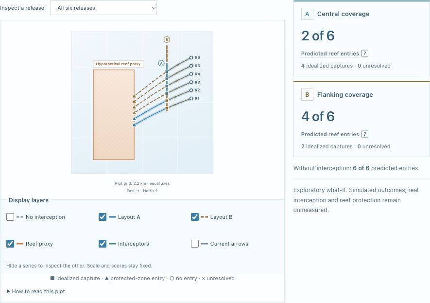

**3D tank rehearsal.** This stock synthetic scene is 40 × 30 cm. The actual measured tray is 35.56 × 22.86 cm. The viewer replays saved surface paths rather than solving 3D fluid flow.

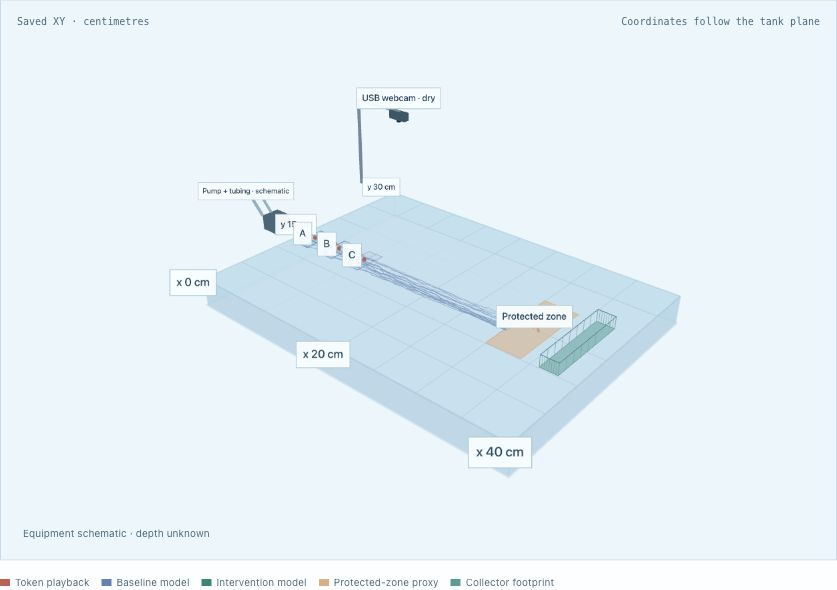

**Real Photon exchange.** A natural question received an actual automated, live-Chalk reply about the pinned saved synthetic case. Private contact headers are cropped; the message text is unchanged. Its numerical evidence ID belongs to that local case, not the hosted case above.

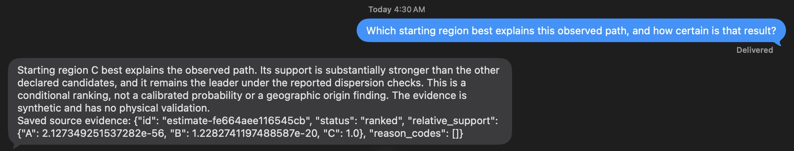

</details>

## Three-part software demo

Open the [hosted workspace](https://nemo-software-demo.onrender.com/workspace) or the [local dashboard](http://127.0.0.1:3000). Public research is readable without operator access; state-changing actions and live model requests require the correct deployment's private operator token. The three core parts are source tracing, layout comparison and evidence explanation; the sequence below also shows the optional ocean and 3D inspection steps.

1. **Trace a source.** In Overview choose **Open source trace**, connect operator access, then **Load demo** if needed. Select the ranked synthetic **Observed trajectory**. Inspect A/B/C and the report identity. **Recompute source support** deliberately creates a new evidence identity; **Test sensitivity** checks the declared variants. The retained-endpoint example is **Unknown**; the bad-mapping example is **Invalid**.
2. **Inspect both directions.** In Investigations switch to **Ocean source research** and explicitly load the saved study. Reveal the five stages, select both GDP groups, toggle layers, and disclose reserved earlier/later positions only for evaluation. The axes and scores do not change when paths are hidden.
3. **Compare prevention layouts.** Prevention defaults to **Ocean · changing currents**. Choose **Compare ocean layouts**, inspect the default downstream scenario, toggle A/B on one plot, and filter a release. Counts always use all six planned releases. The original no-entry control remains available; its zero-entry tie is preserved.
4. **Ask Chalk.** Ask what the chosen report supports and what remains uncertain. Require **Live Chalk explanation**, inspect the action and expand **Evidence citations and tool trace**. A visible configuration flag or an older screenshot is not sufficient.
5. **Inspect the physical experiment separately.** In **Tank experiment & trial ledger**, load its separate synthetic comparison and choose **Open 3D tank**. Orbit, switch layouts/sources, toggle layers and scrub time. Missing physical trials stay missing.

The [full operating runbook](docs/integrated-team-demo.txt), [scientific UI guide](docs/nemo-scientific-demo.md) and [feature handbook](docs/tideward-product-guide.md) give longer walkthroughs. Loading saved studies does not download new NOAA data, train a model, open a camera or send a message.

## Start locally

Use **Python 3.12** and **Node.js 24** to match CI. Package metadata permits Python ≥3.11; Next.js requires Node ≥20.9. From the repository root:

```sh
python3 -m venv .venv
.venv/bin/python -m pip install -e '.[dev,sponsors,ocean]'
cd dashboard
npm ci
cd ..
.venv/bin/python scripts/dev.py
```

- Dashboard: **http://127.0.0.1:3000**. API: **http://127.0.0.1:8000**. Interactive request schemas: **http://127.0.0.1:8000/docs**.
- After the first bootstrap, `.venv/bin/python scripts/dev.py --check` is an optional read-only preflight. On a fresh checkout with no token, run the normal launcher first.
- The launcher checks dependencies/ports, creates a private `.env` and a missing/blank `REEFTRACE_LOCAL_TOKEN`, and preserves existing nonblank settings. The token is shared operator access, not an individual email account.
- Enter the token privately through `/login` or **Operator access**. It remains only in that browser tab's memory and clears on reload. The hosted service has its own separate token; a local token does not authenticate to Render.
- The launcher reuses verified running services, reports unrelated listeners and stops only services it started. It never silently changes sponsor enable flags.
- Starting a **new** messaging-enabled API requires explicit `--allow-photon`. An already running authorized worker is left untouched. The software demo requires neither Photon nor the camera.
- Base scientific/API dependencies are in `pyproject.toml`. `.[sponsors]` installs the Photon SDK; `.[ocean]` installs xarray/NetCDF/Copernicus readers; `.[evaluations]` adds explicit Chalk remote-evaluation tooling. Installing readers or SDKs does not acquire data or invoke a provider.

## Architecture and repository map

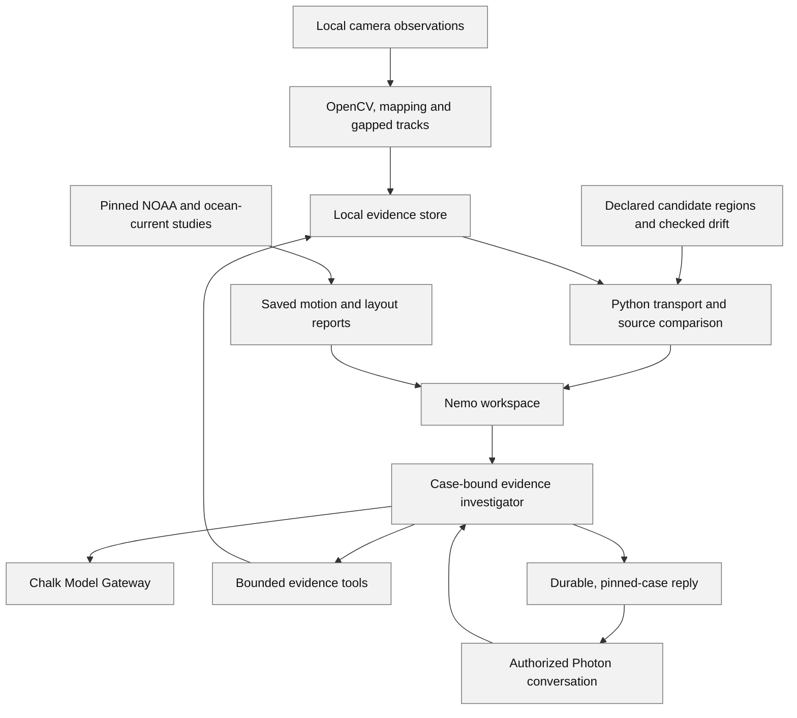

[Download the simple gray-box evidence diagram](docs/assets/nemo/workflow.png).

**Python owns scientific numbers and state.** The browser draws reports; the model explains them. The estimator accepts permitted observations and candidate geometry, never evaluator-only source truth. SQLite stores evidence, revisions, actions and messaging records. Camera acquisition uses a separate spawned process with a bounded latest-frame queue, so failed capture cannot block STOP or a conversation turn.

| Location | Purpose |
| --- | --- |
| `dashboard/` | Next.js / React / TypeScript UI, scientific plots, state freshness, hosted browser preview and Three.js replay |
| `apps/api/reeftrace_api/` | FastAPI routes, strict Pydantic contracts, authentication, cases, evidence, field admission, integrations and local/cloud boundaries |
| `apps/vision/reeftrace_vision/` | Capture process, legacy red tracker, foreground/green detectors, planar mapping, drift and vector diagnostics |
| `apps/transport/reeftrace_transport/` | Spatial drift/support, geometry and forward stochastic particles |
| `apps/estimation/reeftrace_estimation/` | Candidate-source support, abstention gates, prevention and validation methods |
| `apps/ocean/reeftrace_ocean/` | Pinned data readers, geographical interpolation/RK4, baselines, ridge, Kalman and frozen research results |
| `adapters/chalk/` | Server-only gateway and bounded tool/action contract |
| `adapters/photon/` | Official SDK transport, route allowlists, durable inbox/outbox and strict command lane |
| `adapters/local_store/` / `apps/api/.../services/store.py` | SQLite evidence persistence and hashing/transaction behavior |
| `data/public/`, `data/research/`, `data/current_fields/` | Committed scientific inputs, provenance, protocols and frozen outputs |
| `data/sample_runs/` / `tests/fixtures/` | Explicit synthetic demonstrations and software fixtures |
| `scripts/` | Local launcher, handoff/export tools, isolated HTTP checks and saved-study readers |
| `deploy/`, `Dockerfile`, `render.yaml` | Same-origin production packaging, scrubbed child environments and cloud restrictions |
| `tests/`, `dashboard/tests/`, `.github/workflows/ci.yml` | Scientific/API/transport/frontend/packaging regressions and three CI jobs |
| `docs/` | Methods, operating guides, team work, research records and dated verification |
| `firmware/`, `apps/hardware/` | Historical/unused hardware scaffolding; no active pump, serial or robot actuator |

**Tools and their jobs:** OpenCV processes images; NumPy/SciPy implement numerical methods; FastAPI/Pydantic validate and serve contracts; SQLite preserves local evidence; Next.js/React/TypeScript render the workspace; Three.js presents saved paths in 3D; xarray/NetCDF decode ocean files; GitHub Actions checks the source; Docker/Render package the demo. Butterbase is an optional adapter, not a required production database for the current local workflow.

### Interface and presentation

The workspace uses square cards, thin rules, a light-blue palette, concise primary results and collapsed scientific details. Plot labels have short help for hover/focus/touch. Checkboxes control trajectories and overlays without changing the axis scale, saved model scores or denominator. Keyboard focus, mobile layouts and stale-result clearing are covered by regressions and dated browser checks.

The landing follows Welcome → Observe → Trace → Prevent → Verify with an original silent Higgsfield ocean video, self-hosted Rajdhani, the supplied AtomicGlobe/MeridianGlobe adaptation and a light-blue Glyph Trail background. Those globe/glyph effects are decorative, not current observations. Narration, “listen to chapter,” slogans, scroll prompt and manual pause-motion controls were removed. Reduced-motion, hidden-tab cleanup and frame/pixel budgets remain. [Landing provenance](docs/ocean-landing-journey.md) · [UI design](docs/interface-design.md).

## Camera, saved calibration and the real rig

### Actual hardware and saved measurements

| Item | Current role |
| --- | --- |
| Logitech **C270** USB webcam | Connected camera used for local preview; buying the older proposed C920s is not required |
| Clear tray | Megana's recorded inside waterline: **35.56 × 22.86 cm**, or **14 × 9 inches** |
| Pond Boss **80 GPH** pump | Manually powered on its original separate AC cord; its rating is volume throughput, not the local water velocity |
| About 3 ft of **3/8-inch-ID** clear tubing | Return/outlet routing in the same tray; arrangement must be recorded with each experiment |
| Mesh collection pocket | Physical collector; its capture efficiency and effect on flow are not assumed measured |
| Identical green caps | Controlled floating markers; token behavior is not automatically pure water velocity or arbitrary plastic behavior |
| Black reference marks / green collector borders | Visible geometry/reference aids; automatic scientific calibration is not established merely by seeing them |
| Dry fixed overhead support | Keeps the image pose stable; altered waterline, camera or layout changes the measurement conditions |

Pixel coordinates start at the top left with +x right and +y down. Megana's saved tank coordinates use the bottom-right pump-side waterline corner, +x left and +y up the short wall; the homography supplies that change of frame. Her coarse historical checks were 1.91, 2.24 and 2.77 cm, with a 3 cm tolerance selected after viewing the placements. Those historical errors are not present-view accuracy or evidence that the default 0.5 cm criterion was met.

[PR #9](https://github.com/Jose-Gael-Cruz-Lopez/reeftrace/pull/9) and the [commissioning log](docs/rig-commissioning-run-log.md) preserve actual placements, dimensions, exclusions and limits. The earlier [rig-guide PDF](docs/tideward-rig-guide.pdf) is a build reference with a proposed C920s and historical inventory; this table describes the C270 setup actually used. Arduino, ESP32, gantry, relays, decorative coral and 3D printing are not required by the selected software workflow.

### Preview, calibration and physical evidence are different modes

| Mode | Inputs and behavior | Allowed scientific use |
| --- | --- | --- |
| Hosted browser preview | Explicit camera permission, selected browser device, video only, no audio or frame uploads | View the camera. Render cannot run OpenCV against this Mac's USB device |
| Local live USB preview | Explicit start, camera/session identity, latest-frame MJPEG, pixel guide and cursor coordinates | View and inspect pixels without a tank or calibration |
| Saved-rig green display | Historical geometry/reference plus direct green color/shape detection and bounded image registration | Real marker pixels and **estimated** centimetres; no approved mapping, profile, source case, flow or trial created |
| Estimated rehearsal | Historical homography plus current detector checks; explicit 1–10 s recording | Save approximate/gapped local tracks in a separate `estimated_rehearsal` record; cannot train measured flow or approve field receipts |
| Measured calibration / recording | Session-bound mapping, independent current check points, references, token size and valid associations | Eligible evidence for separately checked flow fitting/validation and later admitted source trials |
| Saved-footage replay | Previously recorded local frames and frozen detector policies | Development regression; opens no camera and establishes no independent physical accuracy |

The local C270 was observed at **1280 × 720**. The low-latency preview uses one session-bound MJPEG stream, latest frames up to 15 fps and no per-frame React state updates. Acquisition preserves the delivered camera mode; recorded tracking defaults to 10 Hz. The view spans the main content width, with capture controls underneath. Reference capture, token-size measurement and recording share a lock; decoded reference memory is bounded. [Camera contract](docs/camera-preview.md).

### Reuse Megana's handoff without repeating existing dimensions

The private `reeftrace-rig-handoff` folder contains reference/calibration material that was not committed to Git. `scripts/prepare_tank_handoff.py` checks its reference and reconstructs the historical mapping from the four fit and three check placements. It does not turn old checks into fresh alignment evidence. The [reuse guide](docs/reuse-saved-tank-calibration.md) gives the preparation/import commands and measured versus estimated branches.

- **For a visual rehearsal:** reuse the existing bounds and historical mapping, explicitly choose estimated mode, and keep the unvalidated label.
- **For measured claims:** reuse the same dimensions and surveyed landmark positions, but verify the current image alignment independently. Loading the old JSON, shifting all old points together or matching image features does not establish current centimetre accuracy.
- A fresh background or cap pixel-area check is a detector check; it is not a request to remeasure every physical dimension.
- Private reference images, SQLite records, raw footage and contact routes stay on the capture Mac, outside Git and Render.

The current live green display tolerates camera auto-exposure changes by detecting the declared marker directly instead of requiring background subtraction for that display mode. The separate `foreground_surface_v2` recording/replay policy retains full-scene lighting/shift checks and rejects rim-crossing, non-green or implausibly shaped components. A 37-frame development replay accepted 33 with v1 and 37 with v2; those clips informed development and are **not an independent accuracy test**. [Detector policies](docs/surface-detector-replay.md) · [Foreground method](docs/foreground-token-detection.md).

The broader automatic grid/boundary registration task remains [Trove #3 for Aarush](https://trov.dev/nemo/#tickets/3). Bounded display registration has shipped; automatic physical calibration, continuously validated boundaries and a measured ML pipeline have not.

## Chalk, Photon and Grok

### Chalk: turn a numerical report into an inspectable explanation

Chalk is the evidence investigator, not the trajectory calculator. A request follows this chain:

1. The user selects a case or research snapshot and asks a question.
2. The API checks operator permission, case revision, report identity and allowed tools.
3. A language model is called through **Chalk Model Gateway** with a bounded action/tool contract.
4. Tools return the selected case, immutable source report or exact research result. Source calls include `get_case` and `get_source_evidence`; some eligible workflows also expose tightly scoped observation/sensitivity/manual-task tools.
5. The returned action and cited evidence are checked. A stale revision, unsupported tool or invalid contract is rejected.
6. The UI shows the explanation, action, evidence IDs, tool trace and whether there was a **live model response**.

For example, Chalk can explain why C's simulated histories fit the saved path, whether the declared dispersion variants retain that ranking, and why those bars do not identify a real polluter. It can interpret the ocean-layout counts and state which assumptions need physical testing. It cannot change Python's source support, alter counts, relabel a synthetic record as measured or upgrade Unknown by wording alone. Citations provide traceability; users still need to review generated prose.

**Live versus unavailable:** `live_model_response: true` means a live provider responded, not that every scientific claim is validated. An unavailable provider returns explicit `STOP` / `live_model_response: false`, a safe failure code and the unchanged numerical evidence. Readiness/configuration is not an authenticated call. Current request bounds are 25 seconds per call within a 60-second whole-turn deadline, with bounded tools and no hidden automatic provider retries. Research-specific investigators generally permit only `REPORT` / `STOP`.

A live hosted check is shown above. Source, ocean-source, ocean prevention, tank prevention, fresh NOAA, matched-current and residual research reviews bind their own exact evidence/snapshot identities. [Chalk user guide](docs/chalk-user-guide.md) · [Gateway adapter](adapters/chalk/) · [Integration history](docs/integrations.md).

### Photon: the saved-case investigator over iMessage

The authorized direct conversation sends a question to the **same investigator**, with a private allowlist of handles, roles and case IDs. It is pinned to those cases; it does **not** silently follow the live green cap or whichever dashboard case is open.

The local worker persists inbound IDs, processing leases and immutable outbox bodies/idempotency keys before sending. Retries preserve the original route/body/key; a new body cannot overwrite an old send. Strict authorized `STOP`, `CANCEL` and `APPROVE` commands use a dedicated control lane instead of waiting on conversational generation. The source contract still applies to an answer delivered by phone.

The screenshot records a genuine natural question, live Chalk investigation and automatic response visible in Messages. At that checkpoint, the local worker was enabled/ready/running. This is historical connection evidence, not a promise of ongoing availability. **HTTP 202 / outbox `accepted` alone is not device delivery.** The received Mac reply is the independent device observation.

The hosted cloud profile is different: **Photon replies remain disabled there**. Its explicit read-only check authenticates the configured project and cannot send/list conversations or prove pairing. A read-only variable name does not reduce a provider key's actual privileges. [Photon adapter](adapters/photon/README.md) · [Hosted verifier](deploy/README.md#optional-read-only-photon-project-connection).

### Grok and the scope of “ML”

Grok assisted physics research, candidate-model comparisons, causal Kalman/RK4 design, reverse-source limitations, test design and code review. Cursor also contributed to implementation. Prompts, reviews, draft corrections and actual local verification are retained in the [contribution ledger](docs/grok-contribution-ledger.md) and [evidence bundle](docs/grok-evidence-bundle.md). Suggestions were checked rather than treated as numerical evidence.

The learned motion component is a small **ridge velocity AR(1)** model fitted to permitted prefixes, plus explicit diagnostic/transfer variants. Kalman is state estimation; RK4 is numerical integration; the green detector is declared image processing. They are not newly trained neural trash-recognition models. The backend executes the calculations; opening Grok or a chat subscription is not proof of xAI API use.

An optional server-side xAI Voice adapter and deterministic evidence briefing exist, but funded live Voice/Imagine API use and sponsor-track qualification remain unverified. The landing narration was removed. No API-credit redemption, billing enablement or background xAI request is required by this README. The requested ongoing automation is **GitHub checks on pushes and pull requests**; the earlier recurring Grok research schedule is not a claim of active unattended training.

## Datasets: what Nemo actually uses

Nemo uses four environmental products: historical NOAA buoy positions, a saved PacIOOS current forecast, a historical HYCOM current subset, and NOAA satellite-derived coral heat-stress values. They answer different questions. The ocean studies help test motion calculations; the tank needs its own measured camera mapping, drift recordings and release outcomes.

The saved buoy trajectory files contain **13 logical GDP identifiers and 326 hourly position records**. This count excludes selection metadata, identity registries, generated forecasts and repeated use of the same positions by different algorithms. Thirteen logical IDs do not establish thirteen independent physical deployments; unresolved aliases and correlated observations remain limitations.

| Product | What is actually saved | What Nemo uses it for | Relevance to the real tank |
| --- | --- | --- | --- |
| NOAA Global Drifter Program hourly product | Small historical trajectory subsets: 13 logical IDs, 326 position rows | Compare motion forecasts with later processed buoy positions | Tests coordinate, timing and evaluation methods; cannot supply tank flow or centimetre calibration |
| PacIOOS ROMS Main Hawaiian Islands | One three-time, near-surface current-model snapshot | Dynamic ocean trajectories and two idealized interception layouts | Demonstrates the decision workflow; does not measure the pump, token or tank |
| HYCOM GOFS 3.1 historical currents | Three forcing times at 15 m, matched to two historical GDP groups | Compare current-only and current-plus-initial-motion forecasts | Helps investigate model structure; a 15 m ocean field cannot be transferred into a shallow tank |
| NOAA Coral Reef Watch Degree Heating Week | Seven daily values at one historical Florida Keys grid cell | Explain environmental heat-stress context beside the evidence briefing | Explains why a receiving area can be vulnerable; does not measure the artificial coral or validate interception |

### 1. NOAA buoy positions: actual trajectory inputs

**Source:** NOAA AOML Global Drifter Program, ERDDAP dataset `drifter_hourly_qc`, endpoint release v2.01, DOI [10.25921/x46c-3620](https://doi.org/10.25921/x46c-3620). The saved endpoint metadata identifies **CC BY 4.0**. These are quality-controlled, mathematically interpolated hourly buoy positions, not raw GPS fixes or observations of plastic.

All times below are UTC. Row counts count position records only, excluding CSV column and units rows.

| Saved study group | GDP identifier | Position interval | Position rows |
| --- | --- | --- | ---: |
| Initial historical fixture | `8707978` | 1987-10-03 00:00–23:00 | 24 |
| Earlier Atlantic cohort | `12730` | 2000-06-01 00:00–23:00 | 24 |
| Earlier Atlantic cohort | `12731` | 2000-06-01 00:00–23:00 | 24 |
| Earlier North Pacific cohort | `300234063243480` | 2020-06-01 00:00–23:00 | 24 |
| Earlier North Pacific cohort | `300234063472530` | 2020-06-01 00:00–23:00 | 24 |
| Fresh Atlantic cohort | `300234062321360` | 2021-06-01 00:00–23:00 | 24 |
| Fresh Atlantic cohort | `300234062953270` | 2021-06-01 00:00–23:00 | 24 |
| Fresh Indian cohort | `300234060609830` | 2021-06-01 00:00–23:00 | 24 |
| Fresh Indian cohort | `300234063435990` | 2021-06-01 00:00–23:00 | 24 |
| Fresh North Pacific cohort | `300234063123200` | 2022-06-01 00:00–23:00 | 24 |
| Fresh North Pacific cohort | `300234065385690` | 2022-06-01 00:00–23:00 | 24 |
| Matched-current/residual cohort | `300234066836710` | 2022-05-31 00:00–2022-06-01 06:00 | 31 |
| Matched-current/residual cohort | `300534061292930` | 2022-05-31 00:00–2022-06-01 06:00 | 31 |
| **Total** | **13 logical IDs** | **Historical subsets, not a continuous record** | **326** |

For the first eleven IDs, each 24-row trajectory supplies 18 earlier context positions and six later targets. The two matched-current IDs supply 25 context positions followed by six hourly targets; their forecast origin is **2022-06-01 00:00 UTC**. In that matched study, stationary and current-only use the origin; last drift and the initial-residual candidate use the final two context fixes. The earlier 23 context positions are descriptive/QC context, not a fitted training set for those four candidates.

Latitude/longitude are geographic degrees. Ocean velocity and velocity-error diagnostics use metres per second; position errors use metres. The earlier CSVs also contain published `ve`, `vn`, `err_ve` and `err_vn` columns, but those columns do not enter the fixed motion models. The matched-current trajectory CSVs request only ID, time, latitude and longitude.

The initial 1987 day was selected to demonstrate access and ingestion, then reused for a small chronological forecast example. It was not selected as a representative generalization benchmark. The older four-group study acquired four of six planned slots; failed Indian-basin slots remain missing. The subsequent six-group study is a separate, complete acquisition. NOAA's upstream interpolation can use later raw fixes, so Nemo's own forecast-before-scoring checks do not establish raw real-time forecast causality.

**Tank relevance:** these records exercise the same ideas of position, velocity, forecast error and evidence preservation. They contain no tank source labels, camera calibration, mesh-capture outcomes or pump measurements. Model performance on an ocean buoy cannot be reported as tank-token accuracy or proof that a reef was protected.

Saved inputs and methods: [initial CSV](data/public/noaa-gdp-8707978-19871003.csv), [initial provenance](data/public/noaa-gdp-8707978-19871003.provenance.json), [earlier cohort](data/public/noaa-multidrifter-v1/README.md), [fresh selection](data/public/noaa-fresh-drifter-v2/selection.json), [fresh study](docs/fresh-noaa-study.md), and [matched-current acquisition manifest](data/research/matched-current-v2/manifest.json).

### 2. PacIOOS: the ocean prevention scenario's changing currents

**Source:** PacIOOS / University of Hawaiʻi, [ROMS Main Hawaiian Islands](https://www.pacioos.hawaii.edu/metadata/roms_hiig.html), ERDDAP dataset `roms_hiig`. The saved source is forecast-model output, not directly measured debris motion.

- Variables: eastward `u` and northward `v`, in **m/s**.
- Valid times: **2026-10-17 18:00**, **21:00**, and **2026-10-18 00:00 UTC**.
- Selected depth: **0.25 m**; source interval **three hours**; nominal spacing roughly **4 km**.
- Actual saved grid: **3 × 29 × 37** time/latitude/longitude cells: **3,219 total**, **2,997 valid**, **222 masked**.
- Actual bounds: **20.500412–21.505518° N**, **−158.79059 to −157.40552° longitude**.
- CSV size: **222,654 bytes**; captured **2026-10-17 17:02:30.709198 UTC**.
- A separately verified single model issue time is **not available**. The source is an FMRC Best Dataset aggregation, with assimilation described in its metadata. Retrieval before valid time does not by itself prove complete operational forecast causality.

The default ocean comparison replays this fixed snapshot. The saved valid-time window has ended; it is an **archived forecast scenario**, not live conditions. Opening the page does not download newer currents. Interpolated arrows and smooth RK4 trajectories do not add observations or resolve reef-scale eddies. The two layout drawings are idealized first-contact interception hypotheses, not measured collection hardware.

**Tank relevance:** this dataset makes the changing-current layout demonstration concrete, but its geographic metres/m/s do not calibrate a camera in centimetres. Its modeled velocity is not the pump's volumetric flow rate. A physical mesh can alter local flow; the ocean what-if holds currents unchanged.

Read the [saved manifest, exact source URLs and licence](data/current_fields/pacioos-current-forecast-v1/manifest.json), [input guide](data/current_fields/pacioos-current-forecast-v1/README.md), and [ocean comparison contract](docs/ocean-prevention.md).

### 3. HYCOM: the matched historical current experiment

**Source:** HYCOM GOFS 3.1, `GLBy0.08/expt_93.0/uv3z/2022`, via the [HYCOM NCSS dataset metadata](https://ncss.hycom.org/thredds/ncss/grid/GLBy0.08/expt_93.0/uv3z/2022/dataset.xml).

- Variables: `water_u`, `water_v`, decoded to **m/s**.
- Valid times: **2022-06-01 00:00, 03:00 and 06:00 UTC**.
- Selected depth: exactly **15 m**.
- Raw dimensions: **time=3, depth=1, latitude=251, longitude=188**.
- Accepted current array: **3 × 251 × 188**, with **135,318 valid** and **6,246 masked** cells out of **141,564**.
- Actual latitude support: **25–35° N**. Actual normalized longitude support: **−80 to −65.03997802734375°**. The requested nominal −65° edge is not an extra saved coordinate.
- At the tile's middle latitude, approximate spacing is **7.715–7.721 km east–west** and **4.434 km north–south**. Spacing is not a guarantee of effective physical resolution.
- Each separately retained v1/v2 NetCDF body is **572,604 bytes**, with its own raw hash. Preserve their separate acquisition identities.

The v1 attempt downloaded current bytes but blocked both trajectory requests after metadata admission failed; its result remains **0/36**. The separate v2 amendment acquired both 31-row buoy trajectories and scored **36/36** model/hour cells. The later initial-residual diagnostic reuses v2's two groups and current inputs; it adds a fourth candidate and **no new scientific acquisition**.

**Tank relevance:** matching model currents with buoy motion helps investigate the forecasting calculation. A 15 m ocean product cannot measure shallow tank circulation, and a drogued buoy is not equivalent to loose surface plastic or the team's controlled green cap. An initial observed-motion residual can combine object response, forcing error and processing differences; it is not an identified tank drag or windage coefficient.

Read [v1 acquisition receipts](data/research/matched-current-v1/manifest.json), [v2 acquisition receipts](data/research/matched-current-v2/manifest.json), [actual HYCOM support](docs/matched-current-v2-results.md#5-actual-current-support-not-an-expanded-nominal-tile), and [the separate exploratory residual result](docs/origin-residual-results.md).

### 4. NOAA Coral Reef Watch: historical reef heat context

**Source:** NOAA Coral Reef Watch daily global **5 km Degree Heating Week**, version **3.1**; ERDDAP dataset `noaacrwdhwDaily`, variable `degree_heating_week`.

- One Florida Keys-area grid cell: **24.575° N, −81.525° longitude**.
- **Seven daily rows**, **1–7 July 2023**, at **12:00 UTC** each day.
- Units: **°C-weeks**. Saved values: **2.96, 3.18, 3.43, 3.72, 3.99, 4.24, 4.53**.
- Original CSV: **383 bytes**; retrieved **2026-10-17 02:04:02.088121 UTC**.

DHW is accumulated heat-stress context from an analyzed satellite-derived product. These are not seven raw satellite images. The displayed values do not directly confirm bleaching and are not current conditions. The seven-day excerpt reads NOAA's already calculated DHW; Nemo does not reconstruct twelve weeks of heat stress from seven days.

**Tank relevance:** the panel explains environmental vulnerability. It does not measure the artificial coral, change source scores or current vectors, estimate ecological damage, or show that interception reduced heat stress.

Read [the CSV](data/public/noaa-coral-context/noaa-crw-dhw-florida-keys-20230701-20230707.csv), [exact provenance and reuse terms](data/public/noaa-coral-context/noaa-crw-dhw-florida-keys-20230701-20230707.provenance.json), and [the interpretation guide](docs/grok-space-context.md#the-real-space-data-artifact).

### Metadata, reused observations and score counts

Dataset descriptions, candidate-origin snapshots, ID/WMO registries and drogue metadata are saved for selection, identity checks and provenance. An identifier appearing in a registry does not mean its complete trajectory was downloaded or used to train a model.

| Research result | Reused inputs | Meaning of its count |
| --- | --- | --- |
| Earlier four-group comparison | Four 24-position trajectories | 96 scored model/hour outcomes from 24 later target positions; two of six planned groups were not acquired |
| LOPO and fixed Kalman diagnostics | The same four earlier trajectories | Additional algorithm comparisons, not four new drifters or newly independent observations |
| Fresh six-group study | Six separate 24-position trajectories | 180 scored model/hour outcomes sharing 36 later target positions |
| Matched-current v2 | Two 31-position trajectories plus HYCOM | 36 scored model/hour outcomes sharing 12 later processed positions |
| Initial-residual diagnostic | The same matched v2 groups and forcing | 48 scored model/hour outcomes reusing those same 12 already-viewed targets; explicitly post-outcome exploratory |

Generated forecasts, cached API responses, public-showcase snapshots and replay reports are derived artifacts, not additional source observations. A score count must not be described as the number of independent experiments. Failed acquisitions remain visible: the first fresh-study attempt selected no trajectories, and the separate Indian extension acquired no new trajectories after its timeout.

### Synthetic data and the missing real experiment

The bundled tank demonstration contains **synthetic** flow samples, a generated drift field, synthetic observations and separately stored evaluator-only release truth. The OpenCV replay uses generated red-token frames. Analytic current fields and hand-authored trial-ledger scenarios test numerical and software behavior. None of those fixtures is measured tank footage, a physical release or an observed capture outcome.

A measured experiment requires the existing fixed overhead camera, an independently checked current water-surface mapping, separate drift-fitting and validation recordings for each layout, and new known-source releases under a frozen protocol. Every token must be accounted for, including unresolved outcomes. A verified release-time/identity anchor is additionally required before matched-time positional error is reported. The current 3D tank is a schematic replay of saved surface paths; it does not manufacture these missing measurements.

Read [synthetic fixture declarations](data/sample_runs/README.md), [field commissioning](docs/field-commissioning.md), [physical validation protocol](docs/prevention-validation-protocol.md), and [3D replay limitations](docs/tank-simulator.md).

### Researched sources that are not integrated datasets

These sources were investigated as possible future inputs. Their scientific payloads or model weights have **not** been downloaded and integrated into Nemo's evidence pipeline:

| Candidate | Possible future use |
| --- | --- |
| TrashCan | Underwater debris detection/segmentation; not overhead red-token training |
| MARIDA | Sentinel-2 multispectral debris-feature segmentation; not an RGB webcam dataset |
| SeaClear Marine Debris Dataset | Underwater ROV object/segmentation evaluation; not release-source labels |
| GLAD near-surface drifter trajectories | Additional motion/dispersion studies with launch-group dependence retained |
| NOAA IOOS/HF-radar currents | Coastal current observations where region/time coverage matches a separate object track |
| NOAA GTS/OSMC fixes | Availability-aware motion evaluation with raw message-time and identifier audits |
| NOAA MDMAP shoreline surveys | Debris amount/type context with survey area, effort and protocol retained |
| Copernicus SMOC merged currents | A separately acquired surface transport input; the implemented local NetCDF reader is not proof of a download |
| Copernicus GLORYS12 reanalysis | A separately designed historical forcing comparison with assimilation limitations |
| NASA OSCAR final v2 | Satellite-informed ocean-scale current research; distinct from the older `jplOscar` mirror inspected for metadata |

OpenDrift/Leeway and OceanParcels are researched model frameworks and examples, not measurement datasets acquired by this project. Documentation or a catalogue entry does not establish access, licensing of every weight, training readiness or a successful experiment. See [the dataset catalogue](docs/datasets.md), [additional researched sources](docs/research-real-data.md), [readiness/next-study notes](docs/grok-ml-next-study.md), and [current-data proposals](docs/next-current-data-study.md).

### Decorative map data

The repository also contains **Natural Earth 1:110 million land**: a commit-pinned, public-domain GeoJSON with **127 land polygons**, **5,143 coordinate pairs** and **138,160 original bytes**. It supports globe presentation, not coastline navigation, mapped reef boundaries, current measurements or tank calculations. Its display role is separate from all four environmental products above. Read [the map provenance](docs/research-evidence/landing-globe-natural-earth.json).


## Frozen results: what the comparisons actually show

| Study / task | Saved outcome | Interpretation |
| --- | --- | --- |
| Initial 1987 NOAA day, six-hour position-only forecast | ADE: stationary **3,855.0 m**, last drift **4,385.8 m**, ridge **3,557.4 m**; ridge endpoint error **7,561.2 m** versus stationary **6,774.6 m** | One selected day; better average error does not mean better final error or generalization |
| Fresh six-group / five-model study | ADE: last drift **1,573.423 m**, fixed Kalman **1,655.662 m**, own-prefix ridge **1,772.130 m** | Last drift performs best on mean error in this cohort; no automatic promotion or retuning |
| Matched-current **v1** | **0/36** model/hour cells after compatibility failures | Preserve the failed attempt; do not silently replace it with v2 |
| Matched-current **v2** | **36/36** cells. Equal-ID macro ADE: stationary **3,490.119 m**, last drift **1,510.232 m**, HYCOM current-only **5,063.020 m** | Current-only does not improve on last drift on this small retrospective sample |
| Initial-residual diagnostic | Fourth fixed candidate; **48/48** model/hour outcomes reuse 12 already-viewed targets. Residual ADE **1,030.0495 m**, FDE **2,355.9582 m** | Descriptive improvement after viewing outcomes; no new data, independent validation or automatic promotion |
| Six-hour reverse-current **06:00 → 00:00** | Mean earlier-position miss: current-only **8,696.822 m**, last drift **2,197.726 m**, stationary **6,069.353 m** | Reversing a forward model is not by itself an accurate source finder |
| Filtered three-fix tutorial anchored at **03:00** | GDP `300234066836710`: backward error **403.531 m**, final forward error **860.020 m**. GDP `300534061292930`: **389.248 m** / **1,023.657 m** | Different, shorter retrospective task; eight evaluation cells share two already-viewed buoy groups |
| Ocean prevention downstream what-if | **6/6** entries without interception, **2/6** with A, **4/6** with B | Same six hypothetical releases; ideal first-contact capture; receiving proxy selected after viewing forecast |
| Original ocean prevention control | Preserved zero-entry tie | A zero-entry tie must remain visible, not be replaced by a favorable scenario |
| Real physical source/interception | No independently validated result | Camera visibility and saved dimensions are prerequisites, not source-accuracy or collection-benefit measurements |

The [fresh study](docs/fresh-noaa-study.md), [matched-current v2 results](docs/matched-current-v2-results.md), [residual results](docs/origin-residual-results.md) and [ocean-source results](docs/ocean-source-research.md) preserve complete metrics, cohort definitions, hashes and limitations. The 25-case lookback perturbation paths are a sensitivity envelope, not calibrated uncertainty. Numerical forward/backward closure measures solver consistency, separately from distance to the actual earlier buoy fix.

## Scientific formulas, explained through the tank experiment

This is the implemented scientific stack. **Source tracing stays first:** measure a floating token's path, compare plausible release regions, preserve Unknown when the evidence is insufficient, then compare interventions. Ocean movement studies test a different scale and object. The equations below do not make a buoy a piece of plastic or turn a software replay into a physical experiment.

### Which equation belongs to which feature?

| Feature | Calculation | Units and boundary |
| --- | --- | --- |
| Tank candidate-source comparison | Forward stochastic particles under $u_{token}(x,y)+b$, dispersion and retention; compare full permitted histories | cm / s; each layout needs its own independently checked drift data |
| Position-only NOAA benchmark | Stationary, last/mean drift, ridge AR(1), fixed constant-velocity Kalman | m / s; no ocean-current forcing added to those frozen baselines |
| NOAA bidirectional walkthrough | Causal three-fix Kalman anchor, then HYCOM plus one fixed filtered-motion offset, integrated by RK4 | Geographic position / m/s; earlier/later hypotheses, no source-release proof |
| Ocean prevention | PacIOOS changing-current advection, $b=0$, no stochastic dispersion; idealized first-contact layouts | Geographic position / m/s; hypothetical releases and reef proxy |
| 3D tank view | Render saved surface paths and report counts | Declared synthetic centimetres; no second fluid solver |

### Symbols and units

| Symbol | Simple meaning | Units or role |
| --- | --- | --- |
| $p,X,z$ | Position, modeled position, observed position | Tank: cm; ocean metric frame: m; API geography: degrees |
| $t,\Delta t$ | Timestamp or elapsed interval | s; ocean timestamps are UTC |
| $u,v$ | Drift vector, or east/north current components | Tank cm/s; ocean m/s |
| $D$ | Constant random spreading strength | Tank cm²/s |
| $\pi_s,w_a$ | Declared candidate-source and release-age weights | Normalized nonnegative weights; source weights are positive |
| $P,Q,R$ | State, process-noise and measurement-noise covariance | Mixed position/velocity units; defined for the Kalman model below |
| $N$ | Number of particles, releases or samples in the stated calculation | Always inspect the denominator; model paths are not independent physical trials |

The camera homography $H_{\rm camera}$ is a **3×3 mapping**; the Kalman observation matrix $H_K$ is **2×4**. They share a conventional letter but are unrelated. Observation quality $g_i$ below is also different from Kalman acceleration spectral density $q$.

### F1. Detect a controlled marker and map pixels to centimetres

The **current saved-rig live display** uses `saved_green_marker_preview_v2`: OpenCV HSV hue **35–85**, saturation **80–255**, value **20–255**, a 3×3 opening and 5×5 closing. A candidate must satisfy aspect ratio ≤2, circularity ≥0.45, solidity ≥0.75 and an area range **0.35–3 times** a saved same-size development marker area. These are declared policies, not calibrated probabilities. The display does not approve a new physical token-size measurement.

For contour area $A$, perimeter $L$ and convex-hull area $A_h$:

$$
\operatorname{circularity}=\frac{4\pi A}{L^2},\qquad
\operatorname{solidity}=\frac{A}{A_h},\qquad
u_{px}=\frac{m_{10}}{m_{00}},\quad v_{px}=\frac{m_{01}}{m_{00}}.
$$

The separate surface-v2 recording/replay detector adds foreground, green-marker, complete-component/tank-outline and compact-shape gates. Legacy `red_hsv` remains for the original red-marker pipeline and generated replay: hue $[0,10]\cup[170,179]$, $S\ge100$, $V\ge70$, 3×3 opening/closing and area 25 pixels²–5% of frame. Those red settings do not describe today's direct green display.

For a valid water-plane mapping:

$$
\begin{bmatrix}\tilde x\\\tilde y\\w\end{bmatrix}
=H_{\rm camera}\begin{bmatrix}u_{px}\\v_{px}\\1\end{bmatrix},
\qquad x_{cm}=\tilde x/w,\quad y_{cm}=\tilde y/w.
$$

Independent checks use $e_i=\|\hat p_i-p_i\|_2$ and $e_{\max}=\max_i e_i$. Measured approval requires the declared threshold (default **0.5 cm**) with at least **four fit pairs and three separate noncollinear check pairs**. This is a maximum point-error check, not an accuracy confidence interval.

The estimated live display can register historical/current images with ORB features and a bounded translation: at least 15 inliers, inlier fraction ≥0.5, residual ≤3 px and translation ≤64 px under the saved policy. This is **image alignment estimation**, not independent water-plane calibration. It cannot confer measured-flow/source/trial eligibility.

The registration uses matched feature displacements and their componentwise median:

$$
d_i=p_{i,\mathrm{current}}-p_{i,\mathrm{reference}},\qquad
\hat d=\operatorname{median}_i d_i,\qquad
\mathrm{inlier}_i=\mathbf1\{\|d_i-\hat d\|_2\le3\ \mathrm{px}\}.
$$

After the two bounded median/inlier refinements, accepted translation is applied only above 0.5 px. Estimated centimetres normalize
$H_{\rm camera}[u_{px}-\hat d_x,\ v_{px}-\hat d_y,\ 1]^T$; the grid shifts into the current view. A failed registration can leave green pixels visible while withholding centimetres/grid. Rotation, perspective and waterline changes are not calibrated by a translation.

**Foreground/reference math.** For 5–60 empty-scene frames, let $B_{Lab}(p)$ be their componentwise median Lab color, and $r_j(p)=\|I_{j,Lab}(p)-B_{Lab}(p)\|_2$. The stored robust variation is

$$
\sigma_{ref}(p)=\operatorname{GaussianBlur}_{5\times5}
\left[1.4826\operatorname{median}_j r_j(p)\right].
$$

For the phase-aligned current frame, the small global exposure adjustment is
$g=\operatorname{median}(I_{gray})/\max(\operatorname{median}(B_{gray}),1)$.
Using the separately stored median BGR image $B_{BGR}$, the foreground mask before morphology is

$$
F(p)=\mathbf1\left\{
\|Lab(I_{aligned}(p))-Lab(\operatorname{clip}(gB_{BGR}(p),0,255))\|_2
>\max(18,6\sigma_{ref}(p))
\right\}.
$$

The ROI/border mask also applies. A global brightness change over 20%, confident translation over 8 px or more than 15% changed pixels refuses/gaps the current frame. Reference capture itself rejects confident drift over 1.5 px or excessive busy pixels. Surface-v2 intersects this unchanged foreground mask with green HSV **H 35–85 / S ≥80 / V ≥40**, then applies complete-component, shape and area gates. Zero or several admitted candidates remain gaps. The current direct green **display** instead permits V ≥20 without requiring background subtraction; that deliberate display path does not weaken measured-record admission. [Foreground implementation](apps/vision/reeftrace_vision/foreground.py).

A missed/ambiguous observation breaks a track. The original associated tracker also breaks for nonpositive time, a gap over 0.5 s or displacement greater than $20\Delta t$ cm. The legacy associated tracker assigns accepted `quality=1`; this is a declared value, not calibrated detection confidence. The display-only preview does not publish a calibrated confidence score.

**In our tank:** reuse the measured tray dimensions and historical artifacts, keep the webcam fixed, and verify current alignment for measured work. Planar mapping does not recover depth or correct every lens/refraction effect. [Current green display](apps/api/reeftrace_api/services/detector_preview.py) · [Surface detector](apps/vision/reeftrace_vision/surface_token.py) · [Mapping](apps/vision/reeftrace_vision/calibration.py) · [Tracking](apps/vision/reeftrace_vision/tracking.py).

### F2. Measure drift from the observed path

$$
v_x=\frac{x_2-x_1}{t_2-t_1},\qquad
v_y=\frac{y_2-y_1}{t_2-t_1},\qquad
c=\frac{p_1+p_2}{2},\qquad |v|=\sqrt{v_x^2+v_y^2}.
$$

**Simple meaning:** distance divided by time estimates how fast and in which direction the token moved. Samples use non-overlapping associated pairs separated by 0.1–0.5 s. Gaps remain gaps; there is no invented observation between them.

**In our tank:** these measurements describe the floating token under that pump setting, water depth and layout. Timestamps currently use host receipt time, not an independently measured camera exposure clock. Pump GPH measures volume throughput; it cannot be substituted for local token velocity. [Sample extraction](apps/vision/reeftrace_vision/tracking.py).

### F3. Fit a spatial drift field from separate recordings

Positions enter grid cells $c=\lfloor(p-p_{\min})/h\rfloor$. Each cell keeps median position and componentwise median velocity. Nearby cells contribute through inverse-distance weighting:

$$
\hat u(p)=\frac{\sum_{j\in K}w_jv_j}{\sum_{j\in K}w_j},
\qquad
w_j=\max(\|p-p_j\|^2,10^{-12})^{-\alpha/2}.
$$

Exact-node queries return that node's velocity. Defaults are eight neighbours and $\alpha=2$. Support is separate:

$$
S(p)=\mathbf1\{p\text{ inside tank bounds and }\min_j\|p-p_j\|\le r\}.
$$

Node scatter and validation error use $\sqrt{\operatorname{mean}\|v_{pred}-v_{obs}\|^2}$. Validation RMSE includes supported validation samples only, so its coverage must also be shown. The reusable fitter defaults to **5 cm cells / 10 cm radius**; the recorded-flow API defaults to **1 cm / 3 cm**. These are different entry points, not competing measured estimates.

**In our tank:** use separate recordings to fit and check each layout's drift. The measured tank model uses a frozen spatial field $u(x,y)$; changing pump conditions are not a commissioned time-varying tank model. A numerical velocity outside support is not usable measured evidence. [Flow model](apps/transport/reeftrace_transport/flow.py).

### F4. Simulate forward from each candidate source

$$
dX_t=[u(X_t)+b]dt+\sqrt{2D}\,dW_t,
$$

$$
X^*_{k+1}=X_k+[u(X_k)+b]\Delta t+
\sqrt{2D\Delta t}\,\xi_k,\qquad \xi_k\sim N(0,I_2).
$$

This Euler–Maruyama model combines measured drift, a declared bias $b$ and constant isotropic dispersion $D$. Particles start uniformly over each candidate polygon. Rectangle walls reflect movement; validated traps absorb on first contact, including crossings between saved nodes. Once absorbed, a particle remains absorbed.

The resolution heuristic halves the step until

$$
V_{\max}\Delta t+3\sqrt{2D\Delta t}\le\ell_{\min}/2.
$$

This is a numerical heuristic, not a guaranteed bound on a Gaussian jump.

**In our tank:** particles represent possible histories of one standardized token under the fitted conditions. Fix dispersion, bias, age prior and step rules before blind releases. This is not a pressure/volume/3D fluid solver and does not predict how an interceptor changes the water. [Transport code](apps/transport/reeftrace_transport/simulation.py).

### F5. Compare each candidate's histories with what the camera saw

For source $s$, particle $n$, possible age $a$ at the first observation and observed positions $z_i$:

$$
r_i=X_{sn}(a+t_i)-z_i,
\qquad
L_s=\sum_aw_a\frac1N\sum_n
\exp\left[-\frac12\sum_{d=x,y}r_d^TC^{-1}r_d\right].
$$

The shared temporal residual covariance is:

$$
C_{ij}=\frac{\sigma_z^2e^{-|t_i-t_j|/\tau}}{\sqrt{g_ig_j}}
+\sigma_m^2+\mathbf1_{i=j}\frac{0.05\sigma_z^2}{g_i}.
$$

Library defaults: position bandwidth $\sigma_z=0.7$ cm, shared model bandwidth $\sigma_m=0.3$ cm, correlation time $\tau=0.8$ s. Registered profiles retain their own frozen parameters; these defaults are not measurements of physical camera noise. The shared-offset term contributes to **every** covariance entry. Many adjacent observations cannot average it away. Gaussian factors common to sources are omitted; this is a compatibility kernel, not a calibrated density.

For a first-seen-retained endpoint, only already-retained simulated particles contribute:

$$
L_s=\sum_aw_a\frac1N\sum_n\mathbf1_{\rm retained}
\exp[-\|X_{sn}(a)-z\|^2/(2\sigma^2)],
\qquad \sigma^2=\sigma_z^2/g+\sigma_m^2.
$$

The denominator remains **all particles**, including ones that never arrive. Earlier observed history takes priority over an endpoint-only interpretation.

**In our tank:** compare a measured path against candidate releases without exposing the true release label to this function. A shared retained endpoint can erase information; a source may stay Unknown even when the token is clearly visible. [Likelihood implementation](apps/estimation/reeftrace_estimation/estimator.py).

### F6. Normalize source support and decide whether to abstain

$$
S_s=\frac{\pi_sL_s}{\sum_j\pi_jL_j},\qquad
A=L_{\rm leader}^{1/m}.
$$

The implementation uses log-sum-exp to avoid numerical underflow. $A$ is a length-normalized absolute-fit diagnostic for the leading source, with $m$ selected observations. It is not a p-value. If every likelihood is zero, no uniform posterior is fabricated.

**Simple meaning:** a source gets more support when its allowed paths match the observation better, after the declared prior. The result is explicitly `relative_support_not_probability`, conditional on the candidate set and model. Registered app profiles allow 2–5 sources; the reusable estimator allows 2–8.

| Default gate | Requirement |
| --- | --- |
| Absolute fit | At least 0.02 for the prior-weighted leader |
| Top-two prior-weighted support margin | At least 0.20 |
| Top-two likelihood-only support margin | At least 0.10 |
| Observed-field support | 1.00 |
| Minimum candidate mean particle-time path support | 0.90 |
| Mean observation quality | At least 0.50 |
| Trajectory evidence | At least 3 points over 0.5 s; at most 20 selected points |
| Calibration, token, retention and sensitivity | Must satisfy their explicit contracts; changed leader or status under a declared sensitivity variant withholds acceptance |

**In our tank:** `ranked` with a non-null `ranked_source` is an accepted model ranking within the declared candidates. `unknown` is abstention, even with a leading source and bars; `invalid` rejects unusable input. Record every attempt. High relative support cannot guarantee that an unlisted true source will be detected as unknown. [Source gates](apps/estimation/reeftrace_estimation/estimator.py), [mission and source-validation plan](docs/source-tracing-mission.md).

### F7. Follow changing geographic currents without mixing degrees and metres

Ocean mode uses bilinear spatial and linear temporal interpolation:

$$
(u,v)(\phi,\lambda,t)=\sum_{ijk}w_i^tw_j^\phi w_k^\lambda(u,v)_{ijk}.
$$

WGS84 converts current in m/s into geographic movement. With latitude/longitude in radians:

$$
N(\phi)=\frac a{\sqrt{1-e^2\sin^2\phi}},\quad
M(\phi)=\frac{a(1-e^2)}{(1-e^2\sin^2\phi)^{3/2}},\quad
\dot\phi=\frac v{M(\phi)},\quad
\dot\lambda=\frac u{N(\phi)\cos\phi}.
$$

Here $a=6378137$ m, $f=1/298.257223563$, $e^2=f(2-f)$. Code uses equivalent metre-per-degree derivatives. The separate position-only NOAA models use a spherical azimuthal-equidistant east/north map with radius **6,371,008.8 m** and a 50 km prediction-domain limit; this is not the WGS84 ellipsoid.

For $\dot X=f(t,X)$, classical RK4 advances:

$$
k_1=f(t,X),\quad k_2=f(t+h/2,X+hk_1/2),\quad
k_3=f(t+h/2,X+hk_2/2),\quad k_4=f(t+h,X+hk_3),
$$

$$
X_{next}=X+\tfrac h6(k_1+2k_2+2k_3+k_4).
$$

**Simple meaning:** sample changing currents at the start, two estimated midpoints and end of each short step. Masked contributors and missing times stop support; no extrapolation is substituted. Steps align with forcing knots. A smaller step improves a numerical approximation, not the source data's coastal resolution.

**In our tank:** the transferable idea is advancing position under a measured field. Geographic ocean arrays cannot calibrate tank centimetres. The current ocean model has no explicit object windage, diffusion, beaching or physical interceptor response. [Geographic solver](apps/ocean/reeftrace_ocean/advection.py), [geodesy](apps/ocean/reeftrace_ocean/field.py), [numerical checks](docs/rk4-numerical-quality.md).

### F8. Compare against simple movement baselines

Let $p_n$ be the last context position and $v_i=(p_{i+1}-p_i)/\Delta t$.

| Model | Equation | Beginner explanation and tank relevance |
| --- | --- | --- |
| Stationary | $\hat p_{n+h}=p_n$ | Predict no movement. A useful minimum baseline for a future tank replay. |
| Last drift | $\hat p_{n+h}=p_n+h\Delta t\,v_{last}$ | Continue the latest measured movement. Can beat a complex model. |
| Mean drift | $\hat p_{n+h}=p_n+h\Delta t\,\bar v$ | Continue the average earlier velocity. |

The existing NOAA baseline implementations assume hourly cadence. They are not already commissioned irregular-time centimetre models. [Baselines](apps/ocean/reeftrace_ocean/benchmark.py), [mean drift](apps/ocean/reeftrace_ocean/ablation.py).

### F9. Ridge velocity AR(1) and pooled transfer diagnostic

Centre velocity samples by mean $\mu$ and divide by one scalar scale $s=\max(\sqrt{\operatorname{mean}(v-\mu)^2},10^{-9})$. Earlier and next samples form $X,Y$:

$$
A=(X^TX+\alpha I)^{-1}X^TY,\quad\alpha=1,
$$

$$
\hat v_{k+1}=\mu+(\hat v_k-\mu)A,\qquad
\hat p_{k+1}=\hat p_k+\Delta t\hat v_{k+1}.
$$

Code solves the linear system rather than explicitly inverting it. If spectral radius $\rho(A)>0.98$, scale $A$ by $0.98/\rho(A)$. The row-vector convention matters. Own-prefix ridge estimates two mean components and four matrix entries from its permitted prefix only. The post-hoc pooled diagnostic estimates the shared matrix from three other groups' centred prefixes, retaining the held group's permitted mean/last velocity.

**Simple meaning:** learn a small rule for how motion changes, then forecast without resetting to future observations. **In our tank:** the test discipline transfers, but the ocean-fitted coefficients and noise assumptions do not. No model is promoted automatically. [Ridge code](apps/ocean/reeftrace_ocean/benchmark.py), [pooled diagnostic](apps/ocean/reeftrace_ocean/lopo.py).

### F10. Constant-velocity Kalman filter

The research state is $x=[p_x,p_y,v_x,v_y]^T$, in metres and m/s:

$$
F=\begin{bmatrix}I_2&\Delta tI_2\\0&I_2\end{bmatrix},\quad
Q=q\begin{bmatrix}\Delta t^3I_2/3&\Delta t^2I_2/2\\\Delta t^2I_2/2&\Delta tI_2\end{bmatrix},
\quad H_K=[I_2\ 0],\quad R=\sigma_p^2I_2.
$$

Fixed assumptions: $\sigma_p=100$ m, **$R=10000I_2$ m²**, $q=10^{-6}$ m²/s³. This is continuous white acceleration, not the alternative constant-acceleration-per-interval noise convention.

Initialize at the second fix, separated by $\delta$:

$$
x_1=\begin{bmatrix}z_1\\(z_1-z_0)/\delta\end{bmatrix},\qquad
P_1=\begin{bmatrix}R&R/\delta\\R/\delta&2R/\delta^2\end{bmatrix}.
$$

Predict, then update using permitted context positions:

$$
x^-=Fx,\quad P^-=FPF^T+Q,\quad S=H_KP^-H_K^T+R,
\quad K=P^-H_K^TS^{-1},
$$

$$
x^+=x^-+K(z-H_Kx^-),\quad
P^+=(I-KH_K)P^-(I-KH_K)^T+KRK^T.
$$

The implementation uses a gain solve and the Joseph covariance update. Once forecasting begins, no held observation updates are allowed. The anchor is the filtered last context state, unlike raw-position baselines.

**Simple meaning:** balance a simple motion prediction against noisy position observations while carrying model spread. **In our tank:** do not reuse a 100 m assumed error for centimetre measurements. This filter is a separate geographic diagnostic; the tank source engine is the forward-particle comparison above. [Kalman code](apps/ocean/reeftrace_ocean/kalman.py), [exact contract audit](docs/algorithm-contract-audit.md).

### F11. Initial current residual: a separate exploratory diagnostic

$$
b=v_{last}-u_{HYCOM}(X_0,t_0),\qquad
u_{corrected}(X,t)=u_{HYCOM}(X,t)+b.
$$

The offset stays constant in local east/north components and the original RK4 follows the corrected copied field. There is no fitted coefficient, decay or clipping.

**Simple meaning:** let the final observed drift supply one initial discrepancy from the ocean model. **In our tank:** this is not an identified windage coefficient or a calibrated pump correction. It reuses two already-viewed groups and twelve target positions. “Origin” here means forecast start, not a pollution release source. Do not give a reverse-origin calculation a residual derived at the unknown earlier position. [Saved residual study](docs/origin-residual-results.md).

### F12. Measure position, speed and direction errors

For position errors $e_h$ at $H$ prediction times:

$$
ADE=\frac1H\sum_he_h,\qquad FDE=e_H,\qquad
RMSE_p=\sqrt{\frac1H\sum_he_h^2}.
$$

ADE is the average miss; FDE is the final miss; RMSE emphasizes large misses. Tank errors use Euclidean centimetres. Geographic errors use a declared spherical great-circle distance:

$$
d=2R_E\arcsin\sqrt{\sin^2(\Delta\phi/2)+\cos\phi_1\cos\phi_2\sin^2(\Delta\lambda/2)},
\qquad R_E=6371008.8\text{ m}.
$$

Velocity differences use actual successive predicted positions, not future-observation resets:

$$
r_v=v_{pred}-v_{obs},\quad RMSE_v=\sqrt{\operatorname{mean}\|r_v\|^2},
\quad b_{speed}=\|v_{pred}\|-\|v_{obs}\|,
\quad MAE_{speed}=\operatorname{mean}|b_{speed}|.
$$

Tank direction error is $\arccos[\operatorname{clip}((v_p\cdot v_o)/(\|v_p\|\|v_o\|),-1,1)]$. Ocean headings use $\operatorname{atan2}(v_E,v_N)\bmod360^\circ$ and the wrapped absolute heading difference. Direction is withheld below 0.01 cm/s in the tank diagnostic or 0.005 m/s in the ocean diagnostic.

$$
skill=1-\frac{\sum e_{model}}{\sum e_{baseline}}.
$$

The zero-baseline denominator gives null skill. Positive skill is a descriptive reduction in miss, not significance. Equal-group summaries weight complete drifter groups equally; primary results are withheld when required coverage is incomplete.

**In our tank:** score a complete withheld recording or release, preserve gaps and unsuccessful runs, and report coverage alongside error. The separate recorded-path diagnostic forecasts from the first position only using deterministic reflected forward Euler, $X_{k+1}=\operatorname{Reflect}[X_k+u(X_k)\Delta t]$, with $D=0$ and no traps or later position updates. It checks continuous reflected-segment support; the frozen source/prevention engines use finite-node support. [Vector diagnostics](apps/vision/reeftrace_vision/vector_diagnostic.py), [recorded-path diagnostic](apps/vision/reeftrace_vision/field_trajectory_diagnostic.py), [ocean metrics](apps/ocean/reeftrace_ocean/vector_diagnostics.py).

### F13. Distinguish model spread from validated uncertainty

Kalman observed-position checks add measurement noise to latent position spread:

$$
d_M^2=(\hat p-z)^T(P_{pp}+R)^{-1}(\hat p-z),\qquad
d_M^2\le-2\ln(1-a).
$$

The threshold is the nominal two-dimensional Gaussian level $a$. Other training diagnostics use the 90th percentile (`higher` quantile) of earlier expanding-origin errors. Overlapping errors and assumed noise do not establish calibrated 90% coverage.

**In our tank:** source-support bars, scenario envelopes, missing-data bounds and Gaussian ellipses mean different things. A visibly narrow cloud is not proof of accuracy. Independent release-labelled data are needed to evaluate uncertainty and wrong accepted identifications. [Uncertainty contract](docs/algorithm-contract-audit.md).

### F14. Compare interception by the first event

$$
\tau_Z=\inf\{t:X_t\in Z\},\qquad
\tau_T=\inf\{t:X_t\in T\}.
$$

**Simple meaning:** did the token enter the protected zone before encountering an interceptor, within the declared horizon? In ocean mode reef entry wins simultaneous ties. Tank event timestamps are numerical-node upper bounds; ocean contacts are interpolated along supported output chords.

Let $E$ be supported zone entries, $U$ paths unsupported/unresolved before an event or horizon, and $N$ all planned model particles/releases:

$$
p_{entry}\in[E/N,(E+U)/N].
$$

For baseline bounds $[L_b,U_b]$ and intervention bounds $[L_i,U_i]$:

$$
B\in[L_b-U_i,\ U_b-L_i].
$$

Tank recommendations check every declared source/scenario and are withheld if any particle's event-prefix nodes lack support. Ocean layout A is preferred only when its upper entry bound is strictly below B's lower bound; otherwise show a resolved tie or indeterminate result. Unknown paths never disappear from a favorable denominator. These are accounting bounds, not confidence intervals.

**In our tank:** measure separate fields for both layouts; the software does not derive the new water flow from collector geometry. Count full ensembles rather than a few display lines. A no-event tank `unresolved_count` is different from an unsupported path and from an unresolved physical observation. [Tank prevention](apps/estimation/reeftrace_estimation/prevention.py), [ocean prevention](apps/ocean/reeftrace_ocean/ocean_prevention.py).

### F15. Keep missing real trials in predicted-versus-measured accounting

For $P$ planned releases, $R$ logged releases, $E$ zone entries, $U$ unresolved outcomes and $M=P-R$ missing slots:

$$
p_{planned}\in[E/P,(E+U+M)/P],\qquad
p_{logged}\in[E/R,(E+U)/R].
$$

With no logged releases, observed bounds remain **[0,1] with denominator 0**, not a measured zero rate. Benefit subtracts opposite bound endpoints as above. Keep synthetic and operator-reported physical ledgers separate; an operator entry is not automatically camera-verified or a causal-effect estimate.

**In our tank:** freeze and counterbalance the release plan, record entries/interceptions/no-entry/unresolved outcomes, and retain missed planned releases. Do not turn missing evidence into success. [Trial accounting](apps/api/reeftrace_api/services/prevention.py).

### F16. Read satellite heat context and the 3D scene correctly

Nemo reads NOAA's already-produced Degree Heating Week series; it does not calculate DHW from raw satellite temperature images. Its simple displayed change is $DHW_{last}-DHW_{first}$, here $4.53-2.96=1.57$ °C-weeks.

**In our tank:** the reef proxy explains why interception might matter; heat stress does not identify this token's origin or establish coral damage from plastic. The 3D scene replays the same saved surface paths and counts with schematic equipment. It is not a second physics engine. Chalk explains saved numerical evidence; Python computes the authoritative numerical results. [Satellite reader](apps/ocean/reeftrace_ocean/satellite.py), [3D guide](docs/tank-simulator.md).

### F17. Trace backward and forward from a filtered observation

The ocean-source prototype reverses a deterministic field using **both** the negative velocity and decreasing actual time:

$$
\frac{dY}{d\tau}=-u(Y,T-\tau),\qquad Y(0)=X_{observed}.
$$

A copied field reverses time knots/arrays/masks and negates u/v, then the unchanged positive-time RK4 integrates increasing lookback age. Merely negating today's velocity while advancing through tomorrow's snapshots is incorrect. This local ODE reversal does not require a divergence-free field. Random diffusion, beaching and capture cannot simply be undone this way.

The five-step walkthrough separately uses three permitted fixes at 01:00/02:00/03:00 UTC: scatter → connected observed path → causal Kalman-filtered estimates → explicit drift rule → both directions. Its three-fix filter is a separately declared teaching/research example; it does not change the frozen eight-or-more-fix benchmark. From the filtered 03:00 position/velocity:

$$
b_{03}=v_{filtered,03}-u_{HYCOM}(X_{filtered,03},03{:}00),
\qquad \dot X=u_{HYCOM}(X,t)+b_{03}.
$$

The same constant east/north offset is added to a copied field for both branches. The backward equation negates that **whole corrected field** at decreasing physical time; the forward branch advances normally. No earlier/later validation position updates either branch. A future endpoint is a conditional candidate interception rendezvous at a stated time, not guaranteed capture or an optimized physical collector location.

The separate 06:00→00:00 diagnostic shows earlier candidates under 25 fixed endpoint/current perturbation cases at one/three/six-hour lookbacks. They are a sensitivity envelope, not calibrated probabilities or confidence coverage. All cases and failures stay visible; no hull spans missing support. Numerical forward closure and distance to the actual earlier buoy position are separate checks. The saved current-only six-hour mean miss is **8,696.822 m**, versus **2,197.726 m** for last drift; reversing the dynamic current model does not guarantee a more accurate historical position. Both groups are previously viewed, so this is retrospective exploratory reconstruction, not independent pollutant-source validation.

Read the saved study without recomputing it:

```sh
.venv/bin/python -m scripts.evaluate_ocean_source
```

The historical one-time scoring command was `.venv/bin/python -m scripts.evaluate_ocean_source --first-score`. It requires committed reviewed methods and an unused output directory; it refuses to overwrite this existing attempt. The normal reader verifies saved identities/lineage without running inference or contacting a provider. See [the execution and identity contract](docs/ocean-source-research.md#read-the-saved-study-without-running-it-again).

**In our tank:** the observed/filtered/hypothesis labels help inspect a track, but use measured centimetres, actual timing and the tank's own checked drift field. Ocean metre-scale noise and HYCOM at fifteen metres do not transfer. Keep the existing forward candidate-source estimator for blind known-release trials, especially when retention erases path history. [Full ocean-source method, visual stages, API and validation boundary](docs/ocean-source-research.md).

### Turn the formulas into the real tank experiment

| Step | What the team actually measures or freezes | Formulas and evidence | Passing software does not replace |
| --- | --- | --- | --- |
| 1. Set the physical conditions | Inside dimensions, waterline/depth, fixed dry camera, token class, pump outlet and manual setting | Real geometry and session identity | Reusing the recorded 35.56×22.86 cm tray bounds; the synthetic 40×30 cm map is not its dimensions |
| 2. Approve the water-plane map | ≥4 fit marks plus ≥3 independent check marks at the water surface | F1, maximum error and saved map | A physically checked centimetre mapping |
| 3. Measure each layout's drift | Separate fitting and validation recordings, valid associations and timestamps | F2–F3, validation RMSE plus coverage | Pure water-current measurements or an ocean-to-tank conversion |
| 4. Freeze source inference | Candidate polygons, priors, release-age window, noise/dispersion, gates, variants and full release plan | F4–F6; source/time truth kept evaluator-only | Known-source, independently recorded releases |
| 5. Run blind source trials | Same token and conditions; estimator sees permitted path, never the actual source label | Save Ranked/Unknown/Invalid report before unblinding | Actual source-identification accuracy; retain all planned failures/abstentions |
| 6. Evaluate source results | Unblind labels after saving report; distinguish correct/wrong accepted from abstentions | Correct accepted / planned; correct accepted / accepted; wrong accepted / accepted; accepted / planned; zero denominators stay undefined | A lower NOAA ADE cannot establish these source fractions |
| 7. Compare interventions | Same protected region, independent layout fields, frozen counterbalanced release plan | F14 predicted events; F15 separately logged actual outcomes | Collector efficiency, flow feedback and ecological benefit |
| 8. Review and preserve evidence | Original timestamps/recordings, map/profile IDs, hashes, settings, all trials and missing slots | F12–F15; explicit Chalk explanation bound to evidence | A model answer is not a measurement or permission to change an outcome |

**Current boundary:** no independently validated physical tank source/interception trial result has been established. NOAA/HYCOM/PacIOOS support separate ocean movement research. They cannot supply missing centimetre calibration, source labels, a plastic response model or measured reef protection. The next source-labelled experiment must keep complete runs/sessions disjoint, freeze decisions before outcomes and never rerun or retune until a favorable answer appears.


## Application states and evidence freshness

Numerical status, case state, agent action and delivery status are separate contracts:

| Contract | Actual states/transitions |
| --- | --- |
| Case | New observation → `OBSERVED`. A committed estimate → `INVESTIGATE` and a new revision/evidence ID, even if its numerical result is Invalid. STOP → `STOPPED`, increments revision and cancels pending recovery tasks. Any recorded manual terminal outcome → `RECOVERING`; new observations/revalidation are required for later live work. |
| Source report | `ranked`, `unknown` or `invalid`. Unknown may retain conditional support values but has no accepted ranked source. Invalid/Unknown are scientific outcomes, not fabricated zero error or a forced winner. |
| Manual recovery task | Current eligible LIVE case → `proposed`; approval within the 60-second expiry gate → `awaiting_human`; operator outcome → `manual_recovered`, `failed` or `uncertain`. Pending tasks can be `cancelled`. Approval is a human task, not motor execution. Synthetic/replay cases cannot create one. |
| Prevention comparison | Frozen to exact source evidence/revision, layout/profile identities and trial plan. A recompute, STOP or recovery makes it archival (`CASE_CHANGED_OR_STOPPED`); history remains readable, while new trials/reviews are rejected. New trials create a new evaluation digest; a stale Chalk answer/receipt cannot silently follow it. |
| Ocean comparison | Read-only `COMPLETED`, `PARTIAL` or `UNSUPPORTED` forcing result; independent `BEST_LAYOUT`, `TIE` or `INDETERMINATE` recommendation. Four hashes bind source, method, selected scenario and complete report. Expiry changes forecast mode and report identity; it never becomes a physical trial or tank comparison. |
| Trial ledger | Immutable one-release rows: `zone_entry`, `intercepted_before_entry`, `no_entry` or `unresolved`. The same key/body retries exactly; a changed body with the same key conflicts. Per-source/layout quotas are enforced. The UI shows the counterbalanced next slot; the API records out-of-order entries and reports `order_followed=false` rather than silently correcting them. |
| Chalk result | Case agent actions include `REPORT`, `UNKNOWN`, `OBSERVE_MORE`, `REQUEST_APPROVAL`, `STOP`; a research review permits only `REPORT`/`STOP`. An agent's STOP ends that turn without authorizing an action; it is not automatically a case STOP. Revision/snapshot checks reject results made stale while a model was responding. |
| Photon | Inbox `pending → processing → done/failed`; outbox `pending → sending → accepted/failed`, with leases and immutable-key/body retries for retryable transport failures. `accepted` means HTTP 202, not Delivered/read. Strict authorized `STOP`, `CANCEL`, `APPROVE` commands bypass conversational generation; quoted prose is not a command. |

Manual collection proposals and approval also recheck the current LIVE camera session, calibration, rig state and target-observation freshness (default 5 s), as well as the 60 s proposal expiry. An invalid source blocks a proposal; Unknown does not by itself forbid collecting a visible token when all manual-task gates pass. Manual recovery does not require or establish a confident source identity.

STOP never erases saved evidence and does not cut external pump power. The software contains no pump, gantry or autonomous robot actuator. Public research loads are read-only; source/prevention model calls and state changes require local operator access.

### Two export/validation contracts

The current-case `analysis_bundle_v1` export has `payload_sha256` and `payload_canonical_json`. Importing its validation manifest checks exact identity, partition and recomputed trial accounting; it returns **`IDENTITY_AND_ACCOUNTING_CHECKED_METHOD_NOT_RERUN`**. It does not rerun the separate numerical method or prove an independent experiment.

Trace 2's offline validator uses its distinct `content_hash` envelope and full immutable method inputs. Its published synthetic alternatives are alternative outcomes for the same fixture, not additive independent trials. Do not rename hashes or treat a redacted product export as a complete method-replay bundle. [The export-contract audit](docs/software-export-contract.md), [validation protocol](docs/prevention-validation-protocol.md), [Trace 3 contract](docs/trace3-research-and-contract.md), and [Aarush's merged rehearsal](docs/experiment-validation-v2.md) explain the boundary.

## API and evidence reference

The running [OpenAPI reference](http://127.0.0.1:8000/docs) describes exact request schemas. Public result readers are different from operator-protected writes and live model calls. The primary API code is [FastAPI main](apps/api/reeftrace_api/main.py) and the [versioned endpoint modules](apps/api/reeftrace_api/api/v1/endpoints/).

| Family | Purpose and identity boundary |
| --- | --- |
| `/api/v1/health`, `/api/v1/status` | Process/readiness checks; ordinary polling does not invoke providers |
| Cases, estimates, sensitivity, investigations and actions | Selected case/revision, immutable evidence ID, operator authentication and stale-result rejection |
| Camera, token references, saved calibrations, rehearsals and field sessions | Local-only capture/reference/session contracts; cloud capture is disabled |
| Prevention comparisons, trials, evaluations and exports | Exact source evidence/layout/profile/plan; immutable row keys, full denominators and archival rules |
| `/api/v1/research/real-data` and other historical diagnostics | Pinned NOAA results with observed/predicted/vector/uncertainty disclosures |
| `/api/v1/research/ocean-prevention` | One of two fixed scenario presets; snapshot, method, scenario and report hashes |
| `/api/v1/research/matched-current` | Explicit `study_version=v2` for the completed amendment; omission preserves v1 API compatibility |
| `/api/v1/research/ocean-source` | Saved retrospective source-research result, filtered walkthrough and lookback sensitivity |
| Research `.../investigate` routes | Bounded read-only Chalk review bound to the exact selected result and protocol hashes |
| Satellite context / case briefing | Separate heat-stress context and immutable deterministic text; optional explicit audio request is separately gated |
| `/api/v1/integrations/photon/verify` | Explicit hosted read-only project authentication; no message send/list/worker enablement |

Four hashes bind an ocean comparison: **source snapshot**, **method**, **scenario** and **complete report**. Other studies retain their own protocol/report/selection/implementation identities. Result readers reject stale pins before provider access and recheck lineage afterward. Changing a case clears obsolete investigator/sensitivity/approval displays; STOP rejects a late response. A good-looking old answer cannot silently attach to new evidence.

## Deployment and private configuration

The actual full software demo is [nemo-software-demo.onrender.com](https://nemo-software-demo.onrender.com/). It uses the repository's production package: Next.js and a single private Python API behind one public origin. The internal API port is not published. This live URL was exercised by the Ask Chalk check above; configuration files alone would not establish deployment success.

| Environment | Available | Explicit boundary |
| --- | --- | --- |
| Local Mac | OpenCV capture, private references/footage/store, measured/estimated camera workflows, optional authorized Photon worker and Chalk | Camera starts only by operator action; private artifacts stay local |
| Hosted Render demo | Workspace, committed research/synthetic reports, bounded Chalk review, browser preview, explicit read-only Photon authentication | No laptop USB/OpenCV capture, physical rig action, cloud messaging worker or xAI narration |
| Read-only ocean showcase | Separate public presentation target documented in `docs/public-ocean-showcase.md` | Not the full local experiment service or proof of a current Vercel deployment |

The Free demo store is disposable across lifecycle events; do not use it as the only copy of an experiment. Export trial evidence before restart/redeploy and use a deliberately provisioned persistent local/block volume for durable operation. Automatic deployment is disabled in the declared Render configuration; a Git push alone does not prove that the running service changed. Check the deployed revision and perform a smoke test after a reviewed software release. [Deployment and process-isolation guide](deploy/README.md).

Start with [.env.example](.env.example). Never commit `.env`, operator tokens, provider keys, routing identities, raw handoffs or local databases. There is no public demo token in this README.

| Variable / configuration | Job |
| --- | --- |
| `REEFTRACE_DATA_DIR` | Local/private evidence store; never mount one directory for two Photon projects |
| `REEFTRACE_LOCAL_TOKEN` | Server-side operator authentication; enter only the matching local/hosted token privately |
| `REEFTRACE_ALLOWED_ORIGINS` | Exact allowed dashboard origins; an allowed CORS/preflight is not authorization to mutate |
| `REEFTRACE_CAMERA_STALE_S`, `REEFTRACE_CAMERA_SAMPLE_HZ` | Freshness and tracking cadence; not a promise of measured exposure timing |
| `CHALK_ENABLED` | Explicit enable flag; false in offline tests |
| `CHALK_ROUTER_BASE_URL`, `CHALK_ROUTER_API_KEY`, `CHALK_ENV_ID`, `CHALK_MODEL` | Existing server-only gateway endpoint, scoped key, environment and permitted model/route |
| `PHOTON_ENABLED`, `PHOTON_API_KEY`, `PHOTON_PROJECT_ID`, `PHOTON_ROUTES_JSON` | Local worker configuration and exact authorized direct routes/cases |
| `PHOTON_READONLY_API_KEY`, `PHOTON_READONLY_PROJECT_ID` | Separate hosted project verifier; never enables a reply runtime |
| `GROK_VOICE_ENABLED`, `XAI_API_KEY` | Optional explicit server-side speech; disabled in the documented demo/cloud profile |

Provider credentials reach Python only, not the Next child or `NEXT_PUBLIC_` variables. Starting/restarting a server is not required for reading this documentation and must not interrupt an active recording. After deliberately changing environment settings, follow the service's restart procedure; a browser reload cannot update Python's environment.

## Verification and reproducible checks

### Current evidence checkpoint

The code baseline **`c6365f74b0735c306f116c312adabc23c315d45a`** passed all three jobs in [GitHub run 39104053232](https://github.com/Jose-Gael-Cruz-Lopez/reeftrace/actions/runs/39104053232):

| Scope | Recorded result | What it proves |
| --- | --- | --- |
| Python/scientific suite | **2,354 passed, 1 skipped, 1 warning** | The assertions and saved replays for that exact uploaded source |
| Deployment unit tests | **12 passed** | Offline packaging/isolation/process contracts, not a deployed-service uptime guarantee |
| Frontend Node tests | **394 passed** | State, freshness, graph and UI contract regressions; these are not browser clicks |
| Isolated HTTP workflow | **241 PASS, 0 FAIL, 6 expected BLOCKED** | Real HTTP against its own disposable guarded child; no camera/provider/message side effects |
| Lint / dependencies / types / build | Passed in that run | Ruff, dependency consistency, ESLint, generated route types, TypeScript and production compilation |
| Fresh live hosted Chalk | REPORT, live label, correct evidence and successful evidence tools | One authenticated deployed integration turn on a saved synthetic case |
| Fresh local Photon + Chalk | Natural question, live REPORT, durable accepted reply and visible received message | One authorized pinned synthetic-case conversation round trip |
| Physical scientific accuracy | **Not established** | Requires separate measured-flow and blind source/interception trials |

Counts are tied to the stated code checkpoint, not advertised as timeless totals. The [live-integration receipt](docs/research-evidence/nemo-live-integration-verification-20261018.json) and [image manifest](docs/assets/nemo/manifest.json) separate CI, UI observation, provider success and physical evidence. Older dated receipts in `docs/research-evidence/` and `docs/grok-evidence/` remain historical evidence, not current instructions or proof of a later commit.

### Safe complete software rehearsal

The isolated HTTP runner starts its **own** child API/store on a random loopback port with credentials stripped and camera/provider/Photon guards. It does not test against or restart the user's live API.

```sh
.venv/bin/python scripts/e2e_offline.py --timeout-seconds 240 --output work/offline-http-audit.json
.venv/bin/python -m ruff check apps adapters scripts tests deploy
.venv/bin/python -m pip check
.venv/bin/python -m unittest discover -s deploy -p 'test_*.py' -v
```

For the full pytest suite, use a clean source copy and isolated data/environment matching [CI](docs/ci.md), not a private live store. Install `.[dev,sponsors,evaluations,ocean]` so optional contract tests do not skip only because an SDK is absent.

```sh
CHALK_ENABLED=false PHOTON_ENABLED=false PHOTON_ROUTES_JSON='[]' GROK_VOICE_ENABLED=false \
  .venv/bin/python -m pytest -q --strict-config --strict-markers -ra
cd dashboard
node --test tests/*.test.mjs
npm run lint
npx next typegen
npx tsc --noEmit
npm run build
```

The checked-in [workflow](.github/workflows/ci.yml) also clears provider credentials/models/routes, uses temporary evidence directories, verifies optional SDK imports, replays pinned results without acquisition and rejects fixture rewrites. It runs on pushes and pull requests. Check the **exact new commit's three jobs**, not just an older green run.

### Read or reproduce saved research without a new experiment

```sh
.venv/bin/python scripts/evaluate_real_data.py --output work/real-data-replay.json
.venv/bin/python scripts/evaluate_motion_ablation.py --output work/motion-ablation-replay.json
.venv/bin/python scripts/evaluate_multidrifter_study.py --output work/multidrifter-replay.json
.venv/bin/python scripts/evaluate_fresh_drifter_study.py --output work/fresh-drifter-replay.json
.venv/bin/python -m scripts.evaluate_matched_current_study --directory data/research/matched-current-v1 --output work/matched-v1-read.json
.venv/bin/python -m scripts.verify_matched_current_v2_portable --output work/matched-v2-portable.json
.venv/bin/python -m scripts.evaluate_origin_residual_diagnostic
.venv/bin/python -m scripts.evaluate_ocean_source
```

Run from the repository root; outputs are derived artifacts in ignored `work/`. The readers preserve data, methods, forecast-before-score lineage and frozen result pins. The portability verifier bounds computed floating-point differences; it does not rewrite the evaluator or saved scientific result. Do **not** run acquisition, protocol-freeze, `--first-score`, retuning or replacement-result commands merely to demonstrate an existing study.

The older `e2e_demo.py` and `e2e_prevention.py` are live-server tools with different guards and can invoke a configured Chalk gateway. They are not interchangeable with the offline runner. A configured Photon worker should not be switched off just to read documentation or run the separately guarded offline audit.

**Test meanings:** PASS verifies that assertion; FAIL is a defect to investigate; BLOCKED identifies a scope the deliberately isolated run did not exercise. The six expected offline blockers do not cancel separately observed live successes, and they must not be counted as passed physical/provider tests. Numerical closure, Node tests, browser checks, CI, a live model answer and blind physical accuracy are different evidence categories.

## Team contributions and remaining work

Merged work includes Megana's [PR #6](https://github.com/Jose-Gael-Cruz-Lopez/reeftrace/pull/6) demo acceptance/accessibility work, Aarush's [PR #7](https://github.com/Jose-Gael-Cruz-Lopez/reeftrace/pull/7) export/accounting audit and synthetic regressions, and Megana's [PR #9](https://github.com/Jose-Gael-Cruz-Lopez/reeftrace/pull/9) commissioning measurements/detector work. Later integration added calibration handoff/reuse, estimated rehearsals, surface replay, session-bound green display, low-light visibility and the hosted/local camera boundary. The current repository, not an old handoff, is the implementation reference.

| Remaining work | Concrete completion evidence |
| --- | --- |
| Current measured alignment and drift | Reuse known dimensions/landmarks; independently check current mapping; fit and validate separate recordings for each fixed layout |
| Blind source validation | Freeze candidates/priors/noise/gates and complete planned releases; evaluator hides source truth until each answer is saved |
| Source uncertainty | Report wrong accepted, correct accepted, Unknown, Invalid, missing and coverage; do not turn support bars into calibrated probabilities |
| Physical interception | Counterbalanced planned releases, independent layout fields and observed zone-entry/mesh-retention outcomes |
| Automatic grid/boundary workflow | Aarush's Trove #3: robust reference registration, boundary layers and stale-mapping behavior; independently validate measured coordinates |
| Export-to-method bridge | Complete reviewed immutable inputs for the full numerical method; current product validation proves identity/accounting only |
| Better ocean inference | More appropriate surface forcing and object response, independent release-labelled histories, prospective availability/coverage checks and frozen evaluation |
| Accessible/operational use | Additional real screen-reader/browser checks, persistent deployment evidence, provider latency/failure observation and reviewed release procedures |

The earlier [four-person plan](docs/four-person-build-plan.md), [software handoffs](docs/software-handoffs.md) and [team prompts](docs/team-handoff-prompts.md) retain their original assignments. They do not authorize new hardware actions, cloud billing, autonomous messaging or unbounded model research. Grok review can inform a new preregistered study, but viewed outcomes are never relabelled as unseen evidence.

## Full documentation map

| Topic | Primary references |
| --- | --- |
| Mission and every feature | [Source-first mission](docs/source-tracing-mission.md), [complete product handbook](docs/tideward-product-guide.md), [scientific demo](docs/nemo-scientific-demo.md), [integrated runbook](docs/integrated-team-demo.txt) |
| Numerical/source contracts | [Algorithm audit](docs/algorithm-contract-audit.md), [tank physics](docs/physics.md), [prevention physics](docs/prevention-physics.md), [transport research](docs/research-transport-physics.md) |
| Camera and actual rig | [Camera preview](docs/camera-preview.md), [commissioning run log](docs/rig-commissioning-run-log.md), [saved calibration reuse](docs/reuse-saved-tank-calibration.md), [surface detector replay](docs/surface-detector-replay.md), [field commissioning](docs/field-commissioning.md), [rig PDF](docs/tideward-rig-guide.pdf) |
| Data and ML evaluation | [Dataset catalogue](docs/datasets.md), [original real data](docs/research-real-data.md), [fresh NOAA study](docs/fresh-noaa-study.md), [ML audit](docs/ml-experiment-audit.txt), [training diagnostic](docs/grok-ml-diagnostic.md), [motion-vector research](docs/motion-vector-research.txt) |
| Changing currents / numerical accuracy | [Current-driven prediction](docs/current-driven-prediction.md), [ocean prevention](docs/ocean-prevention.md), [RK4 quality](docs/rk4-numerical-quality.md) |
| Historical matched-current results | [Original design](docs/matched-current-study-plan.md), [v1 result](docs/matched-current-results.md), [compatibility diagnosis](docs/matched-current-v1-compatibility-diagnosis.md), [v2 amendment](docs/matched-current-v2-amendment.md), [v2 result](docs/matched-current-v2-results.md), [portable verifier](docs/matched-current-v2-portable-verification.md) |
| Residual / bidirectional research | [Residual result](docs/origin-residual-results.md), [residual Data Lab](docs/origin-residual-datalab.md), [ocean source research](docs/ocean-source-research.md) |
| Prevention, trials and 3D | [Workflow](docs/prevention-workflow.md), [3D contract](docs/tank-simulator.md), [physical protocol](docs/prevention-validation-protocol.md), [team validation rehearsal](docs/experiment-validation-v2.md) |
| Exports and team algorithms | [Export contract](docs/software-export-contract.md), [Trace 3 contract](docs/trace3-research-and-contract.md), [Trace 3 implementation](docs/trace3-implementation.md) |
| AI and messaging | [Chalk guide](docs/chalk-user-guide.md), [integration contracts/history](docs/integrations.md), [Photon adapter](adapters/photon/README.md), [satellite/optional Voice](docs/grok-space-context.md) |
| Grok development evidence | [Contribution ledger](docs/grok-contribution-ledger.md), [canonical bundle](docs/grok-evidence-bundle.md), [review continuation](docs/grok-evidence-continuation.md), [evidence manifest](docs/grok-evidence/manifest.json) |
| Deployment and verification | [Production package](deploy/README.md), [CI](docs/ci.md), [verification runbook](docs/verification.md), [acceptance matrix](docs/software-demo-acceptance.md), [read-only showcase](docs/public-ocean-showcase.md) |
| UI and media provenance | [Design notes](docs/interface-design.md), [landing/globe/video](docs/ocean-landing-journey.md), [this README's media manifest](docs/assets/nemo/manifest.json) |
| Future studies | [Learning plan](docs/research-learning-plan.md), [next current-data study](docs/next-current-data-study.md), [Grok ML next study](docs/grok-ml-next-study.md) |
| Trov documentation | [Archive navigation](docs/trov-export/README.md), [manifest](docs/trov-export/manifest.json), [source-first publication receipt](docs/research-evidence/nemo-source-first-trov-publication-20261018.json) |

Trov exports are **dated snapshots**: their captured source revisions, hashes and historical DRAFT labels remain intact. This README is the current repository entry point; it does not silently rewrite an old exported archive or claim that a newer repository edit has already been republished to Trov.

## Plain-language glossary

| Term | Meaning in Nemo |
| --- | --- |
| Source / A, B, C | Declared possible places where an object entered the tank; not a chemical detector reading or a named polluter |
| Green cap / token | The controlled floating object observed by the camera |
| Current / drift | A velocity vector: direction and speed at a place/time; token drift can differ from pure water motion |
| Pump flow rate | Volume per unit time; a pump's GPH label is not the velocity at each grid point |
| Observed / filtered / modeled | A recorded position / a state estimate using permitted observations / a simulated hypothesis |
| Kalman | A position-and-velocity estimator that balances assumed model and measurement uncertainty |
| RK4 | A four-stage numerical integrator; it is not a learned model or new current measurement |
| Relative source support | Conditional compatibility among the declared candidates; not geographic probability |
| ADE / FDE | Average / final distance miss in a stated forecast experiment; neither is source-identification accuracy |
| Reef proxy | A hypothetical receiving-area polygon used in the software comparison, not a surveyed protected reef |
| Capture | Ideal first contact in a simulation, or a separately recorded physical outcome; the two must not be merged |
| Unknown / Invalid | Insufficient distinguishing evidence / unusable input; useful outcomes, not failures to hide |
| 3D simulation | A schematic view of the same saved surface paths and reports, not CFD |
| Chalk / Photon / Grok | Evidence explanation / authorized messaging channel / development research and review assistance |
