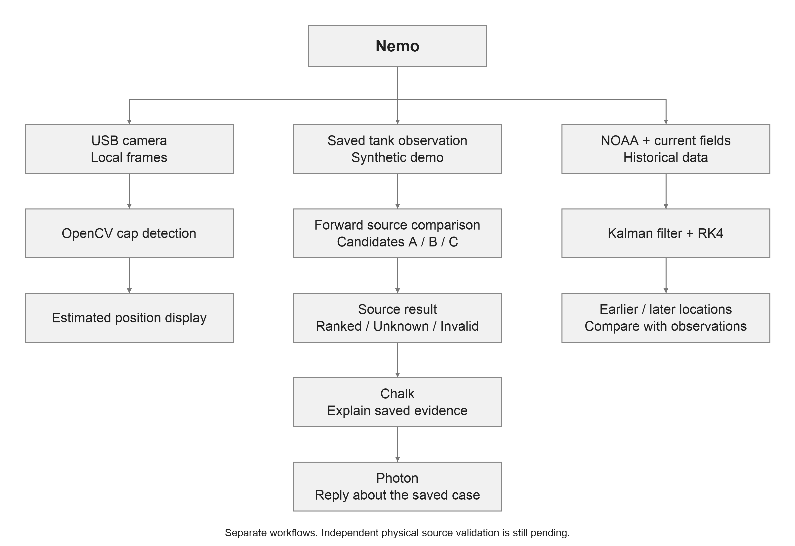
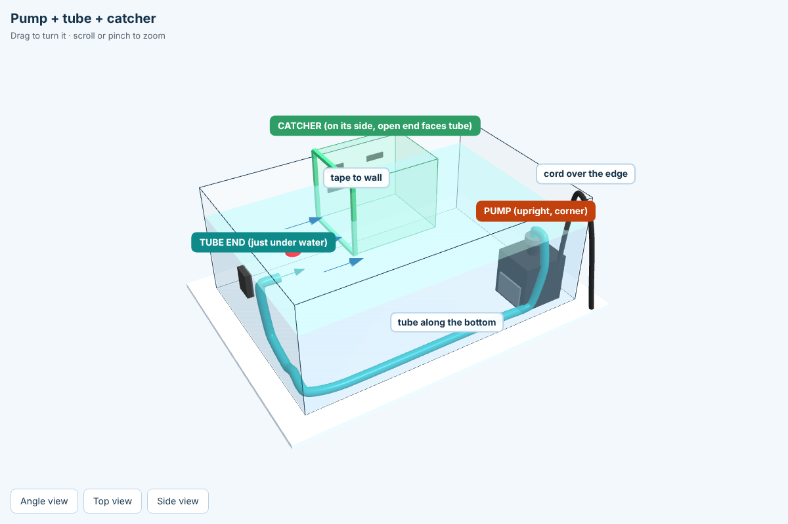
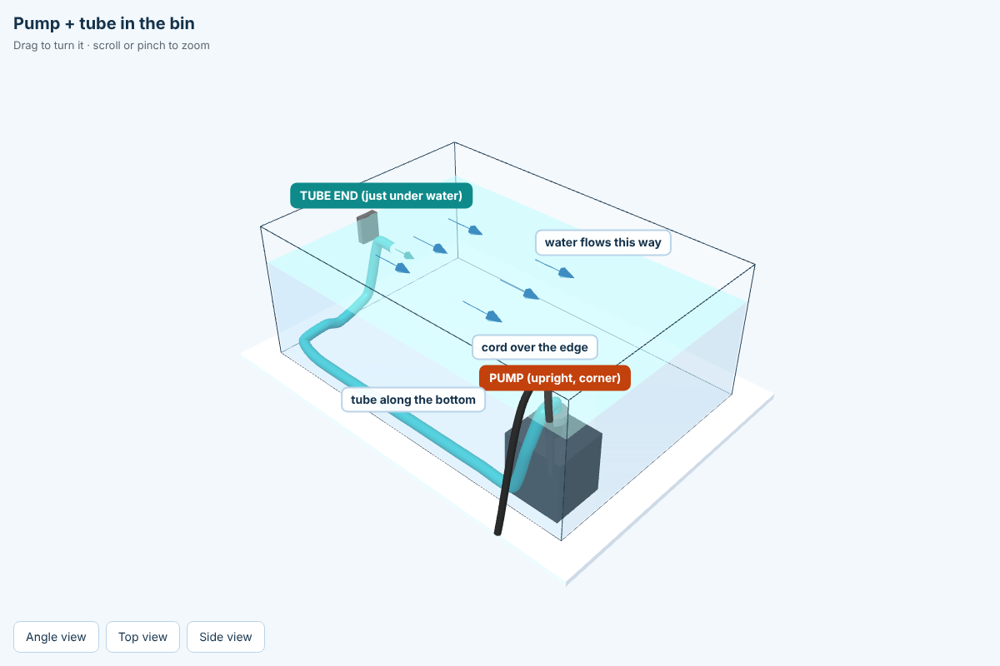
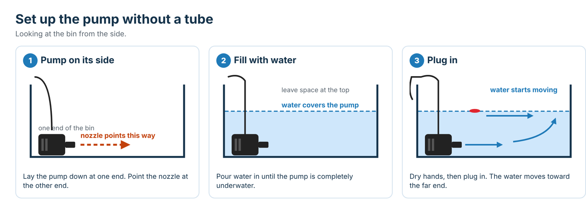
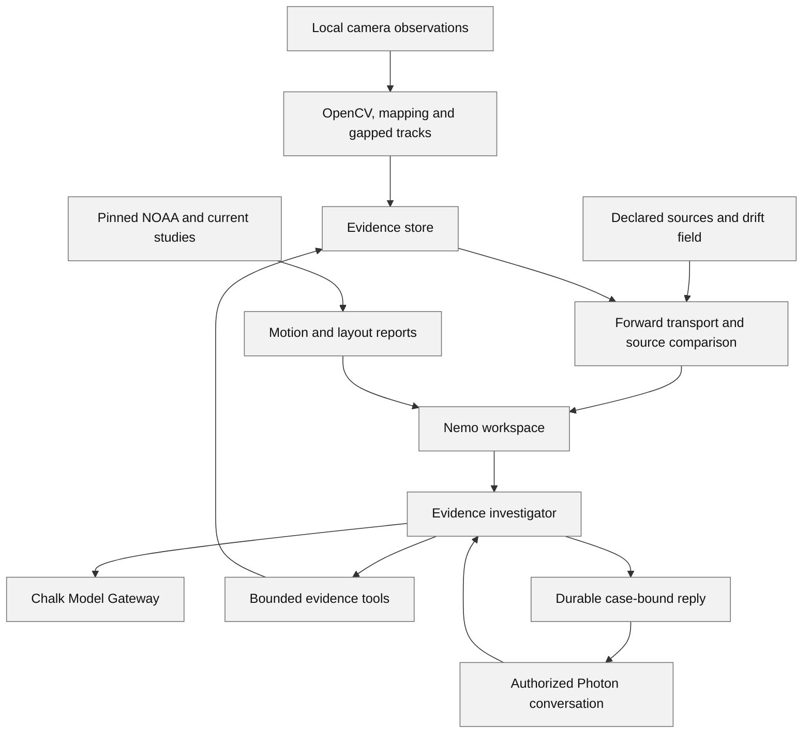

# Nemo

**Where did the trash enter the water—and where will it go next?**

Nemo brings camera observations, current-driven motion models and evidence-based explanations into one workspace. It starts with source tracing, then connects the result to a practical question: where could collection equipment intercept floating trash before it reaches a vulnerable area?

[Explore Nemo](https://nemo-software-demo.onrender.com/) · [Devpost project story](https://devpost.com/software/nemo-i69rus) · [Mathematics and physics](#scientific-formulas-explained-through-the-tank-experiment) · [Datasets and results](#datasets-what-nemo-actually-uses)

## Inspiration

When floating trash reaches a shoreline, we can see where it stopped. But where did it enter the water? And where could we collect the next piece before it reaches a vulnerable habitat?

Nemo connects those questions. **Source tracing is our main purpose; prevention is the next decision.** We began with an experiment we could see and understand: a green bottle cap representing floating trash, three possible entry regions, a webcam, a pump and a mesh collector.

Our project brings that small, visible experiment together with historical ocean observations. A coastal team could use this approach to investigate plausible entry locations and compare collection plans against the evidence. Nemo presents each result in its own context: real marker observations, synthetic tank experiments and historical buoy research.

## What it does

Nemo brings observation, modeling and explanation into one workspace, with three distinct evidence paths:

1. **Real camera observation:** OpenCV finds a green cap in our tray. The screen shows the detected marker and an explicitly estimated grid.
2. **Synthetic source investigation:** saved simulated paths demonstrate how Nemo compares possible entry regions and handles uncertainty.
3. **Historical ocean research:** real archived NOAA buoy positions test motion models and earlier/later position hypotheses.

These paths connect through one scientific workflow: **observe → estimate motion → compare possible sources → predict movement → explain the evidence**. Each screen labels its data origin so a simulated prediction is distinguishable from a real measurement.

### What are A, B and C?

They are candidate regions where an object could have entered the tank. Nemo simulates possible journeys from those regions and compares them with the saved observed path. In our synthetic example, C fits best under the declared assumptions. The support bars describe compatibility within those candidates, not a calibrated probability or proof of a polluter's identity.

The estimator can return **Ranked**, **Unknown** or **Invalid**. A cap first seen trapped at a collector may not reveal its earlier journey. Unknown communicates that the evidence does not distinguish a source; Invalid identifies evidence that cannot support the comparison.

## Our physical prototype

Our rig uses a **Logitech C270 USB webcam**, a clear tray, a **Pond Boss 80 GPH pump**, about three feet of **3/8-inch-inside-diameter tubing**, a mesh collection pocket and reusable green caps. Megana measured the inside waterline as **35.56 × 22.86 cm**. A person operates the pump using its separate original power cord; Nemo observes the experiment rather than controlling the pump electronically.

The cap represents a standardized piece of floating trash. The black marks provide visual references, and the green borders describe the collection region. The webcam records the surface from above.

These illustrations explain placement and tubing routes. Their arrows show intended circulation rather than a measured current field. The third shows the alternative without tubing.

### Seeing the cap and the grid

The local detector uses **green color and compact-shape checks** to identify the controlled marker. Camera frames remain on the capture laptop. A saved image-to-tank mapping and bounded image registration place an estimated grid over the tray. Image pixels are real observations; displayed centimetres carry the estimated-coordinate label rather than being presented as current measured accuracy.

The latest direct green display keeps the marker visible through camera auto-exposure changes. The separate foreground recording policy compares frames with an empty-tank reference and rejects rim-crossing or ambiguous objects. The preview, reference, image box and coordinates share a camera session and exact frame identity.

The camera view uses one latest-frame MJPEG stream and a large display with capture controls underneath. This separates smooth preview playback from the slower recording/analysis work.

## How the physics works

For tank source investigation, Nemo sends particles forward from each candidate region under declared drift, spreading and retention assumptions, then compares their histories with the observation. This tests possible journeys instead of assuming that one backward line reveals a unique origin.

The ocean walkthrough makes a different calculation visible. It starts with three permitted historical NOAA positions, connects them, and uses a **causal Kalman filter** to estimate position and velocity. The connected line is a visual estimate between fixes, rather than newly observed movement.

### Formula 1: update the motion estimate

$$
\boxed{\hat s_k=\hat s_k^-+K_k\left(z_k-H_K\hat s_k^-\right)}
$$

**Updated estimate = predicted state + weighted measurement correction.**

The state contains position and velocity. $\hat s_k^-$ is the predicted state, $z_k$ is an observed position, $H_K$ selects the state's position components, and $K_k$ determines how strongly the observation changes the estimate. The filter carries uncertainty through this update. It uses permitted observations and keeps reserved comparison positions separate.

### Formula 2: follow a changing current

$$
\boxed{\frac{d\mathbf X}{dt}=\mathbf u(\mathbf X,t)+\mathbf b}
$$

**Particle motion = changing modeled current + fixed initial motion offset.**

The current $\mathbf u$ changes with position and time. In this walkthrough the initial offset is

$$
\mathbf b=\hat{\mathbf v}(T)-\mathbf u\!\left(\hat{\mathbf X}(T),T\right).
$$

It is computed at the final permitted filtered observation and held fixed afterward. RK4 integrates the resulting field in both directions. Purple explores earlier positions; teal projects later motion. The two branches are trajectory hypotheses; reversing transport does not undo mixing, beaching or capture or establish an object's release time.

The separate ocean prevention example uses current-only motion, $\mathbf b=0$. The tank source estimator uses forward stochastic particles in centimetres. The complete equations, state transitions, units and numerical rules are expanded in the [mathematics section](#scientific-formulas-explained-through-the-tank-experiment).

## Real data and results

We use archived **NOAA Global Drifter Program** positions, historical **HYCOM** currents, a saved **PacIOOS ROMS** current forecast and separate **NOAA Coral Reef Watch** heat-stress context. Buoys provide a real motion-evaluation dataset. HYCOM's selected 15-metre depth and the difference between a buoy and floating plastic define the scope of that comparison; reef heat stress provides habitat context rather than source evidence.

One frozen comparison evaluated five fixed models on six new-to-project historical buoy groups: **180 model-hour outcomes against 36 distinct later positions**. Mean position error was about **1,573 m for last observed drift, 1,656 m for Kalman and 1,772 m for ridge velocity AR(1)**. The simple last-drift baseline performed best on this cohort. Reusing targets across methods does not create independent experiments.

A separate retrospective reverse-current test missed earlier positions by **8.70 km on average**, versus **2.20 km** for last-drift extrapolation on two already-viewed targets. We kept this unfavorable result. Reversing a forward model alone does not validate pollution-source inference, and a tiny numerical round-trip error does not prove the recovered past is correct.

The full dataset inventory and results below preserve the original observations, saved methods, model comparisons and study identities.

## From a source question to a prevention experiment

The ocean comparison applies equal-length interception layouts to the same six hypothetical releases under changing currents. It predicts **six reef-proxy entries without interception, two with layout A and four with B**. Capture is idealized, and the receiving-area proxy was chosen after viewing the forecast. Those counts describe the modeled scenario, rather than measured reef protection.

The plot combines trajectories in one view. Checkboxes let the viewer select layouts, the reef proxy, interceptors and current arrows. Hiding a layer changes the drawing, not the scale, denominator or computed result.

### The 3D experiment

The Three.js tank scene renders saved geometry and representative surface paths. Users can orbit, switch layouts and scrub time while full-report counts remain fixed. Its stock **40 × 30 cm synthetic scene is separate from our 35.56 × 22.86 cm physical tray**. The equipment and depth are schematic; the scene presents the surface model rather than solving volumetric fluid flow.

The trial ledger distinguishes predictions, synthetic outcomes and reported physical trials, retaining unresolved or missing releases in the accounting. Predicted and recorded outcomes have separate identities and denominators.

## Chalk, Photon and Grok

### Chalk: an explanation connected to the evidence

**Python computes the scientific results. Chalk helps explain them.** A question is attached to the selected case. Our backend checks permissions and report identity, then exposes bounded evidence tools to a language model through **Chalk Model Gateway**. The returned explanation must satisfy its action contract and cite permitted evidence; stale or invalid output is rejected.

Here is the actual request flow:

1. The user asks about the selected observation.
2. `get_case` reads its identity, revision and data origin.
3. `get_source_evidence` returns the saved numerical report, source support, fit, coverage, sensitivity results and assumptions.
4. Chalk explains those results and cites the matching evidence ID.
5. Nemo displays the answer, live-response label and tool trace beside the report.

For the source example, Chalk explains why C fits the saved synthetic path, how it compares with A and B, and how the candidate set, priors, release window and transport model condition that answer. The citations connect the explanation to the actual report. A provider failure leaves the numerical evidence available; it cannot turn Unknown into a source ranking.

A fresh check of the hosted app on **18 October 2026** returned a live **REPORT** in about **7 seconds**. Its cited evidence ID exactly matched the selected source report. This screenshot is the actual response, not a written mockup. [Dated verification receipt](docs/research-evidence/nemo-live-integration-verification-20261018.json).

### Photon: the same investigation in a conversation

**Photon brings the saved-case investigator into iMessage.** We verified a delivered automatic reply to the natural question: “Which starting region best explains this observed path, and how certain is that result?”

The authorized conversation is pinned to a saved case; it does not silently follow the live cap. A local worker handles messaging with durable inbox/outbox records and idempotent retries. The explanation and numerical evidence ID travel together. Hosted Photon checks project authentication read-only; the recorded reply was handled by the authorized local worker.

### Grok: research and implementation assistance

**Grok helped us challenge the implementation.** We used it for physics research, model comparisons, causal filtering, RK4, reverse-source limitations and test design, with Cursor contributing to development. We checked suggestions against code, data and tests and retained reviews and corrections. Our Python backend executes the calculations.

The learned motion component is a compact **ridge velocity AR(1)** model fitted to permitted historical prefixes. Kalman performs state estimation, RK4 performs numerical integration, and OpenCV performs declared marker detection. Each method has an explicit role in the pipeline. [Grok contribution record](docs/grok-contribution-ledger.md).

## How we built Nemo

Python, **FastAPI**, **Pydantic**, **OpenCV**, **NumPy**, **SciPy** and **SQLite** support the scientific services. **Next.js**, **React** and **TypeScript** provide the interface, with **Three.js** for the 3D experiment. **xarray/NetCDF** decode the archived ocean-current files. **GitHub Actions** checks the implementation, and **Docker/Render** package the hosted application.

The browser presents the reports; Python owns the numerical values, case revisions and evidence records. Webcam processing runs on the local companion because a cloud server cannot open the capture laptop's USB camera. The hosted interface presents the saved research, synthetic examples and live Chalk investigation.

The visual design uses a light-blue palette, square cards, clear plot layers and collapsible scientific details. The silent ocean landing connects Observe, Trace, Prevent and Verify. Its video, globe and pale glyph background are presentation elements, separate from the scientific data.

Software architecture and evidence contracts

### Application states and evidence freshness

Numerical status, case state, agent action and delivery status are separate contracts:

| Contract | Actual states/transitions |
| --- | --- |
| Case | New observation → `OBSERVED`. A committed estimate → `INVESTIGATE` and a new revision/evidence ID, even if its numerical result is Invalid. STOP → `STOPPED`, increments revision and cancels pending recovery tasks. Any recorded manual terminal outcome → `RECOVERING`; new observations/revalidation are required for later live work. |
| Source report | `ranked`, `unknown` or `invalid`. Unknown may retain conditional support values but has no accepted ranked source. Invalid/Unknown are scientific outcomes, not fabricated zero error or a forced winner. |
| Manual recovery task | Current eligible LIVE case → `proposed`; approval within the 60-second expiry gate → `awaiting_human`; operator outcome → `manual_recovered`, `failed` or `uncertain`. Pending tasks can be `cancelled`. Approval is a human task, not motor execution. Synthetic/replay cases cannot create one. |
| Prevention comparison | Frozen to exact source evidence/revision, layout/profile identities and trial plan. A recompute, STOP or recovery makes it archival (`CASE_CHANGED_OR_STOPPED`); history remains readable, while new trials/reviews are rejected. New trials create a new evaluation digest; a stale Chalk answer/receipt cannot silently follow it. |
| Ocean comparison | Read-only `COMPLETED`, `PARTIAL` or `UNSUPPORTED` forcing result; independent `BEST_LAYOUT`, `TIE` or `INDETERMINATE` recommendation. Four hashes bind source, method, selected scenario and complete report. Expiry changes forecast mode and report identity; it never becomes a physical trial or tank comparison. |
| Trial ledger | Immutable one-release rows: `zone_entry`, `intercepted_before_entry`, `no_entry` or `unresolved`. The same key/body retries exactly; a changed body with the same key conflicts. Per-source/layout quotas are enforced. The UI shows the counterbalanced next slot; the API records out-of-order entries and reports `order_followed=false` rather than silently correcting them. |
| Chalk result | Case agent actions include `REPORT`, `UNKNOWN`, `OBSERVE_MORE`, `REQUEST_APPROVAL`, `STOP`; a research review permits only `REPORT`/`STOP`. An agent's STOP ends that turn without authorizing an action; it is not automatically a case STOP. Revision/snapshot checks reject results made stale while a model was responding. |
| Photon | Inbox `pending → processing → done/failed`; outbox `pending → sending → accepted/failed`, with leases and immutable-key/body retries for retryable transport failures. `accepted` means HTTP 202, not Delivered/read. Strict authorized `STOP`, `CANCEL`, `APPROVE` commands bypass conversational generation; quoted prose is not a command. |

Manual collection proposals and approval also recheck the current LIVE camera session, calibration, rig state and target-observation freshness (default 5 s), as well as the 60 s proposal expiry. An invalid source blocks a proposal; Unknown does not by itself forbid collecting a visible token when all manual-task gates pass. Manual recovery does not require or establish a confident source identity.

STOP never erases saved evidence and does not cut external pump power. The software contains no pump, gantry or autonomous robot actuator. Public research loads are read-only; source/prevention model calls and state changes require local operator access.

### Export and validation contracts

The current-case `analysis_bundle_v1` export has `payload_sha256` and `payload_canonical_json`. Importing its validation manifest checks exact identity, partition and recomputed trial accounting; it returns **`IDENTITY_AND_ACCOUNTING_CHECKED_METHOD_NOT_RERUN`**. It does not rerun the separate numerical method or prove an independent experiment.

Trace 2's offline validator uses its distinct `content_hash` envelope and full immutable method inputs. Its published synthetic alternatives are alternative outcomes for the same fixture, not additive independent trials. Do not rename hashes or treat a redacted product export as a complete method-replay bundle. [The export-contract audit](docs/software-export-contract.md), [validation protocol](docs/prevention-validation-protocol.md), [Trace 3 contract](docs/trace3-research-and-contract.md), and [Aarush's merged rehearsal](docs/experiment-validation-v2.md) explain the boundary.

## Challenges and what we learned

Our hardest practical challenge was getting usable evidence. Shadows, ripples, small camera shifts and cap retention affected recordings. We excluded unusable wet runs instead of treating trapped-cap jitter as water flow. The direct green display, foreground policies, estimated-grid labels and exact frame/session checks came from those observations.

The model comparisons taught us to keep simple baselines. A more elaborate model was not automatically better, and a smooth backward animation was not proof of a true origin. We retained unfavorable results, ambiguous examples and invalid inputs alongside the successful demonstrations.

The software tests exercise source states, evidence freshness, authentication, NOAA stages, trajectory controls, frame/box identity, 3D playback, messaging retries and provider-failure paths. The code baseline `c6365f7` passed **2,354 Python tests**, **394 frontend tests**, **241 isolated HTTP checks** and **12 deployment unit tests**; its Python run also recorded one skip and one warning, while the isolated HTTP run reported six explicitly blocked live/physical scopes. Separate live checks produced the actual Chalk and Photon responses shown above. [Exact CI checkpoint](https://github.com/Jose-Gael-Cruz-Lopez/reeftrace/actions/runs/39104053232).

**Nemo connects a visible observation to a testable explanation.** It helps people examine where an object could have entered the water, understand its possible movement and compare a collection plan using evidence they can inspect.

## Scientific formulas, explained through the tank experiment

Nemo's calculation chain connects image pixels and timestamps to a declared motion model, candidate-source support and interception outcomes. Tank calculations use centimetres and seconds; ocean studies use geographic coordinates, metres and seconds. These equations describe the implemented methods and the scope of each displayed result.

Expand every formula, its symbols, units, implementation and connection to the tank

### Which equation belongs to which feature?

| Feature | Calculation | Units and boundary |
| --- | --- | --- |
| Tank candidate-source comparison | Forward stochastic particles under $u_{token}(x,y)+b$, dispersion and retention; compare full permitted histories | cm / s; layout-specific checked drift inputs |
| Position-only NOAA benchmark | Stationary, last/mean drift, ridge AR(1), fixed constant-velocity Kalman | m / s; no ocean-current forcing added to those frozen baselines |
| NOAA bidirectional walkthrough | Causal three-fix Kalman anchor, then HYCOM plus one fixed filtered-motion offset, integrated by RK4 | Geographic position / m/s; earlier/later hypotheses, no source-release proof |
| Ocean prevention | PacIOOS changing-current advection, $b=0$, no stochastic dispersion; idealized first-contact layouts | Geographic position / m/s; hypothetical releases and reef proxy |
| 3D tank view | Render saved surface paths and report counts | Declared synthetic centimetres; no second fluid solver |

### Symbols and units

| Symbol | Simple meaning | Units or role |
| --- | --- | --- |
| $p,X,z$ | Position, modeled position, observed position | Tank: cm; ocean metric frame: m; API geography: degrees |
| $t,\Delta t$ | Timestamp or elapsed interval | s; ocean timestamps are UTC |
| $u,v$ | Drift vector, or east/north current components | Tank cm/s; ocean m/s |
| $D$ | Constant random spreading strength | Tank cm²/s |
| $\pi_s,w_a$ | Declared candidate-source and release-age weights | Normalized nonnegative weights; source weights are positive |
| $P,Q,R$ | State, process-noise and measurement-noise covariance | Mixed position/velocity units; defined for the Kalman model below |
| $N$ | Number of particles, releases or samples in the stated calculation | Always inspect the denominator; model paths are not independent physical trials |

The camera homography $H_{\rm camera}$ is a **3×3 mapping**; the Kalman observation matrix $H_K$ is **2×4**. They share a conventional letter but are unrelated. Observation quality $g_i$ below is also different from Kalman acceleration spectral density $q$.

### F1. Detect a controlled marker and map pixels to centimetres

The **current saved-rig live display** uses `saved_green_marker_preview_v2`: OpenCV HSV hue **35–85**, saturation **80–255**, value **20–255**, a 3×3 opening and 5×5 closing. A candidate must satisfy aspect ratio ≤2, circularity ≥0.45, solidity ≥0.75 and an area range **0.35–3 times** a saved same-size development marker area. These are declared policies, not calibrated probabilities. The display does not approve a new physical token-size measurement.

For contour area $A$, perimeter $L$ and convex-hull area $A_h$:

$$
\operatorname{circularity}=\frac{4\pi A}{L^2},\qquad
\operatorname{solidity}=\frac{A}{A_h},\qquad
u_{px}=\frac{m_{10}}{m_{00}},\quad v_{px}=\frac{m_{01}}{m_{00}}.
$$

The separate surface-v2 recording/replay detector adds foreground, green-marker, complete-component/tank-outline and compact-shape gates. Legacy `red_hsv` remains for the original red-marker pipeline and generated replay: hue $[0,10]\cup[170,179]$, $S\ge100$, $V\ge70$, 3×3 opening/closing and area 25 pixels²–5% of frame. Those red settings do not describe today's direct green display.

For a valid water-plane mapping:

$$
\begin{bmatrix}\tilde x\\\tilde y\\w\end{bmatrix}
=H_{\rm camera}\begin{bmatrix}u_{px}\\v_{px}\\1\end{bmatrix},
\qquad x_{cm}=\tilde x/w,\quad y_{cm}=\tilde y/w.
$$

Independent checks use $e_i=\|\hat p_i-p_i\|_2$ and $e_{\max}=\max_i e_i$. Measured approval requires the declared threshold (default **0.5 cm**) with at least **four fit pairs and three separate noncollinear check pairs**. This is a maximum point-error check, not an accuracy confidence interval.

The estimated live display can register historical/current images with ORB features and a bounded translation: at least 15 inliers, inlier fraction ≥0.5, residual ≤3 px and translation ≤64 px under the saved policy. This is **image alignment estimation**, not independent water-plane calibration. It cannot confer measured-flow/source/trial eligibility.

The registration uses matched feature displacements and their componentwise median:

$$
d_i=p_{i,\mathrm{current}}-p_{i,\mathrm{reference}},\qquad
\hat d=\operatorname{median}_i d_i,\qquad
\mathrm{inlier}_i=\mathbf1\{\|d_i-\hat d\|_2\le3\ \mathrm{px}\}.
$$

After the two bounded median/inlier refinements, accepted translation is applied only above 0.5 px. Estimated centimetres normalize
$H_{\rm camera}[u_{px}-\hat d_x,\ v_{px}-\hat d_y,\ 1]^T$; the grid shifts into the current view. A failed registration can leave green pixels visible while withholding centimetres/grid. Rotation, perspective and waterline changes are not calibrated by a translation.

**Foreground/reference math.** For 5–60 empty-scene frames, let $B_{Lab}(p)$ be their componentwise median Lab color, and $r_j(p)=\|I_{j,Lab}(p)-B_{Lab}(p)\|_2$. The stored robust variation is

$$
\sigma_{ref}(p)=\operatorname{GaussianBlur}_{5\times5}
\left[1.4826\operatorname{median}_j r_j(p)\right].
$$

For the phase-aligned current frame, the small global exposure adjustment is
$g=\operatorname{median}(I_{gray})/\max(\operatorname{median}(B_{gray}),1)$.
Using the separately stored median BGR image $B_{BGR}$, the foreground mask before morphology is

$$
F(p)=\mathbf1\left\{
\|Lab(I_{aligned}(p))-Lab(\operatorname{clip}(gB_{BGR}(p),0,255))\|_2
>\max(18,6\sigma_{ref}(p))
\right\}.
$$

The ROI/border mask also applies. A global brightness change over 20%, confident translation over 8 px or more than 15% changed pixels refuses/gaps the current frame. Reference capture itself rejects confident drift over 1.5 px or excessive busy pixels. Surface-v2 intersects this unchanged foreground mask with green HSV **H 35–85 / S ≥80 / V ≥40**, then applies complete-component, shape and area gates. Zero or several admitted candidates remain gaps. The current direct green **display** instead permits V ≥20 without requiring background subtraction; that deliberate display path does not weaken measured-record admission. [Foreground implementation](apps/vision/reeftrace_vision/foreground.py).

A missed/ambiguous observation breaks a track. The original associated tracker also breaks for nonpositive time, a gap over 0.5 s or displacement greater than $20\Delta t$ cm. The legacy associated tracker assigns accepted `quality=1`; this is a declared value, not calibrated detection confidence. The display-only preview does not publish a calibrated confidence score.

**Connection to the tank:** the historical map uses the measured tray dimensions; its session/alignment labels distinguish estimated display coordinates from checked water-plane positions. Planar mapping does not recover depth or correct every lens/refraction effect. [Current green display](apps/api/reeftrace_api/services/detector_preview.py) · [Surface detector](apps/vision/reeftrace_vision/surface_token.py) · [Mapping](apps/vision/reeftrace_vision/calibration.py) · [Tracking](apps/vision/reeftrace_vision/tracking.py).

### F2. Measure drift from the observed path

$$
v_x=\frac{x_2-x_1}{t_2-t_1},\qquad
v_y=\frac{y_2-y_1}{t_2-t_1},\qquad
c=\frac{p_1+p_2}{2},\qquad |v|=\sqrt{v_x^2+v_y^2}.
$$

**Simple meaning:** distance divided by time estimates how fast and in which direction the token moved. Samples use non-overlapping associated pairs separated by 0.1–0.5 s. Gaps remain gaps; there is no invented observation between them.

**Connection to the tank:** these measurements describe the floating token under that pump setting, water depth and layout. Timestamps currently use host receipt time, not an independently measured camera exposure clock. Pump GPH measures volume throughput; it cannot be substituted for local token velocity. [Sample extraction](apps/vision/reeftrace_vision/tracking.py).

### F3. Fit a spatial drift field from separate recordings

Positions enter grid cells $c=\lfloor(p-p_{\min})/h\rfloor$. Each cell keeps median position and componentwise median velocity. Nearby cells contribute through inverse-distance weighting:

$$
\hat u(p)=\frac{\sum_{j\in K}w_jv_j}{\sum_{j\in K}w_j},
\qquad
w_j=\max(\|p-p_j\|^2,10^{-12})^{-\alpha/2}.
$$

Exact-node queries return that node's velocity. Defaults are eight neighbours and $\alpha=2$. Support is separate:

$$
S(p)=\mathbf1\{p\text{ inside tank bounds and }\min_j\|p-p_j\|\le r\}.
$$

Node scatter and validation error use $\sqrt{\operatorname{mean}\|v_{pred}-v_{obs}\|^2}$. Validation RMSE includes supported validation samples only, so its coverage must also be shown. The reusable fitter defaults to **5 cm cells / 10 cm radius**; the recorded-flow API defaults to **1 cm / 3 cm**. These are different entry points, not competing measured estimates.

**Connection to the tank:** each layout profile has distinct fitting and validation record identities. The measured tank model uses a frozen spatial field $u(x,y)$; changing pump conditions are not a commissioned time-varying tank model. A numerical velocity outside support is not usable measured evidence. [Flow model](apps/transport/reeftrace_transport/flow.py).

### F4. Simulate forward from each candidate source

$$
dX_t=[u(X_t)+b]dt+\sqrt{2D}\,dW_t,
$$

$$
X^*_{k+1}=X_k+[u(X_k)+b]\Delta t+
\sqrt{2D\Delta t}\,\xi_k,\qquad \xi_k\sim N(0,I_2).
$$

This Euler–Maruyama model combines measured drift, a declared bias $b$ and constant isotropic dispersion $D$. Particles start uniformly over each candidate polygon. Rectangle walls reflect movement; validated traps absorb on first contact, including crossings between saved nodes. Once absorbed, a particle remains absorbed.

The resolution heuristic halves the step until

$$
V_{\max}\Delta t+3\sqrt{2D\Delta t}\le\ell_{\min}/2.
$$

This is a numerical heuristic, not a guaranteed bound on a Gaussian jump.

**Connection to the tank:** particles represent possible histories of one standardized token under the fitted conditions. Dispersion, bias, age priors and step rules are explicit model inputs. This is not a pressure/volume/3D fluid solver and does not predict how an interceptor changes the water. [Transport code](apps/transport/reeftrace_transport/simulation.py).

### F5. Compare each candidate's histories with what the camera saw

For source $s$, particle $n$, possible age $a$ at the first observation and observed positions $z_i$:

$$
r_i=X_{sn}(a+t_i)-z_i,
\qquad
L_s=\sum_aw_a\frac1N\sum_n
\exp\left[-\frac12\sum_{d=x,y}r_d^TC^{-1}r_d\right].
$$

The shared temporal residual covariance is:

$$
C_{ij}=\frac{\sigma_z^2e^{-|t_i-t_j|/\tau}}{\sqrt{g_ig_j}}
+\sigma_m^2+\mathbf1_{i=j}\frac{0.05\sigma_z^2}{g_i}.
$$

Library defaults: position bandwidth $\sigma_z=0.7$ cm, shared model bandwidth $\sigma_m=0.3$ cm, correlation time $\tau=0.8$ s. Registered profiles retain their own frozen parameters; these defaults are not measurements of physical camera noise. The shared-offset term contributes to **every** covariance entry. Many adjacent observations cannot average it away. Gaussian factors common to sources are omitted; this is a compatibility kernel, not a calibrated density.

For a first-seen-retained endpoint, only already-retained simulated particles contribute:

$$
L_s=\sum_aw_a\frac1N\sum_n\mathbf1_{\rm retained}
\exp[-\|X_{sn}(a)-z\|^2/(2\sigma^2)],
\qquad \sigma^2=\sigma_z^2/g+\sigma_m^2.
$$

The denominator remains **all particles**, including ones that never arrive. Earlier observed history takes priority over an endpoint-only interpretation.

**Connection to the tank:** the estimator compares permitted paths against candidate releases while evaluator-only source truth stays outside the function. A shared retained endpoint can erase information; a source may stay Unknown even when the token is clearly visible. [Likelihood implementation](apps/estimation/reeftrace_estimation/estimator.py).

### F6. Normalize source support and decide whether to abstain

$$
S_s=\frac{\pi_sL_s}{\sum_j\pi_jL_j},\qquad
A=L_{\rm leader}^{1/m}.
$$

The implementation uses log-sum-exp to avoid numerical underflow. $A$ is a length-normalized absolute-fit diagnostic for the leading source, with $m$ selected observations. It is not a p-value. If every likelihood is zero, no uniform posterior is fabricated.

**Simple meaning:** a source gets more support when its allowed paths match the observation better, after the declared prior. The result is explicitly `relative_support_not_probability`, conditional on the candidate set and model. Registered app profiles allow 2–5 sources; the reusable estimator allows 2–8.

| Default gate | Requirement |
| --- | --- |
| Absolute fit | At least 0.02 for the prior-weighted leader |
| Top-two prior-weighted support margin | At least 0.20 |
| Top-two likelihood-only support margin | At least 0.10 |
| Observed-field support | 1.00 |
| Minimum candidate mean particle-time path support | 0.90 |
| Mean observation quality | At least 0.50 |
| Trajectory evidence | At least 3 points over 0.5 s; at most 20 selected points |
| Calibration, token, retention and sensitivity | Must satisfy their explicit contracts; changed leader or status under a declared sensitivity variant withholds acceptance |

**Connection to the tank:** `ranked` with a non-null `ranked_source` is an accepted model ranking within the declared candidates. `unknown` is abstention, even with a leading source and bars; `invalid` rejects unusable input. Stored reports retain the status and reason codes. High relative support cannot guarantee that an unlisted true source will be detected as unknown. [Source gates](apps/estimation/reeftrace_estimation/estimator.py), [mission and source-validation plan](docs/source-tracing-mission.md).

### F7. Follow changing geographic currents without mixing degrees and metres

Ocean mode uses bilinear spatial and linear temporal interpolation:

$$
(u,v)(\phi,\lambda,t)=\sum_{ijk}w_i^tw_j^\phi w_k^\lambda(u,v)_{ijk}.
$$

WGS84 converts current in m/s into geographic movement. With latitude/longitude in radians:

$$
N(\phi)=\frac a{\sqrt{1-e^2\sin^2\phi}},\quad
M(\phi)=\frac{a(1-e^2)}{(1-e^2\sin^2\phi)^{3/2}},\quad
\dot\phi=\frac v{M(\phi)},\quad
\dot\lambda=\frac u{N(\phi)\cos\phi}.
$$

Here $a=6378137$ m, $f=1/298.257223563$, $e^2=f(2-f)$. Code uses equivalent metre-per-degree derivatives. The separate position-only NOAA models use a spherical azimuthal-equidistant east/north map with radius **6,371,008.8 m** and a 50 km prediction-domain limit; this is not the WGS84 ellipsoid.

For $\dot X=f(t,X)$, classical RK4 advances:

$$
k_1=f(t,X),\quad k_2=f(t+h/2,X+hk_1/2),\quad
k_3=f(t+h/2,X+hk_2/2),\quad k_4=f(t+h,X+hk_3),
$$

$$
X_{next}=X+\tfrac h6(k_1+2k_2+2k_3+k_4).
$$

**Simple meaning:** sample changing currents at the start, two estimated midpoints and end of each short step. Masked contributors and missing times stop support; no extrapolation is substituted. Steps align with forcing knots. A smaller step improves a numerical approximation, not the source data's coastal resolution.

**Connection to the tank:** the transferable idea is advancing position under a measured field. Geographic ocean arrays cannot calibrate tank centimetres. The current ocean model has no explicit object windage, diffusion, beaching or physical interceptor response. [Geographic solver](apps/ocean/reeftrace_ocean/advection.py), [geodesy](apps/ocean/reeftrace_ocean/field.py), [numerical checks](docs/rk4-numerical-quality.md).

### F8. Compare against simple movement baselines

Let $p_n$ be the last context position and $v_i=(p_{i+1}-p_i)/\Delta t$.

| Model | Equation | Beginner explanation and tank relevance |
| --- | --- | --- |
| Stationary | $\hat p_{n+h}=p_n$ | Predict no movement. A useful minimum baseline for a future tank replay. |
| Last drift | $\hat p_{n+h}=p_n+h\Delta t\,v_{last}$ | Continue the latest measured movement. Can beat a complex model. |
| Mean drift | $\hat p_{n+h}=p_n+h\Delta t\,\bar v$ | Continue the average earlier velocity. |

The existing NOAA baseline implementations assume hourly cadence. They are not already commissioned irregular-time centimetre models. [Baselines](apps/ocean/reeftrace_ocean/benchmark.py), [mean drift](apps/ocean/reeftrace_ocean/ablation.py).

### F9. Ridge velocity AR(1) and pooled transfer diagnostic

Centre velocity samples by mean $\mu$ and divide by one scalar scale $s=\max(\sqrt{\operatorname{mean}((v-\mu)^2)},10^{-9})$. Earlier and next samples form $X,Y$:

$$
A=(X^TX+\alpha I)^{-1}X^TY,\quad\alpha=1,
$$

$$
\hat v_{k+1}=\mu+(\hat v_k-\mu)A,\qquad
\hat p_{k+1}=\hat p_k+\Delta t\hat v_{k+1}.
$$

Code solves the linear system rather than explicitly inverting it. If spectral radius $\rho(A)>0.98$, scale $A$ by $0.98/\rho(A)$. The row-vector convention matters. Own-prefix ridge estimates two mean components and four matrix entries from its permitted prefix only. The post-hoc pooled diagnostic estimates the shared matrix from three other groups' centred prefixes, retaining the held group's permitted mean/last velocity.

**Simple meaning:** learn a small rule for how motion changes, then forecast without resetting to future observations. **Connection to the tank:** the test discipline transfers, but the ocean-fitted coefficients and noise assumptions do not. No model is promoted automatically. [Ridge code](apps/ocean/reeftrace_ocean/benchmark.py), [pooled diagnostic](apps/ocean/reeftrace_ocean/lopo.py).

### F10. Constant-velocity Kalman filter

The research state is $x=[p_x,p_y,v_x,v_y]^T$, in metres and m/s:

$$
F=\begin{bmatrix}I_2&\Delta tI_2\\0&I_2\end{bmatrix},\quad
Q=q\begin{bmatrix}\Delta t^3I_2/3&\Delta t^2I_2/2\\\Delta t^2I_2/2&\Delta tI_2\end{bmatrix},
\quad H_K=[I_2\ 0],\quad R=\sigma_p^2I_2.
$$

Fixed assumptions: $\sigma_p=100$ m, **$R=10000I_2$ m²**, $q=10^{-6}$ m²/s³. This is continuous white acceleration, not the alternative constant-acceleration-per-interval noise convention.

Initialize at the second fix, separated by $\delta$:

$$
x_1=\begin{bmatrix}z_1\\(z_1-z_0)/\delta\end{bmatrix},\qquad
P_1=\begin{bmatrix}R&R/\delta\\R/\delta&2R/\delta^2\end{bmatrix}.
$$

Predict, then update using permitted context positions:

$$
x^-=Fx,\quad P^-=FPF^T+Q,\quad S=H_KP^-H_K^T+R,
\quad K=P^-H_K^TS^{-1},
$$

$$
x^+=x^-+K(z-H_Kx^-),\quad
P^+=(I-KH_K)P^-(I-KH_K)^T+KRK^T.
$$

The implementation uses a gain solve and the Joseph covariance update. Once forecasting begins, no held observation updates are allowed. The anchor is the filtered last context state, unlike raw-position baselines.

**Simple meaning:** balance a simple motion prediction against noisy position observations while carrying model spread. **Connection to the tank:** the ocean filter's 100 m assumed error and the tank's centimetre mapping are different measurement models. This filter is a separate geographic diagnostic; the tank source engine is the forward-particle comparison above. [Kalman code](apps/ocean/reeftrace_ocean/kalman.py), [exact contract audit](docs/algorithm-contract-audit.md).

### F11. Initial current residual: a separate exploratory diagnostic

$$
b=v_{last}-u_{HYCOM}(X_0,t_0),\qquad
u_{corrected}(X,t)=u_{HYCOM}(X,t)+b.
$$

The offset stays constant in local east/north components and the original RK4 follows the corrected copied field. There is no fitted coefficient, decay or clipping.

**Simple meaning:** let the final observed drift supply one initial discrepancy from the ocean model. **Connection to the tank:** this is not an identified windage coefficient or a calibrated pump correction. It reuses two already-viewed groups and twelve target positions. “Origin” here means forecast start, not a pollution release source. The backward walkthrough instead anchors its offset at the permitted filtered observation, as specified in F17. [Saved residual study](docs/origin-residual-results.md).

### F12. Measure position, speed and direction errors

For position errors $e_h$ at $H$ prediction times:

$$
ADE=\frac1H\sum_he_h,\qquad FDE=e_H,\qquad
RMSE_p=\sqrt{\frac1H\sum_he_h^2}.
$$

ADE is the average miss; FDE is the final miss; RMSE emphasizes large misses. Tank errors use Euclidean centimetres. Geographic errors use a declared spherical great-circle distance:

$$
d=2R_E\arcsin\sqrt{\sin^2(\Delta\phi/2)+\cos\phi_1\cos\phi_2\sin^2(\Delta\lambda/2)},
\qquad R_E=6371008.8\text{ m}.
$$

Velocity differences use actual successive predicted positions, not future-observation resets:

$$
r_v=v_{pred}-v_{obs},\quad RMSE_v=\sqrt{\operatorname{mean}\|r_v\|^2},
\quad b_{speed}=\|v_{pred}\|-\|v_{obs}\|,
\quad MAE_{speed}=\operatorname{mean}|b_{speed}|.
$$

Tank direction error is $\arccos[\operatorname{clip}((v_p\cdot v_o)/(\|v_p\|\|v_o\|),-1,1)]$. Ocean headings use $\operatorname{atan2}(v_E,v_N)\bmod360^\circ$ and the wrapped absolute heading difference. Direction is withheld below 0.01 cm/s in the tank diagnostic or 0.005 m/s in the ocean diagnostic.

$$
skill=1-\frac{\sum e_{model}}{\sum e_{baseline}}.
$$

The zero-baseline denominator gives null skill. Positive skill is a descriptive reduction in miss, not significance. Equal-group summaries weight complete drifter groups equally; primary results are withheld when required coverage is incomplete.

**Connection to the tank:** the diagnostic reports error and coverage while retaining gapped samples. The separate recorded-path diagnostic forecasts from the first position only using deterministic reflected forward Euler, $X_{k+1}=\operatorname{Reflect}[X_k+u(X_k)\Delta t]$, with $D=0$ and no traps or later position updates. It checks continuous reflected-segment support; the frozen source/prevention engines use finite-node support. [Vector diagnostics](apps/vision/reeftrace_vision/vector_diagnostic.py), [recorded-path diagnostic](apps/vision/reeftrace_vision/field_trajectory_diagnostic.py), [ocean metrics](apps/ocean/reeftrace_ocean/vector_diagnostics.py).

### F13. Distinguish model spread from validated uncertainty

Kalman observed-position checks add measurement noise to latent position spread:

$$
d_M^2=(\hat p-z)^T(P_{pp}+R)^{-1}(\hat p-z),\qquad
d_M^2\le-2\ln(1-a).
$$

The threshold is the nominal two-dimensional Gaussian level $a$. Other training diagnostics use the 90th percentile (`higher` quantile) of earlier expanding-origin errors. Overlapping errors and assumed noise do not establish calibrated 90% coverage.

**Connection to the tank:** source-support bars, scenario envelopes, missing-data bounds and Gaussian ellipses mean different things. A visibly narrow cloud is not proof of accuracy. The software labels these quantities by their actual statistical meaning rather than equating them. [Uncertainty contract](docs/algorithm-contract-audit.md).

### F14. Compare interception by the first event

$$
\tau_Z=\inf\{t:X_t\in Z\},\qquad
\tau_T=\inf\{t:X_t\in T\}.
$$

**Simple meaning:** did the token enter the protected zone before encountering an interceptor, within the declared horizon? In ocean mode reef entry wins simultaneous ties. Tank event timestamps are numerical-node upper bounds; ocean contacts are interpolated along supported output chords.

Let $E$ be supported zone entries, $U$ paths unsupported/unresolved before an event or horizon, and $N$ all planned model particles/releases:

$$
p_{entry}\in[E/N,(E+U)/N].
$$

For baseline bounds $[L_b,U_b]$ and intervention bounds $[L_i,U_i]$:

$$
B\in[L_b-U_i,\ U_b-L_i].
$$

Tank recommendations check every declared source/scenario and are withheld if any particle's event-prefix nodes lack support. Ocean layout A is preferred only when its upper entry bound is strictly below B's lower bound; otherwise show a resolved tie or indeterminate result. Unknown paths never disappear from a favorable denominator. These are accounting bounds, not confidence intervals.

**Connection to the tank:** each layout has its own field input; collector geometry does not recalculate hydrodynamics. Counts use full ensembles rather than only the displayed lines. A no-event tank `unresolved_count` is different from an unsupported path and from an unresolved physical observation. [Tank prevention](apps/estimation/reeftrace_estimation/prevention.py), [ocean prevention](apps/ocean/reeftrace_ocean/ocean_prevention.py).

### F15. Keep missing real trials in predicted-versus-measured accounting

For $P$ planned releases, $R$ logged releases, $E$ zone entries, $U$ unresolved outcomes and $M=P-R$ missing slots:

$$
p_{planned}\in[E/P,(E+U+M)/P],\qquad
p_{logged}\in[E/R,(E+U)/R].
$$

With no logged releases, observed bounds remain **[0,1] with denominator 0**, not a measured zero rate. Benefit subtracts opposite bound endpoints as above. Synthetic and operator-reported physical ledgers stay separate; an operator entry is not automatically camera-verified or a causal-effect estimate.

**Connection to the tank:** the ledger stores the declared counterbalanced plan and entries/interceptions/no-entry/unresolved outcomes; missing planned slots stay in the denominator. [Trial accounting](apps/api/reeftrace_api/services/prevention.py).

### F16. Read satellite heat context and the 3D scene correctly

Nemo reads NOAA's already-produced Degree Heating Week series; it does not calculate DHW from raw satellite temperature images. Its simple displayed change is $DHW_{last}-DHW_{first}$, here $4.53-2.96=1.57$ °C-weeks.

**Connection to the tank:** the reef proxy explains why interception might matter; heat stress does not identify this token's origin or establish coral damage from plastic. The 3D scene replays the same saved surface paths and counts with schematic equipment. It is not a second physics engine. Chalk explains saved numerical evidence; Python computes the authoritative numerical results. [Satellite reader](apps/ocean/reeftrace_ocean/satellite.py), [3D guide](docs/tank-simulator.md).

### F17. Trace backward and forward from a filtered observation

The ocean-source prototype reverses a deterministic field using **both** the negative velocity and decreasing actual time:

$$
\frac{dY}{d\tau}=-u(Y,T-\tau),\qquad Y(0)=X_{observed}.
$$

A copied field reverses time knots/arrays/masks and negates u/v, then the unchanged positive-time RK4 integrates increasing lookback age. Merely negating today's velocity while advancing through tomorrow's snapshots is incorrect. This local ODE reversal does not require a divergence-free field. Random diffusion, beaching and capture cannot simply be undone this way.

The five-step walkthrough separately uses three permitted fixes at 01:00/02:00/03:00 UTC: scatter → connected observed path → causal Kalman-filtered estimates → explicit drift rule → both directions. Its three-fix filter is a separately declared teaching/research example; it does not change the frozen eight-or-more-fix benchmark. From the filtered 03:00 position/velocity:

$$
b_{03}=v_{filtered,03}-u_{HYCOM}(X_{filtered,03},03{:}00),
\qquad \dot X=u_{HYCOM}(X,t)+b_{03}.
$$

The same constant east/north offset is added to a copied field for both branches. The backward equation negates that **whole corrected field** at decreasing physical time; the forward branch advances normally. No earlier/later validation position updates either branch. A future endpoint is a conditional candidate interception rendezvous at a stated time, not guaranteed capture or an optimized physical collector location.

The separate 06:00→00:00 diagnostic shows earlier candidates under 25 fixed endpoint/current perturbation cases at one/three/six-hour lookbacks. They are a sensitivity envelope, not calibrated probabilities or confidence coverage. All cases and failures stay visible; no hull spans missing support. Numerical forward closure and distance to the actual earlier buoy position are separate checks. The saved current-only six-hour mean miss is **8,696.822 m**, versus **2,197.726 m** for last drift; reversing the dynamic current model does not guarantee a more accurate historical position. Both groups are previously viewed, so this is retrospective exploratory reconstruction, not independent pollutant-source validation.

The saved study retains its forecast-before-score ordering, artifact identities and reserved-position comparison. [Execution and identity contract](docs/ocean-source-research.md#read-the-saved-study-without-running-it-again).

**Connection to the tank:** observed/filtered/hypothesis labels distinguish the display layers. Tank inference uses its own centimetre field and timing, separately from HYCOM and ocean-scale noise. The forward candidate-source engine compares possible histories even when retention affects the available observations. [Full ocean-source method, visual stages, API and validation boundary](docs/ocean-source-research.md).

## Datasets: what Nemo actually uses

Nemo uses four environmental products: historical NOAA buoy positions, a saved PacIOOS current forecast, a historical HYCOM current subset, and NOAA satellite-derived coral heat-stress values. They answer different questions. The ocean studies test motion calculations; tank camera mappings, drift recordings and release outcomes belong to the separate centimetre-scale experiment.

The saved buoy trajectory files contain **13 logical GDP identifiers and 326 hourly position records**. This count excludes selection metadata, identity registries, generated forecasts and repeated use of the same positions by different algorithms. Thirteen logical IDs do not establish thirteen independent physical deployments; unresolved aliases and correlated observations remain limitations.

| Product | What is actually saved | What Nemo uses it for | Relevance to the real tank |
| --- | --- | --- | --- |
| NOAA Global Drifter Program hourly product | Small historical trajectory subsets: 13 logical IDs, 326 position rows | Compare motion forecasts with later processed buoy positions | Tests coordinate, timing and evaluation methods; cannot supply tank flow or centimetre calibration |
| PacIOOS ROMS Main Hawaiian Islands | One three-time, near-surface current-model snapshot | Dynamic ocean trajectories and two idealized interception layouts | Demonstrates the decision workflow; does not measure the pump, token or tank |
| HYCOM GOFS 3.1 historical currents | Three forcing times at 15 m, matched to two historical GDP groups | Compare current-only and current-plus-initial-motion forecasts | Helps investigate model structure; a 15 m ocean field cannot be transferred into a shallow tank |
| NOAA Coral Reef Watch Degree Heating Week | Seven daily values at one historical Florida Keys grid cell | Explain environmental heat-stress context beside the evidence briefing | Explains why a receiving area can be vulnerable; does not measure the artificial coral or validate interception |

Expand the complete dataset inventory, saved intervals, units and provenance

### 1. NOAA buoy positions: actual trajectory inputs

**Source:** NOAA AOML Global Drifter Program, ERDDAP dataset `drifter_hourly_qc`, endpoint release v2.01, DOI [10.25921/x46c-3620](https://doi.org/10.25921/x46c-3620). The saved endpoint metadata identifies **CC BY 4.0**. These are quality-controlled, mathematically interpolated hourly buoy positions, not raw GPS fixes or observations of plastic.

All times below are UTC. Row counts count position records only, excluding CSV column and units rows.

| Saved study group | GDP identifier | Position interval | Position rows |
| --- | --- | --- | ---: |
| Initial historical fixture | `8707978` | 1987-10-03 00:00–23:00 | 24 |
| Earlier Atlantic cohort | `12730` | 2000-06-01 00:00–23:00 | 24 |
| Earlier Atlantic cohort | `12731` | 2000-06-01 00:00–23:00 | 24 |
| Earlier North Pacific cohort | `300234063243480` | 2020-06-01 00:00–23:00 | 24 |
| Earlier North Pacific cohort | `300234063472530` | 2020-06-01 00:00–23:00 | 24 |
| Fresh Atlantic cohort | `300234062321360` | 2021-06-01 00:00–23:00 | 24 |
| Fresh Atlantic cohort | `300234062953270` | 2021-06-01 00:00–23:00 | 24 |
| Fresh Indian cohort | `300234060609830` | 2021-06-01 00:00–23:00 | 24 |
| Fresh Indian cohort | `300234063435990` | 2021-06-01 00:00–23:00 | 24 |
| Fresh North Pacific cohort | `300234063123200` | 2022-06-01 00:00–23:00 | 24 |
| Fresh North Pacific cohort | `300234065385690` | 2022-06-01 00:00–23:00 | 24 |
| Matched-current/residual cohort | `300234066836710` | 2022-05-31 00:00–2022-06-01 06:00 | 31 |
| Matched-current/residual cohort | `300534061292930` | 2022-05-31 00:00–2022-06-01 06:00 | 31 |
| **Total** | **13 logical IDs** | **Historical subsets, not a continuous record** | **326** |

For the first eleven IDs, each 24-row trajectory supplies 18 earlier context positions and six later targets. The two matched-current IDs supply 25 context positions followed by six hourly targets; their forecast origin is **2022-06-01 00:00 UTC**. In that matched study, stationary and current-only use the origin; last drift and the initial-residual candidate use the final two context fixes. The earlier 23 context positions are descriptive/QC context, not a fitted training set for those four candidates.

Latitude/longitude are geographic degrees. Ocean velocity and velocity-error diagnostics use metres per second; position errors use metres. The earlier CSVs also contain published `ve`, `vn`, `err_ve` and `err_vn` columns, but those columns do not enter the fixed motion models. The matched-current trajectory CSVs request only ID, time, latitude and longitude.

The initial 1987 day was selected to demonstrate access and ingestion, then reused for a small chronological forecast example. It was not selected as a representative generalization benchmark. The older four-group study acquired four of six planned slots; failed Indian-basin slots remain missing. The subsequent six-group study is a separate, complete acquisition. NOAA's upstream interpolation can use later raw fixes, so Nemo's own forecast-before-scoring checks do not establish raw real-time forecast causality.

**Tank relevance:** these records exercise the same ideas of position, velocity, forecast error and evidence preservation. They contain no tank source labels, camera calibration, mesh-capture outcomes or pump measurements. Model performance on an ocean buoy cannot be reported as tank-token accuracy or proof that a reef was protected.

Saved inputs and methods: [initial CSV](data/public/noaa-gdp-8707978-19871003.csv), [initial provenance](data/public/noaa-gdp-8707978-19871003.provenance.json), [earlier cohort](data/public/noaa-multidrifter-v1/README.md), [fresh selection](data/public/noaa-fresh-drifter-v2/selection.json), [fresh study](docs/fresh-noaa-study.md), and [matched-current acquisition manifest](data/research/matched-current-v2/manifest.json).

### 2. PacIOOS: the ocean prevention scenario's changing currents

**Source:** PacIOOS / University of Hawaiʻi, [ROMS Main Hawaiian Islands](https://www.pacioos.hawaii.edu/metadata/roms_hiig.html), ERDDAP dataset `roms_hiig`. The saved source is forecast-model output, not directly measured debris motion.

- Variables: eastward `u` and northward `v`, in **m/s**.
- Valid times: **2026-10-17 18:00**, **21:00**, and **2026-10-18 00:00 UTC**.
- Selected depth: **0.25 m**; source interval **three hours**; nominal spacing roughly **4 km**.
- Actual saved grid: **3 × 29 × 37** time/latitude/longitude cells: **3,219 total**, **2,997 valid**, **222 masked**.
- Actual bounds: **20.500412–21.505518° N**, **−158.79059 to −157.40552° longitude**.
- CSV size: **222,654 bytes**; captured **2026-10-17 17:02:30.709198 UTC**.
- A separately verified single model issue time is **not available**. The source is an FMRC Best Dataset aggregation, with assimilation described in its metadata. Retrieval before valid time does not by itself prove complete operational forecast causality.

The default ocean comparison replays this fixed snapshot. The saved valid-time window has ended; it is an **archived forecast scenario**, not live conditions. Opening the page does not download newer currents. Interpolated arrows and smooth RK4 trajectories do not add observations or resolve reef-scale eddies. The two layout drawings are idealized first-contact interception hypotheses, not measured collection hardware.

**Tank relevance:** this dataset makes the changing-current layout demonstration concrete, but its geographic metres/m/s do not calibrate a camera in centimetres. Its modeled velocity is not the pump's volumetric flow rate. A physical mesh can alter local flow; the ocean what-if holds currents unchanged.

Read the [saved manifest, exact source URLs and licence](data/current_fields/pacioos-current-forecast-v1/manifest.json), [input guide](data/current_fields/pacioos-current-forecast-v1/README.md), and [ocean comparison contract](docs/ocean-prevention.md).

### 3. HYCOM: the matched historical current experiment

**Source:** HYCOM GOFS 3.1, `GLBy0.08/expt_93.0/uv3z/2022`, via the [HYCOM NCSS dataset metadata](https://ncss.hycom.org/thredds/ncss/grid/GLBy0.08/expt_93.0/uv3z/2022/dataset.xml).

- Variables: `water_u`, `water_v`, decoded to **m/s**.
- Valid times: **2022-06-01 00:00, 03:00 and 06:00 UTC**.
- Selected depth: exactly **15 m**.
- Raw dimensions: **time=3, depth=1, latitude=251, longitude=188**.
- Accepted current array: **3 × 251 × 188**, with **135,318 valid** and **6,246 masked** cells out of **141,564**.
- Actual latitude support: **25–35° N**. Actual normalized longitude support: **−80 to −65.03997802734375°**. The requested nominal −65° edge is not an extra saved coordinate.
- At the tile's middle latitude, approximate spacing is **7.715–7.721 km east–west** and **4.434 km north–south**. Spacing is not a guarantee of effective physical resolution.
- Each separately retained v1/v2 NetCDF body is **572,604 bytes**, with its own raw hash. Preserve their separate acquisition identities.

The v1 attempt downloaded current bytes but blocked both trajectory requests after metadata admission failed; its result remains **0/36**. The separate v2 amendment acquired both 31-row buoy trajectories and scored **36/36** model/hour cells. The later initial-residual diagnostic reuses v2's two groups and current inputs; it adds a fourth candidate and **no new scientific acquisition**.

**Tank relevance:** matching model currents with buoy motion helps investigate the forecasting calculation. A 15 m ocean product cannot measure shallow tank circulation, and a drogued buoy is not equivalent to loose surface plastic or the team's controlled green cap. An initial observed-motion residual can combine object response, forcing error and processing differences; it is not an identified tank drag or windage coefficient.

Read [v1 acquisition receipts](data/research/matched-current-v1/manifest.json), [v2 acquisition receipts](data/research/matched-current-v2/manifest.json), [actual HYCOM support](docs/matched-current-v2-results.md#5-actual-current-support-not-an-expanded-nominal-tile), and [the separate exploratory residual result](docs/origin-residual-results.md).

### 4. NOAA Coral Reef Watch: historical reef heat context

**Source:** NOAA Coral Reef Watch daily global **5 km Degree Heating Week**, version **3.1**; ERDDAP dataset `noaacrwdhwDaily`, variable `degree_heating_week`.

- One Florida Keys-area grid cell: **24.575° N, −81.525° longitude**.
- **Seven daily rows**, **1–7 July 2023**, at **12:00 UTC** each day.
- Units: **°C-weeks**. Saved values: **2.96, 3.18, 3.43, 3.72, 3.99, 4.24, 4.53**.
- Original CSV: **383 bytes**; retrieved **2026-10-17 02:04:02.088121 UTC**.

DHW is accumulated heat-stress context from an analyzed satellite-derived product. These are not seven raw satellite images. The displayed values do not directly confirm bleaching and are not current conditions. The seven-day excerpt reads NOAA's already calculated DHW; Nemo does not reconstruct twelve weeks of heat stress from seven days.

**Tank relevance:** the panel explains environmental vulnerability. It does not measure the artificial coral, change source scores or current vectors, estimate ecological damage, or show that interception reduced heat stress.

Read [the CSV](data/public/noaa-coral-context/noaa-crw-dhw-florida-keys-20230701-20230707.csv), [exact provenance and reuse terms](data/public/noaa-coral-context/noaa-crw-dhw-florida-keys-20230701-20230707.provenance.json), and [the interpretation guide](docs/grok-space-context.md#the-real-space-data-artifact).

### Metadata, reused observations and score counts

Dataset descriptions, candidate-origin snapshots, ID/WMO registries and drogue metadata are saved for selection, identity checks and provenance. An identifier appearing in a registry does not mean its complete trajectory was downloaded or used to train a model.

| Research result | Reused inputs | Meaning of its count |
| --- | --- | --- |
| Earlier four-group comparison | Four 24-position trajectories | 96 scored model/hour outcomes from 24 later target positions; two of six planned groups were not acquired |
| LOPO and fixed Kalman diagnostics | The same four earlier trajectories | Additional algorithm comparisons, not four new drifters or newly independent observations |
| Fresh six-group study | Six separate 24-position trajectories | 180 scored model/hour outcomes sharing 36 later target positions |
| Matched-current v2 | Two 31-position trajectories plus HYCOM | 36 scored model/hour outcomes sharing 12 later processed positions |
| Initial-residual diagnostic | The same matched v2 groups and forcing | 48 scored model/hour outcomes reusing those same 12 already-viewed targets; explicitly post-outcome exploratory |

Generated forecasts, cached API responses, public-showcase snapshots and replay reports are derived artifacts, not additional source observations. A score count must not be described as the number of independent experiments. Failed acquisitions remain visible: the first fresh-study attempt selected no trajectories, and the separate Indian extension acquired no new trajectories after its timeout.

### Synthetic fixtures and camera observations

The bundled tank demonstration contains **synthetic** flow samples, a generated drift field, synthetic observations and separately stored evaluator-only release truth. The OpenCV replay uses generated red-token frames. Analytic current fields and hand-authored trial-ledger scenarios test numerical and software behavior. None of those fixtures is measured tank footage, a physical release or an observed capture outcome.

Real camera frames and calibration references remain private on the capture laptop. The live display identifies the green cap and labels its estimated coordinates. Synthetic source cases, synthetic trial outcomes and the 3D surface-path replay have separate data-origin and evidence identities. The trial ledger preserves unresolved outcomes and missing slots, and matched-time error diagnostics use an explicit release-time/identity anchor.

Read [synthetic fixture declarations](data/sample_runs/README.md), [field commissioning](docs/field-commissioning.md), [physical validation protocol](docs/prevention-validation-protocol.md), and [3D replay limitations](docs/tank-simulator.md).

### Decorative map data

The repository also contains **Natural Earth 1:110 million land**: a commit-pinned, public-domain GeoJSON with **127 land polygons**, **5,143 coordinate pairs** and **138,160 original bytes**. It supports globe presentation, not coastline navigation, mapped reef boundaries, current measurements or tank calculations. Its display role is separate from all four environmental products above. Read [the map provenance](docs/research-evidence/landing-globe-natural-earth.json).

Expand every saved comparison and its interpretation

## The complete saved result record

| Study / task | Saved outcome | Interpretation |
| --- | --- | --- |
| Initial 1987 NOAA day, six-hour position-only forecast | ADE: stationary **3,855.0 m**, last drift **4,385.8 m**, ridge **3,557.4 m**; ridge endpoint error **7,561.2 m** versus stationary **6,774.6 m** | One selected day; better average error does not mean better final error or generalization |
| Fresh six-group / five-model study | ADE: last drift **1,573.423 m**, fixed Kalman **1,655.662 m**, own-prefix ridge **1,772.130 m** | Last drift performs best on mean error in this cohort; no automatic promotion or retuning |
| Matched-current **v1** | **0/36** model/hour cells after compatibility failures | Preserve the failed attempt; do not silently replace it with v2 |
| Matched-current **v2** | **36/36** cells. Equal-ID macro ADE: stationary **3,490.119 m**, last drift **1,510.232 m**, HYCOM current-only **5,063.020 m** | Current-only does not improve on last drift on this small retrospective sample |
| Initial-residual diagnostic | Fourth fixed candidate; **48/48** model/hour outcomes reuse 12 already-viewed targets. Residual ADE **1,030.0495 m**, FDE **2,355.9582 m** | Descriptive improvement after viewing outcomes; no new data, independent validation or automatic promotion |
| Six-hour reverse-current **06:00 → 00:00** | Mean earlier-position miss: current-only **8,696.822 m**, last drift **2,197.726 m**, stationary **6,069.353 m** | Reversing a forward model is not by itself an accurate source finder |
| Filtered three-fix tutorial anchored at **03:00** | GDP `300234066836710`: backward error **403.531 m**, final forward error **860.020 m**. GDP `300534061292930`: **389.248 m** / **1,023.657 m** | Different, shorter retrospective task; eight evaluation cells share two already-viewed buoy groups |
| Ocean prevention downstream what-if | **6/6** entries without interception, **2/6** with A, **4/6** with B | Same six hypothetical releases; ideal first-contact capture; receiving proxy selected after viewing forecast |
| Original ocean prevention control | Preserved zero-entry tie | A zero-entry tie must remain visible, not be replaced by a favorable scenario |
| Real camera display | Green marker pixels and an estimated tank-grid overlay | Separate from the synthetic source/interception results above |

The [fresh study](docs/fresh-noaa-study.md), [matched-current v2 results](docs/matched-current-v2-results.md), [residual results](docs/origin-residual-results.md) and [ocean-source results](docs/ocean-source-research.md) preserve complete metrics, cohort definitions, hashes and limitations. The 25-case lookback perturbation paths are a sensitivity envelope, not calibrated uncertainty. Numerical forward/backward closure measures solver consistency, separately from distance to the actual earlier buoy fix.

## Explore Nemo

- [Open the hosted project](https://nemo-software-demo.onrender.com/)
- [Read the Devpost story](https://devpost.com/software/nemo-i69rus)
- [Inspect the scientific contracts](docs/algorithm-contract-audit.md)
- [Read the ocean-source method and saved results](docs/ocean-source-research.md)
- [Read the Grok contribution record](docs/grok-contribution-ledger.md)
- [Inspect the screenshot provenance](docs/assets/nemo/manifest.json)
- [Read the live Chalk/Photon verification](docs/research-evidence/nemo-live-integration-verification-20261018.json)
- [Development and local installation](docs/local-development.md)

Local startup instructions are in the [development guide](docs/local-development.md#start-locally). All screenshots here are static project captures; their manifests preserve exact bytes and scientific context.
