# Algorithm, units and state-transition contract audit

Reviewed 17 October 2026 against the running Tideward / ReefTrace implementation. This is an audit and research plan, **not a new model, a parameter change, or another evaluation**. The frozen NOAA reports and the tank source/prevention algorithms remain unchanged.

The central clarification is that the four-component state `[x, y, vx, vy]` belongs to the **geographic Kalman motion diagnostic**. It is not a universal state for the whole application. A source report, particle retention flag, trial outcome and provider response are different objects with different transitions.

**Notation correction:** the implementation sets position **standard deviation** to `100 m`, hence measurement covariance **R = 10,000 m² I₂**. Writing `R = 100 m² I₂` instead would specify a 10 m standard deviation and a different experiment. Neither value is an empirically calibrated NOAA position error here. See [frozen constants and covariance construction](../apps/ocean/reeftrace_ocean/kalman.py#L17) and [the actual fresh-study protocol](../data/public/noaa-fresh-drifter-v2/protocol.json).

## 1. The numerical systems and their boundaries

| System | Numerical state/input | Units | Output and authority |
| --- | --- | --- | --- |
| Geographic motion experiment | Historical GDP positions; allowed 18-position prefix; six forecast times | Geographic degrees at the boundary; local position m, velocity m/s | Fixed-model forecast/error comparison. It does not identify pollution sources or change a tank profile. |
| Kalman estimator | Mean `m = [x,y,vx,vy]ᵀ`, covariance `P` | Mixed position/velocity units, explicitly below | Filtered training state and free-running forecast mean/covariance. Covariance is model spread, not validated confidence. |
| Recorded-token drift fit | Observed associated positions and actual timestamps; disjoint fitting/validation recordings | cm, s, cm/s | Cell-median IDW token-drift field and support/error diagnostics. It does not infer pure water velocity. |
| Forward source comparison | Candidate polygons, fixed drift field, release-age prior, observation positions | cm, s, cm²/s dispersion | `ranked`, `unknown` or `invalid`, with conditional relative support. |
| Prevention simulation | Two frozen layout profiles, protected polygon, explicit sources/scenarios/horizon | cm, s; dimensionless modeled fractions | First-entry/capture comparison and conservative unsupported-path bounds. It is not a measured intervention effect. |
| Product/workflow | Immutable IDs/hashes, case revisions, approvals, comparison/trial/export state | Identifiers, statuses, evidence lineage | Controls which evidence may be used. Successful UI/API transitions do not establish physical accuracy. |

The last row is documented operationally in [software handoffs](software-handoffs.md). This document covers the mathematical contracts underlying those actions.

## 2. Exact Kalman model

### State order, observation matrix and units

The implementation uses position-first order:

$$
\mathbf m_k=\begin{bmatrix}x_k&y_k&v_{x,k}&v_{y,k}\end{bmatrix}^{T},
\qquad
H=\begin{bmatrix}I_2&0_2\end{bmatrix},
\qquad
\mathbf z_k=H\mathbf m_k+\boldsymbol\epsilon_k.
$$

`H` is 2×4 and observes position, not velocity. The covariance blocks have different dimensions:

$$
P=\begin{bmatrix}P_{pp}&P_{pv}\\P_{vp}&P_{vv}\end{bmatrix},
\quad
[P_{pp}]=\mathrm{m^2},\quad
[P_{pv}]=\mathrm{m^2/s},\quad
[P_{vv}]=\mathrm{m^2/s^2}.
$$

The assumed measurement noise is isotropic, independent between fixes, and zero mean:

$$
R=\sigma_p^2 I_2,\qquad \sigma_p=100\ \mathrm m.
$$

These assumptions describe the implemented model. NOAA's upstream interpolation does not establish IID observation errors. The NumPy implementation is independent of OpenCV's Kalman class; [OpenCV's reference](https://docs.opencv.org/4.13.0/dd/d6a/classcv_1_1KalmanFilter.html) is a useful API/concept reference, not evidence that the application calls that class.

### Transition and the process-noise convention

For the actual elapsed interval `Δt` in seconds:

$$
F(\Delta t)=\begin{bmatrix}I_2&\Delta t I_2\\0_2&I_2\end{bmatrix},
\qquad
Q(\Delta t)=q\begin{bmatrix}
\Delta t^3 I_2/3&\Delta t^2 I_2/2\\
\Delta t^2 I_2/2&\Delta t I_2
\end{bmatrix},
\quad q=10^{-6}\ \mathrm{m^2/s^3}.
$$

This is **continuous white acceleration**, with acceleration entering through a Wiener increment. It follows from integrating `q [τI; I][τI; I]ᵀ` over `τ ∈ [0, Δt]`. It is not the alternative model that draws one constant acceleration per interval and uses terms `Δt⁴/4`, `Δt³/2`, `Δt²` with an acceleration variance in m²/s⁴. Mixing those two conventions would silently change both units and time-step behavior. The [FilterPy discretization source](https://filterpy.readthedocs.io/en/latest/_modules/filterpy/common/discretization.html) distinguishes the models; [our exact transition/noise code](../apps/ocean/reeftrace_ocean/kalman.py#L73) uses the continuous convention.

For one hour, this fixed `q` gives process-noise blocks `Qpp = 15,552 m² I₂`, `Qpv = 6.48 m²/s I₂`, `Qvv = 0.0036 m²/s² I₂`. These are consequences of the declaration, not measured ocean variability. Changing an hour to an assumed camera-frame interval without changing the data/noise protocol would not be a validated transfer.

### Two-fix initialization and why its cross-covariance matters

For the first two position fixes `z₀,z₁`, separated by `δ > 0`, initialize **at the second time**:

$$
\mathbf m_1=\begin{bmatrix}\mathbf z_1\\(\mathbf z_1-\mathbf z_0)/\delta\end{bmatrix},
\qquad
P_1=\begin{bmatrix}
rI_2&(r/\delta)I_2\\
(r/\delta)I_2&(2r/\delta^2)I_2
\end{bmatrix},\quad r=\sigma_p^2.
$$

The velocity error contains the second position error. Under independent errors `e₀,e₁` with covariance `rI`, `Cov(e₁,(e₁−e₀)/δ)=rI/δ`; zeroing this block would claim a false independence. The initialization additionally assumes constant velocity during that first interval; it does not add first-interval acceleration uncertainty. The next correction starts at prefix index 2, so the second fix is not counted again. See [initialization](../apps/ocean/reeftrace_ocean/kalman.py#L86) and [the correction-loop bounds](../apps/ocean/reeftrace_ocean/kalman.py#L119).

This algebra was checked against an independent irregular-time batch least-squares oracle in the negligible-process-noise limit, in addition to synthetic unit tests. Algebraic consistency does not establish the IID/constant-first-interval assumptions on real buoys.

### Prediction, gain solve and Joseph update

For each remaining **prefix** measurement:

$$
\mathbf m_k^-=F_k\mathbf m_{k-1}^+,
\qquad P_k^-=F_kP_{k-1}^+F_k^T+Q_k,
$$

$$
\boldsymbol\nu_k=\mathbf z_k-H\mathbf m_k^-,\qquad
S_k=HP_k^-H^T+R,\qquad
K_k=P_k^-H^TS_k^{-1},
$$

$$
\mathbf m_k^+=\mathbf m_k^-+K_k\boldsymbol\nu_k,
\quad
P_k^+=(I-K_kH)P_k^-(I-K_kH)^T+K_kRK_k^T.
$$

The implementation solves `S X = H P⁻`, then sets `K = Xᵀ`. `S` is 2×2, its right-hand side is 2×4, and `K` is 4×2. Transposing the right-hand side before `solve` is dimensionally wrong; that defect in a Grok draft was corrected before either frozen Kalman study was scored. The Joseph covariance formula avoids relying on cancellation in `(I−KH)P`; [FilterPy's maintained source](https://filterpy.readthedocs.io/en/latest/_modules/filterpy/kalman/kalman_filter.html) also uses this form. [Actual gain and covariance update](../apps/ocean/reeftrace_ocean/kalman.py#L123).

Finite-value, symmetry and positive-semidefinite checks reject unsupported arithmetic. Symmetrization within declared floating tolerances is a roundoff treatment; the code does not clip an implausible trajectory into the 50 km domain or reduce its covariance until it passes.

### Filtering stops at the forecast origin

```mermaid
flowchart LR
    A[First two permitted fixes] --> B[Correlated mean and covariance at fix 2]
    B --> C[Predict using actual dt]
    C --> D[Correct using next permitted prefix fix]
    D -->|Prefix remains| C
    D --> E[Freeze filtered final prefix state]
    E --> F[Six free-running predictions; no corrections]
    F --> G[Persist all-model forecast receipt]
    G --> H[Read held coordinates and score]
```

The returned anchor is the filtered last prefix position. It can differ from the raw last observation. Forecasting propagates only `F` and `Q`; it does not call the correction step on any held-out fix. [Free-running forecast loop](../apps/ocean/reeftrace_ocean/kalman.py#L134).

In the fresh study, all **30 selected group/model tracks** exist before any future coordinate property is evaluated. The reader verifies a persisted forecast receipt before scoring/replaying the held coordinates. [Preparation](../apps/ocean/reeftrace_ocean/fresh_drifter.py#L426), [forecast-receipt gate](../apps/ocean/reeftrace_ocean/fresh_drifter.py#L716), [independent leakage/failure tests](../tests/unit/test_fresh_drifter.py).

### Latent state spread versus an observed-position ellipse

`Ppp` describes the modeled latent position error. A future noisy observation is compared with:

$$
S_{\mathrm{obs},h}=P_{pp,h}+R,
\qquad d_h^2=(\widehat p_h-z_h)^T S_{\mathrm{obs},h}^{-1}(\widehat p_h-z_h).
$$

The report counts a nominal level `a` hit when `d² ≤ −2 log(1−a)`, the two-degree-of-freedom Gaussian threshold. It does **not** compare an observed position against `Ppp` alone. Under the current isotropic, identical-axis assumptions the position ellipses are circles in the local metric plane; no directional confidence has been learned. [Actual observed-ellipse calculation](../apps/ocean/reeftrace_ocean/fresh_drifter.py#L510).

For illustration, if `Ppp=0`, a nominal 90% observation radius is `sqrt(4.60517)×100 m ≈ 214.6 m`. That number is not a 90% empirical guarantee. Six correlated forecast hours and arbitrary noise assumptions cannot establish calibration. The report correctly labels ellipse hits **uncalibrated**.

## 3. The other four geographic models

Let `pᵢ` be prefix positions at the validated one-hour cadence, and `vᵢ=(pᵢ₊₁−pᵢ)/3600`.

| Model | Forecast rule | What is estimated |
| --- | --- | --- |
| Stationary | `p̂h = plast` | No motion; retains the final raw observation. |
| Last drift | `p̂h = plast + h·3600·vlast` | Extrapolates the last observed difference; no regression weights. |
| Mean drift | `p̂h = plast + h·3600·v̄` | Two-component mean velocity from the permitted prefix. |
| Ridge AR(1) | `vnext = v̄ + (vcurrent−v̄) A`; then integrate position | Two mean components and four entries of `A`, fitted only to that prefix. |

[Stationary/last/ridge implementation](../apps/ocean/reeftrace_ocean/benchmark.py#L113); [mean-drift implementation](../apps/ocean/reeftrace_ocean/ablation.py#L64).

For ridge, a common scalar velocity scale makes centered features and targets dimensionless. With **row-vector** convention:

$$
A=(X^TX+\alpha I_2)^{-1}X^TY,\qquad\alpha=1.
$$

This minimizes `||XA−Y||²F + α||A||²F`. If spectral radius `ρ(A)>0.98`, the fixed algorithm scales `A` by `0.98/ρ(A)` before forecasting. This is a declared stability constraint, not an ocean drag law or evidence that errors are small. A nonnormal stable matrix can still have transient amplification. All means remain subject to numerical/domain gates.

These four functions assume a fixed hourly interval; the fresh loader verifies that exact cadence. They are **not implemented as irregular-time camera models**. Kalman's general transition accepts actual elapsed seconds, but general timestamps do not make its frozen 100 m error model applicable to centimetre measurements.

“No global training” means no common model is trained across evaluation IDs. It does not mean the ridge coefficients, average velocity or Kalman state are never estimated. Each is allowed to adapt only on its own permitted 18-position context. Noise hyperparameters remain fixed.

## 4. Geographic coordinates, metrics and frozen data roles

`SphericalLocalFrame` is an azimuthal-equidistant map centered on the first permitted position, with east/north axes and mean Earth radius `6,371,008.8 m`. The radial distance from that origin is a spherical great-circle distance. Pairwise Euclidean distances between arbitrary projected points are not generally identical to great-circle separations. The model bounds prefix/forecast positions to 50 km; that bounds a computational approximation, not a measured sensor uncertainty. [Coordinate map and great-circle metric](../apps/ocean/reeftrace_ocean/benchmark.py#L50).

The fresh evaluator does **not** reject a distant future truth merely because it lies beyond 50 km. It retains the great-circle positional miss and uses the extended spherical projection for diagnostic truth vectors; near the antipode that vector direction is undefined. A large miss must not improve a score by disappearing. [Truth versus prediction mapping](../apps/ocean/reeftrace_ocean/fresh_drifter.py#L376).

For horizon errors `eₕ = great_circle(p̂ₕ,zₕ)`:

$$
\mathrm{ADE}=\frac1{6}\sum_{h=1}^{6}e_h,\qquad
\mathrm{FDE}=e_6,
$$

$$
\mathrm{vectorRMSE}=\sqrt{\frac1{6}\sum_{h=1}^{6}
\left\|\frac{\widehat p_h-\widehat p_{h-1}}{\Delta t_h}
-\frac{z_h-z_{h-1}}{\Delta t_h}\right\|^2}.
$$

The first predicted increment starts at the model's declared raw or filtered anchor; the first observed increment starts at the raw final prefix observation. Later predictions start at **previous forecasts**, never at observed positions. ADE/FDE use metres; vector RMSE uses m/s. All are lower-is-better. The primary model summaries weight each complete GDP-ID group equally. [Scoring and aggregation](../apps/ocean/reeftrace_ocean/fresh_drifter.py#L510).

The fresh v2 result has six selected/downloaded/scored groups and **180 model/horizon scores on 36 distinct observed intervals**. Simple last drift has ADE 1,573.423 m, versus Kalman 1,655.662 m and ridge 1,772.130 m. These results stay frozen; none was promoted automatically. [Exact data, results and receipts](../data/public/noaa-fresh-drifter-v2/README.md).

The identity gate excludes 223 previously exposed GDP IDs and every known reserved/selected WMO alias. Ten old aliases remain missing or ambiguous, so physical-alias completeness and statistical independence remain false. Selection-origin metadata is permitted; future scored positions were unseen by the model at preparation. The v1 schema/transport failure and pre-outcome v2 amendment remain visible. **New unscored GDP-ID groups** is more precise than “all new independent physical drifters.”

NOAA documents quality-controlled, interpolated hourly estimates; interpolation can use later raw fixes upstream. Thus prefix-only code is causal with respect to the supplied record sequence, but this does not establish real-time operational causality. [Official GDP documentation](https://www.aoml.noaa.gov/phod/gdp/hourly_data.php), [Elipot et al. 2016](https://www.aoml.noaa.gov/phod/gdp/papers/Elipot_et_al-2016.pdf).

## 5. Recorded-token field: what the software learns

This subsystem uses **centimetres**, not geographic metres. Pixel detections are mapped with a planar homography:

$$
\lambda\begin{bmatrix}x_{\mathrm{cm}}\\y_{\mathrm{cm}}\\1\end{bmatrix}
=H_{\mathrm{image\to plane}}
\begin{bmatrix}u_{\mathrm{px}}\\v_{\mathrm{px}}\\1\end{bmatrix}.
$$

The homography is a separate 3×3 matrix, unrelated to Kalman's 2×4 observation matrix also conventionally called `H`. The code fits at least four correspondences and checks at least three distinct noncollinear held-out mapping points; maximum validation error determines approval. [Calibration contract](../apps/vision/reeftrace_vision/calibration.py#L33), [OpenCV planar-homography explanation](https://docs.opencv.org/4.13.0/d9/dab/tutorial_homography.html).

The tracker detects a standardized red token, rejects multiple detections and breaks associations across gaps/implausible jumps. `flow_samples` forms nonoverlapping associated differences over declared 0.1–0.5 s lags:

$$
\widehat v_i=\frac{p_{b,i}-p_{a,i}}{t_{b,i}-t_{a,i}},\qquad
c_i=\frac{p_{a,i}+p_{b,i}}2.
$$

[Tracker and difference sampling](../apps/vision/reeftrace_vision/tracking.py#L38). No missing point is filled in as a new observation. This is sparse particle tracking, not a dense PIV measurement.

Within each spatial cell the fit stores median position and componentwise median velocity. At query `x`, nearest-node weights satisfy `wⱼ ∝ ||x−cⱼ||⁻ᵖ`; the interpolated drift is their normalized weighted sum. Exact-node queries return that node's velocity. Support additionally requires being inside declared bounds and within the coverage radius of a measured node. A numerically returned extrapolated velocity is not supported evidence. [Fit and IDW evaluation](../apps/transport/reeftrace_transport/flow.py#L34).

Training residual error, leave-one-node-out error and separate-recording validation error answer different questions. Only the supplied validation subset is used for the displayed validation RMSE, and its supported fraction remains explicit. Repeated recordings/frames cannot be multiplied to manufacture more validation evidence; the runtime validates disjoint recording/frame identities before fitting.

The learned field approximates **token drift under the recorded conditions**. Surface slip, immersion and other unresolved effects are already folded into it. Adding a windage/drag term again without separating those effects can double-count motion. It does not solve Navier–Stokes or infer pressure, three-dimensional flow, coral biology or a universal plastic response.

## 6. Forward particle transport and source compatibility

For an explicit source polygon, uniform-area particles are evolved by:

$$
dX_t=[u_{\mathrm{token}}(X_t)+b]dt+\sqrt{2D}\,dW_t,
$$

$$
X_{k+1}=X_k+[u_{\mathrm{token}}(X_k)+b]\Delta t+
\sqrt{2D\Delta t}\,\xi_k,\quad \xi_k\sim N(0,I_2).
$$

Here `X` is cm, drift is cm/s, and `D` is constant isotropic dispersion in cm²/s. Free diffusion has per-coordinate variance `2Dt`; replacing the square root by noise proportional to `Δt` would change the physical model when the step changes. [Actual integrator](../apps/transport/reeftrace_transport/simulation.py#L39); [Higham's primary numerical-method paper](https://epubs.siam.org/doi/10.1137/S0036144500378302).

Rectangle reflections and absorbing polygon traps are explicit idealizations. Segment intersections, including reflected subsegments, prevent skipping a thin trap solely because the next node lies beyond it. An absorbed particle stays absorbed. This is not hydrodynamic wall flow, partial retention, resuspension or a three-dimensional collision model. Step halving uses a declared drift-plus-three-sigma geometric heuristic and bounded work; it is not a proof that Gaussian jumps cannot exceed a feature.

For an observed trajectory `zᵢ`, candidate source `s`, particle `n` and declared release age `a`, define residuals `rᵢ = Xₛₙ(a+tᵢ)−zᵢ`. The implementation uses a shared temporal residual covariance `C` and averages kernel compatibility:

$$
L_s=\sum_a w_a\frac1N\sum_n
\exp\left[-\frac12\sum_{d=x,y}r_d^T C^{-1}r_d\right].
$$

$$
C_{ij}=\frac{\sigma_z^2e^{-|t_i-t_j|/\tau}}{\sqrt{q_iq_j}}
+\sigma_m^2+\mathbb 1_{i=j}\frac{0.05\sigma_z^2}{q_i}.
$$

Here `qᵢ` is observation quality, **not** Kalman's acceleration spectral density. The shared offset term `σm²` adds to every time pair, so many adjacent frames cannot average that offset away. Velocities derived from these same positions are not multiplied in as independent evidence. [Likelihood code](../apps/estimation/reeftrace_estimation/estimator.py#L138).

For an endpoint first seen retained, the kernel additionally contains a retained-at-age indicator. It is averaged over **all particles**, including failures to arrive/remain retained. Renormalizing only over retained particles would falsely turn rare retention into strong evidence. Prior source weights and release-age weights are explicit; the latter refer to age at the first observation, not at the end of an observed track.

Normalized support is:

$$
S_s=\exp\{\log L_s+\log\pi_s-\operatorname{LSE}_j(\log L_j+\log\pi_j)\}.
$$

The code calls this `relative_support_not_probability`. A high bar means stronger compatibility **among the declared candidates and assumptions**, not “the polluter was identified with this probability.” Absolute fit, quality, coverage, ambiguity, calibration/retention and sensitivity gates can revoke ranking. If pathways merge before the first observation, a shared retained endpoint cannot restore the erased history. [Ranking and Unknown gates](../apps/estimation/reeftrace_estimation/estimator.py#L265), [predeclared sensitivity handling](../apps/estimation/reeftrace_estimation/estimator.py#L318).

Forward-model inverse search is established research, including [BAKTRAK](https://www.ffi.no/publikasjoner/arkiv/baktrak-backtracking-drifting-objects-using-an-iterative-algorithm-with-a-forward-trajectory-model) and [Bayesian plastic-source attribution](https://www.frontiersin.org/journals/marine-science/articles/10.3389/fmars.2022.925437/full). These support the broad method; they do not validate our toy field, residual kernels, priors or source labels.

## 7. Prevention is a competing first-entry decision

The comparison does not feed the source-support percentages into a cleanup-benefit formula. Both layouts release particles from each declared source at `t=0`, without source-prior or release-age weighting. Bounds, source geometry, token class, origin type and complete scenario IDs must agree. Each layout has its own frozen field; the software does not predict how moving an intervention changes hydrodynamics. [Comparison admission](../apps/estimation/reeftrace_estimation/prevention.py#L275).

For a protected zone `Z` and trap set `T`, the relevant competing event is:

$$
\tau_Z=\inf\{t:X_t\in Z\},\quad
\tau_T=\inf\{t:X_t\in T\},\quad
I_Z=\mathbb 1\{\tau_Z\le h,\ \tau_Z\text{ occurs first}\}.
$$

The implementation runs an ordinary trap simulation and a matching simulation with the protected polygon added as a competing absorber. The first retained position determines whether the zone or a trap was encountered first, including reflected segment crossings. Event timestamps are time-node upper bounds, not exact exposure-resolved times. Boundary contact counts; overlapping source/zone/trap geometries are rejected according to the comparison contract. [First-passage accounting](../apps/estimation/reeftrace_estimation/prevention.py#L220).

Let `K` be supported particles known to enter the zone, `U` unsupported particles before event/horizon, and `N` all released model particles. The conservative modeled range is:

$$
P_Z^{\mathrm{lower}}=K/N,\qquad
P_Z^{\mathrm{upper}}=(K+U)/N.
$$

Unknown paths stay in the denominator. Benefit is baseline zone entry minus intervention zone entry; its lower bound subtracts the intervention upper bound from the baseline lower bound. A recommendation requires support and the same direction across **every** declared source/scenario. These ranges and scenario extrema are not sampling confidence intervals or measured pollution reduction. [Benefit and recommendation rules](../apps/estimation/reeftrace_estimation/prevention.py#L332).

Recorded trial outcomes remain a separate ledger. Missing, unresolved or contradictory observations do not become successful interceptions because a simulated fraction was favorable. The independent validator checks frozen input/export hashes and recomputes the numerical comparison; [validation entry point](../apps/estimation/reeftrace_estimation/prevention_validation.py#L482).

### A support limitation that must remain visible

The frozen source/prevention engine checks support at time nodes, not continuously through every spatial subsegment. Its own report explicitly states this limitation. It cannot claim a proof that every interior point of a modeled route was measured.

The **separate recorded-field free-running diagnostic** is stricter: its deterministic `D=0`, no-traps replay proves support along each straight/reflected subsegment by covering it with the union of supported node disks. It uses only the initial observed position for forecasting, actual timestamps and no measurement resets. Whole runs are withheld for gaps, unsupported interiors or budgets. That stronger diagnostic has **not** silently changed the frozen source/prevention model. [Continuous segment guard](../apps/vision/reeftrace_vision/field_trajectory_diagnostic.py#L37), [bounded free-run contract](../apps/vision/reeftrace_vision/field_trajectory_diagnostic.py#L104).

## 8. Read the plots as evidence, not as one interchangeable “confidence”

| Display | What it represents | What a useful inspection asks |
| --- | --- | --- |
| Observed source trajectory | Selected measured or explicitly synthetic positions in the declared tank plane | Is history informative, correctly associated and supported? A stopped endpoint need not erase an earlier useful track. |
| Candidate-source paths/support | Alternative forward histories and their relative residual-kernel match | Do multiple sources produce essentially the same observation? Do gates require Unknown? |
| Data Lab observed/forecast paths | Historical buoy positions versus six free-running forecasts | Does a path curve away, drift too quickly, or start at a filtered versus raw anchor? |
| ADE/FDE/vector tables | Positional miss, final miss and interval-velocity miss in stated units | Does a model win one metric but lose another? Is simple persistence better on untouched groups? |
| Kalman spread/ellipse hits | Gaussian spread under fixed noise assumptions; descriptive observed-position hits | Are assumptions useful? They are not calibrated source confidence. |
| Recorded vector residuals | Predicted token velocity minus observed difference velocity | Where does the frozen field systematically miss, and which samples lack spatial support? |
| Recorded free-running replay | One-start deterministic mean-field path against a saved run | Does small local vector error accumulate into a large displacement without resets? |
| Prevention layout comparison | Conditional simulated first-entry outcomes for two frozen layouts | Is modeled benefit consistent across sources/scenarios, and are unsupported bounds hiding a fragile choice? |
| Trial/evidence briefing | Separately saved outcomes plus an explanation of exact evidence IDs/hashes | Which results are simulated, operator-reported, unresolved or independently checked? |
| Satellite context | Historical ecological context from its own source/time | Why might a region matter? It supplies neither tank drift nor a plastic-source label. |

A numerical mean changing in a Kalman recursion is a **model-state transition**. A source report receiving `ranked` status, a comparison being archived, a trial being recorded or a Chalk reply returning is a **workflow transition**. The LLM explains saved numerical evidence; it does not make the formulas true or turn a successful HTTP call into empirical validation. See [product/state handoffs](software-handoffs.md) for the exact software workflow.

## 9. Next software/math research, with explicit gates

No frozen result should be tuned until it wins. The completed fresh six-group cohort is now a viewed evaluation set. Any next model choice must use development data and a newly frozen confirmation protocol.

| Next investigation | Software deliverable | Evidence required before claiming improvement |
| --- | --- | --- |
| Independent mathematical oracles | Expand analytic synthetic cases: negligible-Q least squares, irregular dt, known covariance propagation, constant drift/diffusion invariants, first-entry/reflection edge cases | Agreement with an independently derived result and failure tests; synthetic correctness remains separate from empirical skill. |
| Noise/model adequacy diagnostics | Save permitted-prefix innovations, their covariance and whitened residuals in an isolated diagnostic | Distinguish observation correlation from process mismatch. NIS uses `νᵀS⁻¹ν`; chi-square interpretation requires the model assumptions. Do not compute latent-state NEES from a noisy observed position as though the true state were known. |
| Spatial GP drift | A separate versioned kernel/noise/support specification and complete-run comparison | Dense disjoint development trajectories; length scale chosen before confirmation; conservative unsupported regions; calibrated uncertainty checked separately. [Official GP documentation](https://scikit-learn.org/stable/modules/gaussian_process.html) explains kernel/noise assumptions, not our empirical adequacy. |
| Time-dependent coastal forcing plus residual | Bounded input contract for UTC, coordinate/depth, QC masks and availability/as-of times; explicit missing-forcing outcomes | Contemporaneously matched fields and whole physical-ID/alias-safe held-out groups. [IOOS HF radar](https://ioos.noaa.gov/project/hf-radar/) provides coastal current observations; it does not guarantee coverage of these offshore drifters. No matched forcing has been acquired for the current study. |
| Robust source/intervention decisions | Evaluate ranking coverage, wrong rankings, Unknown/Invalid rates, and layout-choice stability separately from motion error | Newly held-out evidence and unchanged decision rules. A lower ADE alone need not change which merged source is identifiable or which interception layout is preferable. |

For variable diffusivity, a future Itô/Fickian implementation would need the appropriate drift correction, not just `D(x)` inside a square root; [OceanParcels' diffusion derivation](https://docs.oceanparcels.org/en/latest/user_guide/examples/tutorial_diffusion.html) is an established reference. This is a future contract, not code already running here.

## 10. Audit conclusion and verification boundary

No new must-fix numerical defect was identified in this review of the frozen Kalman, ridge, source-score or first-entry formulas under their declared contracts. The important corrections are **interpretation**: `100 m` standard deviation means `10,000 m²` variance; observed spread uses `Ppp+R`; per-model outcomes are not independent measurements; relative source support, scenario bounds and Gaussian hit levels are different quantities.

The fresh implementation has dedicated synthetic, leakage, actual-replay and tamper tests; it is linked to content-pinned protocol, selection, raw source, implementation, forecast and report receipts. [Kalman numerical tests](../tests/unit/test_kalman.py), [fresh scientific contracts](../tests/unit/test_fresh_drifter.py), [fresh replay/tamper checks](../tests/unit/test_fresh_drifter_replay.py). Passing these checks verifies software/numerical behavior. It does not close the expressly unvalidated operational, source-attribution or environmental-impact claims.

## 11. Next synthetic audit: first-passage bookkeeping

This is a proposed **software-only validation task**, following Grok's static research review. It does not introduce new physics, alter the frozen prevention implementation, tune a model or count new physical trials. Extend uncovered invariants after reviewing [existing first-passage tests](../tests/unit/test_prevention.py#L152) and [persistent-retention tests](../tests/unit/test_transport.py#L80).

### Use the actual disjoint categories

For one layout, source and scenario, let `E` mean any retained node in the **competing** zone-plus-traps ensemble. Its first retained index is `j`; particles without an event use the final index only for horizon/support accounting. Define:

- `Z = E AND first retained position inside/on protected zone`.
- `T = E AND NOT Z`: first absorption by a configured **non-zone trap**. The code does not assign a separate collector role to each trap, so do not call every `T` a measured collector pickup.
- `F = NOT E`: no modeled absorbing event by the horizon. The report calls this `unresolved_count`; it is distinct from a missing operator trial outcome.
- `S = every competing support node through j/horizon inclusive is supported`. This is the existing finite-node support rule, not continuous support.

`Z`, `T`, `F` are disjoint and exhaustive: their integer counts sum **exactly to N**. Unsupported `NOT S` is a second dimension, not a fourth mutually exclusive destination. A correct expanded ledger has six cells: `Z&S`, `Z&~S`, `T&S`, `T&~S`, `F&S`, `F&~S`; all six sum exactly to `N`. Adding the displayed `unsupported_count` to zone/capture/unresolved counts would double-count particles. [Actual partition and active support mask](../apps/estimation/reeftrace_estimation/prevention.py#L220).

Weights are **1/N for every simulated particle**, with no source-prior or release-age weighting. Keep all N, including initially unsupported particles. Each source/scenario remains a separate row; do not sum scenario rows into new trials or add invented nonuniform particle weights. If an initial configuration is invalid—source touching a zone/trap, overlapping traps, nonfinite geometry or incompatible profiles—the comparison raises an input error before a valid experiment exists. Report a rejected configuration, not a mass leak or N fictitious invalid particles. An admitted but unsupported initial position instead remains in its modeled destination/support cell. [Admission rules](../apps/estimation/reeftrace_estimation/prevention.py#L94).

### Independent invariants to check

1. **Conservation and unsupported bounds:** construct a small synthetic accounting fixture with both support states in each of Z/T/F. Check exact integer partitions, the unchanged N denominator, known-zone lower bound `count(Z&S)/N`, upper bound `[count(Z&S)+count(~S)]/N`, and the corresponding conservative benefit subtraction. Unknown paths must never disappear from a favorable fraction.
2. **Persistent absorption:** once an actual simulated particle's retained flag becomes true, it stays true and its position remains fixed at subsequent nodes. Check every later node and particle, not only the last two frames. A low-level simulation can explicitly test initial absorption at t=0, but label that separately: valid prevention profiles prohibit source/trap/zone contact initially.
3. **First event and reported time:** for analytic constant-drift synthetic cases, derive event order independently from the known start, velocity and separate thin polygons. Compare the recorded first retained index and its time-node upper bound. Add a reflected-segment oracle because the chord between saved endpoints can miss the actual encounter. The engine uses segment intersections and actual reflected subsegments; it does not infer events by arbitrary interpolation of decimated UI paths. Do not demand a continuously exact event timestamp from a time-node report. [Geometry event implementation](../apps/transport/reeftrace_transport/geometry.py#L123).
4. **Stopping support at the event:** an unsupported competing node before or at first event must remain unknown; unsupported positions after an already established first event must not retroactively erase it. For no-event particles, support is checked through the full horizon.
5. **Reproducibility and common paths:** rerun the unchanged synthetic case with the same seed and compare complete results. In the trap-only and competing-zone runs, verify the paths agree through nodes strictly before the first competing event. Do not interpret repeatability as accuracy or compare differently seeded realizations as a bookkeeping failure.

Use exact integer identities for conservation. Derive fractional expectations from those integers and use a stated floating representation/ULP allowance only where division requires it; do not invent a universal `1e-12` physical-success or mass-leak tolerance. The existing recommendation branch has its own small numerical tie guard; this task must not change it or repurpose it as a statistical threshold.

**Handoff:** a focused synthetic audit/test proposal with fixture definitions, independent expected partitions/event bounds, explicit rejected-input cases and coverage of currently untested invariants. Keep public datasets, pinned model/source/prevention code, providers and real-trial counts unchanged. A failing invariant should first be reported with a minimal reproduction; it is not permission to repair a frozen implementation silently.
