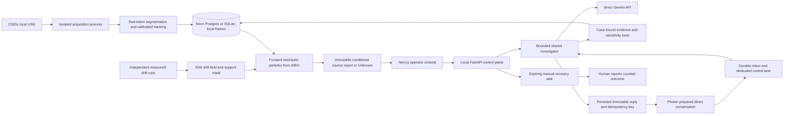

# Implemented software architecture

The authoritative hardware plan is the USB Webcam Edition 5.0 PDF in this repository. The application has no serial driver, motor/pump command, gantry, ESP32 camera, or cloud video dependency. The existing pump circulates water on its original wall cord. The software observes, estimates, investigates and records a human response.

Python owns all scientific scores, camera freshness, case revision, task transitions and database transactions. The browser and LLM cannot supply numeric source scores. The source estimator accepts permitted observations and candidate geometry, not release truth. Source truth lives only in the evaluator file. A source ranking remains conditional on the declared model/candidates/age prior.

The numerical core uses one forward advection–diffusion simulator. Recorded moving history uses correlated position residuals; first-seen-retained observations use retained-arrival support across unknown release ages. Unsupported geometry, poor fit, weak separation, invalid calibration or assumption sensitivity revoke ranking. It never claims that reversing arrows creates a reverse-time posterior.

The API runs one worker on loopback. The USB camera is isolated in a spawned process with a bounded latest-frame queue; failed/stale acquisition cannot block an agent or STOP ingress. OS permission and actual delivered frame mode require hardware commissioning. A five-second observe-again tool persists new recordings without silently joining identities across a gap.

Postgres (or SQLite) stores append-only profiles, calibrations, estimates, analyses and investigations; mutable cases/actions use transactions and revisions. Inbox IDs deduplicate reception. The immutable outbox key/body/route is saved before sends; leases recover interrupted jobs. Photon control commands have a dedicated processor and strict grammar, independent of the conversational model wait. Only an authorized direct route may select its preassigned case IDs. One data directory is bound to one Photon project.

A proposal is a human manual-net task, not motor execution. Replay and synthetic cases cannot create one. Approval rechecks expiry, current evidence/revision, camera session/freshness and rig validity. STOP cancels pending software tasks and does not cut AC power. Failed/cancelled agent invocations cancel their own orphan proposals. Recovery or an operator-reported disturbance requires new measured drift and a physical configuration check before live use resumes.

Public geographic datasets live in a separate ocean package and are not fed into tank-centimetre code. Copernicus authentication/data download and real Gemini/Photon account calls require the team's accounts; absent credentials are disclosed readiness failures, never simulated as live service success.

## Satellite context and spoken evidence

The case workspace reads a pinned historical NOAA Coral Reef Watch DHW sample through
`GET /api/v1/research/satellite-context`. It is a separate ecological-context panel;
there is no path from heat stress to the tank estimator's likelihoods or priors.
`GET /api/v1/cases/{id}/briefing` produces a fixed script from the current immutable
source report plus that independent context. An operator click on
`POST /api/v1/cases/{id}/briefing/audio` invokes the server-only xAI TTS adapter when
explicitly enabled. Case locks, revision checks and an atomic receipt commit prevent
publishing results after STOP or a changed case. Permanent credentials never enter the
browser; no background narration, retries, messages or actuation occur. Voice is
currently disabled by the user's choice to finish without a live key.

The Data Lab additionally exposes `GET /api/v1/research/training-diagnostic`, developed
with Grok in Cursor. Its five overlapping prefix origins use only the first eighteen
NOAA positions, keep the original six-hour holdout report unchanged, and cannot justify
model promotion or generalization claims. See `grok-ml-diagnostic.md` for provenance and
review corrections and `grok-space-context.md` for the source/API contracts.

The workspace uses private Postgres schema `reeftrace_workspace`; preserved legacy `/v1` records use `reeftrace`. Existing data is not silently converted or uploaded.
