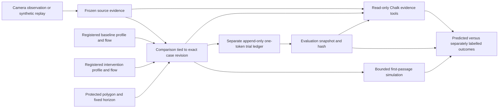

# Tracing to prevention

ReefTrace asks two separate questions: which declared source fits the observed trajectory, and which interception layout is predicted to reduce arrivals at a declared protected zone? A comparison can remain useful when source identity is Unknown because it checks every declared source instead of weighting them by uncalibrated source-support scores.

The zone is a polygon on the tank water plane, measured in centimetres. It is a proxy receiving area. This implementation does not measure coral injury or establish an ocean cleanup benefit.

## One-minute software demo

1. Start `python scripts/dev.py`, open the local dashboard and connect the local operator token privately. Keep `PHOTON_ENABLED=false`.
2. In **Investigations**, load the existing tracing demo and show the ranked trajectory and Unknown retained endpoint.
3. Open **Prevention** and load its explicitly synthetic demonstration. It freezes two registered profiles: the baseline collector sits after the zone; the intervention collector sits upstream. Candidate sources and zone are identical.
4. Read the nominal model table and maps. A token entering the zone before collection still counts as an arrival. Every simulated particle remains in the denominator. Representative dashed paths are illustrations; full-resolution event calculations supply the table.
5. Inspect the outcome tables. The hand-authored demonstration outcomes exercise the ledger; they are not model predictions, actual tank observations or independent physical validation. Missing and unresolved outcomes widen the bounds. No physical trials have run.
6. Expand the creation form, select the demo source case and intervention profile, use a zone separate from sources and collectors, and freeze a new comparison. Log its next one-token trial. Retry protection reuses the exact submission key and payload; never release another token just because a request timed out.
7. Ask Chalk to explain the saved comparison and incomplete trial bounds. Its tool trace must read the source, comparison and evaluation artifacts. It cannot change either numerical report or source uncertainty. A gateway outage produces an explicit STOP while the deterministic tables remain available.

## Architecture and immutable lineage

`apps/estimation/reeftrace_estimation/prevention.py` owns deterministic layout comparison. It reuses the existing particle simulator, reflecting walls and perfectly absorbing collectors. A competing absorbing polygon identifies whether a collector or protected zone is encountered first, including within-step reflected segments. It runs nominal and matching predeclared uncertainty scenarios, with a fixed seed and shared time step. Recommendation requires positive worst-case simulated benefit across all sources/scenarios and completely supported paths. Any unsupported particle withholds a robust recommendation. There is no source-probability weighting or fitted reef-benefit model. See [the numerical contract](prevention-physics.md).

`PreventionService` owns registered profile checks, frozen plans, the separate trial ledger and evaluation snapshots in local SQLite. Comparisons bind exact source evidence and case revision; trials never enter `CaseInput` or alter source ranking. An immutable comparison includes profile and flow hashes. Trial keys are bound to comparison and exact payload; changed retries are rejected. STOP and source recomputation archive the plan for reading and reject new writes.

The dashboard `prevention-workspace.tsx` owns the prevention view. The local operator token authenticates writes. API/provider credentials remain on the server. Browser trial retries retain the exact pending payload in tab-local session storage until confirmed. This is a local single-operator experiment, not a multi-user hosted field platform.

## API contracts

| Method and path under `/api/v1` | Purpose |
| --- | --- |
| GET `/prevention/comparisons` | Comparison summaries, including archival status |
| POST `/prevention/comparisons` | Freeze case, two profiles, zone, horizon, particle count and trial quota |
| GET `/prevention/comparisons/{id}` | Frozen comparison, ledger and exact evaluation snapshot |
| POST `/prevention/comparisons/{id}/trials` | Append an idempotent one-token outcome |
| POST `/prevention/comparisons/{id}/investigate` | Bounded read-only Chalk review of the exact evidence snapshot |
| POST `/prevention/demo` | Reopen or create a clearly synthetic rehearsal, without hardware |

All POST routes require operator authentication. Invalid/stale state returns a conflict; malformed schemas are rejected before writes. Creation uses a bounded worker off the event loop and checks freshness again before saving. Trials use short SQLite transactions. Chalk receipts atomically recheck both case revision and trial snapshot hash after the network turn.

## Physical experiment protocol

Use the existing overhead USB webcam, laptop, tank, manual pump and mesh. No electronics, motors or autonomous controls were added. Establish the protected polygon with the same approved water-plane calibration used by each layout. Register and validate separate measured drift fields for baseline and intervention; moving a mesh can change water motion. Both fields require distinct immutable measurement artifacts and nonoverlapping training/validation recording sets across layouts. Copying the baseline flow into the intervention is rejected.

Freeze the plan before observations: same token class, bounds, source regions, horizon and quota. The default is three sources, two layouts and five independent releases per cell: thirty trials. The recorded sequence counterbalances layout order but is not randomized; current results remain a descriptive pilot. Start each trial with one recovered token at its declared source; wait for stable flow and avoid other tokens in the scene. Observe for the fixed twenty-second horizon. Keep known release labels only in the evaluation ledger.

Record first zone entry, interception before entry, no entry during the full horizon, or unresolved. A captured token must remain intercepted through the horizon to count as prevention. A later pickup cannot undo an earlier arrival. Full-horizon observation and token accounting are mandatory for no-entry and interception outcomes. Physical trials require explicit operator confirmation and measured layout profiles. A linked recording is provenance, not automatic outcome verification. Lost tracking or an unaccounted token is unresolved, never prevention.

A linked recording must belong to the stated measured layout and have timestamped frame lineage showing it began after the plan was frozen. One recording can represent only one release across the ledger. Reusing footage or attaching a pre-plan capture is rejected atomically; an exact retry of an already saved trial remains idempotent.

The evaluation separately reports actual released counts and planned slots, entries, captures, unresolved outcomes and accounting. Planned bounds treat unexecuted and unresolved slots as unknown; released-only bounds include every actual release. Baseline entry bounds minus intervention bounds give conservative effect bounds. Bounds spanning zero do not establish improvement. These are descriptive uncertainty bounds, not statistical confidence intervals; even a completed pilot does not prove causal reef benefit.

## Chalk and Photon

The existing Chalk gateway remains the model interface. The prevention investigator permits only `get_case`, `get_source_evidence` and `get_prevention_evidence`. A non-STOP answer must have read all three and cite the exact source, comparison and evaluation IDs. Raw trial notes are not model instructions. The model receives the deterministic aggregate evaluation, never authority to alter measurements or operate hardware. Original request, whole-turn and tool-call budgets still apply. A concurrent trial, STOP or source revision invalidates a slow answer before commit.

Photon's prepared integration is unchanged and replies remain disabled. This slice does not enqueue or send messages. No runtime xAI API call is needed for this workflow; Grok web was used for development review, which is separate from live Voice API eligibility.

## Verification

Run the repository Python suite, Ruff, dashboard Node tests, lint, generated route types, TypeScript and production build. New regressions cover event order, thin zones/reflections, unsupported paths, frozen geometry, independent measured profiles, origin segregation, full-horizon observations, ledger idempotency and concurrent case/trial changes.

With services running, `python scripts/e2e_prevention.py` exercises actual HTTP creation, trial submission and retry, conflict rejection, conservative unresolved bounds, a real bounded Chalk call, STOP and readable archival history. It refuses to run if Photon or the camera is active. It creates only synthetic outcomes and writes a report to ignored `work/e2e-prevention.json`. Provider availability and physical validation remain separate from software test success.
