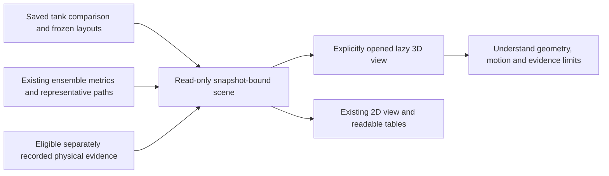

# Tank comparison in 3D: expected motion and recorded evidence

**Implementation status: locally verified, including the browser and live Chalk.**
The lazy 3D view, saved-scene controls and mobile layout have been exercised in the
local application. The complete local test run passed against the same source
files; an exact integration commit, hosted CI and deployment remain separate
publication-time checks. This is not a commissioned tank experiment or a measured
accuracy claim. The existing saved comparison and trial ledger remain authoritative.

## What this view is for

The tank view makes a saved prevention comparison understandable: where a
token could begin, where a mesh collector sits, where the protected receiving area
is, and which representative modeled paths encounter those objects first. When an
eligible physical recording exists, it can show the separately recorded motion
without turning a simulation into an observation.

It addresses three different questions:

1. **Understand the planned rig:** inspect the tank surface, declared sources,
   protected zone, collector and schematic equipment.
2. **Inspect the expected result:** switch between the two frozen layouts and
   replay illustrative paths from the saved numerical report.
3. **Inspect recorded evidence:** read separate physical track segments and gaps,
   alongside the existing trial accounting, when eligible evidence is present.

The rendering does not recompute water flow, infer an unmeasured release time,
change a layout or produce a new environmental-effect estimate. An informative
3D scene is an explanation of the available evidence, not a hydrodynamic digital
twin or a validated underwater robot.

## Where it belongs in the application

The entry point is **Prevention → Tank experiment & trial ledger**,
inside the selected saved comparison, followed by **Open 3D tank**. It complements
the existing 2D comparison and numerical tables. The ocean changing-current
comparison remains a separate mode with different units, sources and assumptions.



Opening or closing this view does not record video, start a camera, append a trial,
change a profile, enable messaging or operate a pump. Camera capture and trial
submission keep their existing explicit controls and authorization gates.

## The planned physical components

The scene draws the same basic rig planned for the experiment:

| Component | Meaning in the view | Physical/evidence limitation |
| --- | --- | --- |
| Container/bin | Boundary around the measured water plane | An illustrative wall/depth does not establish the actual container dimensions or water depth. |
| Overhead USB webcam | Schematic dry camera above the surface | The locally verified C270 preview is not a calibrated tank measurement. A depiction does not prove the camera is currently connected, fixed or aligned. |
| Manual pump and tubing | Schematic source of circulating flow | The existing pump is powered manually. The picture supplies no measured discharge, nozzle direction or flow-speed value. |
| Mesh collector | Registered absorbing pocket geometry for the selected layout | The numerical model assumes perfect absorption; real retention, escape and flow changes require independent trials. |
| Protected coral/receiving-area proxy | The saved protected surface polygon, with an illustrative coral shape | It marks a receiving area; neither coral depth, injury nor ecological benefit is measured. A physical coral ornament is not required to calculate a polygon. |
| Floating token | A representative modeled sample or separately labeled recorded object | A rendered token is not automatically a piece of plastic, a complete ensemble or a measured physical release. |

The scene is not a purchasing record or a mechanical assembly measurement. Follow
the [current product guide](https://github.com/Jose-Gael-Cruz-Lopez/reeftrace/blob/main/docs/tideward-product-guide.md),
[rig guide](https://github.com/Jose-Gael-Cruz-Lopez/reeftrace/blob/main/docs/tideward-rig-guide.pdf)
and [field commissioning protocol](https://github.com/Jose-Gael-Cruz-Lopez/reeftrace/blob/main/docs/field-commissioning.md)
for inventory, connections and the measured setup. The existing pump's power
connection remains separate from the laptop/webcam connection.

## Coordinate and geometry contract

Scientific tank positions use **x/y on the water surface, in centimetres**. A
valid camera homography maps image pixels to that same approved surface plane.
Pixel-grid coordinates alone are not centimetres. Origin, bounds and source/zone
coordinates must come from the saved comparison and its validated profile; the
renderer must not invent them from a photographed container or its apparent size.

The transport surface is **z = 0**. Actual depth is **unknown/null**. Container
walls, water thickness, camera height, tubing, pump body, collector thickness and
coral shape have schematic visual dimensions. They must be labeled schematic and
must not add inferred 3D fluid motion, vertical token motion, underwater tracking,
refraction correction or volume/flow-rate measurements.

The two layouts are immutable choices already stored in the comparison. Selecting
baseline versus intervention changes what is displayed; it does not drag a mesh,
rewrite a collector polygon, refit a flow field or save a new design. Rotating and
zooming move the viewer's camera, not the physical rig or its approved calibration.
Panning is disabled. Arrow keys orbit the view, and Home resets it.

Moving a real mesh can alter water motion. A measured experiment still needs
separately measured and independently validated flow fields for each layout. The
visual model cannot derive that change by moving a 3D object.

## Expected paths and full numerical results

Expected paths are copied from the existing frozen report. The server supplies
the report's **representative nominal samples**, bounded by its existing limit of
up to six paths per source/layout and up to 80 points per path. Unsupported samples
are withheld, and displayed histories are clipped to existing supported samples
before the first event or horizon. The scene discloses withheld or incomplete
representative coverage. An unsupported path has no displayed points and a null
display-stop time; an attractive continuation is never substituted.

Saved event times are **time-node upper bounds, not exact collision times**
(`TIME_NODE_UPPER_BOUND_NOT_EXACT_COLLISION`). A last supported display point or
token disappearance is not an exact mesh impact or protected-zone crossing. The
scene does not invent a collision marker between saved samples.

The table's arrival/capture fractions, conservative bounds and recommendation
come from the **full numerical ensemble**, not from the handful of visible tokens.
Changing a source/path checkbox never changes a denominator, confidence value,
trial result or scientific recommendation. Do not count visible 3D objects and
present that count as the full model result.

Playback interpolates only the saved display polyline for visual continuity. There
is **no second JavaScript physics engine**, stochastic animation, new particle
release, generated trajectory or client-side re-estimation. A smooth animation
does not create finer measured temporal resolution. Retained/end-event display
must not fabricate a continuation beyond the supported saved history.

Flow arrows, when shown, are a **static supported sample of the frozen IDW field**
for the selected tank layout. They are model-field illustrations, not live pump
telemetry, measured volumetric flow, CFD streamlines or proof of unsteady ocean
currents. Unsupported flow locations must remain visibly unsupported.

The numerical assumptions remain those of the
[existing prevention method](https://github.com/Jose-Gael-Cruz-Lopez/reeftrace/blob/main/docs/prevention-physics.md):
surface transport, declared stochastic discrepancy/dispersion, reflecting walls,
perfectly absorbing collector pockets and first protected-zone entry. A collection
after zone entry cannot become prevention because the animation later hides it.

## Recorded evidence: a separate layer and a separate clock

The backend admits only linked physical recordings that satisfy the
existing measured-profile, calibration, camera-session, prospective-recording and
unique-recording lineage checks. A manually entered ledger outcome or a synthetic
demonstration does not create an actual track. This build has no commissioned real
tank recording; the recorded layer remains empty when no eligible recording exists.

Every admitted frame must carry a positive sequence number, a finite capture
elapsed time, a finite monotonic receipt time and a timezone-aware UTC receipt.
Sequence, elapsed time, monotonic time and UTC receipt must increase strictly.
The monotonic-minus-elapsed origin must agree within **1 microsecond** and the
UTC-minus-elapsed origin within **1 millisecond** across the recording. Missing or
contradictory legacy clocks are rejected with HTTP 409; they are not repaired,
resampled or silently shifted. These are clock-consistency admission tolerances,
not measurements of exposure timing, camera latency or release alignment. The
existing 2D recording display remains separate from this stricter scene admission.

An eligible recording contributes its timestamped track **segments and gaps**.
Missing detections, tracking ambiguity, a second token or invalid mapping must not
be bridged into an invented continuous curve. A gap remains missing evidence,
even if the endpoints can be connected attractively in 3D.

The scene distinguishes **not captured**, **reported counts only**, and
**recorded tracks available**. Counts can exist without a visible track, and a
gap-only recording can retain its metadata without becoming a trajectory.

The recorded trace clock is **CAPTURE_START_UNALIGNED**: elapsed time from capture,
not a verified token-release timestamp. The modeled clock is elapsed time from the
declared release. These clocks are not automatically interchangeable. A matching
layout, trial or source label does not establish time alignment or reliable
cross-gap object association.

Consequently:

- Do not animate the recording as a synchronized predicted-versus-actual release
  unless an explicit validated release anchor exists.
- Positional errors/RMSE and matched-time residuals remain **null/unavailable**;
  do not turn proximity on screen into an accuracy score or treat null as zero.
- Any recorded path displayed beside a forecast must visibly retain its own
  capture-relative clock and evidence status. A static complete recorded trace
  is not evidence that every point happened at the current model playback time.
- The trial's separately recorded outcome and accounting remain visible in the
  ledger. A linked recording supports provenance; the picture alone does not
  independently verify human-entered entry, retention or no-entry assertions.

This distinction is the useful comparison today: **what the frozen model expects**
versus **what evidence was actually recorded and what is still unaligned or
missing**. A measured forecast-error study needs an additional release-time and
tracking protocol before the app can report paired positional errors honestly.

## Read-only scene API and freshness

The read-only route under `/api/v1` is:

```text
GET /prevention/comparisons/{comparison_id}/scene
    ?evaluation_snapshot_hash=<selected detail's 64-hex snapshot hash>
```

It binds the scene to the exact selected comparison detail/evaluation identity.
Synthetic scenes can be read publicly in the local app; measured-tank scenes
require local operator authentication. Operator credentials stay in the existing
private configuration and must not be embedded in scene URLs, exported screenshots
or public docs.

The response contains saved x/y geometry, representative timed
paths, unchanged full-ensemble statistics, supported frozen-field vectors and a
separate eligible recording layer. It must not expose camera frames, device file
paths, provider secrets or unrelated recordings. The scene is a projection of
existing evidence, not a new observation or scientific report.

A stale snapshot, concurrent trial update or source revision must not silently
attach old geometry or recorded evidence to new statistics. Show the stale/missing
state and refresh from the newly selected detail explicitly. Do not select another
comparison or recording behind the user's back. STOP/archival rules remain those
of the existing application: readable history is distinct from permission to write
new trials or perform live actions.

## Walkthrough and controls

1. Open a saved **Tank experiment & trial ledger** comparison. Check its synthetic
   versus measured label and the protected zone.
2. Select **Open 3D tank** explicitly. Read the short schematic-depth and evidence
   disclosure before interpreting a token's height or the drawn equipment.
3. Under **Layout**, select **Baseline** or **Intervention**. Under **Release
   source**, select **All declared sources** or an individual source. Compare
   the declared collector/zone positions against the unchanged numerical table.
4. Use **Play saved path**, **Pause** or **Replay**, the **Model elapsed time**
   slider, and **Speed** (0.5×, 1× or 2×) to inspect **model-relative time**.
   Pause and inspect first-event order; do not infer event timing from animation
   smoothness.
5. Toggle **Saved paths**, **Coordinate grid**, **Labels**, **Frozen flow vectors**
   and **Schematic equipment** to reduce overlap. Use **Overhead** for the top view
   or **Reset 3D view** to restore the initial perspective. Drag or use arrow keys
   to orbit; Home also resets the view. Keep source/layout colors and legends
   consistent with the 2D view.
6. The **Playback clock** starts at **Model release · t = 0**. **Recorded capture ·
   separate clock** is disabled without eligible track segments. If available,
   select that separate clock and a **Recording**; its slider becomes **Capture
   elapsed time**. Read gaps and the unaligned-capture notice. Recorded playback
   holds recorded samples within continuous segments rather than interpolating
   across missing detections; absent actual evidence stays absent.
7. Return to the full table and trial ledger for all particles, planned/released
   denominators, unresolved outcomes and conservative effect bounds. A view toggle
   or playback operation never appends a trial.

Changing the layout or source pauses playback and resets the relevant capture
selection/time. It does not align the two clocks. **Close 3D tank** releases the
canvas and returns to the existing 2D/table view. A missing operator connection
shows **Connect operator** for protected measured scenes; a stale/error response
offers **Reload the saved scene**. A graphics failure offers **Retry 3D graphics**
while the 2D comparison remains available.

The local browser demonstration used a saved **synthetic** 40 × 30 cm scene, a
20-second model horizon, three sources and 100 particles per source/layout. Its
all-source predicted protected-zone entries were 300/300 for Baseline and 0/300
for Intervention. Selecting Source B showed 6/6 representative routes while
retaining those all-source headline counts. These are synthetic model outputs,
not tank measurements or evidence of real collection efficiency.

The same browser check exercised layout/source selection, saved-path and vector
checkboxes, arrow-key orbit, reset/overhead controls, and keyboard scrubbing to
6.00 / 20.00 seconds. The recorded clock was disabled because there were zero
physical tracks. Opening created one canvas; closing removed it. At a 390-pixel
viewport the page had no horizontal overflow. Playback also reached the saved
horizon without a new browser error. These local checks are not a deployment or
physical-validation claim.

## Performance, accessibility and fallback

The renderer is a **lazy Three.js view**, loaded only on explicit open.
The existing blue, sharp-corner interface and readable 2D/tables remain usable
without WebGL. If the renderer cannot initialize, show an explanation and keep the
2D evidence available rather than blocking the comparison.

Rendering responds to changed view/playback state, uses a capped device pixel
ratio of 1.5, and avoids a permanent idle animation loop. Orbit controls use no
continuous damping. Playback updates are bounded to 30 Hz and run only while the
scene is playing, visible on screen and in a visible browser tab. Reduced-motion
preferences disable play while keeping manual scrubbing usable. Pausing, hiding
or closing stops unnecessary animation; renderer resources and controls are
disposed on teardown. No USB preview is duplicated and no live camera is polled
to animate this scene.

Play/pause, scrubbing and toggles need labeled accessible controls and a readable
legend. The scene cannot be the sole place to learn the recommendation, units,
missing data or validation limits; those remain available as text and tables.

## Verification status and unfinished physical work

The complete local run passed **1,549 Python tests, 208 frontend tests and 142
guarded HTTP checks**, with zero HTTP failures and six deliberately blocked
external scopes. Ruff, ESLint, route-type generation, TypeScript and the production
build passed. The verification receipt confirms the production source files
matched the isolated tested copy, with no code changes after that copy. These
checks include the read-only scene, admission/failure contracts and existing
software workflows; the six blocked scopes are not presented as verified live
features.

A separate actual browser run exercised WebGL and the controls described above.
The app's live Chalk response used `get_case`, `get_source_evidence` and
`get_prevention_evidence`, cited the selected saved evaluation, retained source
identity **UNKNOWN**, and explained that the favored simulated layout is
conditional on the flow/perfect-capture assumptions. It explicitly identified zero
physical trials and missing independent release, capture/escape, flow and token
accounting evidence. Chalk explained the saved result; it did not compute a new
trajectory, establish a causal effect or validate the 3D animation.

The [separate local execution receipt](https://github.com/Jose-Gael-Cruz-Lopez/reeftrace/blob/main/docs/grok-evidence/tank3d-local-verification.json)
contains the tested source hashes, software counts, browser checks and live Chalk
evidence. Its capture-time hosted-CI field is pending; use the maintained Trov
documentation hub for later exact-commit and hosted-CI status. Local tests, hosted
CI, provider verification and physical evidence must remain separate. At this
checkpoint the camera was stopped, Photon retained its existing enabled setting,
no new Photon message was requested, and no xAI API call or billing change occurred.

Physical validation still requires a fixed dry webcam, a measured water-plane
mapping, stable lighting and token detection, separately recorded layout flows,
independent drift validation, a frozen plan, new one-token releases and complete
released/recovered/outcome accounting. True paired trajectory errors additionally
require a validated release anchor and reliable identity through the observation.
No 3D rendering can replace those measurements.

The separate matched-current NOAA/HYCOM research does not validate this tank
scene. Its [original design](matched-current-study-plan.md) is historical;
the preserved [v1 attempt](matched-current-results.md) scored **0/36** cells after
compatibility failures. The separately frozen [v2 study](matched-current-v2-results.md)
acquired its planned inputs and scored **36/36** cells across two buoy groups.
Current-only RK4 had larger mean errors than last observed drift on that small
retrospective sample. Those are processed ocean-buoy results, not observed tank
paths, plastic forecast skill or measured interception benefit. Synthetic
reader/evaluator tests remain software-contract checks.

This guide contains no shared-chat transcript, private contribution quotations,
credentials, contacts, camera frames or raw physical recordings. Provider,
messaging, paid-billing and hardware-control settings are unchanged by documenting
or viewing the simulator.
