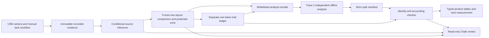

# Trace 3 integration: export, inspect, verify and explain

Jose owns this product/API/Chalk integration. Megana owns Trace 1 field evidence;
Aarush owns Trace 2 independent validation/model research. This implementation
mounts a shared contract without claiming either teammate's physical or scientific
work is finished. Photon replies, camera opening and hardware actuation remain off.

## What now works

1. Open Prevention and load the explicitly synthetic rehearsal, or select a current
   frozen comparison made from admitted profiles.
2. Connect the local operator token privately. Under Evidence export and validation,
   choose **Prepare evidence download**, then **Download evidence JSON**.
3. The browser verifies exact canonical bytes and the comparison/case/source/evaluation
   identities before enabling download. Private notes, trial keys, frames and model
   text are excluded. A content digest checks consistency, not authenticity.
4. **Load rehearsal manifest** selects existing records of one outcome origin. It
   creates no experiment or independent holdout. The manifest can be saved or edited
   locally. A local JSON file is only a draft until **Check and import manifest**.
5. The backend rejects extra metric/prose fields, wrong hashes, omitted/duplicated
   or overlapping split IDs, cross-origin claims and flow-recording leakage. It
   recomputes validation-only counts from saved ledger records. Original planned
   quotas remain denominators; development, unresolved and missing releases do not
   become validation successes. Empty validation partitions are rejected.
6. A current accepted receipt becomes the selected Chalk evidence. An explicit
   question reads case, source, prevention and validation tools and must cite their
   exact IDs. Changing the receipt clears the old answer. STOP or a concurrent
   ledger/source change prevents a stale answer from committing.
7. Saved reports remain readable as archives. New trials archive an older evaluation
   receipt; a stale manifest cannot be resubmitted against the current snapshot.

## Local architecture



The laptop API remains the control plane and SQLite owns immutable records. The
Next.js dashboard holds the operator token only in tab memory. Neither the export
nor the model can operate the pump. No additional service, trained detector,
automatic messaging worker or hardware purchase is introduced.

## API contracts

All paths below are under `/api/v1/prevention/comparisons/{comparison_id}` and
require the existing operator bearer token, including private evaluation reads.

| Method / path | Result |
| --- | --- |
| GET `/export` | `analysis_bundle_v1`: payload, exact `payload_canonical_json`, SHA256, detached export/archive metadata |
| GET `/validation-template?origin=SYNTHETIC_DEMO` | Direct strict `validation_report_v1` rehearsal manifest using existing origin trials only; empty-origin request fails |
| POST `/validation-reports` | `{report: manifest}` → immutable accepted receipt; exact retries are idempotent |
| GET `/validation-reports` | Saved receipt summaries for this comparison |
| GET `/validation-reports/{report_id}` | Accepted typed summary/checks plus current/archive status; cross-comparison IDs rejected |
| POST `/investigate` | `{text, validation_report_id?: string}` → bounded read-only Chalk review |

Use `schemas/evidence_export.py` and `schemas/validation_reports.py` as the exact
contract. `tests/fixtures/team_handoff/analysis_bundle_v1.json` is a small synthetic
interoperability example. Do not replace it with personal or physical data.

The public payload hash covers the exact ASCII compact sorted JSON string. JavaScript
may parse `1.0` as `1`; do not recompute a different hash with `JSON.stringify(payload)`.
The browser verifies semantic agreement with the parsed payload while retaining
and downloading the original canonical bytes. The original evaluation snapshot
hash is opaque because its private original ledger is not the redacted export.

A validation manifest contains only schema version, comparison ID, public payload
hash, evaluation hash, layout origin, outcome origin, bounded protocol ID, purpose,
and the two exact trial-ID partitions. `CONTRACT_REHEARSAL` and
`DECLARED_VALIDATION_SPLIT` have different labels. Both receive
`IDENTITY_AND_ACCOUNTING_CHECKED_METHOD_NOT_RERUN`, not a claim that an external
method, physical independence or preregistration was verified.

## Chalk connection and failure behavior

A provider credential, a Chalk gateway key, the matching environment header and
an allowed model are distinct. Sponsor keys route through the sponsor environment;
creating a personal Gemini connection is unnecessary for that route. Never copy a
key into the repository, UI, Trove, Grok or a support message. Store it only in the
ignored local credentials file and `.env`.

On 17 October the sponsor example model returned HTTP 403, while authenticated model
discovery returned `openai/gpt-6-sol`; a bounded completion and a complete four-tool
ReefTrace review succeeded using that model. These are local observations, not a
promise that another team's key has identical permissions. Discover permitted
models through the key's own `/models` endpoint rather than guessing model IDs.

Chalk documents separate key scopes, budgets and rate limits in its
[Model Gateway guide](https://docs.chalk.ai/docs/model-gateway). A sponsor statement
that keys are not credit-limited does not imply unlimited request rate. ReefTrace
uses a 1,024 completion-token cap, at most nine model calls, a 25 second request deadline
inside a 60 second turn, and no automatic retries. A provider failure yields STOP
and safe status diagnostics while deterministic evidence remains available.
Selected receipt review exposes server-generated counts/checks/fixed limitations,
not imported protocol prose, split trial IDs, keys or raw records to the model.

## Build and test

Run offline checks with sponsor adapters disabled by the test fixtures:

```sh
.venv/bin/python -m pytest -q
.venv/bin/python -m ruff check apps adapters scripts tests
.venv/bin/python -m pip check
cd dashboard
node --test tests/*.test.mjs
npm run lint
npx next typegen
npx tsc --noEmit
npm run build
```

Do the production build in an isolated copy if a live Next dev server is active.
Start the existing launcher with `.venv/bin/python scripts/dev.py`; never open a
second camera-owning worker. `scripts/e2e_validation.py` uses loopback HTTP,
synthetic releases and one explicit bounded live Chalk turn. It rejects a starting
state with Photon, camera, actuation or Voice enabled. It exports, imports, rejects
forged metrics, checks history, reviews a receipt, appends a synthetic trial,
proves stale-report rejection, and STOPs its own disposable source case.

Physical camera commissioning and independent tank trials remain unfinished until
the team actually performs them. Follow `docs/trace3-research-and-contract.md` for
release/session holdouts and small-pilot limitations; do not replace those steps
with a larger LLM or more simulated particles.
