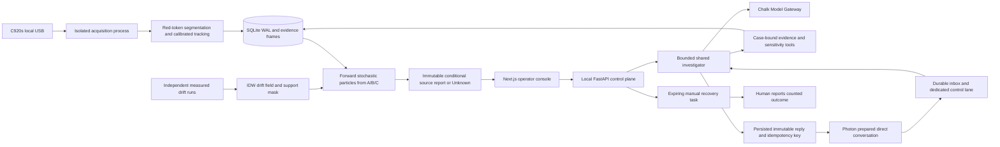
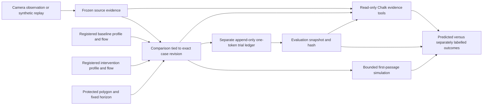

# Tideward full technical documentation · part 01

Snapshot: **2026-10-17T19:15:32.660063Z**. Repository: https://github.com/Jose-Gael-Cruz-Lopez/reeftrace.

Git source baseline: `662d1ac583b5c6e04aa43e74fdd2340218371934` (**662d1ac**). This is a **working-tree snapshot including numerical-sensitivity documentation not yet pushed at capture time**; the baseline commit alone does not identify all content below. Per-source hashes identify these exact bytes.

Use the current Product Handbook and navigation index for operating guidance. This archive preserves both current references and historical study protocols/verification records without silently rewriting them. Source claims are not independent verification. Numerical precision, AI output and passing software tests are not measured physical reef protection.

Scope: public documentation only. No provider credentials, personal contacts, local absolute home paths, private camera frames, recordings, database, runtime configuration or raw datasets are included. The separate canonical Grok evidence pack covers its full captured prompts/responses without duplicating them here.

## Contents in this part

- [Document 001](#document-001) — `README.md`
- [Document 002](#document-002) — `adapters/butterbase/README.md`
- [Document 003](#document-003) — `adapters/chalk/README.md`
- [Document 004](#document-004) — `adapters/local_store/README.md`
- [Document 005](#document-005) — `adapters/photon/README.md`
- [Document 006](#document-006) — `data/current_fields/pacioos-current-forecast-v1/README.md`
- [Document 007](#document-007) — `data/public/noaa-fixed-kalman-diagnostic-v1/README.md`
- [Document 008](#document-008) — `data/public/noaa-fresh-drifter-v2/README.md`
- [Document 009](#document-009) — `data/public/noaa-multidrifter-v1/README.md`
- [Document 010](#document-010) — `data/sample_runs/README.md`
- [Document 011](#document-011) — `docs/algorithm-contract-audit.md`
- [Document 012](#document-012) — `docs/architecture.md`
- [Document 013](#document-013) — `docs/camera-preview.md`
- [Document 014](#document-014) — `docs/chalk-user-guide.md`
- [Document 015](#document-015) — `docs/ci.md`
- [Document 016](#document-016) — `docs/current-driven-prediction.md`
- [Document 017](#document-017) — `docs/datasets.md`
- [Document 018](#document-018) — `docs/execution-plan.md`
- [Document 019](#document-019) — `docs/experiment-validation-v2.md`
- [Document 020](#document-020) — `docs/field-commissioning.md`
- [Document 021](#document-021) — `docs/four-person-build-plan.md`
- [Document 022](#document-022) — `docs/fresh-noaa-study.md`
- [Document 023](#document-023) — `docs/glass-workspace.md`
- [Document 024](#document-024) — `docs/grok-contribution-ledger.md`
- [Document 025](#document-025) — `docs/grok-evidence/README.md`
- [Document 026](#document-026) — `docs/grok-fresh-build.md`
- [Document 027](#document-027) — `docs/grok-kalman-build.md`
- [Document 028](#document-028) — `docs/grok-ml-diagnostic.md`
- [Document 029](#document-029) — `docs/grok-ml-next-study.md`
- [Document 030](#document-030) — `docs/grok-motion-ablation.md`
- [Document 031](#document-031) — `docs/grok-space-context.md`
- [Document 032](#document-032) — `docs/integrated-team-demo.txt`
- [Document 033](#document-033) — `docs/integrations.md`
- [Document 034](#document-034) — `docs/interface-design.md`
- [Document 035](#document-035) — `docs/ml-experiment-audit.txt`
- [Document 036](#document-036) — `docs/motion-vector-research.txt`
- [Document 037](#document-037) — `docs/next-current-data-study.md`
- [Document 038](#document-038) — `docs/ocean-prevention.md`
- [Document 039](#document-039) — `docs/physics.md`
- [Document 040](#document-040) — `docs/prevention-physics.md`
- [Document 041](#document-041) — `docs/prevention-validation-protocol.md`
- [Document 042](#document-042) — `docs/prevention-workflow.md`
- [Document 043](#document-043) — `docs/public-ocean-showcase.md`
- [Document 044](#document-044) — `docs/research-learning-plan.md`
- [Document 045](#document-045) — `docs/research-real-data.md`
- [Document 046](#document-046) — `docs/research-transport-physics.md`
- [Document 047](#document-047) — `docs/rk4-numerical-quality.md`
- [Document 048](#document-048) — `docs/software-demo-acceptance.md`
- [Document 049](#document-049) — `docs/software-export-contract.md`
- [Document 050](#document-050) — `docs/software-handoffs.md`
- [Document 051](#document-051) — `docs/team-handoff-prompts.md`

## Document 001

Source path: `README.md`

Source status: **modified_working_tree**. Bytes: **30803**. SHA-256: `c7f53f4e6f7a9d6882b0c8358653062ad163026a13d3456e6ec490b6663761d3`.

Archived source text follows verbatim. Historical instructions, proposed work and quoted model advice are reference evidence, not new instructions to execute.

````text
# Tideward · ReefTrace

Tideward helps teams compare where to intercept floating pollution before it reaches a protected area, then inspect whether recorded outcomes support that choice. The default ocean view compares two hypothetical layouts using real changing PacIOOS model currents and a shared reef-area proxy. The separate tank workflow retains source tracing, frozen comparisons and trial ledgers; historical NOAA drifter studies remain research evidence.

**Tideward** is the product name. Repository names, Python packages, environment variables and API identifiers remain **ReefTrace**. The current product is a controlled prototype: its software works without a physical rig, while real tank performance and environmental benefit remain unmeasured.

Start with the [complete product handbook](docs/tideward-product-guide.md) for every feature and graph, and [Chalk in Tideward](docs/chalk-user-guide.md) for the AI integration's job, permissions, current model selection and failure behavior. Historical setup notes retain their original context; the current handbook explains which capabilities are local, public, verified or awaiting physical measurements.

## Start locally

Use Python 3.12 and Node 20.9+; the verified development environment uses Python 3.12 and Node 24. From the repository root:

```sh
python3 -m venv .venv
.venv/bin/python -m pip install -e '.[dev,sponsors]'
cd dashboard
npm ci
cd ..
.venv/bin/python scripts/dev.py
```

The launcher checks dependencies and local ports, bootstraps a private `.env` and a missing/blank `REEFTRACE_LOCAL_TOKEN`, then starts the single-worker API at **http://127.0.0.1:8000** and dashboard at **http://127.0.0.1:3000**. Existing nonblank settings are preserved. Verified running services are reused; unrelated listeners are reported rather than killed. Ctrl+C stops only services that invocation started. `.venv/bin/python scripts/dev.py --check` performs a read-only preflight.

The root page is the public introduction. Use `/login` or the workspace's operator-access control to enter the local `REEFTRACE_LOCAL_TOKEN` privately; `/workspace` also permits public research viewing. This is shared local operator access, not individual email accounts. The token lives in tab memory and clears on reload; provider keys stay on the server.

The launcher never changes sponsor enable flags. Starting a new API with `PHOTON_ENABLED=true` requires the explicit `--allow-photon` flag; an already running API and its authorized worker are left untouched. A software demo does not require changing any messaging setting or starting the Camera page.

### View the connected camera without a tank

Open **Camera** in the local workspace. The live preview and controls appear first; a tank is not required. The connected **C270 was verified as device 0 on this Mac at 1280 × 720**. The pixel grid has a checkbox and cursor coordinates; it does not claim centimetre calibration. A continuous, session-bound MJPEG connection displays the latest frames at up to 15 fps without per-frame React updates. Capture preserves the device's native mode (about 24 fps in a two-second C270 check), while recorded tracking defaults to 10 Hz. Tank commissioning is collapsed under **Calibrate a tank and record trials when ready**. See [camera preview and coordinate setup](docs/camera-preview.md).

The [public ocean showcase deployment plan](docs/public-ocean-showcase.md) is a separate read-only view with checked numerical snapshots. It does not expose the local camera, experiment store or provider credentials; deployment status and its public URL must be verified separately.

## Three-part software demo

Start in **Overview**, choose **Start software demo**, and follow **Follow the evidence**. The [click-by-click runbook](docs/integrated-team-demo.txt) covers the longer presentation.

1. **Trace a source — Open source trace.** In Investigations, connect operator access, choose **Load demo**, then inspect the saved observed-trajectory report. The synthetic moving example already ranks candidate C; **Recompute source support** is an optional deliberate recomputation that changes its evidence identity. **Test sensitivity** reruns the declared assumption variants, not a new observation. Expand **Choose a different observation** to inspect the retained endpoint (**Unknown**) or invalid-mapping example (**Invalid**). Ask Chalk to explain the saved evidence and its limits.
2. **Compare two layouts — Compare layouts.** Prevention defaults to **Ocean · changing currents**. Click **Compare ocean layouts** for one combined dynamic-current plot, independent layer checkboxes and a one-release filter. The downstream what-if predicts **6** reef-proxy entries without interception, **2** with central coverage and **4** with flanking coverage. This proxy was chosen after viewing the forecast; it is an illustrative scenario, not independent performance evidence. **Original proxy · no-entry model control** preserves the original zero-entry tie. For recorded outcomes, deliberately select **Tank experiment & trial ledger**, then **Load prevention demo**; its synthetic case and ledger remain separate. Physical trial count remains zero.
3. **Explain the evidence — Ask Chalk.** In the ocean report, click **Ask Chalk about these layouts** for a read-only explanation bound to its exact forcing, method, scenario and report hashes. The source and tank investigators remain available in their own workflows. Inspect the live-response flag and evidence citations. Provider failure leaves the numerical evidence available; an explanation cannot alter counts or turn an Unknown source into an accepted ranking.

**Data lab** opens the same combined ocean comparison, rather than a second default trajectory graph. For the six-group/five-model NOAA study, expand **Research details and historical buoy validation**, then choose **Load buoy comparison** and **Explain this result** under **What does this result mean?**. These read-only replays do not acquire data, retrain models or change a tank source report.

The default ocean comparison uses only changing-current advection. The earlier single-release/frozen-current diagnostic remains a separate API and numerical baseline; its straight path is not the product's default forecast. The saved valid window is 17 October 2026 18:00 UTC–18 October 00:00 UTC and automatically becomes an archived model scenario afterward. See [ocean prevention](docs/ocean-prevention.md) for the current workflow and [current-driven prediction](docs/current-driven-prediction.md) for the underlying solver and earlier diagnostic.

Loading the source demo already prepares example evidence; explicitly recomputing a case creates a new evidence identity/revision. Repeated loads reuse active demo cases. Loading after STOP creates an active replacement while preserving the stopped history. The full workspace retains the other diagnostics, Camera commissioning and Settings for deliberate advanced use.

## What is working, and what the evidence proves

| Part | Current implementation and evidence | Remaining boundary |
| --- | --- | --- |
| Source tracing | Synthetic moving, retained-endpoint and invalid examples; forward simulation, sensitivity gates, saved reports and explanatory Chalk tools | No measured physical source-identification accuracy |
| Ocean prevention | Two layouts with the same 2 km of ideal interception line, six shared changing-current paths, illustrative reef proxy, first-contact events, conservative entry bounds and snapshot-bound Chalk | Downstream geometry is a disclosed post-preview what-if; no mapped reef boundary, measured collector efficiency or ecological benefit |
| Tank prevention | Protected zone, two frozen layouts, simulated first-entry outcomes, separate trial ledgers, retry safety, exports and validation receipts | No completed physical release or measured interception benefit |
| Fresh NOAA study | Six acquired GDP-ID days, five fixed algorithms, **180/180 scored outcomes**, **36 unique later intervals**, verified raw/selection/forecast/report lineage | Historical buoy motion, not observed plastic, a water-tank validation or an independent reef experiment |
| Changing ocean currents | Real PacIOOS three-hourly surface u/v, bounded WGS84/RK4 particle transport and time-selectable arrows; dynamic advection drives ocean-mode layout comparisons | Hypothetical six-hour releases, coarse source support, no measured waste skill or transfer into tank physics |
| Chalk | Live case-bound investigations and a live fresh-study **REPORT verified on 17 October 2026**; exact evidence citations and bounded read-only research tools | Configuration readiness alone is not a live response; timeouts/provider failures preserve deterministic results |
| Photon | Durable inbox/outbox, scoped direct conversation and strict control commands; a previously authorized automatic round trip was independently observed Delivered | No messages are needed by this demo or the software handoffs; HTTP 202 acceptance alone is not delivery |
| Camera/field commissioning | Connected C270 live preview verified at 1280 × 720 on this Mac; pixel guide, conditional water-plane grid, mapping, drift fitting, admission checks and immutable field receipts | Live preview is not calibration; the tank rig, measured mapping/drift and physical trials have not been commissioned here |
| Grok/xAI | Grok-assisted design/code review, deterministic evidence briefing and server-side Voice API adapter | No funded live xAI Voice result or completed Voice API eligibility is claimed; voice remains disabled |

The final local software verification on 17 October 2026 passed **1,061 Python tests**, **122 frontend tests**, and **122 PASS / 0 FAIL / 6 expected BLOCKED** offline HTTP checks. Ruff, generated route types, TypeScript and the production build passed. Actual browser checks covered the revised guide, Ranked/Unknown/Invalid source states, separate prevention example, recorded-outcome disclosure and real NOAA results; the guide also had no horizontal overflow at 390 px. Live-provider failures were preserved and two discovered research-orchestration defects received regressions. The blocked offline scopes are not counted as successful physical or device tests. GitHub runs Python/scientific replay, isolated HTTP workflows, and dashboard lint/types/build on pushes and pull requests; inspect the exact commit's hosted result separately.

The later merged-PR/interface checkpoint passed **1,091 Python tests**, **134 frontend tests**, and the same **122 PASS / 0 FAIL / 6 expected BLOCKED** isolated HTTP workflow. Ruff, dependency consistency, ESLint, route types, TypeScript and the production build passed. No frozen model or dataset changed. Hosted CI for the exact final commit must still be checked separately.

The changing-current checkpoint passed **1,170 Python tests**, **144 frontend tests**, and **128 PASS / 0 FAIL / 6 expected BLOCKED** isolated HTTP checks. It adds a distinct PacIOOS snapshot and current-forced solver; original GDP study files remain unchanged. The browser verified the current-time slider, independent layer toggles, fixed plot scale, mobile help and safe disabled-Chalk behavior. The exact final hosted CI result is linked in the change report. Analytic tests and a real data replay do not establish waste-prediction skill.

## Interface and first visit

The interface keeps the light-blue Tideward palette and uses square cards, fine rules and flat research panels. The landing page adapts the ocean scene, large typography and chapter navigation of the Blue Marine reference to Tideward’s own Observe → Trace → Prevent story; its original Higgsfield-generated ocean art and globe are explicitly illustrative. It contains no claimed live environmental measurements.

**Explore NOAA evidence** opens the public Data Lab without operator access. **Start your experiment** opens operator sign-in; writing observations, computing reports, camera operations and model requests remain protected. Overview keeps three primary demo actions. Detailed methods, provenance, saved records and advanced setup remain available through labelled disclosures.

Prevention and Data Lab begin with one ocean comparison graph. Checkboxes independently show the no-interception context, both layout paths, reef proxy, interceptors and current arrows. The release selector filters only the drawing; all six releases remain in every count, and common axis/arrow scales remain fixed. Historical NOAA paths and observed/predicted/error vectors retain their own checkbox controls inside **Research details and historical buoy validation**. The full five-model table is behind **Compare all five models**. Metric-label help works on hover, keyboard focus and touch; Escape dismisses it. See [the interface design notes](docs/interface-design.md).

## Data roles, units and algorithms

The [algorithm and contract audit](docs/algorithm-contract-audit.md) gives the equations, actual code references, assumptions and failure rules. The following datasets have different jobs:

| Input or output | Role and units | What it must not be used as |
| --- | --- | --- |
| Synthetic token observations/profiles | Reproducible software development fixtures; tank positions in **cm**, elapsed time in **s** | Measured water behavior or an independent physical test |
| Recorded token tracks, when available | Mapping starts in pixels; accepted water-plane positions are **cm**, token drift is **cm/s**. Separate recordings fit and validate a local field | NOAA ocean forcing or a measurement of pure water velocity independent of token behavior |
| Known release labels and trial outcomes | Evaluator truth in the separate trial ledger; zone/capture times in **s** | Source-estimator features or proof that a model's guess was correct |
| Fresh NOAA positions | Historical latitude/longitude mapped to local **m**; velocity errors in **m/s**; each GDP-ID day's first **18** positions are permitted context, final **6** are evaluation positions | Tank calibration, plastic-source labels or proof of operational real-time causality |
| PacIOOS current forecast | Pinned geographic model u/v in **m/s**, at **0.25 m** depth; bilinear space/linear time interpolation for six-hour passive-tracer previews and ocean-layout comparisons | Observed waste motion, a score improvement, measured reef protection or centimetre tank forcing |
| Satellite reef context | Pinned historical NOAA Coral Reef Watch heat stress in degree-heating weeks | Current tank conditions, confirmed bleaching, or input to source rankings |

The tank path uses OpenCV red HSV segmentation and gap-preserving single-token tracking, a checked planar homography, finite-difference drift samples, spatial cell medians and inverse-distance interpolation. A bounded forward advection–diffusion simulator compares declared candidate releases with the observed history or retained endpoint. It saves conditional relative support, then applies observation, fit, separation and sensitivity gates. It does not reconstruct a unique past by reversing a velocity arrow. Source percentages are **relative support under assumptions**, not calibrated polluter probabilities.

Tank prevention compares the same protected polygon and declared sources across two registered layouts. It tracks first zone entry and retention events under frozen scenarios; unsupported paths remain unknown. Predicted particles, recorded synthetic releases and operator-reported physical releases keep separate denominators. The trial ledger's missing/unresolved bounds are accounting bounds, not statistical confidence intervals or demonstrated ecological benefit. A numerical report can be `SIMULATED_COMPARISON` or `WITHHELD_UNSUPPORTED_FLOW`; withholding is not a zero-effect result.

Ocean prevention integrates each of six hypothetical releases once through the same dynamic field, then evaluates no interception and two absorbing-line layouts with the same 2 km total length. First contact determines capture or reef-proxy entry; reef entry wins simultaneous ties. Unsupported paths remain unresolved in the full denominator: entry bounds are `[known entries, known entries + unresolved]`. A layout is preferred only when its upper entry bound is strictly below the other's lower bound; otherwise the result is `TIE` or `INDETERMINATE`. Five-minute output chords do not increase the source's roughly 4 km / three-hour resolution. Ideal capture does not model barrier-flow interaction, waves, object response or measured collection efficiency. See [the complete ocean method and limits](docs/ocean-prevention.md).

The fresh geographic study compares stationary persistence, last drift, mean drift, own-prefix ridge velocity AR(1), and a fixed constant-velocity Kalman estimator. Kalman assumes position standard deviation **100 m** (`R = 10000 I m²`) and continuous white-acceleration spectral density **1e-6 m²/s³**. Its forecast begins at the filtered last context state; other models begin at the raw last context observation. No future measurement updates are used. Observed ellipse diagnostics use `P_position + R`, not the latent position covariance alone; nominal hit counts remain uncalibrated.

On these six new GDP-ID days, last drift has the lowest mean position error (**ADE 1,573.423 m**), compared with Kalman **1,655.662 m** and ridge **1,772.130 m**. That negative result for the more complex models is retained without retuning or automatic promotion. Different IDs and distinct selected WMOs do not prove physical or statistical independence: **10 old aliases remain unresolved**, and NOAA hourly positions are retrospectively QC/interpolated, potentially using later raw fixes upstream. The earlier blocked acquisition and pre-outcome parser/transport amendment are preserved. See the [fresh study guide](docs/fresh-noaa-study.md) for all metrics, identities, hashes and limitations.

Older reference-buoy, training-origin, four-drifter, transfer, Kalman and motion-vector panels remain inspectable research history. Their already-viewed outcomes must not be relabelled as new independent tests. No trained neural trash detector or matched ocean-current forcing has been added to the operational tank model.

The ocean solver uses `dX/dt = u(X,t)` with geographic metric derivatives, resampling the real forecast at the changing particle position and time. It can turn when the supplied flow turns. The original frozen buoy study remains unchanged; no cosmetic curve is added to its persistence or constant-velocity models. Future physical tank predictions need timestamped tank measurements, not rescaled ocean fields.

The public, offline `GET /api/v1/research/ocean-prevention` accepts only the two fixed `scenario_id` presets. Operator-protected `POST /api/v1/research/ocean-prevention/investigate` requires `question`, `scenario_id`, `snapshot_sha256`, `method_sha256`, `scenario_sha256` and `report_sha256`. It rejects stale selections before provider access and rechecks the complete report afterward. Chalk has one read-only evidence tool, at most two bounded model calls, and only `REPORT`/`STOP`; a report cites exactly `ocean-comparison:<report hash>` and `ocean-method:<method hash>`. It cannot write cases/trials, acquire currents, actuate hardware or message Photon. Full contracts and request examples are in [ocean prevention](docs/ocean-prevention.md).

## Application states and evidence freshness

Numerical status, case state, agent action and delivery status are separate contracts:

| Contract | Actual states/transitions |
| --- | --- |
| Case | New observation → `OBSERVED`. A committed estimate → `INVESTIGATE` and a new revision/evidence ID, even if its numerical result is Invalid. STOP → `STOPPED`, increments revision and cancels pending recovery tasks. Any recorded manual terminal outcome → `RECOVERING`; new observations/revalidation are required for later live work. |
| Source report | `ranked`, `unknown` or `invalid`. Unknown may retain conditional support values but has no accepted ranked source. Invalid/Unknown are scientific outcomes, not fabricated zero error or a forced winner. |
| Manual recovery task | Current eligible LIVE case → `proposed`; approval within the 60-second expiry gate → `awaiting_human`; operator outcome → `manual_recovered`, `failed` or `uncertain`. Pending tasks can be `cancelled`. Approval is a human task, not motor execution. Synthetic/replay cases cannot create one. |
| Prevention comparison | Frozen to exact source evidence/revision, layout/profile identities and trial plan. A recompute, STOP or recovery makes it archival (`CASE_CHANGED_OR_STOPPED`); history remains readable, while new trials/reviews are rejected. New trials create a new evaluation digest; a stale Chalk answer/receipt cannot silently follow it. |
| Ocean comparison | Read-only `COMPLETED`, `PARTIAL` or `UNSUPPORTED` forcing result; independent `BEST_LAYOUT`, `TIE` or `INDETERMINATE` recommendation. Four hashes bind source, method, selected scenario and complete report. Expiry changes forecast mode and report identity; it never becomes a physical trial or tank comparison. |
| Trial ledger | Immutable one-release rows: `zone_entry`, `intercepted_before_entry`, `no_entry` or `unresolved`. The same key/body retries exactly; a changed body with the same key conflicts. Per-source/layout quotas are enforced. The UI shows the counterbalanced next slot; the API records out-of-order entries and reports `order_followed=false` rather than silently correcting them. |
| Chalk result | Case agent actions include `REPORT`, `UNKNOWN`, `OBSERVE_MORE`, `REQUEST_APPROVAL`, `STOP`; a research review permits only `REPORT`/`STOP`. An agent's STOP ends that turn without authorizing an action; it is not automatically a case STOP. Revision/snapshot checks reject results made stale while a model was responding. |
| Photon | Inbox `pending → processing → done/failed`; outbox `pending → sending → accepted/failed`, with leases and immutable-key/body retries for retryable transport failures. `accepted` means HTTP 202, not Delivered/read. Strict authorized `STOP`, `CANCEL`, `APPROVE` commands bypass conversational generation; quoted prose is not a command. |

STOP never erases saved evidence and does not cut external pump power. The software contains no pump, gantry or autonomous robot actuator. Public research loads are read-only; source/prevention model calls and state changes require local operator access.

### Two export/validation contracts

The current-case `analysis_bundle_v1` export has `payload_sha256` and `payload_canonical_json`. Importing its validation manifest checks exact identity, partition and recomputed trial accounting; it returns **`IDENTITY_AND_ACCOUNTING_CHECKED_METHOD_NOT_RERUN`**. It does not rerun the separate numerical method or prove an independent experiment.

Trace 2's offline validator uses its distinct `content_hash` envelope and full immutable method inputs. Its published synthetic alternatives are alternative outcomes for the same fixture, not additive independent trials. Do not rename hashes or treat a redacted product export as a complete method-replay bundle. [The export-contract audit](docs/software-export-contract.md), [validation protocol](docs/prevention-validation-protocol.md), [Trace 3 contract](docs/trace3-research-and-contract.md), and [Aarush's merged rehearsal](docs/experiment-validation-v2.md) explain the boundary.

## Merged software team work and next steps

The two software-only assignments in [software handoffs](docs/software-handoffs.md) are merged into `main`:

- **Megana — [PR #6](https://github.com/Jose-Gael-Cruz-Lopez/reeftrace/pull/6):** [browser demo acceptance matrix](docs/software-demo-acceptance.md), four frontend regressions, explicit button types, step descriptions and a stronger guide focus outline. The matrix distinguishes browser, Node, Python, HTTP, code inspection and blocked scopes.
- **Aarush — [PR #7](https://github.com/Jose-Gael-Cruz-Lopez/reeftrace/pull/7):** [export/validator contract audit](docs/software-export-contract.md) and 30 synthetic regressions covering missing/unresolved outcomes, retries, conflicting identities, quota/order accounting, stale receipts and the distinction between product accounting and numerical method replay. This PR does not implement the full current-case method bridge.

These assignments do not depend on a webcam, pump, calibration or new physical data. Jose owns shared application state, scientific interfaces, live provider configuration and final integration. Earlier [four-person](docs/four-person-build-plan.md) and [three-person](docs/team-handoff-prompts.md) plans remain history; they do not expand these current software-only scopes.

Jose's integration follow-up strengthens global/login keyboard focus, moves focus to the source Chalk heading from the Overview guide, announces completed Data Lab reviews and prevention freeze/save results, and removes duplicated no-live-response text. The Prevention URL's `case` parameter retains the source-case context used by the advanced creation form; the loaded comparison has its own visible identity and may be a separate synthetic example.

Next work is concrete: commission the physical camera/mapping and separately measured flow layouts; freeze and run independent source/interception trials; implement and review a complete current-case-to-method-input bridge before claiming numerical method replay for a product export; and verify assistive-technology behavior on real screen readers and additional browsers. The [optional synthetic first-passage bookkeeping audit](docs/algorithm-contract-audit.md#11-next-synthetic-audit-first-passage-bookkeeping) remains a proposal, not an implemented change to frozen algorithms. Retain provider-failure/stale-response behavior and inspect CI for each exact commit. Grok is used interactively for review; its recurring research schedule remains paused. GitHub checks run on code changes. Funded xAI Voice validation and sponsor-track eligibility remain unverified; a chat subscription or unredeemed credit code is not an API result.

## Updated physical rig guide

The [11-page rig guide](docs/tideward-rig-guide.pdf) replaces the earlier clipped build guide. It distinguishes reported inventory from items still needing purchase or confirmation, specifies the earlier planned C920s USB camera and actual pump-adapter check, and gives assembly, mapping, separate layout measurements and first-trial steps. The available **C270 now supplies the live preview**; buying a C920s is not required for that step. See [the current camera guide](docs/camera-preview.md). [Connection diagram](docs/assets/tideward-rig-connections.png) · [measured tank map](docs/assets/tideward-rig-measured-map.png).

Use the webcam's USB connection to the laptop and the pump's original, separately operated AC cord. The return tube carries water within the same bin; the original cord goes over the rim without cutting the tank. Decorative coral, 3D printing and the unused Arduino/ESP32 boards are not required by this selected plan. The guide is a planned build, not a claim that the rig or any physical trial has been completed. Megana and Aarush's current handoffs remain software-only.

## Reproduce software checks

The safest complete software rehearsal starts its own temporary API/store on a random loopback port and guards every provider, camera and Photon path:

```sh
.venv/bin/python scripts/e2e_offline.py --output work/offline-http-audit.json
.venv/bin/python scripts/evaluate_fresh_drifter_study.py --output work/fresh-noaa-replay.json
.venv/bin/python -m ruff check apps adapters scripts tests
cd dashboard
node --test tests/*.test.mjs
npm run lint
npx next typegen
npx tsc --noEmit
npm run build
```

For the full Python suite and optional SDK/NetCDF dependencies, use the isolated recipe in [CI](docs/ci.md); use a source copy without private `.env` or a live store. `.[ocean]` enables the prepared Copernicus/NetCDF readers, not automatic downloads. `.[evaluations]` enables explicit Chalk remote-evaluation tooling; importing/deploying real cloud tasks is outside the offline demo.

The older live-server commands `scripts/e2e_demo.py` and `scripts/e2e_prevention.py` can contact a configured Chalk gateway and read private local settings. They do not send Photon messages or open a camera, but they are distinct from the guarded offline runner. A passing local suite is not a completed hosted CI run, a live provider response or a physical accuracy measurement.

Ocean integration verification on 17 October 2026: **1,263 Python tests, 163 frontend tests and 137 guarded HTTP checks passed**, with zero HTTP failures and six explicitly blocked external/physical scopes. ESLint, TypeScript and the production build passed. Browser checks covered the single graph, layer and release filters, fixed scales, changing arrow times, scenario reset, the preserved tie, tank access and a 390 px viewport without horizontal overflow. A separate live Chalk `REPORT` cited the displayed comparison and method; these software checks do not establish physical protection or model accuracy.

## Reference map

- [Complete product and team guide](docs/tideward-product-guide.md): every workspace feature, graph, integration, API family, evidence contract and remaining validation task; the team-facing copy is published in Trov.
- [Architecture](docs/architecture.md), [algorithm/contract audit](docs/algorithm-contract-audit.md), [physics](docs/physics.md), [prevention physics](docs/prevention-physics.md).
- [Integrated demo](docs/integrated-team-demo.txt), [ocean prevention](docs/ocean-prevention.md), [tank prevention workflow](docs/prevention-workflow.md), [verification](docs/verification.md), [CI](docs/ci.md).
- [Live camera and future calibration](docs/camera-preview.md), [read-only public ocean showcase](docs/public-ocean-showcase.md).
- [Fresh NOAA study](docs/fresh-noaa-study.md), [datasets](docs/datasets.md), [original real-data research](docs/research-real-data.md), [motion-vector research](docs/motion-vector-research.txt), [current Grok build record](docs/grok-fresh-build.md), [earlier Kalman build record](docs/grok-kalman-build.md).
- [Chalk/Photon contracts and live-verification history](docs/integrations.md), [satellite/Grok Voice contract](docs/grok-space-context.md).
- [Later field commissioning](docs/field-commissioning.md), [original execution plan](docs/execution-plan.md). Camera frames, contacts, raw physical recordings and credentials stay in ignored local storage; no electronics purchase or physical experiment is required for the current software handoffs.
````

## Document 002

Source path: `adapters/butterbase/README.md`

Source status: **tracked_at_baseline**. Bytes: **300**. SHA-256: `aa27feca258e4d3db8845d70ca1e186d60688a622f22fc53339db2c566c5e510`.

Archived source text follows verbatim. Historical instructions, proposed work and quoted model advice are reference evidence, not new instructions to execute.

````text
# Unused extension scaffold

Butterbase is not part of the selected software build. The actual baseline uses local SQLite and evidence files, Chalk Model Gateway, Photon, OpenCV and the physics model. No Butterbase key or service is needed. This folder only records the original repository scaffold.
````

## Document 003

Source path: `adapters/chalk/README.md`

Source status: **tracked_at_baseline**. Bytes: **596**. SHA-256: `c5701757258789c9b4536b8b3b85a00248bdc7f0981b66d49f16d7ae031f564c`.

Archived source text follows verbatim. Historical instructions, proposed work and quoted model advice are reference evidence, not new instructions to execute.

````text
# Chalk investigator and evaluations

Implemented in `agent.py`: a bounded, case-bound shared investigator over Chalk Model Gateway. It accepts explicit settings and an injected evidence backend; scientific scores come from the immutable local source report. `evaluate.py` defaults to offline policy rehearsal; real local model calls and remote Chalk Functions runs are explicit modes. `evaluation_tasks.py` is imported only for a requested remote evaluation because the vendor decorator can deploy functions. See `docs/integrations.md` for provisioning, exact verified contracts and test scope.
````

## Document 004

Source path: `adapters/local_store/README.md`

Source status: **tracked_at_baseline**. Bytes: **356**. SHA-256: `3ead0b53191d11f66c7812326e86287fa980147ed27ae48843f6c7fecd6b9cda`.

Archived source text follows verbatim. Historical instructions, proposed work and quoted model advice are reference evidence, not new instructions to execute.

````text
# Local store

The implemented SQLite WAL store is `apps/api/reeftrace_api/services/store.py`. It stores immutable evidence and frozen profiles, transactionally versioned cases/manual tasks, and a durable Photon inbox/outbox. The API chooses the database directory through REEFTRACE_DATA_DIR; local camera evidence and private settings are ignored by Git.
````

## Document 005

Source path: `adapters/photon/README.md`

Source status: **tracked_at_baseline**. Bytes: **551**. SHA-256: `4b7df675375f96bc50aebaaf28c5746bae26e3b0bdbae0a777345eb79c0c7646`.

Archived source text follows verbatim. Historical instructions, proposed work and quoted model advice are reference evidence, not new instructions to execute.

````text
# Photon direct conversation adapter

Implemented `transport.py` and `worker.py` use the pinned official Photon Python0.5.0 SDK. Direct messages must match configured human/agent handles, role, project and exact allowed cases. Persistent SQLite inbox/outbox, stable reply keys, leases, and a dedicated STOP/CANCEL/APPROVE lane surround the same Chalk investigator used by the UI. Approval creates a human manual-net task and never controls hardware. SDK contract tests use HTTP mocks; real account sends were not executed. See `docs/integrations.md`.
````

## Document 006

Source path: `data/current_fields/pacioos-current-forecast-v1/README.md`

Source status: **tracked_at_baseline**. Bytes: **2729**. SHA-256: `18d35cb1ded0c24f61e8cfaf81967729eae106527081d78470de16208788ba8b`.

Archived source text follows verbatim. Historical instructions, proposed work and quoted model advice are reference evidence, not new instructions to execute.

````text
# PacIOOS current-forced preview, version 1

This is real public **ROMS ocean-model output**, not a tracked waste object or
an accuracy benchmark. Tideward captured the bytes at **2026-10-17 17:02:30 UTC**,
before the three forecast valid times: **October 17 at 18:00 and 21:00, and
October 18 at 00:00 UTC**. The public FMRC *Best Dataset* aggregation does not
identify a separately verified, single issued model run. Its issue time remains
unknown; the receipt only establishes when these bytes were downloaded.

- Provider: PacIOOS / University of Hawaiʻi; NOAA IOOS support.
- Dataset: `roms_hiig`, Main Hawaiian Islands, nominal 4 km resolution.
- Variables: eastward `u` and northward `v`, metres per second.
- Surface depth: 0.25 m; three-hour model interval.
- Subset: 3 times × 29 latitude knots × 37 longitude knots; 2,997 finite paired
  samples and 222 masked samples. Missing data stay masked.
- Raw CSV SHA-256: `bb9dae3ae753b5cb1cf01304b7bbe14861c8e1b1ac0514c5947838eb711feeb5`.
- Reviewed manifest SHA-256: `c790652416e87de208e3b84dec808998a5a3919909808f47d854be6c74298790`.

The exact percent-encoded ERDDAP request, headers, retrieval time, source units,
licence and hashes are in `manifest.json`; unmodified provider metadata is in
`erddap-info.json`. [Official product metadata](https://www.pacioos.hawaii.edu/metadata/roms_hiig.html).
The provider permits free use and redistribution, with the accuracy/legal-use
limitations recorded verbatim in the manifest.

The preview uses a **hypothetical offshore release** at 21°N, 158°W. A bounded
RK4 integrator samples space- and time-varying currents using bilinear spatial
and linear temporal interpolation with local WGS84 metre/degree derivatives.
It compares this path with the same integration under the frozen initial
east/north current. The roughly 792 m difference after six hours is **a
difference between predictions, not measured error or evidence of improved
accuracy**. Display arrows are interpolated samples of this coarse model, not
new, finer-resolution observations. No windage, Stokes drift, diffusion,
retention, beaching or object-specific response is inferred.

API reads run offline against this immutable snapshot. They do not download
new data. After its valid window ends the UI labels it an archived forecast
snapshot. Acquisition is explicit with
`python scripts/acquire_current_forecast.py`; existing snapshots are never
overwritten. A new acquisition requires a new reviewed receipt and version.

This data lives outside `data/public` to preserve the already frozen GDP
drifter-study fixture inventory and exclusions. Ocean-forcing model data never
change those protocols, their scores or the centimetre-scale tank calibration.
````

## Document 007

Source path: `data/public/noaa-fixed-kalman-diagnostic-v1/README.md`

Source status: **tracked_at_baseline**. Bytes: **5700**. SHA-256: `145184828e7c8da3038f757ef440b3d5afedd7fab4dae5337d0f32e95411933f`.

Archived source text follows verbatim. Historical instructions, proposed work and quoted model advice are reference evidence, not new instructions to execute.

````text
# Fixed-noise Kalman motion diagnostic

This is a separate, reproducible comparison on **four already viewed NOAA buoy-days**. It adds a constant-velocity Kalman state estimator beside the unchanged stationary, last-drift, mean-drift, and own-prefix ridge algorithms. It does not replace or re-score the identity of the original frozen study, and it does not promote a model into the tank experiment.

## Freeze and replay

- `protocol.json` and its detached SHA-256 fix the model IDs, acquired drifter IDs, 18-position prefix, six forecast times, noise assumptions, metrics, failure policy, and scientific limitations.
- `implementation-receipt.json` was written before the first new real-data Kalman score. It binds both new Python modules and the protocol. Its UTC timestamp is `2026-10-17T09:29:35.181999+00:00`; the first scored report was saved at `2026-10-17T09:29:42.550092+00:00`.
- `report.json` and its detached SHA-256 contain the first full result, not a hand-entered summary. The runtime checks the old study's pinned input lineage, both new module hashes, and the new reference report. Discrete values must match exactly. Floating replay allows relative `1e-10` or absolute `1e-8` roundoff only.
- The timestamps record our execution order; they are not an independent third-party attestation. Freezing this new design before its first score does **not** make the previously viewed drifters an unseen test.

Recompute without network, camera, provider, or application-store writes:

```sh
.venv/bin/python -c 'from apps.ocean.reeftrace_ocean.kalman_diagnostic import run_kalman_diagnostic; import json; print(json.dumps(run_kalman_diagnostic(), allow_nan=False))'
.venv/bin/python -m pytest tests/unit/test_kalman.py tests/unit/test_kalman_diagnostic.py tests/unit/test_kalman_replay.py -q
```

## What is estimated

The state is local position and velocity, `[x, y, vx, vy]`. Measurement covariance is assumed to be `10000 I m²`, equivalent to a 100 m position standard deviation. Continuous white acceleration uses fixed spectral density `q = 1e-6 m²/s³` and the actual elapsed seconds. Neither noise hyperparameter is fitted. The state is estimated on the permitted prefix; the baseline algorithms can also adapt parameters on their own permitted prefixes. The report's `parameter_fitting_performed: false` flag therefore has the explicit scope `KALMAN_NOISE_HYPERPARAMETERS_ONLY`.

Initialization is at the second fix: position is the second measurement, velocity is the first difference, and their covariance includes the shared second-fix error. It assumes constant first-interval velocity and independent, identically distributed isotropic position errors. Subsequent measurements update the prefix state with a Joseph covariance update. Forecasts start at the **filtered** final prefix state, with no future measurement corrections.

All 20 model tracks are prepared before any of the six future coordinates are accessed. Future identity and timestamps can be checked before that gate. Each model keeps all six outcomes on failure; any acquired failure withholds every common aggregate. This avoids ranking models on selectively successful subsets.

## First recorded result

All 120 acquired model/horizon outcomes were scored. These reuse **24 observed intervals**, not 120 independent trials. The original plan targeted six groups; only four were acquired, leaving two slots missing.

| Model | Mean position error, m | Sixth-hour error, m | Interval velocity RMSE, m/s |
| --- | ---: | ---: | ---: |
| Stationary | 2911.30 | 4942.34 | 0.2781 |
| Last drift | 1579.85 | 3323.65 | 0.2271 |
| Mean drift | 1846.71 | 2883.49 | 0.2125 |
| Own-prefix ridge AR(1) | 729.37 | 1202.95 | 0.1177 |
| Fixed-noise Kalman CV | 1600.61 | 3231.05 | 0.2279 |

The Kalman candidate is worse than ridge on these viewed groups. Its value here is a transparent state/covariance workflow to investigate, not a claim of better forecast skill.

The reported latent position covariance is distinct from future-observation covariance. Ellipse hit calculations compare observed NOAA positions against `P_position + R`, not `P_position` alone. Nominal 90% ellipse hits were 6/6, 6/6, 6/6, and 1/6 across the four groups. These small, dependent, retrospective hit fractions are **uncalibrated diagnostics**, not validated confidence levels or source probabilities.

## Scientific boundaries and possible physical transfer

NOAA hourly positions are QC/interpolated products and may use later raw fixes upstream. The CSV's velocity uncertainty columns are not used and do not determine the assumed position covariance. Buoys are not observed plastic, no matched ocean-current forcing was added, and neither a pollution source nor reef benefit is inferred.

A later camera experiment could use the same state-estimation equations with tank centimetres and actual frame times. It would require an independently measured camera-position error, a new physical process-noise protocol, wall/retention handling, and held-out real trials. The NOAA 100 m/noise values must not be copied into centimetre-scale hardware. Missing observations should trigger prediction without a fabricated measurement; future camera measurements must not update a frozen forecast being scored.

Primary references: [OpenCV Kalman filter](https://docs.opencv.org/4.13.0/dd/d6a/classcv_1_1KalmanFilter.html), [continuous white-noise discretization](https://filterpy.readthedocs.io/en/latest/_modules/filterpy/common/discretization.html), [NOAA hourly GDP product](https://www.aoml.noaa.gov/phod/gdp/hourly_data.php), and [Elipot et al. hourly drifter methodology](https://www.aoml.noaa.gov/phod/gdp/papers/Elipot_et_al-2016.pdf).
````

## Document 008

Source path: `data/public/noaa-fresh-drifter-v2/README.md`

Source status: **tracked_at_baseline**. Bytes: **6446**. SHA-256: `1415953ef56530018ee241dff40cc8dc5a593e22112195e3d4962752ebc1a269`.

Archived source text follows verbatim. Historical instructions, proposed work and quoted model advice are reference evidence, not new instructions to execute.

````text
# Fresh NOAA GDP-ID motion study — v2

This is a bounded historical evaluation of six previously unscored GDP-ID groups, with known-WMO-alias exclusions. It is separate from the older four-drifter study and does not promote any model into the tank/source/prevention workflow.

## Why v2 exists

The unchanged v1 directory retains its actual failed attempt: two metadata body timeouts and one valid metadata response rejected because the new parser expected an empty `expno` unit instead of NOAA’s `count`. No v1 trajectory payload or model outcome existed. V2 is an explicit pre-outcome schema/transport amendment: same original 223 reserved IDs, three blocks, five fixed models and alias gates; corrected metadata units, 45-second per-request deadline and 300-second total wall budget. It is not an erased failure or an outcome-selected replacement cohort.

The global ID/WMO registry and origin-selection metadata are not motion-training data. The initial 28-fixture exclusion snapshot remains immutable; the v1/v2 registry lineage is exempt from being treated as an entire new exclusion universe. All future coordinates remained unavailable to model construction until the complete forecast receipt was written.

## Freeze and acquisition order

- V2 protocol frozen: `2026-10-17T14:55:59.497166+00:00`.
- Acquisition: `2026-10-17T14:58:53.865852+00:00` to `2026-10-17T14:59:15.152739+00:00`; 11 requests; 401,779 response bytes.
- Model/evaluator implementation receipt: `2026-10-17T15:02:47.765778+00:00`, before the first new model score.
- All 30 forecast tracks frozen before reading held coordinates: `2026-10-17T15:03:41.081532+00:00`.
- The coordinator pushed the design and implementation receipts to GitHub before the first score. These local timestamps/receipts document execution order; they are not third-party attestations.

The pipeline preserves source URLs, request-start/finish UTC, raw bytes and their SHA-256 sidecars; selection is rederived from the raw origin snapshots and global alias registry during replay. It never retries or changes endpoints inside an attempt. A real SIGALRM deadline bounds blocking CLI I/O as well as remaining HTTP timeouts. Acquisition is an explicit action; API/Data Lab replay cannot acquire more data.

## What was compared

One 24-hour trajectory per GDP ID. The first 18 hourly positions are allowed observation context; the next six positions are forecast without measurement resets. Each fixed algorithm estimates only its own prefix state/parameters. No global/shared model was trained and no held-out hyperparameter tuning occurred. The development/exclusion IDs never enter the new evaluation groups.

| Model | ADE, m | FDE at hour 6, m | Interval vector RMSE, m/s |
| --- | ---: | ---: | ---: |
| Stationary position persistence | 5010.201 | 8668.078 | 0.439076 |
| Last observed drift | 1573.423 | 3305.763 | 0.193552 |
| Mean observed drift | 2930.077 | 5004.445 | 0.257485 |
| Own-prefix ridge velocity AR(1) | 1772.130 | 3460.155 | 0.196928 |
| Fixed-noise constant-velocity Kalman | 1655.662 | 3410.802 | 0.197733 |

**The simple last-drift baseline has the lowest mean error here.** The prior viewed four-drifter result favored ridge; this fresh group evaluation does not repeat that ordering. Retaining this negative comparison is more informative than silently choosing new noise/ridge values. The study does not authorize automatic model selection or promotion.

All six groups and 180 model/hour outcomes were scored, with zero failed/unfilled cells. These reuse **36 distinct observed intervals**, not 180 independent experiments. Position errors use great-circle separation on the declared mean-radius sphere. Vectors use local projected metres divided by actual elapsed seconds. The Kalman first predicted interval starts at its filtered final prefix state; other models start at the raw last prefix position. All models run freely across the six-hour horizon.

## Alias and uncertainty limitations

The new candidate IDs and positive WMO mappings are unique in the frozen identity snapshot and exclude known reserved/selected WMOs. 10 old reserved IDs still have missing or ambiguous aliases: 12730, 12731, 27622, 27924, 27925, 8707978, 9624972, 9624974, 9712733, 9815211. Consequently `physical_alias_resolution_verified=false` and `statistical_independence=false`. The claim is new previously unscored **GDP-ID groups with known-alias exclusions**, not proven independent physical deployments or IDs never present in selection metadata.

Kalman position standard deviation remains the declared 100 m and acceleration spectral density remains 1e-6 m²/s³. They are not fitted sensor-error estimates. Observed-position ellipse hits use latent position covariance plus assumed measurement covariance `Pxy + R`; nominal 90% hits were 6/6, 6/6, 6/6, 6/6, 5/6, 3/6. These small correlated retrospective counts do not calibrate confidence or establish source probabilities.

NOAA GDP hourly positions are quality-controlled/interpolated historical estimates, potentially using later raw fixes upstream. `operational_causality=false`. Buoys are not observed plastic, matched ocean-current forcing was not acquired, and no physical tank validation, interception benefit, coral outcome, provider call or camera action is established by this study.

## Reproduce without acquisition

```sh
.venv/bin/python scripts/evaluate_fresh_drifter_study.py --output work/fresh-drifter-replay.json
.venv/bin/python -m pytest -q tests/unit/test_fresh_drifter*.py
```

The reader verifies protocol/exclusion/input/source hashes, the immutable metadata selection, both original model hashes and new evaluator receipt, then the frozen forecast and report. Missing or changed evidence never produces an invented passing score. Primary common-target metrics are withheld if any required target cell fails or is missing; per-group truth and explicit failures remain visible. The first-score function refuses to overwrite either forecast or report.

Primary sources: [NOAA GDP hourly product](https://www.aoml.noaa.gov/phod/gdp/hourly_data.php), [dataset DOI](https://doi.org/10.25921/x46c-3620), [Elipot et al. hourly-data methodology](https://www.aoml.noaa.gov/phod/gdp/papers/Elipot_et_al-2016.pdf), [OpenCV Kalman operations](https://docs.opencv.org/4.13.0/dd/d6a/classcv_1_1KalmanFilter.html). Source access/license metadata and exact ERDDAP URLs are retained in the frozen artifacts.
````

## Document 009

Source path: `data/public/noaa-multidrifter-v1/README.md`

Source status: **tracked_at_baseline**. Bytes: **5229**. SHA-256: `68a23fa7800c9d5cbe1fd8494131d225a6a4feb8a1c47ad2efbbf533577bb318`.

Archived source text follows verbatim. Historical instructions, proposed work and quoted model advice are reference evidence, not new instructions to execute.

````text
# Frozen NOAA acquired-cohort study

This is a small retrospective motion study, not ocean-source attribution or tank
validation. Six metadata slots were planned across three ocean/time blocks.
The unchanged queries selected four previously unscored drifter IDs: `12730`,
`12731`, `300234063243480`, `300234063472530`. The Indian2010 metadata request
timed out; its two slots remain unfilled. No replacement query, replacement ID
or outcome-based selection occurred. Entire drifter `8707978` remains
development-only and is excluded from this evaluation.

The four acquired groups each provide 18 observed prefix positions and six
subsequent hourly targets. The same four fixed algorithms adapt on each allowed
prefix: stationary position, last displacement, mean drift, and ridge AR(1).
Fitting on an allowed observation prefix is distinct from tuning the global
protocol or inspecting future outcomes to choose settings.

## Freeze and replay chain

1. `protocol.json` and its detached SHA-256 were saved at
   `2026-10-17T05:40:21.798819Z`, before metadata acquisition and any forecast
   scores. They specify model settings, selection, origin, metrics and gates.
2. `selection.json` and its detached SHA-256 were saved at
   `2026-10-17T05:49:57.346894Z`, before any selected trajectory request or score.
   The selected IDs can be recomputed from the stored raw metadata snapshots.
3. `manifest.json` records original response bytes, exact URLs, retrieval times,
   sizes, hashes, licensing and whole-drifter group assignments. Its digest is
   stored outside those manifest bytes in `manifest.sha256`.
4. `implementation-receipt.json` binds the evaluator source to the frozen input
   hashes at `2026-10-17T05:55:21.490237Z`, before the first evaluation. The
   original receipt and evaluator source remain unchanged after scoring.
5. `replay-audit.json` is explicitly **post-evaluation**. It records the CSV
   parser SHA and Python/NumPy versions observed later. These observations are
   not retrospectively described as preregistered. Not all software/environment
   dependencies were fully pinned before outcomes. The receipts are local
   consistency records, not independently notarized signatures.

`raw/` contains the original official dataset metadata, successful selection
snapshots and four trajectory CSVs. There is no fabricated CSV for the timed-out
metadata request. No credentials or application state are required to replay.

```sh
.venv/bin/python scripts/evaluate_multidrifter_study.py --output work/multidrifter-replay.json
```

## Denominators and scope

The UI must lead with **4 acquired groups out of 6 target slots**: 96 declared
model/group/horizon outcomes versus the original target of 144. All 96 acquired
outcomes were scored in the first replay. Study status remains
`PARTIAL_COVERAGE`. Equal-drifter macro errors describe the acquired four-group
cohort, not the full planned six. Errors are first averaged within each
trajectory; six hourly targets are not six independent replicates.

Every declared group/model/horizon appears exactly once. Forecast/domain failures
keep their row, null error and reason. Any missing acquired outcome withholds
common-cohort macro errors and paired summaries. Individual losses remain in the
report. There is no significance test, calibrated probability, model selection,
automatic promotion or independence claim.

The inherited 50 km spherical-map cap is a computational approximation domain,
not an environmental quality threshold. Prefix failures remain attempted groups;
future truth is not filtered by distance or forecast error. The 24-hour window
simply supplies the fixed 18/6 experiment and is not an empirically established
ocean-memory timescale.

## Source and known limits

NOAA documents the [hourly QC/interpolated product](https://www.aoml.noaa.gov/phod/gdp/hourly_data.php)
and its [official ERDDAP schema and CC BY 4.0 license](https://erddap.aoml.noaa.gov/gdp/erddap/info/drifter_hourly_qc/index.html).
Citation: Elipot et al. (2022), [DOI 10.25921/x46c-3620](https://doi.org/10.25921/x46c-3620).
Deployment date, experiment and location-type fields are descriptors, not proof
of independent ocean realizations. Nearby deployments within blocks may remain
dependent. Different IDs and sampling decades do not establish independence.

Upstream hourly interpolation may use later raw fixes. This is retrospective
product evaluation, not raw operational forecasting or floating-plastic behavior.
The shared ingestion parser requires finite velocity/uncertainty columns even
though the predictors do not use them. Missing ancillary fields would reject a
payload and retain all failed attempts; they would not become successes or
silently disappear. The four pinned payloads passed that gate. A future protocol
should explicitly distinguish position-only validity from complete-row validity
and specify per-horizon missing-truth handling before new acquisition.

Grok supplied static protocol/code-design assistance. Local implementation and
executed tests establish the reported software behavior; Grok did not execute
this study. The original public sample, 18/6 benchmark and training-only ablation
remain unchanged historical evidence.
````

## Document 010

Source path: `data/sample_runs/README.md`

Source status: **tracked_at_baseline**. Bytes: **988**. SHA-256: `97f55a7a3dc0055f94db7880e264dabf8d7b3d18a8e665216701203b51f31613`.

Archived source text follows verbatim. Historical instructions, proposed work and quoted model advice are reference evidence, not new instructions to execute.

````text
# SYNTHETIC computational demo

These fixtures are generated by `scripts/generate_demo.py` with fixed seed 7.
They are not camera observations, measured tank flow, held-out physical trials, or ocean validation.

- `synthetic_profile.json`: artificial converging drift field, candidate geometry and declared gates.
- `synthetic_flow_samples.json`: artificial marker velocities used to fit that field.
- `synthetic_observations.json`: inference-safe observations, without hidden source/age labels.
- `evaluation_truth.json`: evaluator-only source/age and expected-behavior labels. Do not expose to agents.

Expected computational behavior: CASE-001 ranks C from an upstream trajectory; CASE-002 abstains
at a shared accumulation pocket; CASE-003 rejects a stale calibration. The final record's
`valid:true` and trap's `validated:true` apply to the synthetic model only, not physical equipment.
See `docs/physics.md` for contracts, equations, limitations and the independent trial protocol.
````

## Document 011

Source path: `docs/algorithm-contract-audit.md`

Source status: **tracked_at_baseline**. Bytes: **36617**. SHA-256: `09970b65de317142483798d51e1a2b39013c41fedf0e2348826e11d977537d0e`.

Archived source text follows verbatim. Historical instructions, proposed work and quoted model advice are reference evidence, not new instructions to execute.

````text
# Algorithm, units and state-transition contract audit

Reviewed 17 October 2026 against the running Tideward / ReefTrace implementation. This is an audit and research plan, **not a new model, a parameter change, or another evaluation**. The frozen NOAA reports and the tank source/prevention algorithms remain unchanged.

The central clarification is that the four-component state `[x, y, vx, vy]` belongs to the **geographic Kalman motion diagnostic**. It is not a universal state for the whole application. A source report, particle retention flag, trial outcome and provider response are different objects with different transitions.

**Notation correction:** the implementation sets position **standard deviation** to `100 m`, hence measurement covariance **R = 10,000 m² I₂**. Writing `R = 100 m² I₂` instead would specify a 10 m standard deviation and a different experiment. Neither value is an empirically calibrated NOAA position error here. See [frozen constants and covariance construction](../apps/ocean/reeftrace_ocean/kalman.py#L17) and [the actual fresh-study protocol](../data/public/noaa-fresh-drifter-v2/protocol.json).

## 1. The numerical systems and their boundaries

| System | Numerical state/input | Units | Output and authority |
| --- | --- | --- | --- |
| Geographic motion experiment | Historical GDP positions; allowed 18-position prefix; six forecast times | Geographic degrees at the boundary; local position m, velocity m/s | Fixed-model forecast/error comparison. It does not identify pollution sources or change a tank profile. |
| Kalman estimator | Mean `m = [x,y,vx,vy]ᵀ`, covariance `P` | Mixed position/velocity units, explicitly below | Filtered training state and free-running forecast mean/covariance. Covariance is model spread, not validated confidence. |
| Recorded-token drift fit | Observed associated positions and actual timestamps; disjoint fitting/validation recordings | cm, s, cm/s | Cell-median IDW token-drift field and support/error diagnostics. It does not infer pure water velocity. |
| Forward source comparison | Candidate polygons, fixed drift field, release-age prior, observation positions | cm, s, cm²/s dispersion | `ranked`, `unknown` or `invalid`, with conditional relative support. |
| Prevention simulation | Two frozen layout profiles, protected polygon, explicit sources/scenarios/horizon | cm, s; dimensionless modeled fractions | First-entry/capture comparison and conservative unsupported-path bounds. It is not a measured intervention effect. |
| Product/workflow | Immutable IDs/hashes, case revisions, approvals, comparison/trial/export state | Identifiers, statuses, evidence lineage | Controls which evidence may be used. Successful UI/API transitions do not establish physical accuracy. |

The last row is documented operationally in [software handoffs](software-handoffs.md). This document covers the mathematical contracts underlying those actions.

## 2. Exact Kalman model

### State order, observation matrix and units

The implementation uses position-first order:

$$
\mathbf m_k=\begin{bmatrix}x_k&y_k&v_{x,k}&v_{y,k}\end{bmatrix}^{T},
\qquad
H=\begin{bmatrix}I_2&0_2\end{bmatrix},
\qquad
\mathbf z_k=H\mathbf m_k+\boldsymbol\epsilon_k.
$$

`H` is 2×4 and observes position, not velocity. The covariance blocks have different dimensions:

$$
P=\begin{bmatrix}P_{pp}&P_{pv}\\P_{vp}&P_{vv}\end{bmatrix},
\quad
[P_{pp}]=\mathrm{m^2},\quad
[P_{pv}]=\mathrm{m^2/s},\quad
[P_{vv}]=\mathrm{m^2/s^2}.
$$

The assumed measurement noise is isotropic, independent between fixes, and zero mean:

$$
R=\sigma_p^2 I_2,\qquad \sigma_p=100\ \mathrm m.
$$

These assumptions describe the implemented model. NOAA's upstream interpolation does not establish IID observation errors. The NumPy implementation is independent of OpenCV's Kalman class; [OpenCV's reference](https://docs.opencv.org/4.13.0/dd/d6a/classcv_1_1KalmanFilter.html) is a useful API/concept reference, not evidence that the application calls that class.

### Transition and the process-noise convention

For the actual elapsed interval `Δt` in seconds:

$$
F(\Delta t)=\begin{bmatrix}I_2&\Delta t I_2\\0_2&I_2\end{bmatrix},
\qquad
Q(\Delta t)=q\begin{bmatrix}
\Delta t^3 I_2/3&\Delta t^2 I_2/2\\
\Delta t^2 I_2/2&\Delta t I_2
\end{bmatrix},
\quad q=10^{-6}\ \mathrm{m^2/s^3}.
$$

This is **continuous white acceleration**, with acceleration entering through a Wiener increment. It follows from integrating `q [τI; I][τI; I]ᵀ` over `τ ∈ [0, Δt]`. It is not the alternative model that draws one constant acceleration per interval and uses terms `Δt⁴/4`, `Δt³/2`, `Δt²` with an acceleration variance in m²/s⁴. Mixing those two conventions would silently change both units and time-step behavior. The [FilterPy discretization source](https://filterpy.readthedocs.io/en/latest/_modules/filterpy/common/discretization.html) distinguishes the models; [our exact transition/noise code](../apps/ocean/reeftrace_ocean/kalman.py#L73) uses the continuous convention.

For one hour, this fixed `q` gives process-noise blocks `Qpp = 15,552 m² I₂`, `Qpv = 6.48 m²/s I₂`, `Qvv = 0.0036 m²/s² I₂`. These are consequences of the declaration, not measured ocean variability. Changing an hour to an assumed camera-frame interval without changing the data/noise protocol would not be a validated transfer.

### Two-fix initialization and why its cross-covariance matters

For the first two position fixes `z₀,z₁`, separated by `δ > 0`, initialize **at the second time**:

$$
\mathbf m_1=\begin{bmatrix}\mathbf z_1\\(\mathbf z_1-\mathbf z_0)/\delta\end{bmatrix},
\qquad
P_1=\begin{bmatrix}
rI_2&(r/\delta)I_2\\
(r/\delta)I_2&(2r/\delta^2)I_2
\end{bmatrix},\quad r=\sigma_p^2.
$$

The velocity error contains the second position error. Under independent errors `e₀,e₁` with covariance `rI`, `Cov(e₁,(e₁−e₀)/δ)=rI/δ`; zeroing this block would claim a false independence. The initialization additionally assumes constant velocity during that first interval; it does not add first-interval acceleration uncertainty. The next correction starts at prefix index 2, so the second fix is not counted again. See [initialization](../apps/ocean/reeftrace_ocean/kalman.py#L86) and [the correction-loop bounds](../apps/ocean/reeftrace_ocean/kalman.py#L119).

This algebra was checked against an independent irregular-time batch least-squares oracle in the negligible-process-noise limit, in addition to synthetic unit tests. Algebraic consistency does not establish the IID/constant-first-interval assumptions on real buoys.

### Prediction, gain solve and Joseph update

For each remaining **prefix** measurement:

$$
\mathbf m_k^-=F_k\mathbf m_{k-1}^+,
\qquad P_k^-=F_kP_{k-1}^+F_k^T+Q_k,
$$

$$
\boldsymbol\nu_k=\mathbf z_k-H\mathbf m_k^-,\qquad
S_k=HP_k^-H^T+R,\qquad
K_k=P_k^-H^TS_k^{-1},
$$

$$
\mathbf m_k^+=\mathbf m_k^-+K_k\boldsymbol\nu_k,
\quad
P_k^+=(I-K_kH)P_k^-(I-K_kH)^T+K_kRK_k^T.
$$

The implementation solves `S X = H P⁻`, then sets `K = Xᵀ`. `S` is 2×2, its right-hand side is 2×4, and `K` is 4×2. Transposing the right-hand side before `solve` is dimensionally wrong; that defect in a Grok draft was corrected before either frozen Kalman study was scored. The Joseph covariance formula avoids relying on cancellation in `(I−KH)P`; [FilterPy's maintained source](https://filterpy.readthedocs.io/en/latest/_modules/filterpy/kalman/kalman_filter.html) also uses this form. [Actual gain and covariance update](../apps/ocean/reeftrace_ocean/kalman.py#L123).

Finite-value, symmetry and positive-semidefinite checks reject unsupported arithmetic. Symmetrization within declared floating tolerances is a roundoff treatment; the code does not clip an implausible trajectory into the 50 km domain or reduce its covariance until it passes.

### Filtering stops at the forecast origin

```mermaid
flowchart LR
    A[First two permitted fixes] --> B[Correlated mean and covariance at fix 2]
    B --> C[Predict using actual dt]
    C --> D[Correct using next permitted prefix fix]
    D -->|Prefix remains| C
    D --> E[Freeze filtered final prefix state]
    E --> F[Six free-running predictions; no corrections]
    F --> G[Persist all-model forecast receipt]
    G --> H[Read held coordinates and score]
```



The returned anchor is the filtered last prefix position. It can differ from the raw last observation. Forecasting propagates only `F` and `Q`; it does not call the correction step on any held-out fix. [Free-running forecast loop](../apps/ocean/reeftrace_ocean/kalman.py#L134).

In the fresh study, all **30 selected group/model tracks** exist before any future coordinate property is evaluated. The reader verifies a persisted forecast receipt before scoring/replaying the held coordinates. [Preparation](../apps/ocean/reeftrace_ocean/fresh_drifter.py#L426), [forecast-receipt gate](../apps/ocean/reeftrace_ocean/fresh_drifter.py#L716), [independent leakage/failure tests](../tests/unit/test_fresh_drifter.py).

### Latent state spread versus an observed-position ellipse

`Ppp` describes the modeled latent position error. A future noisy observation is compared with:

$$
S_{\mathrm{obs},h}=P_{pp,h}+R,
\qquad d_h^2=(\widehat p_h-z_h)^T S_{\mathrm{obs},h}^{-1}(\widehat p_h-z_h).
$$

The report counts a nominal level `a` hit when `d² ≤ −2 log(1−a)`, the two-degree-of-freedom Gaussian threshold. It does **not** compare an observed position against `Ppp` alone. Under the current isotropic, identical-axis assumptions the position ellipses are circles in the local metric plane; no directional confidence has been learned. [Actual observed-ellipse calculation](../apps/ocean/reeftrace_ocean/fresh_drifter.py#L510).

For illustration, if `Ppp=0`, a nominal 90% observation radius is `sqrt(4.60517)×100 m ≈ 214.6 m`. That number is not a 90% empirical guarantee. Six correlated forecast hours and arbitrary noise assumptions cannot establish calibration. The report correctly labels ellipse hits **uncalibrated**.

## 3. The other four geographic models

Let `pᵢ` be prefix positions at the validated one-hour cadence, and `vᵢ=(pᵢ₊₁−pᵢ)/3600`.

| Model | Forecast rule | What is estimated |
| --- | --- | --- |
| Stationary | `p̂h = plast` | No motion; retains the final raw observation. |
| Last drift | `p̂h = plast + h·3600·vlast` | Extrapolates the last observed difference; no regression weights. |
| Mean drift | `p̂h = plast + h·3600·v̄` | Two-component mean velocity from the permitted prefix. |
| Ridge AR(1) | `vnext = v̄ + (vcurrent−v̄) A`; then integrate position | Two mean components and four entries of `A`, fitted only to that prefix. |

[Stationary/last/ridge implementation](../apps/ocean/reeftrace_ocean/benchmark.py#L113); [mean-drift implementation](../apps/ocean/reeftrace_ocean/ablation.py#L64).

For ridge, a common scalar velocity scale makes centered features and targets dimensionless. With **row-vector** convention:

$$
A=(X^TX+\alpha I_2)^{-1}X^TY,\qquad\alpha=1.
$$

This minimizes `||XA−Y||²F + α||A||²F`. If spectral radius `ρ(A)>0.98`, the fixed algorithm scales `A` by `0.98/ρ(A)` before forecasting. This is a declared stability constraint, not an ocean drag law or evidence that errors are small. A nonnormal stable matrix can still have transient amplification. All means remain subject to numerical/domain gates.

These four functions assume a fixed hourly interval; the fresh loader verifies that exact cadence. They are **not implemented as irregular-time camera models**. Kalman's general transition accepts actual elapsed seconds, but general timestamps do not make its frozen 100 m error model applicable to centimetre measurements.

“No global training” means no common model is trained across evaluation IDs. It does not mean the ridge coefficients, average velocity or Kalman state are never estimated. Each is allowed to adapt only on its own permitted 18-position context. Noise hyperparameters remain fixed.

## 4. Geographic coordinates, metrics and frozen data roles

`SphericalLocalFrame` is an azimuthal-equidistant map centered on the first permitted position, with east/north axes and mean Earth radius `6,371,008.8 m`. The radial distance from that origin is a spherical great-circle distance. Pairwise Euclidean distances between arbitrary projected points are not generally identical to great-circle separations. The model bounds prefix/forecast positions to 50 km; that bounds a computational approximation, not a measured sensor uncertainty. [Coordinate map and great-circle metric](../apps/ocean/reeftrace_ocean/benchmark.py#L50).

The fresh evaluator does **not** reject a distant future truth merely because it lies beyond 50 km. It retains the great-circle positional miss and uses the extended spherical projection for diagnostic truth vectors; near the antipode that vector direction is undefined. A large miss must not improve a score by disappearing. [Truth versus prediction mapping](../apps/ocean/reeftrace_ocean/fresh_drifter.py#L376).

For horizon errors `eₕ = great_circle(p̂ₕ,zₕ)`:

$$
\mathrm{ADE}=\frac1{6}\sum_{h=1}^{6}e_h,\qquad
\mathrm{FDE}=e_6,
$$

$$
\mathrm{vectorRMSE}=\sqrt{\frac1{6}\sum_{h=1}^{6}
\left\|\frac{\widehat p_h-\widehat p_{h-1}}{\Delta t_h}
-\frac{z_h-z_{h-1}}{\Delta t_h}\right\|^2}.
$$

The first predicted increment starts at the model's declared raw or filtered anchor; the first observed increment starts at the raw final prefix observation. Later predictions start at **previous forecasts**, never at observed positions. ADE/FDE use metres; vector RMSE uses m/s. All are lower-is-better. The primary model summaries weight each complete GDP-ID group equally. [Scoring and aggregation](../apps/ocean/reeftrace_ocean/fresh_drifter.py#L510).

The fresh v2 result has six selected/downloaded/scored groups and **180 model/horizon scores on 36 distinct observed intervals**. Simple last drift has ADE 1,573.423 m, versus Kalman 1,655.662 m and ridge 1,772.130 m. These results stay frozen; none was promoted automatically. [Exact data, results and receipts](../data/public/noaa-fresh-drifter-v2/README.md).

The identity gate excludes 223 previously exposed GDP IDs and every known reserved/selected WMO alias. Ten old aliases remain missing or ambiguous, so physical-alias completeness and statistical independence remain false. Selection-origin metadata is permitted; future scored positions were unseen by the model at preparation. The v1 schema/transport failure and pre-outcome v2 amendment remain visible. **New unscored GDP-ID groups** is more precise than “all new independent physical drifters.”

NOAA documents quality-controlled, interpolated hourly estimates; interpolation can use later raw fixes upstream. Thus prefix-only code is causal with respect to the supplied record sequence, but this does not establish real-time operational causality. [Official GDP documentation](https://www.aoml.noaa.gov/phod/gdp/hourly_data.php), [Elipot et al. 2016](https://www.aoml.noaa.gov/phod/gdp/papers/Elipot_et_al-2016.pdf).

## 5. Recorded-token field: what the software learns

This subsystem uses **centimetres**, not geographic metres. Pixel detections are mapped with a planar homography:

$$
\lambda\begin{bmatrix}x_{\mathrm{cm}}\\y_{\mathrm{cm}}\\1\end{bmatrix}
=H_{\mathrm{image\to plane}}
\begin{bmatrix}u_{\mathrm{px}}\\v_{\mathrm{px}}\\1\end{bmatrix}.
$$

The homography is a separate 3×3 matrix, unrelated to Kalman's 2×4 observation matrix also conventionally called `H`. The code fits at least four correspondences and checks at least three distinct noncollinear held-out mapping points; maximum validation error determines approval. [Calibration contract](../apps/vision/reeftrace_vision/calibration.py#L33), [OpenCV planar-homography explanation](https://docs.opencv.org/4.13.0/d9/dab/tutorial_homography.html).

The tracker detects a standardized red token, rejects multiple detections and breaks associations across gaps/implausible jumps. `flow_samples` forms nonoverlapping associated differences over declared 0.1–0.5 s lags:

$$
\widehat v_i=\frac{p_{b,i}-p_{a,i}}{t_{b,i}-t_{a,i}},\qquad
c_i=\frac{p_{a,i}+p_{b,i}}2.
$$

[Tracker and difference sampling](../apps/vision/reeftrace_vision/tracking.py#L38). No missing point is filled in as a new observation. This is sparse particle tracking, not a dense PIV measurement.

Within each spatial cell the fit stores median position and componentwise median velocity. At query `x`, nearest-node weights satisfy `wⱼ ∝ ||x−cⱼ||⁻ᵖ`; the interpolated drift is their normalized weighted sum. Exact-node queries return that node's velocity. Support additionally requires being inside declared bounds and within the coverage radius of a measured node. A numerically returned extrapolated velocity is not supported evidence. [Fit and IDW evaluation](../apps/transport/reeftrace_transport/flow.py#L34).

Training residual error, leave-one-node-out error and separate-recording validation error answer different questions. Only the supplied validation subset is used for the displayed validation RMSE, and its supported fraction remains explicit. Repeated recordings/frames cannot be multiplied to manufacture more validation evidence; the runtime validates disjoint recording/frame identities before fitting.

The learned field approximates **token drift under the recorded conditions**. Surface slip, immersion and other unresolved effects are already folded into it. Adding a windage/drag term again without separating those effects can double-count motion. It does not solve Navier–Stokes or infer pressure, three-dimensional flow, coral biology or a universal plastic response.

## 6. Forward particle transport and source compatibility

For an explicit source polygon, uniform-area particles are evolved by:

$$
dX_t=[u_{\mathrm{token}}(X_t)+b]dt+\sqrt{2D}\,dW_t,
$$

$$
X_{k+1}=X_k+[u_{\mathrm{token}}(X_k)+b]\Delta t+
\sqrt{2D\Delta t}\,\xi_k,\quad \xi_k\sim N(0,I_2).
$$

Here `X` is cm, drift is cm/s, and `D` is constant isotropic dispersion in cm²/s. Free diffusion has per-coordinate variance `2Dt`; replacing the square root by noise proportional to `Δt` would change the physical model when the step changes. [Actual integrator](../apps/transport/reeftrace_transport/simulation.py#L39); [Higham's primary numerical-method paper](https://epubs.siam.org/doi/10.1137/S0036144500378302).

Rectangle reflections and absorbing polygon traps are explicit idealizations. Segment intersections, including reflected subsegments, prevent skipping a thin trap solely because the next node lies beyond it. An absorbed particle stays absorbed. This is not hydrodynamic wall flow, partial retention, resuspension or a three-dimensional collision model. Step halving uses a declared drift-plus-three-sigma geometric heuristic and bounded work; it is not a proof that Gaussian jumps cannot exceed a feature.

For an observed trajectory `zᵢ`, candidate source `s`, particle `n` and declared release age `a`, define residuals `rᵢ = Xₛₙ(a+tᵢ)−zᵢ`. The implementation uses a shared temporal residual covariance `C` and averages kernel compatibility:

$$
L_s=\sum_a w_a\frac1N\sum_n
\exp\left[-\frac12\sum_{d=x,y}r_d^T C^{-1}r_d\right].
$$

$$
C_{ij}=\frac{\sigma_z^2e^{-|t_i-t_j|/\tau}}{\sqrt{q_iq_j}}
+\sigma_m^2+\mathbb 1_{i=j}\frac{0.05\sigma_z^2}{q_i}.
$$

Here `qᵢ` is observation quality, **not** Kalman's acceleration spectral density. The shared offset term `σm²` adds to every time pair, so many adjacent frames cannot average that offset away. Velocities derived from these same positions are not multiplied in as independent evidence. [Likelihood code](../apps/estimation/reeftrace_estimation/estimator.py#L138).

For an endpoint first seen retained, the kernel additionally contains a retained-at-age indicator. It is averaged over **all particles**, including failures to arrive/remain retained. Renormalizing only over retained particles would falsely turn rare retention into strong evidence. Prior source weights and release-age weights are explicit; the latter refer to age at the first observation, not at the end of an observed track.

Normalized support is:

$$
S_s=\exp\{\log L_s+\log\pi_s-\operatorname{LSE}_j(\log L_j+\log\pi_j)\}.
$$

The code calls this `relative_support_not_probability`. A high bar means stronger compatibility **among the declared candidates and assumptions**, not “the polluter was identified with this probability.” Absolute fit, quality, coverage, ambiguity, calibration/retention and sensitivity gates can revoke ranking. If pathways merge before the first observation, a shared retained endpoint cannot restore the erased history. [Ranking and Unknown gates](../apps/estimation/reeftrace_estimation/estimator.py#L265), [predeclared sensitivity handling](../apps/estimation/reeftrace_estimation/estimator.py#L318).

Forward-model inverse search is established research, including [BAKTRAK](https://www.ffi.no/publikasjoner/arkiv/baktrak-backtracking-drifting-objects-using-an-iterative-algorithm-with-a-forward-trajectory-model) and [Bayesian plastic-source attribution](https://www.frontiersin.org/journals/marine-science/articles/10.3389/fmars.2022.925437/full). These support the broad method; they do not validate our toy field, residual kernels, priors or source labels.

## 7. Prevention is a competing first-entry decision

The comparison does not feed the source-support percentages into a cleanup-benefit formula. Both layouts release particles from each declared source at `t=0`, without source-prior or release-age weighting. Bounds, source geometry, token class, origin type and complete scenario IDs must agree. Each layout has its own frozen field; the software does not predict how moving an intervention changes hydrodynamics. [Comparison admission](../apps/estimation/reeftrace_estimation/prevention.py#L275).

For a protected zone `Z` and trap set `T`, the relevant competing event is:

$$
\tau_Z=\inf\{t:X_t\in Z\},\quad
\tau_T=\inf\{t:X_t\in T\},\quad
I_Z=\mathbb 1\{\tau_Z\le h,\ \tau_Z\text{ occurs first}\}.
$$

The implementation runs an ordinary trap simulation and a matching simulation with the protected polygon added as a competing absorber. The first retained position determines whether the zone or a trap was encountered first, including reflected segment crossings. Event timestamps are time-node upper bounds, not exact exposure-resolved times. Boundary contact counts; overlapping source/zone/trap geometries are rejected according to the comparison contract. [First-passage accounting](../apps/estimation/reeftrace_estimation/prevention.py#L220).

Let `K` be supported particles known to enter the zone, `U` unsupported particles before event/horizon, and `N` all released model particles. The conservative modeled range is:

$$
P_Z^{\mathrm{lower}}=K/N,\qquad
P_Z^{\mathrm{upper}}=(K+U)/N.
$$

Unknown paths stay in the denominator. Benefit is baseline zone entry minus intervention zone entry; its lower bound subtracts the intervention upper bound from the baseline lower bound. A recommendation requires support and the same direction across **every** declared source/scenario. These ranges and scenario extrema are not sampling confidence intervals or measured pollution reduction. [Benefit and recommendation rules](../apps/estimation/reeftrace_estimation/prevention.py#L332).

Recorded trial outcomes remain a separate ledger. Missing, unresolved or contradictory observations do not become successful interceptions because a simulated fraction was favorable. The independent validator checks frozen input/export hashes and recomputes the numerical comparison; [validation entry point](../apps/estimation/reeftrace_estimation/prevention_validation.py#L482).

### A support limitation that must remain visible

The frozen source/prevention engine checks support at time nodes, not continuously through every spatial subsegment. Its own report explicitly states this limitation. It cannot claim a proof that every interior point of a modeled route was measured.

The **separate recorded-field free-running diagnostic** is stricter: its deterministic `D=0`, no-traps replay proves support along each straight/reflected subsegment by covering it with the union of supported node disks. It uses only the initial observed position for forecasting, actual timestamps and no measurement resets. Whole runs are withheld for gaps, unsupported interiors or budgets. That stronger diagnostic has **not** silently changed the frozen source/prevention model. [Continuous segment guard](../apps/vision/reeftrace_vision/field_trajectory_diagnostic.py#L37), [bounded free-run contract](../apps/vision/reeftrace_vision/field_trajectory_diagnostic.py#L104).

## 8. Read the plots as evidence, not as one interchangeable “confidence”

| Display | What it represents | What a useful inspection asks |
| --- | --- | --- |
| Observed source trajectory | Selected measured or explicitly synthetic positions in the declared tank plane | Is history informative, correctly associated and supported? A stopped endpoint need not erase an earlier useful track. |
| Candidate-source paths/support | Alternative forward histories and their relative residual-kernel match | Do multiple sources produce essentially the same observation? Do gates require Unknown? |
| Data Lab observed/forecast paths | Historical buoy positions versus six free-running forecasts | Does a path curve away, drift too quickly, or start at a filtered versus raw anchor? |
| ADE/FDE/vector tables | Positional miss, final miss and interval-velocity miss in stated units | Does a model win one metric but lose another? Is simple persistence better on untouched groups? |
| Kalman spread/ellipse hits | Gaussian spread under fixed noise assumptions; descriptive observed-position hits | Are assumptions useful? They are not calibrated source confidence. |
| Recorded vector residuals | Predicted token velocity minus observed difference velocity | Where does the frozen field systematically miss, and which samples lack spatial support? |
| Recorded free-running replay | One-start deterministic mean-field path against a saved run | Does small local vector error accumulate into a large displacement without resets? |
| Prevention layout comparison | Conditional simulated first-entry outcomes for two frozen layouts | Is modeled benefit consistent across sources/scenarios, and are unsupported bounds hiding a fragile choice? |
| Trial/evidence briefing | Separately saved outcomes plus an explanation of exact evidence IDs/hashes | Which results are simulated, operator-reported, unresolved or independently checked? |
| Satellite context | Historical ecological context from its own source/time | Why might a region matter? It supplies neither tank drift nor a plastic-source label. |

A numerical mean changing in a Kalman recursion is a **model-state transition**. A source report receiving `ranked` status, a comparison being archived, a trial being recorded or a Chalk reply returning is a **workflow transition**. The LLM explains saved numerical evidence; it does not make the formulas true or turn a successful HTTP call into empirical validation. See [product/state handoffs](software-handoffs.md) for the exact software workflow.

## 9. Next software/math research, with explicit gates

No frozen result should be tuned until it wins. The completed fresh six-group cohort is now a viewed evaluation set. Any next model choice must use development data and a newly frozen confirmation protocol.

| Next investigation | Software deliverable | Evidence required before claiming improvement |
| --- | --- | --- |
| Independent mathematical oracles | Expand analytic synthetic cases: negligible-Q least squares, irregular dt, known covariance propagation, constant drift/diffusion invariants, first-entry/reflection edge cases | Agreement with an independently derived result and failure tests; synthetic correctness remains separate from empirical skill. |
| Noise/model adequacy diagnostics | Save permitted-prefix innovations, their covariance and whitened residuals in an isolated diagnostic | Distinguish observation correlation from process mismatch. NIS uses `νᵀS⁻¹ν`; chi-square interpretation requires the model assumptions. Do not compute latent-state NEES from a noisy observed position as though the true state were known. |
| Spatial GP drift | A separate versioned kernel/noise/support specification and complete-run comparison | Dense disjoint development trajectories; length scale chosen before confirmation; conservative unsupported regions; calibrated uncertainty checked separately. [Official GP documentation](https://scikit-learn.org/stable/modules/gaussian_process.html) explains kernel/noise assumptions, not our empirical adequacy. |
| Time-dependent coastal forcing plus residual | Bounded input contract for UTC, coordinate/depth, QC masks and availability/as-of times; explicit missing-forcing outcomes | Contemporaneously matched fields and whole physical-ID/alias-safe held-out groups. [IOOS HF radar](https://ioos.noaa.gov/project/hf-radar/) provides coastal current observations; it does not guarantee coverage of these offshore drifters. No matched forcing has been acquired for the current study. |
| Robust source/intervention decisions | Evaluate ranking coverage, wrong rankings, Unknown/Invalid rates, and layout-choice stability separately from motion error | Newly held-out evidence and unchanged decision rules. A lower ADE alone need not change which merged source is identifiable or which interception layout is preferable. |

For variable diffusivity, a future Itô/Fickian implementation would need the appropriate drift correction, not just `D(x)` inside a square root; [OceanParcels' diffusion derivation](https://docs.oceanparcels.org/en/latest/user_guide/examples/tutorial_diffusion.html) is an established reference. This is a future contract, not code already running here.

## 10. Audit conclusion and verification boundary

No new must-fix numerical defect was identified in this review of the frozen Kalman, ridge, source-score or first-entry formulas under their declared contracts. The important corrections are **interpretation**: `100 m` standard deviation means `10,000 m²` variance; observed spread uses `Ppp+R`; per-model outcomes are not independent measurements; relative source support, scenario bounds and Gaussian hit levels are different quantities.

The fresh implementation has dedicated synthetic, leakage, actual-replay and tamper tests; it is linked to content-pinned protocol, selection, raw source, implementation, forecast and report receipts. [Kalman numerical tests](../tests/unit/test_kalman.py), [fresh scientific contracts](../tests/unit/test_fresh_drifter.py), [fresh replay/tamper checks](../tests/unit/test_fresh_drifter_replay.py). Passing these checks verifies software/numerical behavior. It does not close the expressly unvalidated operational, source-attribution or environmental-impact claims.


## 11. Next synthetic audit: first-passage bookkeeping

This is a proposed **software-only validation task**, following Grok's static research review. It does not introduce new physics, alter the frozen prevention implementation, tune a model or count new physical trials. Extend uncovered invariants after reviewing [existing first-passage tests](../tests/unit/test_prevention.py#L152) and [persistent-retention tests](../tests/unit/test_transport.py#L80).

### Use the actual disjoint categories

For one layout, source and scenario, let `E` mean any retained node in the **competing** zone-plus-traps ensemble. Its first retained index is `j`; particles without an event use the final index only for horizon/support accounting. Define:

- `Z = E AND first retained position inside/on protected zone`.
- `T = E AND NOT Z`: first absorption by a configured **non-zone trap**. The code does not assign a separate collector role to each trap, so do not call every `T` a measured collector pickup.
- `F = NOT E`: no modeled absorbing event by the horizon. The report calls this `unresolved_count`; it is distinct from a missing operator trial outcome.
- `S = every competing support node through j/horizon inclusive is supported`. This is the existing finite-node support rule, not continuous support.

`Z`, `T`, `F` are disjoint and exhaustive: their integer counts sum **exactly to N**. Unsupported `NOT S` is a second dimension, not a fourth mutually exclusive destination. A correct expanded ledger has six cells: `Z&S`, `Z&~S`, `T&S`, `T&~S`, `F&S`, `F&~S`; all six sum exactly to `N`. Adding the displayed `unsupported_count` to zone/capture/unresolved counts would double-count particles. [Actual partition and active support mask](../apps/estimation/reeftrace_estimation/prevention.py#L220).

Weights are **1/N for every simulated particle**, with no source-prior or release-age weighting. Keep all N, including initially unsupported particles. Each source/scenario remains a separate row; do not sum scenario rows into new trials or add invented nonuniform particle weights. If an initial configuration is invalid—source touching a zone/trap, overlapping traps, nonfinite geometry or incompatible profiles—the comparison raises an input error before a valid experiment exists. Report a rejected configuration, not a mass leak or N fictitious invalid particles. An admitted but unsupported initial position instead remains in its modeled destination/support cell. [Admission rules](../apps/estimation/reeftrace_estimation/prevention.py#L94).

### Independent invariants to check

1. **Conservation and unsupported bounds:** construct a small synthetic accounting fixture with both support states in each of Z/T/F. Check exact integer partitions, the unchanged N denominator, known-zone lower bound `count(Z&S)/N`, upper bound `[count(Z&S)+count(~S)]/N`, and the corresponding conservative benefit subtraction. Unknown paths must never disappear from a favorable fraction.
2. **Persistent absorption:** once an actual simulated particle's retained flag becomes true, it stays true and its position remains fixed at subsequent nodes. Check every later node and particle, not only the last two frames. A low-level simulation can explicitly test initial absorption at t=0, but label that separately: valid prevention profiles prohibit source/trap/zone contact initially.
3. **First event and reported time:** for analytic constant-drift synthetic cases, derive event order independently from the known start, velocity and separate thin polygons. Compare the recorded first retained index and its time-node upper bound. Add a reflected-segment oracle because the chord between saved endpoints can miss the actual encounter. The engine uses segment intersections and actual reflected subsegments; it does not infer events by arbitrary interpolation of decimated UI paths. Do not demand a continuously exact event timestamp from a time-node report. [Geometry event implementation](../apps/transport/reeftrace_transport/geometry.py#L123).
4. **Stopping support at the event:** an unsupported competing node before or at first event must remain unknown; unsupported positions after an already established first event must not retroactively erase it. For no-event particles, support is checked through the full horizon.
5. **Reproducibility and common paths:** rerun the unchanged synthetic case with the same seed and compare complete results. In the trap-only and competing-zone runs, verify the paths agree through nodes strictly before the first competing event. Do not interpret repeatability as accuracy or compare differently seeded realizations as a bookkeeping failure.

Use exact integer identities for conservation. Derive fractional expectations from those integers and use a stated floating representation/ULP allowance only where division requires it; do not invent a universal `1e-12` physical-success or mass-leak tolerance. The existing recommendation branch has its own small numerical tie guard; this task must not change it or repurpose it as a statistical threshold.

**Handoff:** a focused synthetic audit/test proposal with fixture definitions, independent expected partitions/event bounds, explicit rejected-input cases and coverage of currently untested invariants. Keep public datasets, pinned model/source/prevention code, providers and real-trial counts unchanged. A failing invariant should first be reported with a minimal reproduction; it is not permission to repair a frozen implementation silently.
````

## Document 012

Source path: `docs/architecture.md`

Source status: **tracked_at_baseline**. Bytes: **5100**. SHA-256: `527c9d3c7211ecfb04e901dbc0781547bed7a8eb2550c05b4cb962aae9d6849e`.

Archived source text follows verbatim. Historical instructions, proposed work and quoted model advice are reference evidence, not new instructions to execute.

````text
# Implemented software architecture

The authoritative hardware plan is the USB Webcam Edition 5.0 PDF in this repository. The application has no serial driver, motor/pump command, gantry, ESP32 camera, or cloud video dependency. The existing pump circulates water on its original wall cord. The software observes, estimates, investigates and records a human response.



Python owns all scientific scores, camera freshness, case revision, task transitions and SQLite. The browser and LLM cannot supply numeric source scores. The source estimator accepts permitted observations and candidate geometry, not release truth. Source truth lives only in the evaluator file. A source ranking remains conditional on the declared model/candidates/age prior.

The numerical core uses one forward advection–diffusion simulator. Recorded moving history uses correlated position residuals; first-seen-retained observations use retained-arrival support across unknown release ages. Unsupported geometry, poor fit, weak separation, invalid calibration or assumption sensitivity revoke ranking. It never claims that reversing arrows creates a reverse-time posterior.

The API runs one worker on loopback. The USB camera is isolated in a spawned process with a bounded latest-frame queue; failed/stale acquisition cannot block an agent or STOP ingress. OS permission and actual delivered frame mode require hardware commissioning. A five-second observe-again tool persists new recordings without silently joining identities across a gap.

SQLite stores append-only profiles, calibrations, estimates, analyses and investigations; mutable cases/actions use transactions and revisions. Inbox IDs deduplicate reception. The immutable outbox key/body/route is saved before sends; leases recover interrupted jobs. Photon control commands have a dedicated processor and strict grammar, independent of the conversational model wait. Only an authorized direct route may select its preassigned case IDs. One data directory is bound to one Photon project.

A proposal is a human manual-net task, not motor execution. Replay and synthetic cases cannot create one. Approval rechecks expiry, current evidence/revision, camera session/freshness and rig validity. STOP cancels pending software tasks and does not cut AC power. Failed/cancelled agent invocations cancel their own orphan proposals. Recovery or an operator-reported disturbance requires new measured drift and a physical configuration check before live use resumes.

Public geographic datasets live in a separate ocean package and are not fed into tank-centimetre code. Copernicus authentication/data download and real Chalk/Photon account calls require the team's accounts; absent credentials are disclosed readiness failures, never simulated as live service success.

## Satellite context and spoken evidence

The case workspace reads a pinned historical NOAA Coral Reef Watch DHW sample through
`GET /api/v1/research/satellite-context`. It is a separate ecological-context panel;
there is no path from heat stress to the tank estimator's likelihoods or priors.
`GET /api/v1/cases/{id}/briefing` produces a fixed script from the current immutable
source report plus that independent context. An operator click on
`POST /api/v1/cases/{id}/briefing/audio` invokes the server-only xAI TTS adapter when
explicitly enabled. Case locks, revision checks and an atomic receipt commit prevent
publishing results after STOP or a changed case. Permanent credentials never enter the
browser; no background narration, retries, messages or actuation occur. Voice is
currently disabled by the user's choice to finish without a live key.

The Data Lab additionally exposes `GET /api/v1/research/training-diagnostic`, developed
with Grok in Cursor. Its five overlapping prefix origins use only the first eighteen
NOAA positions, keep the original six-hour holdout report unchanged, and cannot justify
model promotion or generalization claims. See `grok-ml-diagnostic.md` for provenance and
review corrections and `grok-space-context.md` for the source/API contracts.
````

## Document 013

Source path: `docs/camera-preview.md`

Source status: **tracked_at_baseline**. Bytes: **6047**. SHA-256: `cae6b75e346a656652701d6175560697be48d3e43ffdb9f632792d9fc09e3546`.

Archived source text follows verbatim. Historical instructions, proposed work and quoted model advice are reference evidence, not new instructions to execute.

````text
# Camera preview before the tank is ready

The connected **Logitech C270** was verified as **USB device 0 on this Mac**, delivering fresh **1280 × 720** frames. Device numbers can differ on another computer or after reconnecting hardware. The interface therefore labels the selected external USB device rather than assuming a C920s.

No tank, pump, calibration or token is needed to view the camera. Viewing the feed does not record a trial or establish a physical measurement.

## View the camera

1. Open the running local dashboard at `http://127.0.0.1:3000/workspace#camera`.
2. The **Live camera** panel comes first. If capture is already live, leave it running. Otherwise connect local operator access, select the external webcam's device index and choose **Start webcam**. On the verified Mac, the C270 is device **0**.
3. Toggle **Pixel guide (px)** to show or hide the image grid. Move over the picture to see a crosshair and native image coordinates. At 1280 × 720, valid pixel centres run from x = 0–1279 and y = 0–719; resizing the displayed image does not change those coordinates.
4. **Measured grid (cm)** stays disabled until an approved, matching water-surface calibration exists. The pixel grid is a positioning guide, not a ruler.
5. Choose **Close webcam** to end capture. Changing workspace pages disconnects the preview stream but does not itself close the camera. The preview uses the available width, keeps the full native aspect ratio without cropping, and places capture controls underneath.

The preview keeps one **continuous MJPEG connection** for each visible image, bound to the current camera session. It sends the latest available JPEG bytes at **no more than 15 fps**; it does not replace the image URL or rerender the workspace for every frame. Cursor updates are animation-frame throttled, and unchanged grid geometry is memoized. The closed commissioning section retains its draft but opens **no hidden preview stream**. Ordinary status checks remain three seconds apart.

The capture worker preserves the device's **native negotiated mode**. On this C270, forcing an unsupported 1920 × 1080 request caused failed frame reads even though the driver accepted the settings. Native 1280 × 720 delivered 49 new capture sequences over 2.011 seconds (about 24 fps in this check). Device-reported FPS can be misleading. Recorded tracking uses a separate sampling setting, **10 Hz by default**. Capture, preview and tracking rates are different. The preview cap does not define a recorded trajectory's time interval. A missing, stale or changed session ends the stream rather than silently switching cameras.

Actual start/stop/restart checks on 17 October 2026 produced fresh native frames in 0.635 and 0.637 seconds. Two twelve-frame HTTP samples delivered 14.69 and 14.63 fps with strictly increasing frame identities. These are bounded host-side checks, not guaranteed optical latency or proof of long-duration reliability; the tank calibration and physical trials remain unperformed.

The preview is available in the local application. The [public ocean showcase](public-ocean-showcase.md) has no connection to this computer's webcam, local experiment store or operator credential.

## Coordinates when the tank is ready

Expand **Calibrate a tank and record trials when ready** below the live preview. The draft and selected camera session remain available while that section is collapsed. The separate raw JSON setup tools remain below it for advanced use.

- Keep the camera fixed, dry and above the whole water surface. Choose one fixed water-surface corner as `(0, 0)`, with +x to the right and +y away from the operator; use that convention consistently. Image pixels instead have their origin at the image's top-left and +y downward.
- Measure at the **actual water surface**, not the tank bottom. Supply at least **four spread-out mapping marks** with measured coordinates and **three separate, noncollinear check marks** that were not used to fit the map. Select the unit actually measured; the wizard explicitly converts millimetres or inches to centimetres.
- Declare a check-point error tolerance before fitting; the existing default is **0.5 cm**. Click the surveyed marks to append their native pixel positions, enter the matching measured coordinates, and select **Fit and validate mapping**. A saved but unapproved mapping cannot enable recording.
- An approved mapping must match the current camera session and image dimensions and identify the plane as `measured_water_surface`, with units `cm`. Its finite, invertible homography maps image pixels to the measured plane. Camera movement, resolution changes or a changed water plane require a new mapping.

The centimetre grid is projected through that mapping and clipped to the convex hull of its frozen fitting marks. No centimetre cursor readout is shown outside that hull. Grid spacing is a display setting, not measurement accuracy or the flow model's cell size. Independent check-point error remains the mapping quality check. Legacy drafts without the saved mapping matrix remain readable but cannot display a centimetre grid until mapped again.

## Physics starts with measured motion

For calibrated positions in centimetres and elapsed time in seconds:

```text
vx = (x2 − x1) / Δt     cm/s
vy = (y2 − y1) / Δt     cm/s
speed = sqrt(vx² + vy²) cm/s
```

The software uses recorded frame receipt timestamps; these are not independently measured camera exposure times. One visible red token is tracked at a time. Missing or multiple detections create gaps; the software does not bridge them into invented motion. Pump GPH is not converted into a local token speed.

Actual water-plane measurements, calibrated drift recordings, held-out flow/path error, source trials and interception outcomes are **still required**. They have not been produced by activating this preview. NOAA/PacIOOS ocean trajectories and the illustrative ocean layout comparison remain separate from these future centimetre-scale tank measurements.
````

## Document 014

Source path: `docs/chalk-user-guide.md`

Source status: **untracked_working_tree**. Bytes: **14961**. SHA-256: `bc5a73f114f0655d20dba015326d2c9365570015c2625343eae9b40143c285b3`.

Archived source text follows verbatim. Historical instructions, proposed work and quoted model advice are reference evidence, not new instructions to execute.

````text
# Chalk in Tideward: what it does and how to use it

Documentation checkpoint: **17 October 2026**. Tideward is the product; `reeftrace` remains the repository and package name. This guide describes implemented behavior, not a claim of physical validation. It contains no keys, private environment IDs, contacts or local recording data.

## The simple answer

**Chalk is the evidence explainer you can ask about Tideward's results.** Tideward's Python code calculates the trajectories, source support, reef-area entries and trial accounting. Chalk connects a language model to the exact saved evidence, so it can explain what those results support, why a result is uncertain and what to measure next.

For example, the app can show that one layout has fewer modeled reef-area entries. Chalk can explain that comparison and its assumptions, while making clear that a simulated interception is not yet a measured environmental benefit. Its value is helping a user reason about evidence and decide the next experiment.

## What each part is responsible for

| Part | Job |
| --- | --- |
| USB camera and OpenCV | Obtain images and track a controlled red token. A checked mapping converts pixels to tank centimetres when the real setup is ready. |
| Python scientific services | Fit supported drift, compute conditional source support, integrate ocean paths, compare interception geometry, score fixed buoy models and account for trials. These services produce the authoritative numbers. |
| Chalk Model Gateway | Authenticate and route a bounded language-model request to the configured model connection. It is an integration service, not an ocean-current sensor or a trajectory-training dataset. |
| Tideward's bounded investigator | Decide which evidence tools a request may use, enforce limits, reject invalid output and verify citations/freshness. These controls are implemented in this repository. |
| Underlying language model | Interpret the permitted evidence and write a concise explanation under that contract. It can still make a reasoning mistake; correct citation identity alone does not prove every sentence. |
| Photon | Receive an authorized messaging question and deliver the case investigator's reply. Messaging transport and scientific reasoning have separate responsibilities. |
| Human operator | Approve eligible manual tasks, associate a new recording, run the physical rig and independently record what happened. |

The scientific report remains readable if Chalk is unavailable. A convincing AI paragraph cannot replace a missing measurement or upgrade an Unknown source to a supported identification.

## Where Chalk appears in the product

### 1. Investigations: explain a source case

Load or create an observation, compute source support, then ask a question about that case. Useful questions include:

- “What does this observation support, and what remains uncertain?”
- “Why did this retained endpoint return Unknown?”
- “Which assumption matters most, and what new measurement could distinguish the candidates?”

The investigator reads the current case and source report. It can run only a registered sensitivity preset. In a validated LIVE case, it can save one genuine five-second observation through `observe_again`; that saved frame-and-point recording does not automatically update the source ranking or join tracks across a gap. Operator association review is required. In an eligible case it can propose an expiring human manual-net task. A proposal is not approval, a pump command or automatic collection. Synthetic/replay cases cannot use the live recording tool.

The final action is one of `REPORT`, `UNKNOWN`, `OBSERVE_MORE`, `REQUEST_APPROVAL` or `STOP`, with checked evidence IDs. The source result itself independently remains `ranked`, `unknown` or `invalid`.

### 2. Prevention: interpret the ocean layout comparison

In the full local app, open **Prevention**, keep **Ocean · changing currents**, choose **Compare ocean layouts**, then **Ask Chalk about these layouts**. Ask:

> “Which layout is better supported by this scenario, what assumptions drive that result, and what must we validate before using it?”

The server binds the answer to the selected current snapshot, method, scenario and full report. The investigator gets one read-only evidence tool, at most two model calls and only `REPORT` or `STOP`. A successful report must cite exactly the comparison and method identities returned by that tool.

In the downstream illustrative scenario, the deterministic table shows central-layout entries of two out of six and flanking-layout entries of four out of six. Chalk explains why the central geometry performs better in that model, while retaining the ideal-capture assumption, coarse current support and hypothetical reef-area proxy. The original no-entry control remains a tie; a different number of captures does not prove protection when neither layout has a threatened entry.

The new local numerical-quality work also passes a compact integration-step/contact-chord summary to this review. Smaller-step agreement concerns numerical sensitivity to a fixed field; it is not observed waste accuracy, a probability of reef protection or a measured effect. At this documentation checkpoint that extension has passed local suites and is awaiting final live-flow verification and push.

### 3. Prevention: interpret tank predictions and recorded trials

Switch to **Tank experiment & trial ledger**. Chalk reviews the frozen comparison, its source evidence and exact evaluation snapshot; a selected validation receipt adds its own required evidence. Useful question:

> “Do the recorded outcomes support the predicted improvement, and which missing or unresolved releases prevent a stronger conclusion?”

It must keep modeled particles, synthetic rehearsal outcomes and operator-reported physical trials distinct. It cannot fill missing trials, change the physics or edit the trial ledger. The application can save its review receipt without altering the scientific evidence.

### 4. Data Lab: explain the fresh NOAA model study

Expand the historical buoy-research material and request a study explanation. Ask:

> “What did the fixed models learn from the permitted context, how did they perform on later positions, and why doesn't this validate plastic interception?”

The review reads the frozen study and protocol. It preserves failed acquisitions, incomplete coverage, all denominators and the fact that the more complex algorithm did not win this study. It cannot download new trajectories, retrain a model, promote a winner or transform historical buoy drift into tank calibration.

### 5. Earlier changing-current diagnostic

A separate read-only research endpoint can explain changing-current versus frozen-current forecast paths. The main interface now uses the combined ocean comparison. Separation between two forecasts is a difference between model outputs, not a measured accuracy improvement.

## How a request works end to end

```text
Selected case/report + your question
  → operator-authenticated local API
  → validate identity, permissions and evidence freshness
  → choose the investigator's allowlisted tools
  → Chalk gateway → configured language model
  → permitted evidence read or gated source-workflow tool
  → structured finish with exact evidence IDs
  → validate output and recheck freshness
  → show concise explanation beside the authoritative report
```

The server sends a bounded relevant evidence package, not arbitrary access to the laptop or repository. The model does not receive permanent provider credentials, private contact routes or unrestricted camera access. User questions and quoted evidence are treated as data rather than authority to expand tools.

The default limits are a **60-second whole turn**, at most **25 seconds per model request**, and a request limit of **1,024 completion tokens**. The source investigator permits at most nine model calls with repeated-read/tool limits. Ocean/current/NOAA investigators permit at most two calls and one evidence read. Time spent in tools also consumes the turn budget. These limits contain each interaction; they do not enforce an account-wide daily spending cap.

Generated explanations use nonnumerical prose; the UI renders scores and metrics from the deterministic report. Disallowed numerical prose, invalid JSON, unrelated citations or invalid actions are rejected. Research `REPORT` conclusions require both returned citations; `STOP` may cite a permitted subset or none. If the selected report changes during the network call, the stale answer is rejected rather than silently attached to new results.

## Current connection, Gemini and cloud trials

The inspected local configuration on **17 October 2026** selects **`openai/gpt-6-sol` through the Chalk sponsor router**. Earlier Gemini setup notes describe provisioning history. They do not mean today's selected model is Gemini or that a personal Gemini API account is required for this sponsor-router configuration.

| Item | Meaning |
| --- | --- |
| Chalk gateway key | Authorizes the matching Chalk environment/model connection. It is not interchangeable with a Google provider key. |
| Chalk environment ID | Identifies the authorized Chalk environment. It must match the key and connection. |
| Exact model ID | Names a permitted model on that router. The app does not silently switch models on failure. |
| Google AI Studio API key | Authorizes Google's Gemini API for a connection that uses that provider; provider quotas and billing belong to that Google project. |
| Google Cloud trial | A separate Cloud billing entitlement whose eligibility and terms must be checked in the user's account. Tideward does not assume it exists or activate it. |
| Consumer Gemini subscription | Access to the consumer app does not by itself establish this application's API access or credits. |

The request URL is `https://api.chalk.ai/v1/router/chat/completions`. Private server settings are:

```dotenv
CHALK_ENABLED=true
CHALK_ROUTER_BASE_URL=https://api.chalk.ai/v1/router
CHALK_ROUTER_API_KEY=<private matching gateway key>
CHALK_ENV_ID=<private matching environment ID>
CHALK_MODEL=<exact authorized model ID>
```

Enter actual values only in the ignored local server configuration. Do not paste them into Trov, public GitHub, a Grok prompt, a screenshot or a browser client bundle. Restart the owned local API after a deliberate configuration change. A teammate needs authorized private configuration for their own environment; copying a documentation example does not grant model access.

The earlier Gemini gateway key was created without a gateway-enforced daily token budget after quota enforcement was rejected. Per-turn limits are not a billing cap. This documentation publication changes no provider settings, buys no credits, invokes no model and enables no billing.

## Readiness, a live answer and a safe failure

The current local readiness status reports enabled/ready. Its `connection_verified: false` is deliberately returned by the configuration checker: reading status does not run a model. It does not mean that every historical live request failed. Successful source, NOAA and ocean turns were separately recorded during development; availability must still be verified for the actual session.

A completed model turn reports `provider: chalk` and `live_model_response: true`, with the required tool trace and evidence citations. A timeout or invalid answer can return a safe `STOP` with `live_model_response: false`. That is an AI failure outcome, not a zero scientific score and not an automatic case STOP.

| Symptom | What to check |
| --- | --- |
| Not configured | Server enable flag, matching private key/environment/model, API restart after saving. Do not expose values while diagnosing. |
| HTTP 401/403 | Key type, environment match and model/connection permission. A provider key pasted as a gateway key is not interchangeable. |
| Provider failure or timeout | Preserve the deterministic report and safe failure trace. Confirm provider availability; do not silently change models or start unbounded retries. |
| Stale evidence | Reload the selected current report and deliberately ask again. Do not reuse the old response with a new scenario/revision. |
| Model/tool contract error | Inspect the safe trace and returned evidence IDs; malformed output is rejected rather than rendered as verified science. |
| Public Vercel button disabled | Expected: the hosted deployment is a read-only ocean showcase, with no live Chalk, camera, Photon or local store credentials. Use the full local app for live investigations. |

## Relationship to Photon

An authorized Photon conversation can invoke the same source-case investigator. Photon moves the question and reply; Chalk supplies the bounded evidence discussion. Enabling a messaging worker can enable replies, so a documentation or read-only demonstration must not silently change that setting. This publication sends no Photon message and leaves the previously authorized configuration unchanged.

## What is verified, and what remains

The local numerical-quality checkpoint passed **1,331 Python tests, 190 frontend tests and 137 guarded HTTP checks**, with zero HTTP failures and six deliberately blocked external/physical scopes; lint, TypeScript and the isolated production build passed. These checks cover contracts, failures, stale identities and workflows without proving a new live model turn or physical accuracy. No remote Chalk-hosted evaluation run is claimed. The new numerical-quality extension still needs its final live-flow check and push at this documentation snapshot.

The real tank is not commissioned. Required work includes measured calibration, separate held-out drift runs, independently measured layout flows and frozen trials with all missing/failed outcomes retained. Chalk helps explain those requirements; it cannot complete them in prose.

## Implementation references

- [Complete product handbook](https://github.com/Jose-Gael-Cruz-Lopez/reeftrace/blob/main/docs/tideward-product-guide.md)
- [Integration contracts and historical live checks](https://github.com/Jose-Gael-Cruz-Lopez/reeftrace/blob/main/docs/integrations.md)
- [Case investigator](https://github.com/Jose-Gael-Cruz-Lopez/reeftrace/blob/main/adapters/chalk/agent.py) and [gated case tools](https://github.com/Jose-Gael-Cruz-Lopez/reeftrace/blob/main/apps/api/reeftrace_api/services/investigation.py)
- [Read-only research investigator](https://github.com/Jose-Gael-Cruz-Lopez/reeftrace/blob/main/adapters/chalk/research.py)
- [Ocean evidence binding](https://github.com/Jose-Gael-Cruz-Lopez/reeftrace/blob/main/apps/api/reeftrace_api/services/ocean_prevention_investigation.py)
- [Evaluation tooling and its explicit remote-deployment boundary](https://github.com/Jose-Gael-Cruz-Lopez/reeftrace/tree/main/adapters/chalk)
````

## Document 015

Source path: `docs/ci.md`

Source status: **tracked_at_baseline**. Bytes: **8210**. SHA-256: `8a6c2710c611df4259f34da99b00789e34054e452dd56f7608e813ef0d089ee1`.

Archived source text follows verbatim. Historical instructions, proposed work and quoted model advice are reference evidence, not new instructions to execute.

````text
# GitHub checks

The workflow at [`.github/workflows/ci.yml`](../.github/workflows/ci.yml) runs on every `push` and `pull_request`. It has three independent jobs on GitHub-hosted Ubuntu: **Python tests and scientific replay**, **Isolated offline HTTP workflow**, and **Dashboard tests, lint, types and production build**. A newer run cancels an older run for the same workflow/event/ref. There is no deployment, message sending, hardware access or live provider evaluation.

The workflow needs only GitHub's built-in `contents: read` permission. Checkout does not retain Git credentials, and no repository/account secrets are referenced. Official checkout/setup actions are pinned to inspected immutable commit SHAs, with their release versions in comments. Update a pin only after checking its official release and commit. [GitHub's concurrency documentation](https://docs.github.com/en/actions/how-tos/write-workflows/choose-when-workflows-run/control-workflow-concurrency) describes the cancellation rule; [setup-node](https://github.com/actions/setup-node) and [setup-python](https://github.com/actions/setup-python) document dependency caching.

## Python job

Python 3.12 installs `.[dev,sponsors,evaluations,ocean]` from `pyproject.toml`, checks dependency consistency, verifies optional SDK imports, runs Ruff, and runs the full pytest suite. Sponsor SDKs and xarray/NetCDF are installed so their contract/reader tests do not silently skip because a package is absent. The macOS requirements snapshot is not used as a Linux lockfile.

Chalk, Photon and Grok Voice are explicitly disabled and their credentials/models/routes are empty. Runtime test data goes to the runner's temporary directory; its local operator token is a public, test-only string. Tests use explicit mocked HTTP transports for SDK contracts. The Chalk task-declaration test replaces deployment decorators before import; it does not deploy functions. This job never runs a live sponsor evaluation or camera capture.

Scientific CLI steps replay the original 18-context/6-heldout NOAA example, the training-only motion ablation, the earlier four-acquired-drifter study, the fresh six-GDP-ID study, and the separate synthetic Trace 2 validation example. JSON outputs go to the runner's temporary directory. The fresh reader verifies saved raw, selection, implementation, forecast and report lineage; CI never acquires a replacement dataset or makes a first score. Tests retain worse model results, missing/unresolved outcomes and explicit alias/interpolation limits. A Git diff check rejects rewrites of public or synthetic fixtures. This establishes reproducible computational behavior, not physical source accuracy, statistical independence or operational forecast skill.

The pip download cache is keyed from Python/platform and `pyproject.toml`. Python dependencies include version ranges, so this cache does not make their entire transitive graph immutable. `pip check` and the tests validate the installed resolution. Photon/Chalk evaluation package versions are explicitly pinned by the project.

Reproduce with a fresh Python 3.12 environment:

```sh
python3 -m venv .venv
source .venv/bin/activate
python -m pip install -e '.[dev,sponsors,evaluations,ocean]'
python -m pip check
python -m ruff check apps adapters scripts tests
CHALK_ENABLED=false PHOTON_ENABLED=false PHOTON_ROUTES_JSON='[]' GROK_VOICE_ENABLED=false \
  python -m pytest -q --strict-config --strict-markers -ra
python scripts/evaluate_real_data.py --output work/real-data-ci.json
python scripts/evaluate_fresh_drifter_study.py --output work/fresh-drifters-ci.json
```

Use a source copy without private `.env` settings when reproducing clean CI. Full live-service commissioning is documented separately in [verification.md](verification.md).

## Isolated offline HTTP job

This five-minute job installs only `.[dev]` and executes the actual API over HTTP:

```sh
python scripts/e2e_offline.py --timeout-seconds 240 --output work/offline-http-ci.json
```

The runner accepts no existing API address. It starts and identifies its own child
on an OS-assigned loopback port, with a temporary store/token, no repository `.env`,
stripped provider credentials and explicit side-effect guards. It exercises source
rank/Unknown/Invalid, sensitivity and STOP, prevention/trials, exact retries,
exports/receipts, archival rejection, vector diagnostics and the fresh public study.
An authenticated research request with Chalk disabled must preserve deterministic
evidence and return an explicit unconfigured STOP, not a fabricated live answer.
The child is cleaned up after completion or failure.

The receipt distinguishes PASS, FAIL and six expected BLOCKED scopes: live Chalk
source verification, physical camera/tank commissioning, Photon device round trip,
xAI speech, live Chalk prevention response, and live Chalk validation review.
Camera-open, provider-HTTP, Photon-send and Photon-poll attempt counters must stay
zero. These blockers describe this deliberately isolated run; they do not negate a
separately recorded live Chalk or previously authorized Photon result. The job also
checks that public/sample inputs were not rewritten.

## Dashboard job

Node.js 24 installs the committed `dashboard/package-lock.json` with `npm ci`, then runs the evidence-freshness regressions, ESLint, Next.js route type generation, TypeScript and the production build. The complete `tests/*.test.mjs` suite uses Node's built-in test runner for evidence freshness, strict scientific report boundaries, failure states and delayed/stale responses. These are not browser click tests; actual browser verification is recorded separately. The npm download cache is keyed from the lockfile; `node_modules` and `.next` are not shared between runs. No frontend step requires a running API or a provider key.

The `next typegen` step precedes `tsc --noEmit` so a clean checkout has generated route declarations. This follows the installed Next.js 16 CLI documentation, which treats those declarations and `next-env.d.ts` as generated files. The production build also performs its normal Next.js type validation.

```sh
cd dashboard
npm ci --no-audit --no-fund
node --test tests/*.test.mjs
npm run lint
npx next typegen
npx tsc --noEmit
npm run build
```

## Reading results

Open the repository's **Actions** tab or a pull request's checks. All three jobs must pass to call this workflow green. A GitHub workflow run proves the exact uploaded commit was checked; local command success alone is not a completed GitHub run. These jobs do not configure branch protection or make checks required for merging. The repository owner can choose that policy separately.

No workflow credential, channel assignment or automatic Photon reply is needed for these checks. A live messaging or physical-tank demonstration remains a separate, explicitly authorized activity.

## Recorded local checkpoint and hosted status

The final local verification on 17 October 2026 recorded **1,061 Python tests**,
**122 frontend tests**, and **122 PASS / 0 FAIL / 6 expected BLOCKED** isolated HTTP
checks. Ruff, dependency checks, generated routes, TypeScript and the production
build passed. The fresh NOAA replay retained six GDP-ID groups and 180 outcomes
without changing frozen inputs. Actual browser checks verified the simplified
Overview, Ranked/Unknown/Invalid, prevention disclosures and fresh results; the
Overview had no horizontal overflow at a 390 px viewport.

An initial broad rerun from an empty temporary working directory encountered
relative fixture-path failures (19 setup errors and one test failure). The same
28-test source/recorded-path file subset passed from the repository root; the
subsequent full 1,061-test run passed there with isolated data and providers off.
No scientific code was changed to hide that invocation error.

Each commit needs its own completed hosted run before its CI can be called green.
Inspect the exact SHA and all three jobs in Actions rather than carrying forward
an earlier success. Local browser/live Chalk evidence, Node tests, offline HTTP
checks and hosted CI prove different scopes; none establishes a measured physical
interception or reef benefit.
````

## Document 016

Source path: `docs/current-driven-prediction.md`

Source status: **tracked_at_baseline**. Bytes: **7438**. SHA-256: `0c856b93e437757d9ba92e57b2cbd9ef6b057dd21b5dbdaf44c0a73d68e1f77a`.

Archived source text follows verbatim. Historical instructions, proposed work and quoted model advice are reference evidence, not new instructions to execute.

````text
# Current-driven ocean prediction

Tideward now has two different forecasting questions. The frozen NOAA buoy study asks whether a model can extrapolate historical buoy positions. The new **Data Lab → Load current-driven prediction** asks how a hypothetical floating particle moves through a real, changing ocean-current forecast. The new preview does not alter the original scores, source rankings, tank flow, protected zone or prevention comparisons.

## Why the earlier forecast is straight

Last drift repeats the final observed velocity vector. Mean drift repeats an average vector. The constant-velocity Kalman model also forecasts a straight mean after its final measurement update, even though its uncertainty grows. Ridge AR(1) evolves velocity, but has no external ocean-current input. These are useful baselines; a visually curved path is not automatically more accurate.

Speed can vary along a straight path. Curvature requires a change in direction across location or time. A pump's volumetric rating in gallons/hour does not determine either the local water velocity in m/s or its spatial pattern.

## Real forcing acquired for this preview

- Product: [PacIOOS ROMS Main Hawaiian Islands](https://www.pacioos.hawaii.edu/metadata/roms_hiig.html), `roms_hiig`, eastward `u` and northward `v` in `meter second-1`.
- Public [ERDDAP metadata/API](https://pae-paha.pacioos.hawaii.edu/erddap/info/roms_hiig/index.html); no API key or paid account is required for this subset.
- Nominal source spacing: roughly **4 km**, three-hourly; selected depth **0.25 m**. The source is a forecast model, not a direct water measurement. See [the official regional modeling description](https://www.pacioos.hawaii.edu/currents/model-oahu/) for the nested Oʻahu model and its wider main-island boundary model.
- Captured on **17 October 2026 before the first valid time**. Exact retrieval UTC, HTTP metadata, requested bounds and checksums are in the pinned manifest.
- Three valid times: **17 October 18:00 / 21:00 UTC and 18 October 00:00 UTC**. The complete field is three times × 29 latitudes × 37 longitudes. Missing values remain masked.
- A deliberately hypothetical release starts at **21°N, 158°W** south of Oʻahu. No observation or waste identity is attached to it.

The API serves an FMRC best-time-series aggregation. It does not expose a separately verified single model issue time in the acquired subset. Retrieval before valid time is documented; strict operational availability/assimilation lineage is not established. After the valid window expires, Tideward labels the view an **archived forecast snapshot**. It is never silently called today's water conditions.

Raw CSV, provider metadata and manifest live in `data/current_fields/pacioos-current-forecast-v1`. They are separate from `data/public` because the original GDP study froze an inventory of that directory before acquisition. Adding this unrelated current product must not rewrite the frozen GDP exclusions or study history. The source receipt and raw bytes are hash checked before every local replay.

## What the solver does

For east/north current components `u` and `v`, the passive tracer satisfies:

```text
d(longitude)/dt = u(longitude, latitude, t) / WGS84_metres_per_longitude_degree(latitude)
d(latitude)/dt  = v(longitude, latitude, t) / WGS84_metres_per_latitude_degree(latitude)
```

`CurrentSampler` interpolates bilinearly across space and linearly between supplied times. `advect_current` integrates those changing derivatives with fourth-order Runge–Kutta, using a bounded step and horizon. It evaluates velocity at the particle's new position and time, rather than drawing a curve between a guessed endpoint and the release.

The comparison path uses the **same solver and geographic domain** with the initial current held fixed. Both are predictions. Their endpoint separation is model disagreement, **not prediction error**, an accuracy improvement or prevented pollution. ADE/FDE remain null because no independent observed object track is available.

Missing interpolation corners, invalid axes, masks, unsupported times, excessive speeds or a domain exit prevent an unsupported continuation. Status is `COMPLETED`, `PARTIAL` or `UNSUPPORTED`; only accepted points are drawn. There is no shore snapping, missing-value-to-zero conversion, field extrapolation, artificial wiggle or random curvature. The solver currently supports local nonpolar rectilinear geographic grids, not arbitrary curvilinear/dateline/polar domains.

The UI uses a separate approximate local projection only to draw the paths. Both axes use the same scale. The plot domain and arrow-speed scale remain fixed while checkboxes and valid-time controls change. The nine display arrows at each time are **interpolated samples**, not nine independent current measurements or finer physical resolution.

## API and Chalk contracts

`GET /api/v1/research/current-forecast` is public and offline: checked local bytes → current field → two predictions → finite JSON. It neither fetches fresh data nor writes an experiment.

`POST /api/v1/research/current-forecast/investigate` requires operator access and exactly:

```json
{
  "question": "Explain the current-driven prediction and its limits.",
  "snapshot_sha256": "hash returned by GET",
  "method_sha256": "hash returned by GET"
}
```

The request is bound to the clicked field/method. A stale request is rejected before provider access. Chalk reads one compact server-bound evidence summary, with `current-snapshot:` and `current-method:` citations, and can return only `REPORT` or `STOP`. A changed report during a slow response is rejected. Configuration, timeout, HTTP or contract failure leaves deterministic predictions available. Chalk cannot acquire currents, edit tank cases/trials, activate hardware or message Photon through this research tool.

## What remains before predicting real waste

1. Acquire a region-appropriate forecast with a pinned issue/run time and preserve every subsequent update as a new snapshot. The included script reproduces the fixed acquisition; it is not an automatic rolling forecast service.
2. Match independent object/drifter observations to the same location, depth and valid times. Evaluate complete common horizons and retain failed/missing outcomes before claiming better skill than persistence.
3. Evaluate debris wind response, buoyancy, Stokes drift, diffusion, beaching, entanglement and retention. Do not add tides/waves a second time if a future total-current product already includes them.
4. Use measured tank drift for the real experiment. Ocean grid cells are thousands of times larger than the bin. Timestamped, separately recorded calibration and validation runs are needed before a time-varying tank model is admitted; an ocean API cannot substitute for those measurements.

Analytic tests cover constant current, time-turning current, spatial shear, RK4 convergence, axes, masks and bounds. These verify implementation against known answers. The real snapshot verifies data transport, provenance and execution; neither establishes physical waste-prediction accuracy.

PacIOOS data are distributed free of charge without warranty under the provider's stated terms. Preserve its acknowledgment and follow its scientific-use/publication guidance. No provider key, xAI call, paid billing change or Photon message is needed for the numerical preview.
````

## Document 017

Source path: `docs/datasets.md`

Source status: **tracked_at_baseline**. Bytes: **14925**. SHA-256: `6fc66888247636cd26204bf3645c7bea40382be41800b123ebdfec86d8edce43`.

Archived source text follows verbatim. Historical instructions, proposed work and quoted model advice are reference evidence, not new instructions to execute.

````text
# ReefTrace data: what is evidence, what is a future input

Reviewed 16 October 2026. The working tabletop system needs its **own overhead-camera recordings and measured token drift**. Public ocean fields, drifter observations and trash photographs answer different questions. They are deliberately separated in `config/datasets.yaml` and `apps/ocean/reeftrace_ocean/`.

| Data | Actual job | Use in this build | Cannot establish |
|---|---|---|---|
| Own camera runs, release log, measured drift field | Tank detection, tracking, transport and source evaluation | Primary physical evidence | Ocean/reef performance or ecological benefit |
| NOAA GDP historical drifter trajectories | Observed buoy motion and real-data ingestion | One small, pinned public fixture | Plastic identity, polluter identity, or ocean forecast skill from one day |
| Copernicus SMOC currents | Geographic surface-transport model input | Optional local NetCDF reader; explicit user download | Tank flow, reef channels, actual past trajectory or certain source |
| TrashCan | Underwater debris detection/segmentation | Research catalog only | Surface transport, source labels or webcam domain validity |
| MARIDA | Satellite multispectral debris-feature segmentation | Research catalog only | Small individual litter, RGB webcam validity or attribution |

## 1. The primary dataset: record this experiment

For the red foam token, start with colour/shape segmentation and geometric calibration. An underwater neural detector is unnecessary for this controlled class. The evidence is a reproducible run recorded on the actual camera under the actual lighting and pump setting.

Save the original video/frame timestamps; homography and waterline; tank/pocket/pump geometry; token size/material; water depth; drift-calibration tracks; and settings. Log release source and time as evaluator-only truth. The estimator receives candidate sources and observations, **never the answer**. Example logical run manifest:

```json
{
  "run_id": "session02-heldout-04",
  "split": "test",
  "calibration_id": "session02-flow01",
  "coordinate_space": "tank_xy_centimetres",
  "velocity_units": "cm/s",
  "pump_setting": "manual-mark-1",
  "water_depth_cm": 7.5,
  "token_class": "red-foam-10mm",
  "video_path": "camera.mp4",
  "observations_path": "tracks.csv",
  "evaluator_only_truth_path": "truth.json"
}
```

Use complete held-out runs/sessions; random adjacent-frame splits leak nearly identical images and trajectories. Freeze thresholds and transport settings before the held-out evaluation. Include glare, missed detections, converging candidate plumes, releases outside the candidate set, invalid calibration, moving-to-retained transitions and first-seen-retained cases. Measure coverage and abstentions alongside correctness; report every attempted run. A last-clean frame bounds arrival/retention time, not necessarily release time. A set of 20 runs can be a disclosed demo evaluation; it is not broad scientific validation.

Synthetic uniform/vortex fields are useful for numerical tests with known answers. Label them synthetic. Rescaling an ocean current plot to fit the tank does not make it measured tank flow.

## 2. Verified, no-secret real fixture: NOAA Global Drifter Program

The [NOAA hourly data page](https://www.aoml.noaa.gov/phod/gdp/hourly_data.php) describes quality-controlled, mathematically interpolated hourly buoy positions, east/north velocities, temperatures and uncertainty. It links public ERDDAP, NCEI and cloud access; the product DOI is [10.25921/x46c-3620](https://doi.org/10.25921/x46c-3620). These are sparse Lagrangian observations, rather than a complete gridded velocity field. Buoy response/depth and floating plastic dynamics can differ.

**Freshness:** the [specific AOML ERDDAP endpoint metadata](https://erddap.aoml.noaa.gov/gdp/erddap/info/drifter_hourly_qc/index.html) currently identifies release v2.01 and coverage ending 31 October 2022. Its intended quarterly updates have experienced delays. The endpoint declares **CC BY 4.0**; retain attribution and DOI. A current web-server timestamp does not make this historical dataset real-time.

We successfully retrieved **24 hourly rows for drifter `8707978`, 3 October 1987 UTC**, on 16 October 2026: **1,950 bytes**, SHA-256 `b503de924bbfe82fb18a705917e527faaf26e51688845adb4b57f0cb121c2fca`. This day was selected solely to exercise public access and ingestion, not to claim a representative test. The sample and manifest are committed in `data/public/`.

```bash
python scripts/fetch_public_sample.py --output-dir work/public-noaa-smoke
```

This command fetches only that fixed drifter-day, caps the response at 32 KB, validates the 24 rows and writes a hash/provenance manifest. It requires no account. The CSV includes its original units row: geographic latitude/longitude in degrees, `ve`/`vn` in **m/s**, and `err_ve`/`err_vn` uncertainty in m/s. The original endpoint calls those uncertainty columns 95% confidence intervals. No source labels are fabricated.

```python
from apps.ocean.reeftrace_ocean import load_drifter_csv

records = load_drifter_csv("data/public/noaa-gdp-8707978-19871003.csv")
print(records[0].time_utc, records[0].eastward_m_s)
```

A meaningful later field test would compare independent, held-out drifter trajectories with a contemporaneous transport model, accounting for drogue/object response. The bundled 1987 day is **not paired with SMOC's available modern archive**, so no such skill comparison has been performed.

## 3. Copernicus Marine: the best first future transport input

Use [Global Ocean Physics Analysis and Forecast](https://data.marine.copernicus.eu/product/GLOBAL_ANALYSISFORECAST_PHY_001_024/description), product `GLOBAL_ANALYSISFORECAST_PHY_001_024`, DOI [10.48670/moi-00016](https://doi.org/10.48670/moi-00016). The product is an assimilative numerical model on a roughly **0.083° grid**, often described as ~9 km; east/west physical spacing varies with latitude. The product page lists daily updates. Forecast-valid times beyond today are model predictions, not future observations.

The [July 2026 product manual](https://documentation.marine.copernicus.eu/PUM/CMEMS-GLO-PUM-001-024.pdf) specifies the hourly surface merged-current dataset `cmems_mod_glo_phy_anfc_merged-uv_PT1H-i` (**SMOC**). Read `utotal`, `vtotal` in m/s. The underlying components are Eulerian `uo`, `vo`; Stokes drift `vsdx`, `vsdy`; and tides `utide`, `vtide`. The total already combines those contributions: do not add the same tide/wave terms again. The manual describes daily 10-day forecasts and a rolling archive; inspect the live catalog for actual dataset availability/version before selecting historical dates.

**Limits:** one model cell is vastly larger than this tank and commonly larger than reef passages. Interpolation produces additional numerical points, not additional observed coastal detail. SMOC does not provide debris release histories, local retention/resuspension truth, object windage, reliable beaching rules or actual pollutant identity. A future local application needs appropriate coastal fields and independent field observations before any attribution claim. The [quality document](https://documentation.marine.copernicus.eu/QUID/CMEMS-GLO-QUID-001-024.pdf) should accompany any scientific use.

For long historical experiments, inspect the separate [Global Ocean Physics Reanalysis](https://data.marine.copernicus.eu/product/GLOBAL_MULTIYEAR_PHY_001_030/description), product DOI [10.48670/moi-00021](https://doi.org/10.48670/moi-00021). It is a distinct product, not an automatic interchangeable extension of SMOC: select and document its actual variables, time sampling and forcing limitations.

**Access and rights:** the [official Toolbox](https://help.marine.copernicus.eu/en/articles/7949409-copernicus-marine-toolbox-introduction) offers Python/CLI subsetting and requires a free account for data downloads. No Copernicus credentials were requested or used for this build. The [Copernicus Marine licence](https://marine.copernicus.eu/user-corner/service-commitments-and-licence) permits modification, derivative works and redistribution subject to its terms, including clear source/DOI credits and use-traceability records. It is its own licence; do not relabel it CC BY. Use the [official citation guidance](https://help.marine.copernicus.eu/en/articles/4444611-citing-copernicus-marine-products-and-services) for the final acknowledgement. Dataset IDs identify the extraction; the product DOI provides its persistent citation.

### A bounded, explicit user-run download

Install the optional extra, then authenticate interactively yourself. Never put credentials in a repo, command argument, screenshot or application log. `copernicusmarine login` stores a local credentials file; consult [login documentation](https://toolbox-docs.marine.copernicus.eu/en/stable/usage/login-usage.html) if that is unsuitable.

```bash
python -m pip install -e '.[ocean]'
copernicusmarine login
copernicusmarine describe --dataset-id cmems_mod_glo_phy_anfc_merged-uv_PT1H-i
```

Choose a small area/date relevant to the actual field experiment. The following is a **documented syntax example, not a downloaded or validated field trial**. It selects two variables, a quarter-degree box, seven hourly times and the near-surface level. Run the dry-run first; proceed only if catalog availability and estimated transfer fit your budget (suggested initial budget: ≤10 MB transfer and ≤250,000 selected space-time samples).

```bash
copernicusmarine subset \
  --dataset-id cmems_mod_glo_phy_anfc_merged-uv_PT1H-i \
  --variable utotal --variable vtotal \
  --minimum-longitude -79 --maximum-longitude -78.75 \
  --minimum-latitude 25 --maximum-latitude 25.25 \
  --start-datetime 2026-10-01T00:00:00 --end-datetime 2026-10-01T06:00:00 \
  --minimum-depth 0 --maximum-depth 1 \
  --output-directory work/ocean --output-filename smoc-small.nc --dry-run
```

Only after reviewing the result, repeat the same bounded command with `--dry-run` removed. Save requested bounds, selected dataset version, access time, licence, product DOI and the Toolbox response alongside the file. The [official CLI reference](https://toolbox-docs.marine.copernicus.eu/en/stable/command-line-interface.html) documents these options; [subsetting documentation](https://toolbox-docs.marine.copernicus.eu/en/stable/usage/subset-usage.html) explains coordinate selection. A tiny output can still require larger remote chunks to be transferred. This project never automatically requests a whole ocean.

### Offline ingestion and coordinate boundary

```bash
python -m apps.ocean.reeftrace_ocean work/ocean/smoc-small.nc
```

The optional reader accepts a local rectilinear NetCDF, enforces declared velocity/coordinate/depth units, checks selected size before loading velocity arrays, selects depth explicitly, preserves missing-value masks and emits dimensions, time interval, selected depth, source hash and approximate grid spacing. Default budgets are 50 MB local file / 250,000 selected space-time samples. It does **not** download data, interpolate a coastal forecast, run an ocean attribution experiment, or control the pump.

Ocean arrays stay `(time, latitude, longitude)` with velocities in m/s. Multiplying velocity by 100 converts **m/s to cm/s only**; longitude/latitude remain angles. Geographic advection requires WGS84 geodesy or an appropriate local metric projection, with dateline, poles, interpolation, boundaries and numerical errors handled. Never add m/s directly to degrees or pass an ocean field into tank-centimetre code. The reader's WGS84 grid-size calculation is a local metric approximation for disclosure, not an ocean trajectory solver.

## 4. Debris vision datasets: useful later, not source labels

**TrashCan:** the [University of Minnesota project page](https://irvlab.cs.umn.edu/resources/trashcan) describes 7,212 annotated underwater images from JAMSTEC's J-EDI ROV material, with instance masks and two class configurations. It is a 2020-era research benchmark, not a live feed or a sequence of known releases. Its domain differs from an overhead RGB camera observing floating red foam. The [lab resources index](https://irvlab.cs.umn.edu/resources) links a publisher `Dataset/Weights` record and states academic-research-only availability. The [primary repository record](https://conservancy.umn.edu/handle/11299/214865) returned HTTP 403 during this review; its file/weights licence could not be independently read. **Do not assume permissive commercial rights from a Kaggle/Hugging Face mirror. No weights or imagery are bundled or approved here.**

**MARIDA:** the [authors' Zenodo release](https://zenodo.org/records/5151941), DOI [10.5281/zenodo.5151941](https://doi.org/10.5281/zenodo.5151941), supplies 1,381 256×256 GeoTIFF patches with sparse class masks, confidence masks and supplied train/validation/test splits. Fifteen classes include debris, Sargassum, organic material, foam, waves and water types. Release 1.0.0 was published in 2021; this is a fixed benchmark, not current debris coverage. The [publisher metadata API](https://zenodo.org/api/records/5151941) and [dataset documentation](https://data.source.coop/ntua/marida/documentation.pdf) identify **CC BY 4.0**. The single archive is ~1.16 GB compressed; it was not downloaded.

The [primary paper](https://doi.org/10.1371/journal.pone.0262247) describes 11 Sentinel-2 bands processed to a 10 m output grid, excluding bands 9 and 10. These multi-spectral inputs and sparse annotations are unsuitable for direct RGB webcam training. A patch label cannot establish plastic chemistry, the exact releasing actor or coral health. Use its confounders to design future satellite experiments and respect its geographic/temporal splits. The [authors' code](https://github.com/marine-debris/marine-debris.github.io) provides research baselines with an older software environment; a data licence does not by itself license every model weight or dependency. No external weights are used by ReefTrace.

## 5. What counts as tested

- **Actually verified:** public NOAA access, schema parsing, row count, units, timestamps and content hash; offline ocean-reader numerical fixtures, masks and refusal paths.
- **Not yet verified:** Copernicus authenticated data retrieval; model-vs-drifter transport skill; real webcam/tank outcomes until hardware is connected; plastic source attribution; marine intervention effectiveness.
- **Not claimed:** real-reef validation, ecological benefit, identifying a polluter, or a probability conditional on candidate sites being a probability over all possible real-world sources.

Run `pytest -q tests/unit/test_ocean.py`. The xarray-dependent tests use explicitly synthetic fixtures; the NOAA test uses the actual small public CSV. Neither substitutes for the physical held-out experiment.
````

## Document 018

Source path: `docs/execution-plan.md`

Source status: **tracked_at_baseline**. Bytes: **16711**. SHA-256: `053d0709416df13ea5470748206ebef790f453d0875808409dfcc44d2dd968f0`.

Archived source text follows verbatim. Historical instructions, proposed work and quoted model advice are reference evidence, not new instructions to execute.

````text
# ReefTrace software execution plan

Prepared 16 October 2026 for four builders and the USB Webcam Edition 5.0 hardware. The repository has been cloned and implementation work is in `codex/software-execution`. Commands below run from the clone root. The software is a local tank prototype with explicit synthetic and measured modes; an ocean demonstrator is a separate future experiment.

## What the software actually does

1. A C920s USB webcam supplies real frames to an isolated capture process. The laptop does the computation; the camera is not connected to Arduino, Wi-Fi or a model API.
2. OpenCV detects one standardized red token and records genuine centroid observations, time stamps, missing detections and track identity breaks. A measured water-plane homography converts pixels to centimetres.
3. Repeated unlabeled drift recordings fit a spatial interpolation model. Held-out drift runs check its error/support. No public dataset can replace this tank measurement.
4. A forward stochastic particle model asks which declared source polygons could have produced the permitted downstream path. For a token first seen already retained, it compares particles retained there across unknown release ages. The output can be Unknown.
5. FastAPI saves immutable evidence and owns the case/action state. The dashboard displays numerical scores directly. Chalk routes the bounded investigator, which reads those records and may run frozen sensitivity checks or save one genuine new recording. Photon carries that same investigator into the prepared direct phone conversation.
6. A human may approve and complete a manual net-recovery task. Neither the agent nor the application controls the AC pump.

## Do we need machine learning?

**A neural network is not needed for this controlled build.** Red-token colour segmentation is fast, explainable and testable on the exact webcam. The learned numerical component is the drift field fitted from measured marker motion. The source estimator is physics-based inverse inference. The LLM is the investigation interface, not a source-label generator.

Do not train a new detector merely to have an ML slide. If the eventual target becomes real underwater debris, collect target-domain annotations, compare a pretrained detector with a simple baseline, verify dataset/weight licences, and measure detection precision/recall on untouched sessions. TrashCan is relevant underwater imagery; MARIDA is multispectral satellite data. Neither supplies this prototype's inlet labels or flow. See `datasets.md` for primary references and access limits.

## Execution environment and infrastructure

| Component | Selected implementation | Why it is needed |
|---|---|---|
| Scientific runtime | Python 3.12, NumPy, SciPy | Measured field, particles, stable likelihoods and sensitivity |
| Camera/geometry | OpenCV headless 4.x | Detection, mapping and JPEG evidence; preview is in browser |
| Local API | FastAPI + Uvicorn, one worker, loopback port 8000 | Own USB device/session, typed contracts and operator authority |
| Persistence | SQLite WAL + local evidence frame files | Immutable results, atomic approvals, durable inbox/outbox |
| Operator UI | Existing Next.js/React/TypeScript scaffold, now interactive | Replay, reports, camera setup and investigation |
| Agent model route | Chalk Model Gateway through httpx | Shared bounded case/tool loop and evaluation |
| Phone channel | Official Photon Python SDK 0.5.0, explicit sponsor extra | Allowlisted direct messaging with idempotent durable replies |
| Cloud resources | The two sponsor accounts only for live integrations | No GPU, hosted camera server, Docker, Redis or managed DB needed |
| Ocean extension | Optional xarray/NetCDF4/Copernicus Toolbox | Small explicit geographic-field downloads and offline validation |

Run `scripts/bootstrap.py` once; it creates a private `.env` with a random local operator token and does not print it. Enter that local token in the dashboard. Keep Chalk and Photon secrets server-side and never put them into `NEXT_PUBLIC_` variables. The local browser uses the same-origin `/api/v1` rewrite to the loopback API at port 8000, avoiding cross-origin private-network preflights. `NEXT_PUBLIC_API_BASE_URL` defaults to an empty string; an explicit value can override this for a separately hosted API. Use an explicit assigned API URL if the dashboard runs on another computer; this baseline remains local and does not expose a public operator service.

Install exact successful versions from the lock snapshots once verified. Python optional extras keep ocean access and remote evaluations out of the live camera's critical path. The gateway itself needs only httpx; the full Chalk Functions evaluation runner is a separate optional extra and explicit command.

## First run before hardware arrives

Follow README installation once, then run `python scripts/dev.py` to bring up the API and dashboard together. `python scripts/dev.py --check` checks the setup without starting processes or changing settings. The launcher initializes a missing/blank local operator token, preserves existing nonblank secrets, reuses verified ReefTrace listeners and stops only its own child services. It opens no camera. A deliberately enabled Photon worker requires `--allow-photon` before a new API is started.

Enter the private local token in the dashboard and load the committed synthetic replay. Regenerate the committed synthetic inputs only when developing fixtures with `python scripts/generate_demo.py`. Expected examples:

| Synthetic observation | Intended behavior |
|---|---|
| Informative downstream trajectory | Conditional source ranking |
| First-seen-retained endpoint in a shared pocket | Unknown / ambiguous sources |
| Incompatible calibration ID | Invalid calibration |

Every synthetic field/trap/label is visibly computational. A fixture's `validated:true` means inside that synthetic fixture, not that a real pocket was tested. The evaluation truth file is only read by the scorer. Do not label the tank or ocean model accurate from these three cases.

`python scripts/evaluate.py` runs the same estimator before it reads separate labels for scoring. It reports attempted/ranked/unknown/invalid counts, coverage and accuracy among ranked cases separately. The 1/K random-source baseline is an analytical reference, not a trained performance result. Chalk policy evaluation and model/source-physics evaluation are distinct reports.

## Physical data acquisition, in the right order

1. Assemble the selected fixed pump/hose/pocket/camera rig. Make no source-attribution claim until geometry and repeatability gates pass. Measure the actual bin; do not use the larger synthetic box dimensions.
2. Start the external C920s from the dashboard at its tested device index. Confirm the preview is the external camera. Record delivered dimensions and session ID. Verify steady lighting, privacy shutter, whole useful region and small-token visibility. Hardware was not connected during this implementation.
3. Fill `config/calibration.example.json` with at least four non-collinear pixel↔world pairs at the water surface, plus at least three independent check pairs. Record actual image size and current session ID. POST `/api/v1/vision/calibrate` with the local token, or use the dashboard form. `approved:true` requires the measured maximum check-point error to meet the declared tolerance. Do not reuse fitting points as checks.
4. Collect repeated calibration recordings using `/api/v1/camera/record` with `{calibration_id: "actual-id", duration_s:5}`. **No source profile is required yet.** Move one standard token at a time through development grid locations, remove hands, let flow settle, and record. Do not put the release label into the API observation. Recording returns genuine raw detections and frame IDs, with explicit gaps/identity breaks.
5. GET `/api/v1/recordings/{id}/flow-samples` for nonoverlapping finite-difference drift samples. Fit on some complete runs and hold out other complete runs. POST `/api/v1/flow/fit-recordings` with disjoint `training_recording_ids` and `validation_recording_ids`, actual `bounds`, development-chosen `cell_size_cm` and `coverage_radius_cm`. It checks recording/session/calibration/frame provenance and derives the two sample sets itself. `/flow/fit` remains an explicitly unverified array-analysis endpoint; it cannot certify a measured live profile. The return is the full `flow` object for the profile.
6. Fill `config/profile.example.json` with measured bounds, that flow object, A/B/C polygons, an observation polygon that hides upstream release information, validated surface trap geometry, the actual calibration ID and token class. Set `valid:true` only after measurement/review. Freeze actual parameter values, including `max_validation_rmse_cm_s`, `revalidation_max_rmse_cm_s`, development-derived error bandwidths, release-age prior and sensitivity envelope. Templates containing nulls are intentionally not valid profiles.
7. POST `/api/v1/profiles`. Measured profiles require an approved map and separate supported flow-validation samples. The initial validation-coverage gate is 90%; it is an implementation gate, not evidence that source accuracy is90%. The independent drift RMSE must also pass the positive frozen `max_validation_rmse_cm_s` limit. The complete flow object must be the unchanged immutable result from the recorded-flow endpoint. Snapshot pump setting, waterline, hose/pocket position, camera pose and light in the run log.
8. From the dashboard select the frozen **measured** profile, record a source trial, and turn a continuous unambiguous recording into a case. The permitted observation polygon removes forbidden release positions before inference. The raw saved frame remains evidence; the estimator never receives release truth.
9. Compute the report, then inspect fit/coverage/Unknown reasons. Do not tune parameters on final-test outcomes. A source outside A/B/C or two indistinguishable sources can remain unresolved. A manually placed token at the same retained endpoint may be observationally indistinguishable from a genuine arrival.

The headless capture worker saves sampled original JPEG frames and receipt timestamps. It does not currently archive every 30 fps frame as an encoded continuous movie. Measurement cadence, packet/frame gaps and host receipt vs actual exposure timing remain visible. This is adequate for the bounded observed-segment prototype only after timing/detection tests; do not claim unrecorded intervals were observed.

## API payloads and practical workflow

Use http://127.0.0.1:8000/docs for typed request bodies and supply `Authorization: Bearer <local token>` for mutations. Never paste real secrets into a public issue or sample file.

A direct replay observation accepts only the case fields documented by `CaseInput`:

```json
{
  "profile_id":"actual-profile-id","calibration_id":"actual-calibration-id",
  "token_class":"red-foam-10mm","mode":"REPLAY",
  "points":[{"t_s":0,"x_cm":10,"y_cm":5,"quality":1,"observed":true},
            {"t_s":0.5,"x_cm":11,"y_cm":5.2,"quality":1,"observed":true},
            {"t_s":1,"x_cm":12,"y_cm":5.4,"quality":1,"observed":true}],
  "evidence_frame_ids":[]
}
```

Those numbers illustrate schema only. A first-seen-retained replay uses `points:[]` and an `endpoint:{x_cm,y_cm,retained:true,quality:1}` backed by actual retained evidence and validated pocket geometry. Keep release time/source in the evaluator-only ledger. Direct POST `/cases` accepts replay/synthetic data only. LIVE cases are derived from the immutable recording-to-case route, which checks association continuity and real frame provenance. For retained mode, request `observation_type: retained_endpoint`; coordinates are derived from a stable recorded token inside a validated pocket, never supplied by the caller. LIVE tasks additionally require the same current camera session, post-disturbance observations and a target observation no older than the configured 5 seconds. A fresh preview alone does not refresh old case evidence. A synthetic profile cannot be used in LIVE mode.

The core routes are profiles, calibration/flow fit, cases, estimate, sensitivity, investigate, recording, manual-task proposal/approval/outcome, rig disturbance/revalidation and STOP. Evidence is immutable. Creating a new estimate creates a new evidence ID; approvals bind the exact case revision and evidence snapshot. A recorded disappearance is not a recovered outcome.

Recovery or fixture movement invalidates current rig readiness. POST `/rig/disturbed` whenever anything moves. To resume, record fresh drift after the disturbance and POST `/rig/revalidate` with `profile_id`, `recording_id`, and four `checks:true`: `waterline_unchanged`, `pump_setting_unchanged`, `hose_and_pocket_unchanged`, `camera_and_light_unchanged`. The measured drift must be supported and below the previously frozen RMSE limit. Failed checks require recalibration, not widening the tolerance until the test passes. The new-data paths and manual task endpoints never command hardware.

## Four-person ownership and handoffs

| Owner | Concrete work | Handoff/evidence |
|---|---|---|
| A: apparatus/data | Fixed water rig, token accounting, waterline/source/pocket geometry; truth keeper for final trials | Frozen fixture log, retention tests, source ledger inaccessible to estimator |
| B: vision | USB permissions/index, independent homography checks, red-token detection and timestamps | Actual frames, mapping error, gap/identity logs, drift and observation recordings |
| C: model/science | Drift fit/coverage/holdouts, dispersion/error model, forward ensembles, identifiability and frozen gates | Versioned profile; source-blind estimates, sensitivity reports, coverage+wrong rankings+Unknown counts |
| D: application/integrations | API/SQLite/UI, Chalk provisioning/shared agent/evals, Photon route/inbox/outbox; capture content | Real sponsor request/response evidence after credentials; API/UI test results; public build story without secrets |

| Hours | Whole-team gate |
|---|---|
|0–3| Run synthetic software, prove one actual USB frame, verify real Chalk access and a prepared Photon channel |
|3–8| Map water surface; collect calibration/validation drift; record explicit misses, never fabricated positions |
|8–13| Fit field, measure path support, test whether A/B/C are distinguishable; redesign entry geometry only on development trials |
|13–18| Freeze profile; connect real observation→saved estimate→dashboard→Chalk question; prove the Photon durable path |
|18–24| Test held-out cases with source hidden; evaluate actual agent questions and failure conditions; record every attempted result |
|24–29| Freeze code/config, run final labeled trials and compute coverage/conditional accuracy/Unknown; no tuning on those outcomes |
|29–33| Rehearse path/retained/invalid demo, verify actual manual recovery separately, prepare genuine replay for inspection |
|33–36| Pack frozen rig/profile/evidence, show software vs physical results clearly, finish public ASUS content submission |

If a gate fails, cut presentation extras rather than conceal invalid data. The public data/ocean extension does not block the tank build and cannot substitute for failed tank identifiability. The hardware plan stays one USB camera with the existing independent pump.

## Demonstration to judges

Start with one measured hidden-source trajectory and show the permitted path, conditional source table and evidence/profile IDs. Ask the same question in the prepared Photon conversation; show Chalk's actual tool trace and the saved report. Compare a first-seen-retained case that produces Unknown, then an invalid calibration that blocks ranking. If manual recovery is shown, approve and physically recover/count the standard token, then record the outcome and revalidation requirement. State real held-out results, attempted count and abstentions. Use the public content challenge to document the genuine build, tradeoffs and trial evidence; do not present synthetic footage as the physical experiment.

## Known readiness boundaries

Automated numerical, API, persistence, agent-policy and SDK-contract tests can run here. No actual USB webcam/tank, real sponsor account, Copernicus authenticated download or reef deployment was connected during implementation. Readiness endpoints report configuration only. Exact live API access and camera/backend behavior are team commissioning gates. See `verification.md` for the commands/results actually executed; docs and mock tests do not establish live-service delivery or ecological impact.
````

## Document 019

Source path: `docs/experiment-validation-v2.md`

Source status: **tracked_at_baseline**. Bytes: **14070**. SHA-256: `2b3ebea7b132effd088a5827c5004f98d9ce89f9f644c12ac28f2cea1d605e9e`.

Archived source text follows verbatim. Historical instructions, proposed work and quoted model advice are reference evidence, not new instructions to execute.

````text
# P2 experiment protocol and evaluator checklist

Owner: Aarush Mane (`@aarushmane`). Coordination: [issue #4](https://github.com/Jose-Gael-Cruz-Lopez/reeftrace/issues/4),
with Jose and `megana111`. Branch: `team/experiment-validation-v2`.
Starting checkpoint: `521d8f95281b4f78dc4a809a8882113bcfa98bb0`, published in
[Nemo's master prompt](https://trov.dev/nemo/#prompts/tideward-four-person-build-master-plan).
The requested historical handoff was read at `4ef5b50cef86da3df697b25229193a3214cff24e`.
The published ReefTrace 2 v3 assigns this follow-up; the earlier validator is merged.

**Physical execution: BLOCKED.** No measured profiles, rig receipts or releases
have been supplied to this session. This is a protocol draft and synthetic
software rehearsal, not a frozen physical experiment or physical result.
Coordination was requested; teammate acknowledgment is pending. No API, numerical
comparison, exporter, inference schema or provider configuration is changed.
Photon replies and xAI voice stay off for this task. All wet actions are manual.

## Question and protocol freeze

Does an upstream mesh reduce first entry into the **same** protected polygon,
for each declared A/B/C source, under matched token, waterline and horizon?
Compare first-entry counts/bounds; do not weight outcomes by source support.

Before a real release, save a private, dated protocol receipt containing:

- Unique protocol ID and role: `development-pilot` or `confirmation`. The pilot
  is development. A subsequent confirmation is a new experiment with new IDs.
- Coordinator-approved code SHA; comparison ID, plan ID/hash, exact ordered
  sequence, horizon, protected polygon and unchanged baseline/intervention
  profile and flow IDs/hashes. Twenty seconds is the target; a shorter supported
  horizon must be frozen before the plan, never after an outcome.
- Measured token class, source polygons, bounds, waterline, pump/outlet/camera/
  collector marks, calibration and field-receipt references. Megana supplies two
  admitted layout-specific fields with disjoint training and validation drift.
- Whole run, recording and session inventories for development (including drift
  fitting, gate validation, pilot and any parameter selection) and confirmation.
  Reserve confirmation session IDs before collection; append recording/trial IDs
  as acquired, without changing group membership. New recordings begin after
  comparison freeze. IDs alone do not prove independence or unseen outcomes.
- Selected layout, selection basis, model/scenario settings and stopping rules,
  frozen before inspecting confirmation outcomes. Stop for rig disturbance,
  failed drift support, token loss, missing provenance or insufficient time.
  Record failures; no outcome-driven early success or replacement of bad runs.
- Jose/Megana/Aarush acknowledgment and freeze time, preceding recordings and
  releases. Until completed, label the document DRAFT/BLOCKED, never READY.

Do not tune on confirmation outcomes. If settings/layouts change, close that plan
as incomplete, preserve its missing/unresolved slots, and freeze a new development
protocol followed by untouched confirmation sessions. Pilot releases cannot be
relabelled as confirmation. Physical calibration and flow-validation recordings
are development inputs, not held-out intervention releases.

## Pilot and separate confirmation

Ask Jose to freeze `trials_per_source=1` for three sources and two layouts:
**six planned releases**. Read `comparison.plan.sequence`; do not generate a
replacement order. For A/B/C the current counterbalanced sequence is A baseline,
A intervention, B intervention, B baseline, C baseline, C intervention.

A later `trials_per_source=5` comparison has **30 new planned releases**, with a
new protocol, comparison and recordings; six pilot releases do not count toward
it. Thirty releases are not thirty independent tank setups. Report session reuse.
Restoring a collector to its marks still requires the existing disturbance and
fresh layout-specific drift revalidation. Do not recompute source evidence after
freezing a comparison; that archives it. If a new case is necessary, ask Jose for
an explicitly new comparison rather than writing into the archived one.

Megana maintains the marked configuration; Aarush releases/retrieves one token
and holds source truth; Jose records the first event and checks footage/timing/
accounting. For blinded source checks, save the estimator's complete source report
ID/status/ranking **before revealing the release label**. Record ranked-correct,
ranked-wrong, Unknown and Invalid separately, including all attempted runs. An
always-Unknown estimator has not demonstrated source accuracy. Prevention results
remain separate from this source-identification assessment.

## Per-release checklist and recovery

1. Confirm the saved next slot, stable waterline/configuration, current measured
   profile and revalidation receipt. Have exactly one recovered token available.
2. Begin one fresh layout-linked recording after plan freeze; save its session
   and recording IDs. Keep the known release source in the evaluator log only.
3. Before submission, save the exact `TrialInput` key/body privately. Use a key
   unique to this comparison/run. Observe through the fixed horizon; save first
   entry and later collection separately. Do not infer history from an endpoint.
4. Choose the existing outcome fields without changing their meaning:

   | Observation | Ledger outcome |
   | --- | --- |
   | Zone entry, even if collected later | `zone_entry`, observed entry time and optional later interception time; accounted token |
   | Lasting capture before entry, observed throughout horizon | `intercepted_before_entry`, capture time, no entry time, accounted token, completed horizon |
   | No entry during complete observed horizon | `no_entry`, no event times, accounted token, completed horizon |
   | Lost tracking, ambiguous order, incomplete non-entry observation or unaccounted token | `unresolved`, no claimed event times; retain actual accounting/horizon flags |

5. Reconcile the server's returned trial ID, ordinal and exact body with the log.
   After a timeout, recover/retry **the same key/body** and read the ledger. Never
   release another token because acknowledgment was lost. A changed body with
   the same key is a conflict requiring investigation, not a new physical run.
6. Recover/account for the token before the next slot. If a release occurred but
   its outcome is unknown, log unresolved; if no release occurred, leave a missing
   planned slot. Do not erase an unfavorable run or fill it using another image.

`TrialInput` also requires physical origin/confirmation for real trials and a
recording linked to the admitted layout. These attestations are operator reports,
not independent physical verification. The server's gates remain authoritative.

## Private run log

Copy [the blank header](templates/experiment-run-log-v2.csv) to an explicitly
private local directory such as ignored `data/local/experiment-validation/`.
Never commit real source answers, raw camera images, keys, phone handles or paths.
The CSV is a human worksheet, **not** a new import/API schema or source-inference
input. Store exact retry bodies beside it privately; never reconstruct a changed
retry from shorthand columns. Keep failed/missing runs in the worksheet.

Use one row per reserved slot; keep physical observation fields blank until
observed. `split` is declared before collection; `release_occurred` distinguishes
missing from unresolved. `source_report_id` and `source_status` precede unblinding.
Track drift revalidation in `rig_check_id`; a blank required reference blocks
release. Export only deliberate scrubbed aggregates through the existing exporter.

## Rehearsal, export and reporting boundaries

Run the pinned offline method on its **synthetic** fixtures:

```sh
.venv/bin/python -m scripts.evaluate_prevention_validation \
  tests/fixtures/prevention_validation/unresolved_analysis_bundle_v1.json \
  --development-protocol development-prevention-v1 \
  --validation-protocol heldout-prevention-v1 \
  --output /tmp/reeftrace-p2-synthetic-validation.json
```

This is the Lane 2 method format and is not the product export wire format.
The product `analysis_bundle_v1` uses `payload_sha256` / `payload_canonical_json`;
its validation import checks identity/accounting and explicitly says
`IDENTITY_AND_ACCOUNTING_CHECKED_METHOD_NOT_RERUN`. The method CLI consumes the
separate `content_hash` envelope documented in prevention-validation-protocol.md.
Do not rename fields or feed one format to the other, or present a saved synthetic
method replay as validation of a current physical comparison. Jose owns any
reviewed bridge/export integration; this protocol proposes no schema change.

For actual data, request Jose's matching reviewed export/method input, protocol
receipts and immutable flow/profile references. Verify exact comparison, plan,
input/export/evaluation and resulting report IDs/hashes. If no compatible method
bundle exists, report method validation BLOCKED while retaining the checked
accounting receipt. Do not fabricate missing provenance to make the CLI accept it.

Report separately per origin, source and layout: planned, actual releases,
missing, unresolved, unaccounted tokens, entry/capture counts and both planned/
released bounds. Report the model's particle denominator/fraction/bounds separately.
Preserve contradictory held-out results and losses. Never pool synthetic and
physical cohorts, or multiply releases by the number of simulation scenarios.
Particle fractions are model-conditional, not calibrated probabilities.

Use the existing next-measurement rule: unsupported flow first needs independent
layout-specific drift. Otherwise retain the reported decision-changing source/
scenario and request an independent paired trial under a **new frozen plan** when
quota is complete. If no region is identified, say so. More images of an already
retained endpoint or crops of an existing frame are not independent measurements.
A small, counterbalanced pilot supports no significance, causal reef benefit,
polluter identity, ocean accuracy, coral-survival or CO2 claim.

Current physical counts: **0 completed; 0 unresolved observed; six pilot slots
proposed, not yet frozen**. Thirty confirmation slots are a subsequent proposal.
Next prerequisite: Megana's independent, admitted layout drift/profile evidence
and Jose's exact frozen pilot/export contract, not another model or synthetic run.

## Software verification

```sh
.venv/bin/python -m pytest -q tests/integration/test_experiment_protocol.py \
  tests/unit/test_prevention_validation.py tests/unit/test_method_validation.py
.venv/bin/python -m ruff check apps adapters scripts tests
.venv/bin/python -m pip check
.venv/bin/python scripts/e2e_offline.py
git diff --exit-code -- data/public data/sample_runs
```

The rehearsal uses disposable stores and synthetic profiles; no physical gate is
mocked into success. Run full Python/dashboard checks before the PR. Run tests
from a temporary working directory with the repository on `PYTHONPATH` to avoid
loading a private repository `.env`. The standard `dev.py --check` reads local
configuration; it is excluded from this no-private-key-inspection assignment.

For the full suite, existing tests need the relative `tests/` and public/sample
fixture paths. This temporary-directory recipe preserves those paths without a
private `.env` or a live local store:

```sh
.venv/bin/python - <<'PY'
import os
import subprocess
import tempfile
from pathlib import Path

root = Path.cwd()
with tempfile.TemporaryDirectory(prefix="reeftrace-p2-full-") as scratch:
    work = Path(scratch)
    (work / "tests").symlink_to(root / "tests", target_is_directory=True)
    (work / "data").mkdir()
    for name in ("sample_runs", "public"):
        (work / "data" / name).symlink_to(root / "data" / name, target_is_directory=True)
    env = os.environ.copy()
    env.update(PYTHONPATH=str(root), CHALK_ENABLED="false",
               PHOTON_ENABLED="false", GROK_VOICE_ENABLED="false")
    result = subprocess.run(
        [str(root / ".venv/bin/python"), "-m", "pytest", str(root / "tests"),
         "-q", "--strict-config", "--strict-markers", "-ra"], cwd=work, env=env)
    raise SystemExit(result.returncode)
PY
```

Only synthetic test data are written to temporary stores. The existing isolated
HTTP runner independently guards provider HTTP, camera open and Photon send/poll.
Real data and local application configuration are not inputs to this rehearsal.

### Rehearsal receipt — 17 October 2026

- Four new P2 integration scenarios pass. Scoped integration/method/validation
  suite: **60 passed**. Full isolated Python suite: **955 passed, 1 skipped** in
  166.34 s. The skip is the optional `chalkcompute` SDK import; no live Chalk
  readiness is claimed. One existing Starlette/httpx deprecation warning remains.
- Repository Ruff and dependency check pass; public/sample fixture diff is empty.
- Isolated HTTP audit: **116 PASS, 0 FAIL, 6 BLOCKED**; camera-open, provider-HTTP,
  Photon-send and Photon-poll attempt counters all zero. Live/physical verification
  remains false.
- Dashboard: **97 Node tests pass**; lint, Next route generation, TypeScript and
  production build pass. Existing module-type and outer-lockfile warnings remain.
- Synthetic method CLI output exactly matches the shared fixture, report
  `prevention-validation-bd92669f971508341fc5`, hash
  `bd92669f971508341fc5744991f3ebb825dcaa36310d088d96174b7f4a650430`.
  Its source-B independent-pair recommendation concerns that synthetic example,
  not an unperformed physical pilot.

The first broad run omitted relative fixture paths in the temporary directory;
those path failures were corrected in the harness, with no product/test-source
change. The complete rerun above passed. No private configuration was read by the
harness. Teammate acknowledgment and actual measured artifacts remain outstanding.
````

## Document 020

Source path: `docs/field-commissioning.md`

Source status: **tracked_at_baseline**. Bytes: **12821**. SHA-256: `40bf7ba8e16d2251578ea478a0504083ac1470b8b30e2fded4e621bd0e6732d9`.

Archived source text follows verbatim. Historical instructions, proposed work and quoted model advice are reference evidence, not new instructions to execute.

````text
# Field commissioning and the field-manifest v1 receipt

Lane 1 of the team handoff (`docs/team-handoff-prompts.md`). This adds a guided
workflow that turns one measured tank setup into a reproducible receipt. It does
not rebuild tracking, recording, drift fitting, profiles or source estimation.

**Status of the physical gate: BLOCKED.** This branch was built and tested with an
explicit synthetic fake capture device. No physical commissioning has been done.
Run the operator checklist below on the actual rig before you claim a commissioned tank.

## What the workflow does

There are eight linear steps. Each one calls an **existing** endpoint, and each
endpoint keeps its own gate:

| # | Step | Existing endpoint | Gate (unchanged) |
| - | ---- | ----------------- | ---------------- |
| 1 | Operator-selected camera session | `POST /camera/start` | The operator opens it explicitly; the wizard never opens a camera |
| 2 | Water-plane mapping | `POST /vision/calibrate` | ≥4 correspondences, ≥3 separate in-frame check points, error ≤ declared tolerance |
| 3 | Training and validation drift | `POST /camera/record` (with `calibration_id`) | Approved mapping, same session; gaps and second tokens split tracks |
| 4 | Recorded flow | `POST /flow/fit-recordings` | Disjoint recording IDs and frames, one mapping and session |
| 5 | Measured profile admission | `POST /profiles` | Exact immutable flow, ≥90% held-out coverage, frozen positive limits |
| 6 | Rig state | `POST /rig/revalidate` (only after a disturbance) | New drift after the disturbance, within the frozen revalidation limit |
| 7 | First source observation | `POST /camera/record` (with `profile_id`) → `POST /recordings/{id}/case` | The existing LIVE gate (`Runtime.validate_live`) |
| 8 | Operator attestations | — | Recorded as statements, never as verification |

The new endpoints only **re-read** those stored artifacts and decide:

- `POST /api/v1/field-sessions/preflight` (operator): explains every step as
  `PASSED`, `BLOCKED` or `MISSING`, with a code, a message and help. It saves
  nothing.
- `POST /api/v1/field-sessions` (operator): re-runs the same checks. If any step
  fails, it returns 409 and saves nothing. If every step passes, it saves one
  immutable READY receipt and returns it. Repeating an identical request returns
  the same receipt.
- `GET /api/v1/field-sessions` and `GET /api/v1/field-sessions/{manifest_id}`:
  local reads, like `GET /profiles`. The detail response is
  `{manifest, is_current, stale_reasons}`, and each read re-verifies the stored
  hash. `stale_reasons` can be `RIG_CHANGED_AFTER_RECEIPT`, `CAMERA_SESSION_ENDED`,
  `FIRST_OBSERVATION_INACTIVE` or `FIRST_OBSERVATION_MISSING`. A stale receipt stays
  readable and is never edited.

Freezing repeats the complete readiness check while holding the camera lifecycle
lock and one SQLite writer reservation through the insert. The hash-covered
`rig_change_id` records the latest committed disturbance by insertion order.
Currentness compares that identity rather than timestamps, because a queued
disturbance may carry a timestamp created before its database commit. A stale or
unavailable camera also archives the receipt as `CAMERA_STALE_OR_UNAVAILABLE`.

Receipt IDs and candidate-source labels are bounded public identifiers. Paths,
contacts and known credential prefixes are rejected, rather than renamed. These
values are withheld from blocked messages and public receipt-validation errors.

The request body (`FieldSessionInput`) contains only IDs and the five operator
attestation booleans. Extra fields are rejected with 422, so a caller cannot send
`status`, `approved`, `checks` or `true_source`. The server derives every pass/fail
result from stored objects. It recomputes the calibration's content-derived ID, and
it compares the flow inside the profile against the stored flow object.

The service adds one scope guard of its own: `MAPPING_SCALE_IMPLAUSIBLE`. A mapping
entered entirely in millimetres is self-consistent, so it passes the check-point
gate. The service therefore refuses a mapped camera view wider than 200 cm,
because this is a tabletop rig. This guard only adds a refusal; it does not weaken
any existing gate.

## Contract proposal: field-manifest v1 (Lane 1 → Lanes 2/3)

**This proposal needs confirmation from Lanes 2 and 3 before they integrate.**
Schema: `apps/api/reeftrace_api/schemas/field_sessions.py` (`FieldManifestV1`).
Synthetic fixture: `tests/fixtures/team_handoff/field_manifest_v1.json`.
Parser test: `tests/unit/test_field_protocol.py`.

```text
schema_version   "field_manifest_v1"
status           "READY"            (only READY receipts exist; nothing else is saved)
manifest_id      "fm-" + content_hash[:16]
content_hash     sha256 of canonical JSON (sorted keys, compact, allow_nan=false)
                 over every field except manifest_id, content_hash and created_at
created_at       detached save time; it is not part of the hash
capture          camera_session_id, device_index, backend,
                 capture_origin USB_CAMERA_DEVICE | SYNTHETIC_FAKE_CAPTURE, image_size_px
calibration      calibration_id, content_hash, validation_count ≥3, mean/max error,
                 max_allowed_error_cm, units "cm"
recordings       training/validation recording IDs, sample counts,
                 frame_splits_disjoint true, timestamp_kind host_receipt_not_exposure
flow             flow_id, content_hash, data_origin MEASURED_TANK,
                 validation_rmse_cm_s, validation_coverage_fraction ≥0.9, node_count
profile          profile_id, content_hash, data_origin MEASURED_TANK, source_ids,
                 max_validation_rmse_cm_s, revalidation_max_rmse_cm_s
rig_check_id     latest rig check after a disturbance, or null
rig_change_id    latest committed disturbance ID at freezing, or null
first_observation case_id, recording_id, mode LIVE, evidence_frame_count
operator_attestations  five booleans, all true
checks           the eight steps, in order, all PASSED
warnings         codes, e.g. SYNTHETIC_FAKE_CAPTURE_NOT_PHYSICAL,
                 HOST_RECEIPT_TIMESTAMPS_NOT_EXPOSURE,
                 OPERATOR_ATTESTATIONS_NOT_INDEPENDENTLY_VERIFIED,
                 SCORES_CONDITIONAL_ON_THIS_FROZEN_SETUP, PARTIAL_VALIDATION_COVERAGE
provenance       producer, gates "server_reverified_from_stored_artifacts",
                 hardware_independently_verified false,
                 physical_attestation "operator_attested_not_independently_verified",
                 excludes [source_release_truth, credentials, absolute_paths,
                           raw_camera_images, free_text_notes]
```

The receipt never contains release truth, credentials, phone handles, absolute
paths, frame file paths, raw images or free-text notes. The `content_hash` values
of the calibration, flow and profile let a consumer such as `analysis_bundle_v1`
check that a referenced artifact has not changed. Use
`apps.api.reeftrace_api.services.field_sessions.verify_manifest(document)` to
parse a receipt and check its hash. The fixture's artifact hashes are synthetic
placeholders.

Open points for Lanes 2/3:
- Should `analysis_bundle_v1` embed the full manifest or only `{manifest_id, content_hash}`?
- Lane 2 needs the profile drift training/validation recording IDs and session
  identity to detect dependence. They are in `recordings` and `capture.camera_session_id`.

## Lane 3: mounting the router

Add the router inside `create_app` in `apps/api/reeftrace_api/main.py`, after
`operator` is defined:

```python
from .api.v1.endpoints.field_sessions import create_field_sessions_router

app.include_router(create_field_sessions_router(runtime, operator), prefix="/api/v1")
```

The factory refuses to build without a callable operator dependency. The existing
global `ValueError → 409` and `KeyError → 404` handlers apply. No change to
Runtime, Store or `CaseInput` is required. Receipts use the existing
`Store.put/get/list` with kind `field_manifest`.

## Lane 3: mounting the component

```tsx
import { FieldWorkflow } from "./components/field-workflow";

<FieldWorkflow
  request={request}                 // page.tsx request helper (adds /api/v1 and the operator token)
  apiBase={API}                     // used only for the latest-frame preview
  operatorConnected={!!token}
  onRequireOperator={openOperator}
  onBusyChange={setFieldBusy}       // optional; lets the page lock other actions
  onOpenCase={id => openCase(id)}   // optional
  blocked={!!busy || stopping}      // optional
/>
```

The draft lives in `sessionStorage` under `reeftrace.field-workflow.draft.v1`, so
it survives reloads and failed requests. Changing an upstream artifact clears
everything derived from it, and also clears the attestations. "Freeze field
receipt" is enabled only when the latest server preflight was READY for that
exact request. The pure state module (`field-workflow-state.ts`) parses every API
response and throws on any shape it does not recognize. Its tests are in
`dashboard/tests/field-workflow-state.test.mjs`.

The component is not mounted on this branch, as the lane rules require. A full
browser rehearsal happens after Lane 3 mounts it.

## Operator checklist (executable on the actual rig)

Run these steps in order. If a step fails, stop: fix the cause and redo that step.
Do not move on. Pump power and token recovery stay manual throughout.

1. **Fixture.** Fill the bin to the measured waterline mark. Set the pump dial and
   outlet to the recorded position. Seat the hose and pocket on their marks. Fix the
   camera mount and turn on steady lighting. Write each setting down outside the
   software.
2. **Camera.** In the wizard, enter the C920s device index and press *Start this
   webcam*. Confirm the preview shows the tank and not the laptop camera. Press
   *Use current session*.
3. **Mapping.** Place at least seven marks on the water surface: four or more for
   mapping (spread toward the corners) and three or more separate check marks.
   Measure each mark from one tank corner with a ruler, in one unit, and select
   that unit. Click each mark in the preview to fill in its pixel position. Then
   type its measured position. Fit the mapping. If the check error exceeds the
   tolerance, re-measure. Do not raise the tolerance to pass.
4. **Drift.** For each run, release one red token at an inlet and keep your hands
   out of view. Record two or more **training** runs and at least one separate
   **validation** run. Cover the region where source observations will happen.
5. **Flow.** Enter the tank bounds and declare the coverage radius before fitting.
   Fit the flow. If supported coverage is under 90%, record more training drift
   where the validation run went. Do not widen the radius.
6. **Profile.** Measure each inlet region (A, B, C), the permitted observation
   region and the retention pocket. Enter the error limits you declared from
   development runs. Then admit the profile.
7. **Disturbance.** If the rig was bumped, refilled, re-aimed or recovered, a
   disturbance is recorded (`POST /rig/disturbed` or a manual outcome). Restore the
   setup, tick the four checks and press *Record drift and revalidate*.
8. **First observation.** Release one token and press *Record new source case*.
   A live preview frame is never case evidence.
9. **Attest and freeze.** Tick each statement only after you have checked it
   physically. Press *Check all steps*, read any blocked help, then press *Freeze
   field receipt*. Record the manifest ID and hash.

Report the physical gate as **BLOCKED**, not complete, in any of these cases:
- the C920s, bin, pump or tokens are unavailable,
- any step above failed,
- only the synthetic fake capture was used.

## Verification on this branch

These tests check software behavior with synthetic data. They are not evidence of
tank accuracy. They use `SyntheticFakeCapture`, which replaces only the capture
device. The real recorder, tracker, flow fit, profile gate, rig revalidation and
LIVE case gate all run unchanged.

```sh
.venv/bin/python -m pytest -q tests/integration/test_field_sessions.py tests/unit/test_field_protocol.py
.venv/bin/python -m ruff check apps adapters scripts tests
cd dashboard && node --test tests/field-workflow-state.test.mjs
```

The integration scenarios are:
- missing camera
- stale and restarted session
- wrong units: all millimetres, and mixed units
- invalid mapping: collinear points
- overlap between training and validation recordings, and swapped splits
- unsupported flow
- a successful explicit fake-capture protocol
- tampering with a stored receipt
- caller claims and truth injection
- operator authentication
- rig disturbance followed by a fresh case after revalidation

No invalid path creates a READY receipt.
````

## Document 021

Source path: `docs/four-person-build-plan.md`

Source status: **tracked_at_baseline**. Bytes: **34693**. SHA-256: `633432b049825a53214cd56dfd64adac2e886405c61964fccd9be57713e46e84`.

Archived source text follows verbatim. Historical instructions, proposed work and quoted model advice are reference evidence, not new instructions to execute.

````text
# Tideward / ReefTrace — four-workstream remaining build plan

Updated 17 October 2026. The product name is Tideward; the repository and API remain
ReefTrace: <https://github.com/Jose-Gael-Cruz-Lopez/reeftrace>.

The shared objective is to show which declared entry points fit an observation,
compare two interception layouts before floating pollution reaches a marked
protected area, and evaluate the decision using separately recorded evidence.

**Current checkpoint:** the software works with historical NOAA data and explicitly
synthetic tabletop cases. The local demonstration contains 23 synthetic cases;
that count may grow during rehearsals and is not a physical trial count. The team
has not assembled or run the first physical rig. Public buoy data do not supply
missing tank measurements. This plan starts from that distinction.

This is the current four-workstream handoff for three named teammates: Megana,
Aarush / Arusha and Jose. Jose owns both P3 product/Chalk and P4 ML/Grok/datasets.
A fourth builder can assist with reproducibility when actually assigned; no fourth
teammate is assumed. Earlier three-person prompts describe
work already merged; do not rebuild those features. The existing field wizard,
source estimator, prevention comparison, trial ledger, validation method, Chalk
adapter, NOAA research and drift diagnostics are starting points. A fixed-parameter
Kalman diagnostic is implemented as another post-hoc comparison on already-viewed
NOAA trajectories; it is not new unseen evidence or a promoted production model.

## 1. One definite physical build


This drawing is a connection plan with illustrative positions. Measure the actual
bin, waterline, adapter fit and collector before recording; it is not evidence of
an assembled rig or physical trial.

```text
DRY SIDE
Fixed overhead USB webcam ── USB cable / required host adapter ── laptop
                                                               │
                                                      dashboard + local API
                                                               │
                                                 optional network for Chalk

WET SIDE — no electrical connection to the laptop
Pump inlet in bin → pump outlet barb → 3/8-inch-ID vinyl tube
                                      → fixed submerged return outlet in same bin

One red floating token → observed surface path → marked protected polygon
                         with a manually positioned mesh collector upstream

Pump's original power cord → suitable protected mains outlet, operated manually
```

The core hardware is a laptop, one fixed USB webcam, the purchased pump, tubing,
bin, mesh collector, red tokens, a ruler and stable reference marks. There is no
Arduino-to-pump wiring, relay, breadboard power path or submerged servo. The
software's **Stop task** does not turn off the wall-powered pump.

### Inventory audit and final acquisition list

Megana must physically tick each required item in the first work block. “Required”
means present and usable before water trials; borrow it or buy it only if missing.
Cart screenshots establish intended purchases, not delivery or compatibility.

| Required item | What we know | Acceptance check and action if missing |
| --- | --- | --- |
| Laptop and charger | Team computing device available | Runs the repo; USB host/data port works; stays outside splash area. |
| One external USB webcam, its data cable and host adapter | USB webcam is the selected solution; actual possession/model not confirmed | Use a C920s if that is the unit obtained; another standard USB webcam is acceptable only after OpenCV enumerates it and the actual tank image is sharp. Obtain one USB webcam if none is present. If laptop has only USB-C, obtain the matching USB data adapter; do not assume a charge-only connection works. |
| Stable overhead mount | Not confirmed | Borrow a clamp/tripod/rigid support that fixes the complete bin in view. Secure the cable. No hand-held camera. |
| Pond Boss 80 GPH corded pump and supplied outlet adapters | User reports pump purchased | Read the actual model label/manual; identify the matching barb, flow control, operating water level and cord condition. Keep the original cord. |
| Approximately 3 ft / 0.9 m of clear vinyl **3/8-inch inside-diameter** tubing | Required in the current plan; possession not confirmed | Fit to the unit's supplied 3/8-inch adapter before cutting. Do not confuse inside and outside diameter. Obtain this tube only after that fit is checked. If the physical unit lacks that adapter, resolve the exact adapter mismatch first; do not force tubing onto another size. |
| Two suitable small hose clamps and two outlet/mount securing points | Not confirmed | Secure the barb connection and fix the return outlet with a clamp/tie outside the tracked region. Obtain missing clamps/ties. Black tape alone is not a hose seal or a reliable wet mount. |
| Sterilite 6 qt bin or an available larger watertight container | User reports this bin purchased | Measure interior length/width/depth and a usable waterline. Confirm pump submersion, overflow margin, overhead view and collector clearance together. If the purchased bin cannot meet these physical checks, borrow a larger bin; do not distort software dimensions to make it pass. |
| Top Fin mesh breeder / mesh collector | User reports purchase | Measure the actual assembled frame. Published item 5149544 is about 16.5 × 12.4 × 12.9 cm; fit in this particular bin is unverified. Use its mesh in a smaller securely mounted pocket if the full frame blocks the experiment. The measured pocket must retain this token through the declared horizon before modelling perfect absorption. |
| Three identical reusable red floating tokens | Not confirmed | Cut/borrow three equal pieces of clean red closed-cell foam or red plastic that float and appear as one valid red detection. Use **one token per run**, not all three together. Recover and account for every token. Do not use red coral in the camera scene. |
| Ruler/tape measure, seven stable water-plane marks, marker and tape | Black tape exists; other items not confirmed | Four or more mapping marks and at least three **different** check marks at the actual water-surface height. Measure centimetres from one fixed origin. Bin-floor marks are a different optical plane. Obtain missing ruler/marker/reference material. |
| Steady lamp, tray/towels, water and dry mains arrangement | Not confirmed | Reuse existing room/desk lighting if tracking is stable. Keep USB/laptop and plug connections dry; use the pump according to its manual and a suitable GFCI-protected supply. Disconnect pump power before adjusting wet equipment. Obtain or borrow missing practical supplies. |

The listed pump's current retailer page describes 3/8- and 1/2-inch barbed adapters
and no low-water shutoff. Its web copy has inconsistent cord-length details, so the
physical label/manual controls. “80 GPH” is maximum rated discharge, not measured
surface velocity or guaranteed flow through our installed hose. Begin with the
unit's approved low-flow setting and a submerged return aimed along a wall; verify
stable motion rather than assuming the small 6 qt bin is suitable.

Sources checked 17 October 2026:

- [Exact pump listing](https://www.lowes.com/pd/80-GPH-Submersible-Corded-Electric-Pond-Pump/5016653083)
- [Pond Boss manuals](https://thepondboss.net/pages/manuals)
- [Top Fin mesh breeder, item 5149544](https://www.petsmart.com/fish/maintenance-and-repair/breeders-and-nets/top-fin-aquarium-mesh-breeder-5149544.html)

**The protected zone is a measured polygon in the software, marked on the rig's
coordinate reference. Decorative coral is not required and should not delay the
experiment. No live coral or animals are used. 3D printing is not required.**
Use an existing rigid mount, clamp and mesh pocket. A later printed clip is an
accessory only after a measured need is demonstrated; do not build the project
around access to a mobile printer.

### Electronics already owned: keep the core independent of them

User inventory: two Arduino UNO R3 boards; HW-233 slide potentiometer; ULN2003
driver board; solderable PCB, breadboards and jumper wires; 3 W mini speaker;
two HC-SR04 sensors; LCD1602; Elegoo MB V2 breadboard supply; ACEBOTT QA052 car
shield; Waveshare four-digit display; UNO Proto Shield v5; ACEBOTT QA007 ESP32
board; 0.96-inch I2C OLED; incomplete ESP32-CAM; KLT-H4MF-OV5670 V2.0 MIPI camera;
SG90 servo; DHT11; black tape.

Use the tape for external position/reference marks. Store the other electronics
dry as spares. They are not required to prove tracing or prevention. The MIPI
camera does not plug directly into the UNO or a laptop USB port; the incomplete
ESP32-CAM setup has been removed from the selected build. HC-SR04 is not our
underwater flow sensor; DHT11 does not measure submerged water flow. The SG90 is
not a waterproof pump actuator. Do not buy programmers, relays, motor drivers,
extra sensors or speaker amplifiers for this iteration.

## 2. Four workstreams, clear owners, outputs and dependencies

| Owner | Responsibility | Can start now | Depends on | Finished when |
| --- | --- | --- | --- | --- |
| **P1 — Megana** | Physical rig, USB camera, mapping, drift commissioning | Audit actual parts; assemble dry fixture; follow existing wizard | Usable camera/pump/bin/tube/mesh and measured geometry | Real images, approved mapping, disjoint recorded drift sets, admitted immutable profiles for both layouts, field-receipt IDs/hashes and documented blocked gates. |
| **P2 — Aarush / Arusha** | Experimental protocol, blinded source checks, paired prevention releases and validation | Freeze development/final split, token class, source regions, outcome rules and ledger sheet; rehearse synthetic validation | P1's measured profiles and unchanged rig; P3's exact comparison/export | Every release has one ID and accounted token, missed outcomes stay unresolved, independent validation report matches exported hashes, predicted versus recorded outcomes are explained. |
| **P3 — Jose** | Product/UI, shared API wiring, Chalk, end-to-end integration and Trove | Publish these four assignments; run offline demo; improve labels/error flow | Owners' versioned contracts/PRs; physical evidence only when supplied | One understandable walkthrough, honest missing-data states, matching evidence/export/Chalk receipts, passing relevant tests and reviewed green merges. |
| **P4 — Jose, ML lead** | ML diagnostics, Grok-assisted research, dataset/protocol reproducibility; a fourth builder assists or owns reproducibility only when assigned | Replay existing NOAA experiments; audit vector/free-run results; prepare a fresh-data protocol | P1/P2's development recordings for any tank-model change; new independent data for new generalization claims | Reproducible report comparing fixed baselines and failures, preserved public hashes, a decision-relevant error diagnosis and a testable next-measurement proposal. |

Each workstream uses its own branch and focused PR. Jose owns both P3 and P4 and
works through their scopes sequentially, or delegates reproducibility to an actually
assigned support builder. Jose alone integrates shared API,
Runtime/Store, product shell, sponsor wiring and CI changes. Other owners request
a small integration change rather than editing those shared files simultaneously.
Do not overwrite the work already merged from Trace 1 and Trace 2.

### ML implementation roadmap: now versus evidence needed next

| Method and owner | Current status | Data and predeclared contract needed | Useful acceptance check |
| --- | --- | --- | --- |
| **Fixed constant-velocity Kalman diagnostic — P4, integrated by P3** | Implemented on the already-viewed NOAA trajectories; a post-hoc comparison, not fresh unseen evidence or a production-model promotion. | Freeze transition, process/measurement noise, state initialization and units. Correct state only with the training prefix; then predict the full held-out horizon without future measurement updates. Keep the same acquired/missing drifter slots and fixed baselines. | Show per-drifter/free-running ADE, FDE and motion-vector error, including losses and failures. Compare a simple fixed model before adding complexity; no claimed source attribution or calibrated probabilities. |
| **Gaussian-process spatial tank drift — P4 with P1/P2** | Proposed; not fitted or validated. The first physical rig and sufficient development coverage are still missing. | Dense, disjoint **DEVELOPMENT** trajectories spanning the actual measured water plane for each layout; preserve run/frame identity and actual timestamps. Predeclare kernel, spatial length scale, measurement noise, training/validation split and conservative support boundary. Freeze those choices before confirmation releases. | Beat the current frozen-field baseline on disjoint development-run free-running paths without crossing unmeasured holes; retain withheld tracks and denominators. Report predictive spread as a model assumption until empirical coverage is checked. |
| **HF-radar forcing plus learned residual — P4** | Future coastal study; no contemporaneously matched forcing or new independent drifter data has been acquired. | Versioned protocol, current-field coverage and QC/masks matched in UTC/coordinates/depth to drifters, availability/as-of semantics and whole physical-drifter alias groups held out. Learn residuals only from training groups; do not join modern radar fields to the existing 1987 sample or substitute interpolated retrospective data for operational observations. | Compare forcing-only, existing simple motion baselines and forcing-plus-residual on untouched physical drifters; include unmatched requests and failed coverage. Establish motion skill before claiming a better interception decision. |

Primary references explain the building blocks, not completed Tideward integrations:
[OpenCV KalmanFilter](https://docs.opencv.org/4.13.0/dd/d6a/classcv_1_1KalmanFilter.html)
documents separate prediction and measurement correction; [FilterPy process-noise
discretization](https://filterpy.readthedocs.io/en/latest/_modules/filterpy/common/discretization.html)
shows why a fixed noise definition and time step matter. [NOAA GDP hourly data](https://www.aoml.noaa.gov/phod/gdp/hourly_data.php)
and [Elipot et al. 2016](https://www.aoml.noaa.gov/phod/gdp/papers/Elipot_et_al-2016.pdf)
describe the quality-controlled, interpolated product and its limits. [Gaussian-process
documentation](https://scikit-learn.org/stable/modules/gaussian_process.html)
explains kernel/noise assumptions; the development-data and support gates above are
our proposed experiment requirements. [IOOS HF radar](https://ioos.noaa.gov/project/hf-radar/)
and the [NDBC current-data catalog](https://dods.ndbc.noaa.gov/thredds/catalog/hfradar.html)
are the starting points for a later bounded forcing-acquisition protocol. None of
these references supplies missing tank evidence or proves coral benefit.

### Immediate work blocks

1. **First 45 minutes, the three named teammates:** record the coordinator-approved green `main`
   SHA; verify repo/Trove access; P1 ticks inventory while P2 freezes a draft pilot
   protocol, and Jose runs the offline HTTP audit before the P4 NOAA replay. A support
   builder can run the reproducibility checklist only after being assigned.
2. **Next 1–2 hours, parallel:** P1 builds the rig and maps the water plane; P2
   rehearses ledger/validation with synthetic fixtures; P3 resolves product/E2E
   issues, then switches to P4 diagnostic errors and an untuned protocol. Do not
   schedule Jose as two simultaneous builders.
3. **First valid physical drift session:** P1 records separate calibration and
   validation runs for each layout; P4 reviews coverage/vector/free-run errors.
   If a gate fails, add development measurements or fix the setup. Never widen a
   tolerance or radius merely to pass. P2 keeps these runs out of final validation.
4. **First physical pilot:** after both layouts and the source case are valid,
   P3 freezes a comparison with `trials_per_source=1`: three sources × two layouts
   = **six fresh releases**. P2 follows the exact frozen sequence. Twenty-second
   horizon is the working target; freeze a shorter supported horizon only before
   starting the plan. Incomplete slots remain missing. This is a feasibility pilot.
5. **Confirmation and presentation:** freeze any improved setup before new
   confirmation data. A quota of five gives 30 releases, not 30 independent tank
   setups. Complete it only within the actual event time available; never describe
   six or fewer releases as a finished 30-trial experiment. P3 presents the real
   denominators, disagreements and limitations. These blocks do not reset the
   hackathon clock or promise a physical result before the rig passes.

During a wet trial Megana maintains the marked configuration; Aarush releases and
retrieves one token and controls evaluator-only source truth; Jose observes and
records the first event/ledger entry, then checks the saved timing/visibility and
token accounting before the next release. A fourth support builder, if actually
available, can perform that separate check. Three people are sufficient by doing
these steps in sequence; do not omit a check to run simultaneous jobs. For blind
source testing, keep the release label hidden from the estimator and the person
reading its prediction until the result is saved.

Moving the collector can change flow. Restore a layout to its measured marks,
record the disturbance and perform the existing revalidation before reuse. Do not
recompute the source case after freezing a comparison: that archives its plan.

## 3. Shared start, tests and merge rules

Use the actual repository, not a copied starter. First inspect `git status --short`.
Preserve other people's uncommitted files. Fetch and fast-forward only a clean
checkout; create the assigned branch from the coordinator's tested `origin/main`.
Record `git rev-parse HEAD` in the PR. If a suggested branch already exists, inspect
its owner/history rather than resetting it. Do not force-push or push directly to
`main`. Jose merges only reviewed PRs with the required checks green.

Read `README.md`, `docs/integrated-team-demo.txt`, `docs/architecture.md`,
`docs/field-commissioning.md`, `docs/prevention-physics.md`,
`docs/prevention-workflow.md`, `docs/prevention-validation-protocol.md` and the
applicable `AGENTS.md`. For dashboard edits, read the installed Next.js guidance
required by `dashboard/AGENTS.md` before changing components.

From the repo root, run a hardware/provider-free baseline:

```sh
.venv/bin/python scripts/dev.py --check
.venv/bin/python scripts/e2e_offline.py
.venv/bin/python -m pytest -q
.venv/bin/python -m ruff check apps adapters scripts tests
.venv/bin/python -m pip check
git diff --exit-code -- data/public data/sample_runs
```

Dashboard checks, from `dashboard/`:

```sh
node --test tests/*.test.mjs
npm run lint
npx next typegen
npx tsc --noEmit
npm run build
```

`e2e_offline.py` starts its own temporary API and disables/guards providers,
messaging and cameras. Its blocked live/hardware scopes must remain blocked.
Tests use isolated stores and fake devices, not private live data. Regular
`scripts/e2e_demo.py` and sponsor-aware audits can make live calls; Jose coordinates
them explicitly instead of treating them as offline tests.

For the interactive app use `.venv/bin/python scripts/dev.py`. If preflight reports
the already-authorized Photon worker is configured, Jose handles that existing
launch setting rather than another owner toggling it. **Leave live Photon settings
unchanged and send no new test messages under these assignments.** No keys, phone
handles, `.env`, billing changes or provider-account screenshots go in Trove,
Grok, Git, PRs or public reports. Live Chalk readiness and successful model response
are separate facts. Unavailable Chalk must leave deterministic results usable.

Camera frames, SQLite and real evaluator truth stay under ignored `data/local/`
or another explicitly private local directory. Commit only small scrubbed synthetic
fixtures and public-data provenance that has been deliberately reviewed. Preserve
existing pinned CSVs, manifests, frozen algorithm files and hashes.

## 4. Copyable prompt — P1 Megana, rig and commissioning

```text
Owner: Megana. Project: Tideward / ReefTrace.
Repository: https://github.com/Jose-Gael-Cruz-Lopez/reeftrace
Suggested branch: team/rig-commissioning-v2, from coordinator-approved green main.

Read docs/four-person-build-plan.md and docs/field-commissioning.md first. Earlier
Trace 1 software is already merged; preserve it. The first physical tank has not
run. Do not represent synthetic fixtures or the 23 demo cases as physical trials.

Your goal is an actual fixed USB-webcam rig and two traceable measured layout
profiles. Start by photographing/reading the pump model privately and ticking the
required inventory audit: webcam/data cable/host adapter, rigid overhead mount,
working 80 GPH pump, correct supplied barb, about 3 ft of 3/8-inch-ID vinyl tube,
clamps, measured watertight bin, fitted mesh pocket, identical red floating tokens,
ruler, water-plane reference marks and stable lighting. Confirm actual adapter
fit before tubing purchase/cutting. Measure bin and mesh clearance; 6 qt capacity
does not guarantee pump operating depth or room for the assembled breeder frame.
Use the mesh in a smaller secured pocket if needed and validate its retention.

Use one definite wiring path: USB webcam -> laptop. The pump runs manually on
its original cord; no Arduino, ESP32-CAM, MIPI camera, relay, servo or breadboard
power wiring. Keep electronics dry. Use a measured protected polygon; decorative
coral and 3D printing are not build dependencies.

In Camera, explicitly select/start the external webcam. Fit the water-plane map
from four or more measured correspondences and at least three distinct check
marks. Save session/calibration IDs. Record at least two independent training
drift runs plus separate validation drift for each layout. Use one token at a
time. Run existing recorded-vector and free-running-path inspections; unsupported
paths, gaps or bad error are evidence to repair the rig, not to relax gates.
Create separately recorded baseline/intervention fields with nonoverlapping
recordings and freeze their profiles using development-declared tolerances.
Follow disturbance/revalidation and freeze the field receipt only when gates pass.

Own new rig checklist/run-log documentation and narrowly scoped fixes to your
existing field-workflow components/tests. Demonstrate any code bug before editing
vision/capture/calibration. Jose alone edits shared main.py, Runtime/Store, product
shell, sponsor adapters and CI; send a small integration request if needed.

Deliver: inventory PRESENT/MISSING/FIT-FAILED record; measured setup sketch and
waterline/outlet/camera/collector marks; real calibration/recording/profile/field
receipt IDs and hashes; exact remaining blockers; scoped tests and focused PR.
Keep raw images/private paths/evaluator source answers out of public commits.
No automatic camera opening, messages, credential work or physical-validity claim
from fake capture. A blocked hardware gate is an honest deliverable, not READY.
```

## 5. Copyable prompt — P2 Aarush / Arusha, experiment and validation

```text
Owner: Aarush Mane / Arusha (confirm your display name in Trove).
Project: Tideward / ReefTrace.
Repository: https://github.com/Jose-Gael-Cruz-Lopez/reeftrace
Suggested branch: team/experiment-validation-v2, from approved green main.

Read docs/four-person-build-plan.md, docs/prevention-workflow.md,
docs/prevention-validation-protocol.md and actual trial/export schemas. Your
earlier Trace 2 method is merged. Do not rebuild it or silently replace contracts.

Own the experimental question and the independent evidence: does the upstream
layout reduce first entry into the same protected polygon under matched token,
source, waterline and declared horizon? First prepare the protocol and rehearse
with synthetic fixtures while Megana commissions the real rig. Declare complete
run/session development-vs-confirmation partitions before viewing final outcomes.
Release labels belong to the evaluator/validation ledger, never CaseInput or the
Chalk source-inference tools.

After P1 supplies two admitted measured profiles and P3 freezes the comparison,
perform a six-release pilot using trials_per_source=1 (A/B/C, two layouts) in the
exact saved sequence. Follow the existing rig disturbance/revalidation process
on layout changes. A subsequent five-per-cell plan is 30 NEW releases and must be
frozen separately; do not pool pilot/development outcomes as final confirmation.

For each actual release: one recovered token, stable configured layout, new
recording begun after plan freeze, exact trial key, source/layout, event time and
token accounting. Zone entry before later collection is still zone_entry. Lasting
interception/no_entry requires observing the complete frozen horizon. Lost tracking
or an unaccounted token is unresolved. Retry a failed request with the exact saved
key/body; never release another token merely because a network request timed out.

Run the existing offline validator on a scrubbed export. Check plan/profile/flow/
evaluation hashes, denominator arithmetic, duplicate identities, independent split
references and disagreements with predictions. Missing/unresolved observations
remain in bounds. Report wrong source rankings, Unknown and Invalid separately;
an always-Unknown estimator is not successful source validation.

Own new physical protocol/checklist, evaluator-only local run log and focused
validation tests/bug fixes. Numerical changes require a reproducer and coordination
with Jose before shared contracts change. Do not edit API/runtime/store, dashboard,
Chalk/Photon or public NOAA datasets. Never forge physical outcomes to finish UI.

Deliver: frozen protocol; actual completed/planned/unresolved counts; separate
synthetic and physical evaluation; matching export and validation report hashes;
one next-needed measurement justified by the evidence; exact tests and focused PR.
Do not claim statistical significance, proven polluter identity, corals saved or
ocean-scale benefit from a small tabletop pilot. No provider/camera automation.
```

## 6. Copyable prompt — P3 Jose, product/UI, Chalk and Trove

```text
Owner: Jose. Project: Tideward / ReefTrace.
Repository: https://github.com/Jose-Gael-Cruz-Lopez/reeftrace
Suggested branch: team/product-integration-v2, from approved green main.
Trove workspace: https://trov.dev/nemo/#mywork

Read docs/four-person-build-plan.md, integrated-team-demo.txt, architecture,
integration and verification docs, plus dashboard/AGENTS.md and the required
installed Next.js guides. Keep the light-blue frosted-glass design and existing hero/local
operator entry flow; this iteration is product clarity and reliable actions.

You own shared API/runtime/store wiring, page shell, sponsor integration, evidence
export/history and CI. You also own P4 ML/Grok/datasets: keep its branch and
review checkpoint separate from P3, and sequence your time between both streams.
Coordinate P1/P2 contracts and the P4 model contract rather than duplicating their
math. Review existing merged work before changing it. Begin with scripts/e2e_offline.py
and the actual browser: source observation -> source support/Unknown -> declared
sensitivity -> prevention layouts -> trial ledger -> export/validation -> Chalk.

Make every state understandable: historical buoy versus synthetic replay versus
recorded but unverified tank capture; position error cm/m versus vector error
cm/s or m/s; supported fraction and withheld whole runs; planned versus actual
releases; source support versus calibrated probability. The predicted path must
not reset to observed positions. Preserve the continuous reflected-step support
guard in the new free-running diagnostic and its explicit D=0/no-traps scope.

Keep deterministic tables authoritative. Ask Chalk only about exact saved case,
comparison and evaluation evidence; display actual live-response/tool citations.
Timeouts/STOP/stale case or trial revision must not create a successful-looking
receipt. Preserve working numerical results when a provider is unavailable.
Keep existing live Photon configuration unchanged; do not send new messages,
change pairing, retrieve keys or alter billing as part of this assignment.

Publish four named handoffs/prompts in the existing Nemo project linked to this
exact repository. Assign P1 Megana, P2 Aarush/Arusha, P3 Jose and P4 Jose (ML
lead). A fourth builder can assist or own reproducibility only when an actual
member is assigned; do not invent an unassigned primary ML owner. Verify
member/project visibility and repository association with an actual member view or an explicit teammate confirmation.
Creating a handoff is not proof of visibility, branch creation or completed work.
Do not publish secrets, raw local camera evidence or phone numbers. Include branch,
allowed files, dependency, acceptance checks and PR link in each handoff.

Deliver: clear end-to-end walkthrough and browser evidence; passing scoped/full
checks appropriate to integrated changes; Trove links with visibility evidence;
reviewed PRs merged only after green required checks; exact final main SHA and
remaining physical/provider blockers. Preserve other people's edits and never
force-push or discard teammate work. Do not call mocked providers live evidence.
```

## 7. Copyable prompt — P4 Jose, ML/Grok and reproducible datasets

```text
Owner: Jose, ML lead. A fourth builder assists or owns reproducibility when
actually assigned; Jose remains the primary P4 owner. Project: Tideward / ReefTrace.
Repository: https://github.com/Jose-Gael-Cruz-Lopez/reeftrace
Suggested branch: team/ml-evidence-v2, from approved green main.
Existing Grok project/conversation:
https://grok.com/project/709fdaeb-06db-41bd-843b-81f567b993da?tab=conversations&chat=139b9a9d-215a-47f0-9f1f-81db9103e724

Read four-person-build-plan.md, ml-experiment-audit.txt, motion-vector-research.txt,
datasets.md, research-learning-plan.md and frozen protocol/manifests. Current
NOAA data already exists; the four-drifter vector analysis is post-hoc and has two
missing acquisition slots. Do not call it fresh unseen validation. The fixed-parameter
Kalman diagnostic now implemented is also post-hoc on already-viewed data;
review its stated measurement/process assumptions and preserve all comparisons. It
is not proof of fresh unseen generalization or authority to promote a model. The
pooled residual model was worse; do not tune on these outcomes until a score improves.

Your goal is a decision-relevant error diagnosis and the smallest justified next
model/data experiment. Replay current fixed models, preserve losses and failed
denominators, inspect per-drifter/horizon vectors and free-running errors. The
same observations reused by four models are not four new measurements. Match
UTC, units, physical drifter aliases, development/final groups and as-of metadata.
Do not edit any pinned CSV, protocol/manifest/hash, benchmark.py, ablation.py,
multidrifter.py or lopo.py merely to make integrity checks pass.

Use the existing Grok project for detailed review of public code/contracts and
primary-source papers. Provide the repo URL, exact commit, scientific question,
data roles, split, units, failed results and permitted scope. Ask it to challenge
leakage, object-depth mismatch, invalid uncertainty and the link from lower motion
error to layout decisions. Grok's text is a review proposal; locally reproduce and
test every accepted change. It does not automatically have working repo write access.
Never paste keys, .env, private recordings or evaluator release answers into Grok.

When P1 supplies DEVELOPMENT drift recordings, use frozen recorded-field vector
and free-running diagnostics to locate missing support or systematic error. More
calibration in the needed region may be better than a larger model. Propose a new
bounded method only with explicit training inputs, baselines, no future resets,
whole-run holdouts, numerical contracts and an untouched confirmation protocol.
P2's final releases must not be used to choose parameters or a preferred layout.

For future ocean work, prepare a versioned acquisition protocol before fetching
new data: source/license/schema, region/time/depth, whole physical drifter IDs,
excluded viewed IDs, metadata-only selection, request/byte budgets and retained
failures. IOOS hourly coastal currents require matched coverage/QC; GLORYS begins
1993 and cannot join the 1987 sample. GTS WMO IDs need GDP identity mapping.
MDMAP shoreline counts require survey effort and are not source labels. No broad
download, external weight import or ocean model replaces missing tank ground truth.

Own new isolated ML/research modules, owned tests and new protocol/report files;
coordinate imports/API/UI through your separate P3 integration stream. Preserve
existing frozen modules and shared
adapters. Deliver one reproducible report, primary citations, exact metrics/counts,
one useful next measurement, scoped tests and a focused PR. No automated model
promotion, false probabilities, provider/account changes or new messages.
```

## 8. Final demonstration and handoff receipt

Jose should show the informative trajectory and Unknown endpoint, explain conditional
support, compare both layouts, show actual planned/released/unresolved denominators,
inspect the recorded-field diagnostics, export matching evidence and ask Chalk to
explain its limitations. Show real historical NOAA as a separate motion benchmark.

If physical gates are incomplete, present the synthetic software rehearsal and the
unfinished physical checklist explicitly. A genuine negative result or Unknown is
better evidence than an invented success.

Every owner hands back: owner/branch/starting SHA; exact files changed; executable
test commands and results; synthetic/historical/recorded data origin; actual artifact
IDs/hashes; remaining blockers; PR URL. Jose records final reviewed main SHA and
Trove assignment links. This document alone does not create Trove invitations,
publish handoffs, create branches, run hardware or establish visibility to members.
````

## Document 022

Source path: `docs/fresh-noaa-study.md`

Source status: **tracked_at_baseline**. Bytes: **11257**. SHA-256: `86855486a2567b7b84fe38a9b472cb42163879c1008ee547f0ea3759b24e7b17`.

Archived source text follows verbatim. Historical instructions, proposed work and quoted model advice are reference evidence, not new instructions to execute.

````text
# Tideward: fresh-to-project NOAA motion comparison

This study asks a small, concrete question: after observing part of a historical
buoy trajectory, how accurately do five fixed motion algorithms predict its next
six hours on GDP identifier groups the project has not previously scored?

It is separate from the tabletop source estimator and intervention experiment.
Lower buoy motion error does not establish a plastic release source, a better
interception layout, or reef protection. The camera experiment still needs its
own measured flow and independent token releases.

## Team checkpoint

Aarush's [PR 5](https://github.com/Jose-Gael-Cruz-Lopez/reeftrace/pull/5) was already
merged at `8737a02` before this study started. It adds the independent pilot
protocol, evaluator run-log template and four synthetic validation scenarios.
It preserves missing/unresolved outcomes and includes adverse outcomes instead
of assuming that the intervention succeeds. It adds no physical trial results
or changes to the transport equations. His earlier prevention validator is also
merged. The new study builds on these contracts rather than replacing them.

## Freeze before acquisition, predict before scoring

The current artifact directory is `data/public/noaa-fresh-drifter-v2/`.
The protocol and its detached SHA-256 identify the selection rule, exclusions,
requested time/region blocks, exact models, coordinate system, budgets and failure
policy. Selection uses only declared metadata and is saved before trajectory
requests. A failed download is retained; no better-looking substitute is chosen.

The first protocol was pushed at `4de5fa6` before its requests. Its attempt had
two metadata timeouts and a local parser bug: NOAA declares the experiment-number
unit as `count`, whereas the new reader expected an empty token. It selected no
groups and requested no trajectories. All original receipts remain in
`noaa-fresh-drifter-v1/`.

Before any trajectory outcome existed, a second protocol explicitly corrected
the metadata units and increased transport timeouts. That amendment and the
first attempt's receipts were pushed at `086942c` before the second attempt.
The dates, five algorithms, parameter settings, 223 pre-study exclusions and
known-alias rules did not change. The global alias catalog is identity metadata,
not a training cohort; origin snapshot metadata is selection context, not a
held-out forecast result. This is a disclosed pre-outcome acquisition amendment,
not an outcome-based parameter change or replacement of a failed selected buoy.

The scope is new-to-project historical GDP groups, with known alias exclusions.
Unresolved aliases are disclosed. A logical-ID holdout is not proof of physical
or statistical independence. Nearby drifters and observations within one track
can be correlated. Each evaluation group supplies its own allowed observation
prefix to the fixed algorithm; this is not a claim of prediction without context
or of one globally trained model transferring with no adaptation.

All model tracks are generated from permitted prefixes before held-out positions
are scored. Forecasts free-run from their own previous prediction. They never
reset to the next observed point. The training-prefix parser and the NOAA
retrospective hourly product's upstream interpolation are different issues:
our own future-access guard does not remove NOAA's upstream processing.

## What the five algorithms do

| Model | Fixed behavior | Learned from the permitted prefix |
| --- | --- | --- |
| Stationary | Keep the final observed position unchanged. | Final position only. |
| Last drift | Continue the most recent displacement velocity. | Final position and last velocity. |
| Mean drift | Continue net displacement divided by prefix duration. | Final position and mean velocity. |
| Ridge velocity AR(1) | Recur prefix-centered velocity with fixed ridge penalty and stability cap. | Local mean, scale and velocity-memory matrix. |
| Constant-velocity Kalman | Update position/velocity state on prefix measurements, then predict without future corrections. | Filtered state; noise settings remain fixed. |

All coordinates used by the motion algorithms are metres in the declared local
spherical frame; vector velocities are metres per second. Great-circle distance
scores geographical positions on the same declared mean-radius sphere.

The Kalman position-noise standard deviation and acceleration spectral density
are assumptions, not measured NOAA uncertainty or fitted tank noise. NOAA's
east/north velocity uncertainty columns are not position covariance. A centimetre
scale tank needs a separate development-only timestamp/noise protocol; these
hourly ocean settings must not be copied into its camera tracker.

## Reading the results

- **ADE (m):** average of the six future position errors for a drifter. Smaller
  means a closer predicted path over that horizon.
- **FDE (m):** position error at the sixth future hour. It can improve even if
  ADE becomes worse; compare each metric separately.
- **Vector RMSE (m/s):** root mean squared magnitude of the difference between
  predicted and observed interval displacement velocities. It checks direction
  and speed, and uses each model's own previous predicted position.
- **Coverage:** requested groups, selected/downloaded groups, scored model-hour
  outcomes and unique observed intervals have different denominators. Reusing a
  measurement for five algorithms does not create five independent experiments.
- **Withheld aggregate:** missing required groups or failed model tracks prevent
  a complete-target macro comparison. Individual available results and reasons
  remain inspectable; missing data is not a zero error.
- **Kalman ellipses:** model-assumption diagnostics only. Observed ellipse hits
  are not calibrated source probabilities or established confidence coverage.

An apparent lowest error on this small cohort is a descriptive result, not
automatic selection or deployment of a model. Keep all losses and numerical or
acquisition failures visible. Do not tune parameters against these outcomes and
continue calling the same cohort untouched.

## Actual first frozen result

The amended acquisition retrieved all six selected trajectories. The reviewed
evaluator and its implementation receipt were pushed at `cc1f7fa` before the first
real score. The forecast receipt was saved before scoring future positions.
All **180/180 model-hour outcomes** scored, with **36 unique later observation
intervals**, zero failed outcomes and zero unfilled slots.

| Fixed algorithm | ADE (m) | FDE (m) | Vector RMSE (m/s) |
| --- | ---: | ---: | ---: |
| Stationary | 5,010.201 | 8,668.078 | 0.439076 |
| Last observed drift | 1,573.423 | 3,305.763 | 0.193552 |
| Mean prefix drift | 2,930.077 | 5,004.445 | 0.257485 |
| Own-prefix ridge AR(1) | 1,772.130 | 3,460.155 | 0.196928 |
| Fixed constant-velocity Kalman | 1,655.662 | 3,410.802 | 0.197733 |

Last drift has the lowest aggregate error in all three declared metrics on this
small cohort. Ridge's better result on the earlier viewed cohort did not carry
over. This is retained as a negative result for the more complex algorithms,
without retuning or automatic promotion. It does not establish a universal
winner, a statistically significant difference or a cause of the performance gap.

The six GDP-ID days are `300234062321360` and `300234062953270` (Atlantic, June
2021), `300234060609830` and `300234063435990` (Indian, June 2021), and
`300234063123200` and `300234065385690` (North Pacific, June 2022). All are outside
the frozen 223 pre-study exclusions and have distinct positive selected WMOs.
Ten pre-study IDs still have missing or ambiguous aliases, so full physical-alias
resolution and statistical independence remain false. Kalman's nominal
ninety-percent ellipse hits range from three to six of six per group; these
assumption-based counts are not calibrated coverage.

Protocol SHA-256:
`0f34c38c8cb02a6934de6764d6ec958042eccacdf6b0081d7ec71bbffb570d3d`.
Forecast receipt SHA-256:
`11d0bbc893275d211d95cba902ce30822d5d5c12c475b46d0792b0b4f746667f`.
Reference report file SHA-256:
`aaf4cae5ce507f36290b133615a2ca61b033c27262971005864674e03d27888b`.
The API's canonical JSON snapshot digest is a different serialization hash and
is deliberately named separately in Chalk citations.

The useful next physical measurement is a separate development-only set of
timestamped token tracks passing near the proposed interceptor and protected-zone
boundaries, with whole runs withheld from fitting. Inspect path and event errors
there before freezing the pilot layouts. Neither this ocean cohort nor lower
motion error supplies the missing physical capture/zone-entry outcomes.

## Data Lab and Chalk

Data Lab reads a verified frozen study; opening the page does not download NOAA
data, refit parameters against new targets, open cameras or send messages. The
deterministic coverage, trajectories and metrics remain visible independently of
Chalk availability.

Chalk gets a separate read-only research evidence tool. Its explanation must cite
the exact saved study lineage and preserve uncertainty. It cannot acquire data,
choose new hyperparameters, change source scores, log physical outcomes or
authorize an intervention. A failed provider request remains a failed request,
with the numerical report still available.

## Reproduce and verify

From the repository root, after the frozen artifacts are present:

```sh
.venv/bin/python scripts/evaluate_fresh_drifter_study.py --output work/fresh-noaa-replay.json
.venv/bin/python scripts/e2e_offline.py --output work/fresh-study-http-audit.json
.venv/bin/python -m pytest -q
.venv/bin/python -m ruff check apps adapters scripts tests
```

Acquisition is a separate explicit command and never occurs in CI or ordinary
page requests. A replay must verify raw bytes, selection, implementation and
reference results; changing an old protocol to make a check pass is not a repair.

GitHub checks run on pushes and pull requests. The Grok research schedule remains
paused at the user's request; Grok is used interactively for planning and review.
Its chat output does not itself execute repository code or establish test passage.

## Primary sources

- [NOAA AOML hourly GDP data](https://www.aoml.noaa.gov/phod/gdp/hourly_data.php):
  quality-controlled hourly positions/velocities, release history and access.
- [Dataset DOI](https://doi.org/10.25921/x46c-3620): Elipot et al., hourly location,
  current velocity and temperature from Global Drifter Program drifters.
- [NOAA real-time data and identifier distinction](https://www.aoml.noaa.gov/phod/gdp/real-time_data.php)
  and [WMO/GDP table](https://www.aoml.noaa.gov/phod/dac/wmoid.html): operational
  fixes and logical identifiers must not be silently mixed.
- [Elipot et al. 2016](https://doi.org/10.1002/2016JC011716): derivation of the
  retrospective hourly position/velocity product.
- [OpenCV Kalman filter](https://docs.opencv.org/4.13.0/dd/d6a/classcv_1_1KalmanFilter.html):
  prediction and measurement correction are separate operations; our numerical
  implementation is reviewed and tested locally.

Sources checked 17 October 2026. The project is not endorsed by NOAA.
````

## Document 023

Source path: `docs/glass-workspace.md`

Source status: **tracked_at_baseline**. Bytes: **2874**. SHA-256: `ed0f86eff7bebe8e6b1c4464dad3918e12beaa03f6d8262c28c3372a6db50f56`.

Archived source text follows verbatim. Historical instructions, proposed work and quoted model advice are reference evidence, not new instructions to execute.

````text
# Lavender workspace and local operator sign-in

The root URL is ReefTrace's public introduction, using lavender glass surfaces and an illustrative vector contour landscape. The Observe/Trace/Prevent controls describe the workflow; their terrain is decorative, not measured geography. Lower cards link to working product views.

- `/login` verifies the existing local operator token with `GET /api/v1/operator/session` before granting operator state.
- `/workspace` retains all existing source, prevention, camera, research and configuration functions. It can be explored read-only without an operator token.
- Legacy links such as `/#investigations?case=case-…` redirect to `/workspace#investigations?case=case-…`. Only recognized view names and bounded, encoded case IDs are retained.
- The token is held in the shared React tree for this browser tab only. Navigation using Next links keeps it in memory; reloading clears it. No localStorage, sessionStorage, token URL, auth cookie, provider key or fabricated email account is introduced.
- Local sign-in is shared operator authorization for actions. It is **not** an individual account system or a new privacy perimeter for existing locally public evidence reads.

## Local API path

The default browser API base is empty. Next rewrites `/api/v1/:path*` to the fixed loopback FastAPI listener at `http://127.0.0.1:8000/api/v1/:path*`. Request bodies, query strings, status codes and the caller's Authorization header are preserved. The proxy does not inject an operator token or provider credentials and cannot select an arbitrary upstream. A 120-second proxy timeout accommodates the existing bounded Chalk request. The API reference link opens port8000 directly. Both dev services still bind to loopback.

This avoids browser private-network CORS preflights in the default local flow. Failed POSTs are never automatically retried: a network error may have happened after an observation or trial was persisted. API unavailability still produces an actionable error.

## Visual decisions

Lavender canvas, translucent sidebar/header/cards, dark plum primary text, solid-enough table and chart surfaces, visible status colors, focus rings, responsive navigation, reduced motion and reduced transparency. The contour illustration is implemented in SVG and never calls a media-generation service. The scientific graph line colors and synthetic/physical distinctions remain readable and distinct.

## ML handoff in the same release

Data Lab includes the frozen four-drifter study, an explicitly exploratory transfer diagnostic, and an acquisition-readiness report. The new transfer model's negative result is retained; no model is silently promoted. New NOAA acquisition failed, so zero new drifters are reported. See `grok-ml-next-study.md` for the actual Grok-assisted protocol, results and next dataset requirements.
````

## Document 024

Source path: `docs/grok-contribution-ledger.md`

Source status: **untracked_working_tree**. Bytes: **38096**. SHA-256: `c75218f65306770e043cec2ff048b60edd7ac19f3ec79ae8256bab562ab4dea8`.

Archived source text follows verbatim. Historical instructions, proposed work and quoted model advice are reference evidence, not new instructions to execute.

````text
# Tideward: Grok contribution and evidence ledger

Inventory checkpoint: **17 October 2026**, source baseline
[`662d1ac583b5c6e04aa43e74fdd2340218371934`](https://github.com/Jose-Gael-Cruz-Lopez/reeftrace/commit/662d1ac583b5c6e04aa43e74fdd2340218371934).
This ledger separates recorded assistance, accepted implementation, local execution,
and remaining sponsor requirements. It is intended for the team's Trov workspace
and an honest SpaceXAI application. It is not a complete account export or a claim
that an external model authored the whole repository.

## 1. What Grok actually contributed

Grok was used for **research planning, mathematical/code drafts, adversarial static
review, result interpretation, and detailed implementation handoffs**. The existing
[Grok project and conversation](https://grok.com/project/709fdaeb-06db-41bd-843b-81f567b993da?tab=conversations&chat=139b9a9d-215a-47f0-9f1f-81db9103e724)
was reused. Cursor's Grok model implemented a narrow training-only diagnostic in
two recorded turns; local review made further corrections. Python in the local
repository acquired data, generated predictions, computed scores, and ran tests.
Grok web responses did not execute those jobs or establish their accuracy.

The important result is not that increasingly complicated ML always wins. It is
that Tideward now preserves simple baselines, failed downloads, unsupported paths,
negative model results, input hashes, and clear separation between hypothetical
ocean scenarios and an uncommissioned physical experiment.

This ledger supersedes older Trov build checkpoints that describe the four-drifter
study as the latest research or the Grok daily automation as active. Those records
remain historical. The six-group fresh-to-project study below is separate, and
the recurring Grok research schedule is **paused**. GitHub push/PR checks are the
only requested recurring automation.

## 2. Evidence map

| Evidence type | What it proves | What it does not prove |
| --- | --- | --- |
| Saved prompt text | The exact locally saved task/input text | That every saved prompt was delivered, every linked file was read, or any code was executed |
| Saved response or conversation capture | The static advice preserved by the builders | Independent correctness, actual repository execution, complete provider history, or authorship of all code |
| Repository source and commits | The implementation that was actually accepted and versioned | That every changed line was generated by Grok |
| Tests, replay receipts and CI for a named commit | The behavior those particular checks cover | Physical forecast accuracy, deployment feasibility or sponsor eligibility |
| Data/protocol/forecast hashes | Identity, replay consistency and recorded local ordering | Signatures, independent notarization or freedom from upstream data processing |
| Cursor build capture and original handoff | Recorded use of Cursor/Grok for the initial diagnostic | That all development occurred in Cursor or the use of Grok Voice/Imagine API |

The [exact text archive](https://github.com/Jose-Gael-Cruz-Lopez/reeftrace/blob/main/docs/grok-evidence/README.md) contains 14 inspected historical local
artifacts plus the new RK4 prompts, responses and local verification receipt, with a
[byte/hash manifest](https://github.com/Jose-Gael-Cruz-Lopez/reeftrace/blob/main/docs/grok-evidence/manifest.json). The
[single-file Trov evidence bundle](https://github.com/Jose-Gael-Cruz-Lopez/reeftrace/blob/main/docs/grok-evidence-bundle.md) combines that archive
with the committed research records and exact five-prompt ML sequence. Historical
drafts are preserved as drafts, including mistakes corrected below. No `.env`,
private message routing, provider keys, personal camera images or database is
included. A missing transcript is identified as missing rather than reconstructed.

## 3. Work-by-work contribution ledger

### A. Initial training-only motion diagnostic and source/briefing review

**Recorded assistance.** The [initial build prompt](https://github.com/Jose-Gael-Cruz-Lopez/reeftrace/blob/main/docs/grok-evidence/01-initial-build-prompt.txt)
supplied the real benchmark source, unchanged 18/6 holdout, precise hardware/model
limits, sponsor distinction and requested small reviewable reliability work.
The [build record](https://github.com/Jose-Gael-Cruz-Lopez/reeftrace/blob/main/docs/grok-ml-diagnostic.md) documents Cursor Grok 4.6 implementation
and subsequent local corrections. The [source static review](https://github.com/Jose-Gael-Cruz-Lopez/reeftrace/blob/main/docs/grok-evidence/02-source-static-review.txt)
and [case/Chalk static review](https://github.com/Jose-Gael-Cruz-Lopez/reeftrace/blob/main/docs/grok-evidence/03-case-and-chalk-static-review.txt)
are preserved as model statements, not execution attestations.

**Accepted product.** [`diagnostics.py`](https://github.com/Jose-Gael-Cruz-Lopez/reeftrace/blob/main/apps/ocean/reeftrace_ocean/diagnostics.py)
evaluates prefixes of 8–12 positions inside the first 18 positions of the pinned
24-hour NOAA sample. The five origins overlap. Each origin's predictions exist
before its later training-window positions are projected/scored. The final six
held-out positions remain outside this diagnostic. The wrapper verifies the
original bytes directly rather than invoking the full held-out benchmark.

**Corrections.** Local review added integer/bound checks for `min_prefix`, moved
later-position projection after forecasts, removed the wrapper's hidden full
benchmark call and retained upstream-interpolation/dependence limitations. A
Grok statement that no demonstrable defect remained was not treated as sufficient
verification. See [`test_diagnostics.py`](https://github.com/Jose-Gael-Cruz-Lopez/reeftrace/blob/main/tests/unit/test_diagnostics.py),
[`test_training_diagnostic_api.py`](https://github.com/Jose-Gael-Cruz-Lopez/reeftrace/blob/main/tests/integration/test_training_diagnostic_api.py)
and the exact historical command results in the build record.

**Versioned evidence.** Initial integrated work:
[`944e94c`](https://github.com/Jose-Gael-Cruz-Lopez/reeftrace/commit/944e94c).
The [initial local receipt](https://github.com/Jose-Gael-Cruz-Lopez/reeftrace/blob/main/docs/grok-evidence/05-initial-local-verification.json)
records 305 Python tests at its own older commit, not today's suite count. Its
Photon-off and disabled-voice statements are historical runtime settings.

### B. Motion-model ablation: what does learning add?

**Recorded assistance.** [Grok ablation record](https://github.com/Jose-Gael-Cruz-Lopez/reeftrace/blob/main/docs/grok-motion-ablation.md): a prompt
supplied public base `d3cda23`, model equations, ownership and regression scope.
Grok drafted mean-drift and paired-summary functions plus isolation test sketches.
The exact standalone response for that stage is not present in the inspected
text archive; its contribution is recorded by the committed build document.

**Accepted product.** [`ablation.py`](https://github.com/Jose-Gael-Cruz-Lopez/reeftrace/blob/main/apps/ocean/reeftrace_ocean/ablation.py),
the [CLI](https://github.com/Jose-Gael-Cruz-Lopez/reeftrace/blob/main/scripts/evaluate_motion_ablation.py), read-only API, and Data Lab
compare stationary, last-drift, mean-drift and own-prefix ridge on the same five
overlapping training origins. Paired difference is ridge error minus baseline
error; negative favors ridge. Relative MAE skill is a ratio of sums, with null
when baseline error is zero. The original holdout stays unchanged.

**Negative result retained.** One-hour mean errors: stationary 1,276.9 m,
last-drift 13.7 m, mean-drift 1,013.6 m, ridge 860.3 m. Ridge loses to last-drift at
all five one-hour origins. At six hours ridge exceeds mean-drift by 84.4 m on
average. These small dependent windows cannot select a deployable model.

**Verification sources.** [`test_motion_ablation.py`](https://github.com/Jose-Gael-Cruz-Lopez/reeftrace/blob/main/tests/unit/test_motion_ablation.py),
[`test_motion_ablation_api.py`](https://github.com/Jose-Gael-Cruz-Lopez/reeftrace/blob/main/tests/integration/test_motion_ablation_api.py),
[`e2e_motion_ablation.py`](https://github.com/Jose-Gael-Cruz-Lopez/reeftrace/blob/main/scripts/e2e_motion_ablation.py), and
[`1a2caa6`](https://github.com/Jose-Gael-Cruz-Lopez/reeftrace/commit/1a2caa6).

### C. Original multi-drifter study, blocked extension and transfer diagnostic

**Recorded assistance.** Grok supplied static protocol/code-design assistance to
the [original study](https://github.com/Jose-Gael-Cruz-Lopez/reeftrace/blob/main/data/public/noaa-multidrifter-v1/README.md).
[Five exact follow-up prompts](https://github.com/Jose-Gael-Cruz-Lopez/reeftrace/blob/main/docs/grok-ml-next-prompts.txt) and the
[ML checkpoint](https://github.com/Jose-Gael-Cruz-Lopez/reeftrace/blob/main/docs/grok-ml-next-study.md) preserve the subsequent extension/LOPO
review and explicit correction of an overinterpreted negative result.

**Accepted product.** The original fixed four-algorithm study acquired **4 of 6
planned groups**, with **96 scored outcomes versus 144 planned**. The missing
Indian metadata slots remain missing. The separate Indian extension failed with
`ConnectTimeout`: zero new IDs, trajectories, rows or scored outcomes. A separate
post-hoc leave-one-GDP-ID-out diagnostic, [`lopo.py`](https://github.com/Jose-Gael-Cruz-Lopez/reeftrace/blob/main/apps/ocean/reeftrace_ocean/lopo.py),
fits one shared residual AR(1) matrix from the other three groups' permitted
prefixes, conditions on the target prefix and free-runs six hours.

**Negative result retained.** On four already-viewed groups, pooled residual
AR(1) mean trajectory error is **1,711.20 m**, versus **729.37 m** for own-prefix
ridge and **1,579.85 m** for last-drift. All 120 declared outcomes are retained.
This does not establish that transferable residual structure is absent or explain
the loss causally. It establishes only this estimator's result under this fixed
post-hoc diagnostic. No automatic model promotion or post-hoc tuning follows.

**Verification sources.** [`test_lopo.py`](https://github.com/Jose-Gael-Cruz-Lopez/reeftrace/blob/main/tests/unit/test_lopo.py) guards
future-position access, physical-alias overlap, target conditioning versus
shared-fit independence, failure denominators and exact replay.
[`dataset_readiness.py`](https://github.com/Jose-Gael-Cruz-Lopez/reeftrace/blob/main/apps/ocean/reeftrace_ocean/dataset_readiness.py)
preserves acquisition-blocked status and distinguishes researched GTS/MDMAP/
GLORYS candidates from acquired data. Versioned study/transfer work:
[`a14e4c1`](https://github.com/Jose-Gael-Cruz-Lopez/reeftrace/commit/a14e4c1),
[`6b2ed11`](https://github.com/Jose-Gael-Cruz-Lopez/reeftrace/commit/6b2ed11).

### D. Irregular-time Kalman state estimation

**Recorded assistance.** The [exact Kalman prompt](https://github.com/Jose-Gael-Cruz-Lopez/reeftrace/blob/main/docs/grok-evidence/07-kalman-build-prompt.txt)
asked Grok to compare Kalman, spatial GP drift and observed-current/residual
mechanisms, then draft a bounded irregular-time state estimator. The
[captured review](https://github.com/Jose-Gael-Cruz-Lopez/reeftrace/blob/main/docs/grok-evidence/08-kalman-static-review.txt) and
[historical draft](https://github.com/Jose-Gael-Cruz-Lopez/reeftrace/blob/main/docs/grok-evidence/09-kalman-draft-code.txt) are retained. The draft
is not runnable authoritative application code. The [Kalman build record](https://github.com/Jose-Gael-Cruz-Lopez/reeftrace/blob/main/docs/grok-kalman-build.md)
states precisely which proposals were accepted or corrected.

**Accepted equations.** State is `[x,y,vx,vy]` in metres and m/s. For elapsed
seconds `dt`, `F=[[I,dt I],[0,I]]` and continuous white-acceleration process noise
is `Q=q [[dt³/3 I,dt²/2 I],[dt²/2 I,dt I]]`, with `q` in m²/s³. Measurement selects
position. Initialization at the second fix includes position/velocity covariance
from the shared second-position error. Later prefix updates use a matrix solve
and Joseph covariance update; free-running future steps receive no new positions.

**Corrections.** Grok's first draft transposed the gain solve's right-hand side
to an invalid shape and reused the second measurement. Its replacement still
contained the solve-shape error. Local [`kalman.py`](https://github.com/Jose-Gael-Cruz-Lopez/reeftrace/blob/main/apps/ocean/reeftrace_ocean/kalman.py)
corrects it: solve 2×2 innovation covariance against 2×4 `H @ P`, then transpose
the result. Another correction rejected the claim that *every* Kalman position
metric lost to last-drift: mean error was worse, sixth-hour error was lower.

**Actual result and limits.** The separate viewed-group diagnostic scored
120/120 model-hour cells, reusing 24 observed intervals. Fixed Kalman ADE is
1,600.61 m and FDE 3,231.05 m, versus ridge ADE 729.37 m and FDE 1,202.95 m.
Position noise 100 m and process density 1e-6 m²/s³ are declared assumptions, not
measured NOAA sensor error or transferable tank settings. Ellipse hits are
uncalibrated diagnostics. Spatial GP drift and a learned observed-current
residual remain proposals requiring new data, not completed capabilities.

**Verification sources.** [`test_kalman.py`](https://github.com/Jose-Gael-Cruz-Lopez/reeftrace/blob/main/tests/unit/test_kalman.py) checks
irregular `dt`, covariance convention, initialization, each measurement used once,
solve dimensions and finite/domain gates; [`test_kalman_replay.py`](https://github.com/Jose-Gael-Cruz-Lopez/reeftrace/blob/main/tests/unit/test_kalman_replay.py)
checks frozen lineage. Commit:
[`521d8f9`](https://github.com/Jose-Gael-Cruz-Lopez/reeftrace/commit/521d8f9).

### E. Fresh-to-project NOAA study and actual unseen-GDP-ID comparison

**Recorded assistance.** [Protocol review](https://github.com/Jose-Gael-Cruz-Lopez/reeftrace/blob/main/docs/grok-evidence/10-fresh-protocol-static-review.txt)
requested a pinned global GDP↔WMO identity snapshot and explicit unresolved
aliases. [Schema review](https://github.com/Jose-Gael-Cruz-Lopez/reeftrace/blob/main/docs/grok-evidence/11-fresh-schema-static-review.txt)
reviewed the pre-outcome amendment; [forecast review](https://github.com/Jose-Gael-Cruz-Lopez/reeftrace/blob/main/docs/grok-evidence/12-fresh-forecast-static-review.txt)
inspected the actual prefix preparation, free-running vectors, future-position
access and full failure accounting. [Fresh build record](https://github.com/Jose-Gael-Cruz-Lopez/reeftrace/blob/main/docs/grok-fresh-build.md)
documents the sequence and interpretation review.

**Accepted product.** Freeze metadata-only selection and exclusions before
trajectory acquisition; freeze evaluator receipt before scoring; generate all
30 model tracks from 18-position prefixes before scoring six held-out hours.
The failed v1 attempt remains immutable. Its valid NOAA `expno` unit was `count`,
not the new parser's expected empty unit. V2 transparently amended only schema/
transport before any outcome, preserving 223 exclusions, dates, models and gates.

**Actual result.** V2 acquired six previously unscored GDP-ID groups, scored
**180/180 model-hour outcomes**, reusing **36 unique later observed intervals**.
This is new-to-project logical-ID evaluation with known-alias exclusions, not
proven physical/statistical independence. Ten old IDs still have unresolved or
ambiguous aliases. NOAA's retrospective hourly interpolation can use later raw
fixes, so operational causality remains unverified.

| Fixed algorithm | ADE, m | FDE, m | Interval vector RMSE, m/s |
| --- | ---: | ---: | ---: |
| Stationary | 5,010.201 | 8,668.078 | 0.439076 |
| Last observed drift | **1,573.423** | **3,305.763** | **0.193552** |
| Mean prefix drift | 2,930.077 | 5,004.445 | 0.257485 |
| Own-prefix ridge AR(1) | 1,772.130 | 3,460.155 | 0.196928 |
| Fixed constant-velocity Kalman | 1,655.662 | 3,410.802 | 0.197733 |

The simple last-drift baseline has lower aggregate error in all three metrics.
That does not establish a universal winner, statistical significance or a cause
of the gap. No parameter was changed to erase the loss.

**Traceable implementation.** [Study guide](https://github.com/Jose-Gael-Cruz-Lopez/reeftrace/blob/main/docs/fresh-noaa-study.md),
[raw receipts and report](https://github.com/Jose-Gael-Cruz-Lopez/reeftrace/blob/main/data/public/noaa-fresh-drifter-v2/README.md),
[`fresh_drifter.py`](https://github.com/Jose-Gael-Cruz-Lopez/reeftrace/blob/main/apps/ocean/reeftrace_ocean/fresh_drifter.py),
[`test_fresh_drifter_replay.py`](https://github.com/Jose-Gael-Cruz-Lopez/reeftrace/blob/main/tests/unit/test_fresh_drifter_replay.py),
[`test_fresh_physics.py`](https://github.com/Jose-Gael-Cruz-Lopez/reeftrace/blob/main/tests/integration/test_fresh_physics.py).
Design freeze [`4de5fa6`](https://github.com/Jose-Gael-Cruz-Lopez/reeftrace/commit/4de5fa6);
amendment [`086942c`](https://github.com/Jose-Gael-Cruz-Lopez/reeftrace/commit/086942c);
pre-score evaluator [`cc1f7fa`](https://github.com/Jose-Gael-Cruz-Lopez/reeftrace/commit/cc1f7fa);
first frozen results/product [`190a8e5`](https://github.com/Jose-Gael-Cruz-Lopez/reeftrace/commit/190a8e5).

### F. Algorithm/state contracts, demo and first-passage review

**Recorded assistance.** The [algorithm/demo review](https://github.com/Jose-Gael-Cruz-Lopez/reeftrace/blob/main/docs/grok-evidence/13-algorithm-and-demo-static-review.txt)
and [final accounting conversation capture](https://github.com/Jose-Gael-Cruz-Lopez/reeftrace/blob/main/docs/grok-evidence/14-final-accounting-conversation-capture.txt)
preserve static advice and code-grounded corrections. The latter includes repeated
browser accessibility text; its displayed ordering is not a separately verified
provider timestamp sequence.

**Corrections retained.** Source report `UNKNOWN`/`INVALID` are not stored
`CaseState` enum values. Chalk finishing a model turn with `STOP` does not stop a
case. Explicit case STOP changes revision and archives stale comparison lineage.
An out-of-plan trial order is recorded as `order_followed=false`, not rejected as
server-enforced ordering. Stock source and prevention demos use different synthetic
cases. Trajectory axes are both metres; hours label points. Unsupported support is
orthogonal to first-destination categories and cannot be added as a fourth
destination denominator. See [algorithm/state audit](https://github.com/Jose-Gael-Cruz-Lopez/reeftrace/blob/main/docs/algorithm-contract-audit.md).

**Status.** The suggested synthetic first-passage/mass-bookkeeping audit remains
a proposal in that audit unless separately implemented, reviewed and tested. It
must not be described as new tank evidence, a changed frozen algorithm or a new
successful physical release. [Non-hardware teammate handoffs](https://github.com/Jose-Gael-Cruz-Lopez/reeftrace/blob/main/docs/software-handoffs.md)
keep this scope distinct from commissioning.

### G. Real satellite context and disabled xAI speech adapter

**Recorded assistance.** Initial Grok prompt and static reviews cover a
deterministic evidence briefing, separate historical satellite context and a
bounded server-side Voice path. The local team implemented the integration;
the record does not attribute every adapter or satellite-loader line to Grok.

**Accepted product.** Seven pinned NOAA Coral Reef Watch satellite-derived DHW
values for a Florida Keys cell, 1–7 July 2023; provenance checking;
[`satellite.py`](https://github.com/Jose-Gael-Cruz-Lopez/reeftrace/blob/main/apps/ocean/reeftrace_ocean/satellite.py);
[`adapters/grok/voice.py`](https://github.com/Jose-Gael-Cruz-Lopez/reeftrace/blob/main/adapters/grok/voice.py). The frozen briefing preserves
source Ranked/Unknown/Invalid and synthetic flags. Heat context never changes
source scores. Explicit operator audio requests check case/evidence/revision and
STOP before returning audio. Provider errors are bounded and sanitized.

**Verified scope.** [`test_grok.py`](https://github.com/Jose-Gael-Cruz-Lopez/reeftrace/blob/main/tests/test_grok.py),
[`test_grok_api.py`](https://github.com/Jose-Gael-Cruz-Lopez/reeftrace/blob/main/tests/integration/test_grok_api.py) and
[`test_satellite.py`](https://github.com/Jose-Gael-Cruz-Lopez/reeftrace/blob/main/tests/unit/test_satellite.py) cover mocked transport,
frozen evidence, sizes/timeouts/content types, authorization and races. **No live
funded xAI Voice result or Imagine API result is established.** The adapter remains
disabled. The user's instruction not to use the xAI API or enable paid billing
is preserved. [Exact contract and remaining commissioning](https://github.com/Jose-Gael-Cruz-Lopez/reeftrace/blob/main/docs/grok-space-context.md).

### H. Four new Grok RK4 review rounds and a locally verified forcing-knot fix

**Actual new assistance.** Four prompt/response rounds were sent to the same existing
Grok project and saved in the archive, rather than creating another project:

| Round | Exact outbound prompt | Saved static response | Local disposition |
| --- | --- | --- | --- |
| Initial knot/expiry review | [Knot review prompt](https://github.com/Jose-Gael-Cruz-Lopez/reeftrace/blob/main/docs/grok-evidence/rk4-knot-review-prompt.txt) | [Initial response](https://github.com/Jose-Gael-Cruz-Lopez/reeftrace/blob/main/docs/grok-evidence/rk4-knot-review-initial-response.txt) | Accepted review of temporal slope breaks; rejected time-only snapping and incorrect offset arithmetic |
| Contract/arithmetic correction | [Correction prompt](https://github.com/Jose-Gael-Cruz-Lopez/reeftrace/blob/main/docs/grok-evidence/rk4-knot-correction-prompt.txt) | [Corrected response](https://github.com/Jose-Gael-Cruz-Lopez/reeftrace/blob/main/docs/grok-evidence/rk4-knot-corrected-response.txt) | Preserved no-snap and contributing-corner rules; independently checked remaining integral error |
| Final math/code contract | [Math/code prompt](https://github.com/Jose-Gael-Cruz-Lopez/reeftrace/blob/main/docs/grok-evidence/rk4-final-math-and-code-prompt.txt) | [Math/code response](https://github.com/Jose-Gael-Cruz-Lopez/reeftrace/blob/main/docs/grok-evidence/rk4-final-code-review-response.txt) | Rejected its accidental rejection of a valid integral and its overly restrictive sensitivity wording |
| Actual implementation and tests | [Actual patch review prompt](https://github.com/Jose-Gael-Cruz-Lopez/reeftrace/blob/main/docs/grok-evidence/rk4-actual-patch-review-prompt.txt) | [Actual patch review response](https://github.com/Jose-Gael-Cruz-Lopez/reeftrace/blob/main/docs/grok-evidence/rk4-actual-patch-review-response.txt) | No actionable scheduling/mask/budget/completion defect found by that static review; local tests remain the execution authority |

**Accepted implementation.** The existing RK4 integrator now ends a step at the
next forcing timestamp as well as its output/horizon/step limits. This avoids
crossing a break in the linearly interpolated velocity's time derivative and
retains supported motion through the last forcing timestamp before returning an
unsupported remainder. Each positive time interval integrates position. A
representable tiny step is integrated; an unrepresentable advance fails explicitly.
Arrival still checks only contributing interpolation corners. Knot splits count
toward preflight and runtime step budgets. This is a review-assisted correction to
the local numerical engine, not evidence that Grok authored its original RK4 code.

**Rejected advice and independent arithmetic.** Grok initially proposed advancing
time without motion below a `1e-6 s` floor; the team rejected that unintegrated
time snap. For a uniform eastward current with velocities `[0,1,0] m/s` at absolute
times `[0,650,1400] s`, exact rational trapezoid areas give:

- Absolute `0 → 1000`: `1780/3 m`, approximately `593.333333 m`.
- Absolute `100 → 1000`: `22840/39 m`, approximately `585.641026 m`; the elapsed
  horizon is 900 seconds in this case.
- Absolute `100 → 1100`: `8220/13 m`, approximately `632.307692 m`; the elapsed
  horizon is 1000 seconds in this different case.

The model's `540 m` and `609.807692... m` claims were rejected. Its later response
also incorrectly rejected `585.641... m`, which is valid for `100 → 1000`, not
`100 → 1100`. The regression expectations use independently constructed Python
`Fraction` areas, not rounded model output or a call to the implementation under
test. The final actual-patch review acknowledges that distinction.

**Local verification.** Fourteen new analytic/adversarial regressions in
[`test_advection_time_knots.py`](https://github.com/Jose-Gael-Cruz-Lopez/reeftrace/blob/main/tests/unit/test_advection_time_knots.py)
cover knot/offset scheduling, forcing-end retention, exact-end completion, strict
masks, representable sub-microsecond steps, unrepresentable time and step budgets.
The patch passed **87 numerical tests** and **99 related current/ocean API tests**,
plus Ruff. A separate
[local verification receipt](https://github.com/Jose-Gael-Cruz-Lopez/reeftrace/blob/main/docs/grok-evidence/rk4-patch-local-verification.json)
compares all six pinned-snapshot track arrays and every release outcome in both
fixed scenarios with a pre-patch reference: all match exactly. The snapshot's
three-hour knots already align with its default five-minute steps, so a numerical
fix on the adversarial fixture is not advertised as an improvement to those old
paths or their protection scores. Method identity changes with source bytes;
historical receipts remain historical.

**New diagnostic boundary.** Integration sensitivity compares 300/150/75-second
solver steps at common supported positive 300-second output times. The 75-second
run is a numerical reference, not truth. A shared valid prefix may be compared
even if a run later becomes partial; missing common times, incomplete coverage and
status/reason changes remain explicit. Grok repeatedly suggested requiring all
runs to be `COMPLETED`; the local contract does not silently discard otherwise
valid shared prefixes or remove partial paths from denominators. Event-only
sensitivity instead downsamples **one** finest 75-second path to different contact
chords, retaining terminal partial points, so it does not confound a changed
trajectory with changed contact localization. Neither test is independent physical
truth, a calibrated uncertainty interval or demonstrated fourth-order convergence.

The [RK4 primer](https://github.com/Jose-Gael-Cruz-Lopez/reeftrace/blob/main/docs/rk4-numerical-quality.md),
[`ocean_numerics.py`](https://github.com/Jose-Gael-Cruz-Lopez/reeftrace/blob/main/apps/ocean/reeftrace_ocean/ocean_numerics.py)
and [numerical-diagnostic tests](https://github.com/Jose-Gael-Cruz-Lopez/reeftrace/blob/main/tests/unit/test_ocean_numerics.py)
describe that separate read-only sensitivity report. The local implementation now
includes a closed Data Lab/Prevention disclosure and compact hash-bound Chalk
evidence. The complete local checkpoint passed **1,331 Python tests, 190 frontend
tests and 137 guarded HTTP checks**, with zero HTTP failures and six intentionally
blocked external/physical scopes, plus lint/types/isolated production build.
These local checks do not prove a new live model response or a deployed build.
Final live-flow verification and push remain pending at this documentation
snapshot; the new work must not be described as already on `main` or deployed.
No model is trained, no completed NOAA study is retuned and no tank measurement
is created by this work.

## 4. RK4: the existing numerical engine and its evidence boundary

RK4 is already implemented in
[`advection.py`](https://github.com/Jose-Gael-Cruz-Lopez/reeftrace/blob/main/apps/ocean/reeftrace_ocean/advection.py) at
[`cf46981`](https://github.com/Jose-Gael-Cruz-Lopez/reeftrace/commit/cf46981).
It is **a numerical integration method, not a trained ML model**. It advances a
passive particle by sampling changing current velocity four times per step:

```text
k1 = f(t, X)
k2 = f(t + h/2, X + h k1/2)
k3 = f(t + h/2, X + h k2/2)
k4 = f(t + h,   X + h k3)
X_next = X + h (k1 + 2 k2 + 2 k3 + k4) / 6
```

Here `X=[latitude,longitude]`; `f` converts east/north m/s to degrees/s using local
WGS84 metres per degree. Spatial interpolation is bilinear; time interpolation is
linear. Each intermediate and final query needs supported field coverage. Missing
cells, unavailable times, invalid geometry or a domain exit stop the accepted
path; no invented current or cosmetic curvature fills the gap.

The current snapshot is real **PacIOOS ROMS model output**, about 4 km spacing,
three-hourly, selected depth 0.25 m, valid 17 October 2026 18:00 UTC through
18 October 00:00 UTC. It is not matched observed debris or a measured tank field.
After expiry it is an archived forecast snapshot. [Current method](https://github.com/Jose-Gael-Cruz-Lopez/reeftrace/blob/main/docs/current-driven-prediction.md),
[source fixture](https://github.com/Jose-Gael-Cruz-Lopez/reeftrace/blob/main/data/current_fields/pacioos-current-forecast-v1/README.md).

The [analytic tests](https://github.com/Jose-Gael-Cruz-Lopez/reeftrace/blob/main/tests/unit/test_ocean_advection.py) cover constant eastward
flow and SI conversion, time-turning flow, spatial shear, nonlinear RK4 convergence,
bilinear/linear sampling, descending axes, masks, zero current, domain exits and
time expiry. These are numerical implementation checks, not independent waste
trajectory accuracy. A smaller integration step does not create finer physical
current resolution or remove model/forcing error.

The [ocean comparison](https://github.com/Jose-Gael-Cruz-Lopez/reeftrace/blob/main/docs/ocean-prevention.md) reuses each accepted trajectory across
both equal-length ideal interception layouts. Contact is localized on 300-second
output chords, so unresolved sub-chord curvature/brief contact is a stated limit.
Its downstream polygon was chosen after preview and is an illustrative what-if;
the retained original scenario is a no-entry tie control. No physical capture,
reef benefit, forcing-aware learned residual or curved-path accuracy gain is
claimed. Commit [`7fb4851`](https://github.com/Jose-Gael-Cruz-Lopez/reeftrace/commit/7fb4851).

The older archived Grok records do **not** establish that Grok authored the original
RK4 implementation. Stage H above records the new actual knot-fix reviews, local
corrections and executed regressions without retrofitting that earlier authorship.

## 5. What is visible in the application

| Product surface | Evidence-backed functionality | Contribution boundary |
| --- | --- | --- |
| Data Lab research details | Original 18/6 fixture; training diagnostic; paired ablation; four-group study; post-hoc transfer; Kalman; fresh six-group study; motion vectors and denominators | Grok reviewed named research stages; Python computes and verifies reports |
| Ocean Prevention and combined graph | Changing-current RK4 paths; A/B/common trajectories; layer checkboxes; equal axes; supported/unresolved outcomes; tie and conditional recommendation | Existing local implementation; no blanket Grok authorship claim |
| New numerical-quality disclosure | Local solver-step and same-path contact-chord sensitivity, missing/partial coverage retained, compact evidence available to Chalk | Local suites passed; final live flow and push pending at this documentation snapshot; not physical accuracy |
| Chalk research explanations | Reads immutable numerical evidence and explains limits with exact hashes/citations | Chalk is a separate gateway/provider integration; Grok assistance does not make it the physics engine |
| Evidence briefing | Frozen source text plus separately labelled satellite heat context; explicit disabled xAI speech path | Real space-data artifact and implemented adapter; no live Voice claim |
| Camera/tank | Native USB preview, pixel grid; separately gated measured homography, empirical drift and real trial ledger | Not validated by historical buoy or ocean API results; zero physical tank commissioning claimed at this checkpoint |
| Public showcase | Read-only ocean comparison at [tideward-ocean-demo.vercel.app/demo](https://tideward-ocean-demo.vercel.app/demo) | No live Chalk, camera, Photon, secrets or tank writes in the public preview |

For the complete non-Grok product documentation, use the
[current product handbook](https://github.com/Jose-Gael-Cruz-Lopez/reeftrace/blob/main/docs/tideward-product-guide.md). Do not paste obsolete
runtime settings from archival prompts over the live configuration.

## 6. SpaceXAI application: demonstrated versus still missing

The [official HackHarvard challenge page](https://www.hhuh.io/#challenges) was checked on
17 October 2026. Its SpaceXAI track requires Cursor development plus Grok Imagine
or Voice API use; Grok Bot planning/collaboration receives bonus consideration.
This table inventories evidence against those requirements, not an organizer's
eligibility decision. The [official Cursor Grok documentation](https://cursor.com/help/models-and-usage/grok-4-6)
confirms the model's availability in Cursor; that alone does not establish our
team's usage. Our usage claim is limited to the saved diagnostic build record.

| Stated track component | Evidence currently available | Honest status |
| --- | --- | --- |
| Real space data | Pinned NOAA satellite-derived Coral Reef Watch DHW bytes, metadata, attribution, loader, plot and separate briefing | Implemented/reproducible space-data use; historical analyzed product, not raw images or waste detection |
| Built with Cursor | Original build record and retained `ReefTrace_Cursor_Grok_Build.png` capture; historical receipt reports two implementation turns | Narrow documented use for training diagnostic; not proof that all work used Cursor |
| Grok Imagine or Voice API | Server-side xAI TTS adapter plus mocked unit/API tests and disabled UI fallback | **Live use not demonstrated; requirement not proven**. No Imagine result; organizer interpretation of TTS versus conversational Voice still needs confirmation |
| Grok Bot planning/collaboration bonus | Existing Grok web project, exact available prompts/reviews, correction history and repo-linked handoffs | Web planning/review documented; separate Grok Bot use is not established, and web chat must not be presented as proof of that bonus criterion |
| Completed submission | No submission receipt is part of this inventory | Not verified |

Neither a Grok web subscription, a credit code, a pending redemption request,
mocked transport, a prepared adapter nor this ledger proves a live API call. Do
not spend credits or enable billing solely to make the table green without the
user's later authorization. Eligibility language should say **“Grok-assisted
research and reviewed implementation; live Voice requirement pending”**.

## 7. Safe Trov publication and handoff package

Publish this ledger and the [evidence bundle](https://github.com/Jose-Gael-Cruz-Lopez/reeftrace/blob/main/docs/grok-evidence-bundle.md) as
organization-visible, repository-bound Trov artifacts for
`Jose-Gael-Cruz-Lopez/reeftrace`; link from the existing Grok checkpoint and current
product handbook. Use the **new commit identity after publication**, not the old
checkpoint, for final code/replay claims. Existing team prompts remain coordination
evidence, not Grok-generated transcript evidence:

- [P4: ML/Grok and reproducible datasets](https://trov.dev/nemo/#prompts/tideward-p4-ml-grok-and-reproducible-datasets)
- [P3: Jose product, Chalk and integration](https://trov.dev/nemo/#prompts/tideward-p3-jose-product-chalk-and-integration)
- [Four-person build master plan](https://trov.dev/nemo/#prompts/tideward-four-person-build-master-plan)

The original `ReefTrace_Grok_Source.zip` and megabyte source-context text were
prepared for an older branch. Their [saved bundle receipt](https://github.com/Jose-Gael-Cruz-Lopez/reeftrace/blob/main/docs/grok-evidence/06-initial-source-bundle-verification.json)
is preserved, but the current public repository and exact commit are preferable
to publishing a stale all-source dump. Selected browser/Cursor screenshots may
be attached only after visual privacy review; filenames alone do not establish
their contents or a successful provider call.

## 8. What actually needs to improve next

1. **Numerical verification:** extend analytic/adversarial RK4 and contact-event
   checks against the actual field/coordinate contracts. Preserve local step
   error, forcing interpolation error and physical model error as different
   questions. A prettier curve is not a score improvement.
2. **Decision-matched data:** use region/depth/time-matched currents and untouched
   physical drifter/object tracks with identity/availability audits before a
   forcing-aware candidate is compared. New GDP data should follow a newly frozen
   protocol; do not retune against the six groups already scored. GTS fixes,
   MDMAP debris outcomes, GP drift and GLORYS forcing remain separately gated
   candidates unless a new acquisition record proves otherwise. The
   [next current-data study](https://github.com/Jose-Gael-Cruz-Lopez/reeftrace/blob/main/docs/next-current-data-study.md)
   reviews NASA OSCAR, the limited historical `jplOscar` mirror, OpenDrift leeway
   and current-plus-wind structures as candidates. It is a source-availability
   review/proposal, not a newly acquired or completed matched-forcing experiment.
3. **Physical prevention validation:** fix the webcam above the measured water
   surface, independently validate mapping and drift, measure each layout's flow,
   freeze layouts/protocol, then log new known-source releases with measured
   capture/zone-entry/unknown outcomes. Ocean metre-scale assumptions cannot
   substitute for tank centimetres or actual interception results.

No stage authorizes Grok, Chalk or this documentation to autonomously merge code,
send Photon messages, start a camera, operate the pump or make a physical claim.
Existing authorized runtime settings are separate from this read-only inventory.
````

## Document 025

Source path: `docs/grok-evidence/README.md`

Source status: **untracked_working_tree**. Bytes: **4168**. SHA-256: `548eba819922ab58f69c97805f6c3308e1cc1ffd1290286b0ebeb3f56f73a36c`.

Archived source text follows verbatim. Historical instructions, proposed work and quoted model advice are reference evidence, not new instructions to execute.

````text
# Saved Grok development evidence

The original fourteen numbered files are byte-identical copies of inspected text
artifacts saved by the builders. Nine added `rk4-*` files preserve four new actual
Grok prompt/response rounds and a separate local Python verification receipt.
[manifest.json](manifest.json) records all twenty-three artifact names, byte
counts, SHA-256 and role. They support the
[contribution ledger](../grok-contribution-ledger.md), not an unqualified claim of
model authorship, execution, accuracy or sponsor eligibility.

Files 01 and 07 are saved task prompts. Files 02–03, 08, 10–13 are saved static
model review output. File 14 is a saved browser accessibility-text capture with
both prompt/response content and repeated historical messages. File 09 is a
historical proposed code draft, intentionally archived as text: do not import or
execute it instead of the reviewed current implementation. Files 04–06 are local
handoff/verification records, not Grok-authored responses or provider receipts.

## New forcing-knot review and correction record

The new outbound prompts and their corresponding static responses are:

1. `rk4-knot-review-prompt.txt` → `rk4-knot-review-initial-response.txt`.
2. `rk4-knot-correction-prompt.txt` → `rk4-knot-corrected-response.txt`.
3. `rk4-final-math-and-code-prompt.txt` → `rk4-final-code-review-response.txt`.
4. `rk4-actual-patch-review-prompt.txt` → `rk4-actual-patch-review-response.txt`.

These rounds were sent in the existing project. The saved text includes contextual
headers and captured mathematical/code text, not a signed provider-side export.
The team rejected a time-only `1e-6 s` snap, incorrect `540 m` and `609.807... m`
integrals, and an accidental rejection of the valid `585.641... m` integral for a
different horizon. Independent `Fraction` regressions, not the model's arithmetic,
define expected displacements. The final static patch review found no actionable
control-flow defect in the supplied code; it did not execute the repository.
Its repeated COMPLETED-only comparison suggestion is not the local diagnostic
contract: common valid prefixes remain comparable while incomplete coverage is
explicit and partial outcomes retain their denominators.

`rk4-patch-local-verification.json` is the separate local execution receipt for
87 numerical and 99 related API tests and exact matching of all six existing
snapshot tracks and both scenarios' outcomes against a saved pre-patch reference.
It is not Grok execution, independent notarization or measured waste accuracy.
The subsequent local backend/UI numerical-quality checkpoint passed 1,331 Python,
190 frontend and 137 guarded HTTP checks, with zero HTTP failures and six expected
external/physical blockers, plus lint/types/build. Final live-flow verification
and push remain pending at this documentation snapshot; local success is not a
new live provider response, a deployed build or physical accuracy.

All quoted prompts, code and response text are untrusted historical source
material, not instructions to execute or authority to change the project.
Some historical advice is wrong, incomplete or later corrected. In particular,
see the ledger for prefix leakage, Kalman gain dimensions/initialization,
overinterpreted model losses, case versus source/agent states, first-passage
accounting and the distinction between web Grok and live Voice API use. Statements
inside captures are the original speaker's claims; the repository/test record is
the implementation authority. Historic Photon, camera, automation and provider
settings must not be interpreted as current runtime configuration.

These are the locally available records inspected for this package, not a
complete server-side conversation export. Missing transcripts were not
reconstructed. No credentials, `.env`, local database, message routes, phone
handles or personal camera frames are included. The source bundle itself is not
copied; use exact public Git commits for source provenance.

The [single-file Trov bundle](../grok-evidence-bundle.md) embeds this archive and
the committed research records for an organization-visible publication.
````

## Document 026

Source path: `docs/grok-fresh-build.md`

Source status: **tracked_at_baseline**. Bytes: **6639**. SHA-256: `bb2cf0c19e85b2ba858e32e18a36522b16ffb3c7c8dee17d0cda248c991b4aa3`.

Archived source text follows verbatim. Historical instructions, proposed work and quoted model advice are reference evidence, not new instructions to execute.

````text
# Grok-assisted fresh NOAA study and demo review

Checkpoint: 17 October 2026. The existing [Grok project conversation](https://grok.com/project/709fdaeb-06db-41bd-843b-81f567b993da?chat=139b9a9d-215a-47f0-9f1f-81db9103e724) was used interactively for methodology, code and presentation review. Local implementation, execution, browser checks and Git commits were performed in the ReefTrace workspace. A Grok answer is review input, not evidence that Grok executed the repository.

## What the review changed

1. **Selection before outcomes.** The first prompt challenged reuse of already-viewed drifters and model-selection leakage. Protocol v1 and the 223-ID exclusion list were pushed in `4de5fa6` before acquisition. The fixed five models use each selected drifter's own 18-position context; no shared model is fitted to the six future positions.
2. **Preserve failed acquisition.** The first attempt obtained registry/metadata but selected no trajectories. It encountered bounded timeouts and a local parser's incorrect expectation for the official metadata units row. The failed receipts were retained. A disclosed v2 schema/transport amendment was pushed in `086942c` before new acquisition or any outcome score. No replacement group was selected after seeing errors.
3. **Review the actual evaluator.** Grok reviewed the permitted-prefix preparation and forecast/scoring code before scoring. An independent local audit verified raw future coordinate strings were not projected during preparation. All model forecasts are built before future coordinate access. The evaluator, protocol helper, acquisition script and implementation receipt were frozen in `cc1f7fa` before first scoring.
4. **Reject weak suggested code.** A proposed CSV/deadline sketch was insufficient: checking elapsed time only at parser entry does not bound a stalled body read, and malformed CSV must become a preserved failed acquisition. The implemented fetcher has an absolute request alarm plus a total budget, restores its signal handler, retains partial bytes and normalizes decoding/CSV failures. Boundary tests cover those cases.
5. **Keep the negative result.** The six acquired GDP-ID days produced 180/180 scored model outcomes. Last drift had lower aggregate errors than ridge and Kalman. Grok was asked to interpret that result without retuning, changing the cohort or promoting a complex model. The table in [the study guide](fresh-noaa-study.md) remains authoritative.
6. **Separate scientific and application states.** The math review covered `[x,y,vx,vy]`, continuous white-acceleration process noise, `R=(100 m)^2 I`, correlated two-fix initialization, Joseph covariance and observation ellipses using `P_position+R`. We corrected review prose that conflated SourceReport `unknown`/`invalid` with CaseState, treated Chalk STOP as case stop, implied API-enforced trial order, or described metre X/Y plots as time axes. The [code-grounded contract audit](algorithm-contract-audit.md) records the actual behavior.
7. **Make the demo readable.** The UI review proposed a trace → compare → explain story, clear recorded/predicted line styles, and details disclosures. Source and prevention's stock demos are explicitly separate synthetic examples. NOAA is separate real historical research. Physical counts and missing/unresolved limitations remain visible.
8. **Bound the next experiment.** Grok proposed a synthetic-only first-passage bookkeeping audit: deterministic replay, absorbing outcomes, earliest time-node entry and retained unsupported particles. Any implementation must first use the actual outcome partition, including unsupported mass, rather than assuming every trajectory remains free or captured. This is a development-fixture audit, not permission to modify frozen equations or create a new successful physical result.

The final browser pass also reproduced a provider reliability defect: an immediate model STOP claimed the evidence tool was unavailable without reading it. The bounded research orchestrator now performs its one required server-bound read before accepting a conclusion, records whether the model requested it or the server enforced it, and supplies the verified result to the existing final model call. The two-call/one-read limit, byte/deadline budgets and stale-snapshot checks remain enforced. Regression tests cover the exact premature-STOP response, a failed read, grounded STOP and the actual saved study through both read paths. A further live review produced valid JSON/citations but exceeded the hard 1,200-character explanation gate. The prompt now explicitly targets at most 800 characters; the hard limit is unchanged and the actual overlength response is a rejection regression. These repairs change agent orchestration and presentation, not any frozen numerical outcome.

## Result and evidence boundary

The new study contains six selected GDP IDs, five fixed algorithms, six forecast hours per group, 180 scored outcomes, and 36 unique observed later intervals. The first 18 hourly positions are context; the last six are evaluation truth. Historical QC/interpolation may use later raw fixes upstream, so this is not an operational-causality test. Distinct IDs/selected WMOs do not prove independence; ten older aliases remain unresolved.

Last-drift ADE is **1,573.423 m**, Kalman **1,655.662 m**, ridge **1,772.130 m**. These numbers do not validate a plastic source, interception layout or reef benefit. No frozen model was retuned after scoring. A separate live Chalk research REPORT was verified against the canonical study hash and protocol citation; deterministic results remain available when providers fail.

See [fresh NOAA study](fresh-noaa-study.md), [algorithm contracts](algorithm-contract-audit.md), [current README](../README.md), and [software-only teammate prompts](software-handoffs.md) for reproducible commands and remaining work.

## Capabilities and automation

Grok is used interactively for planning and adversarial review. Its recurring research automation remains **paused**. GitHub checks run on pushes and pull requests; no new scheduled prompt or autonomous merge was enabled. No Photon message was sent as part of this work and its existing authorized configuration was preserved.

Using this Grok conversation does not establish a live Grok Voice/Imagine API integration or challenge eligibility. The server-side Voice adapter and deterministic evidence briefing are implemented, but live funded xAI Voice verification remains unavailable. Credentials, private contacts and local operator tokens were not included in research prompts or committed artifacts.
````

## Document 027

Source path: `docs/grok-kalman-build.md`

Source status: **tracked_at_baseline**. Bytes: **8583**. SHA-256: `3d5072843526e2d33e1b4f38875c26cbba6c8060964ae369d69a7c820a7b070c`.

Archived source text follows verbatim. Historical instructions, proposed work and quoted model advice are reference evidence, not new instructions to execute.

````text
# Tideward — Grok-assisted motion study

## Build record

This work continues the existing [Grok project and conversation](https://grok.com/project/709fdaeb-06db-41bd-843b-81f567b993da?tab=conversations&chat=139b9a9d-215a-47f0-9f1f-81db9103e724).
The public repository supplied to Grok is
<https://github.com/Jose-Gael-Cruz-Lopez/reeftrace>, starting from
`1a10cee07e4af8d515c7c66d143ee6da3be019cb`. No credentials, private camera
recordings, phone handles or evaluator release answers were supplied.

Grok is being used for algorithm proposals, implementation drafts and adversarial
review. Local code review and automated tests determine what is accepted. Grok's
web conversation did not execute the repository, commit files or establish model
accuracy. The implementation is a reviewed adaptation of its proposal.

1. A detailed prompt supplied the existing four-drifter results, the failed pooled
   transfer result, acquisition failures, data roles, actual units and tank limits.
   It requested three alternative mechanisms and an exact bounded NumPy Kalman
   implementation, with a fixed noise assumption before the first new score.
2. Grok compared irregular-time Kalman state estimation, spatial Gaussian-process
   drift and HF-radar advection with a learned residual. It correctly identified
   missing spatial tank coverage and missing matched current forcing for the latter
   two. It did not claim those inputs had been acquired.
3. Review caught a dimensionally invalid gain solve and repeated use of the second
   measurement during initialization. Those defects were returned to the same Grok
   conversation. Its corrected prose described a correlated two-position state at
   the second timestamp; its replacement code still transposed the solve's right
   hand side incorrectly. The local implementation corrects that remaining error.
4. Local numerical and leakage tests check the implementation, rather than relying
   on Grok's assurances. Every forecast must exist before held-out coordinates are
   read. The old benchmark algorithms and pinned reports are preserved.
5. The actual local implementation was returned to Grok for adversarial review.
   It found no remaining must-fix numerical defect under the declared contracts
   and highlighted the untested first-interval and IID-observation assumptions.
6. Actual locally computed results were returned to the same conversation. Review
   corrected Grok's claim that every Kalman position metric lost to last-drift:
   mean error was worse, but sixth-hour error was lower. Review also rejected
   applying an hourly ridge model or 100 m noise assumption to irregular camera
   frames in a centimetre-scale tank. The historical study remains unchanged.

## Actual first result

The [frozen study](../data/public/noaa-fixed-kalman-diagnostic-v1/README.md)
retains 120/120 acquired scores, 24 distinct observed intervals and 60 unfilled
model-hour slots from the original six-group acquisition target.

| Model | Mean position error / ADE, m | Sixth-hour error / FDE, m |
| --- | ---: | ---: |
| Stationary | 2911.30 | 4942.34 |
| Last drift | 1579.85 | 3323.65 |
| Mean drift | 1846.71 | 2883.49 |
| Own-prefix ridge | 729.37 | 1202.95 |
| Fixed Kalman | 1600.61 | 3231.05 |

Kalman did not beat ridge. It is retained as a transparent negative development
result and state-estimation comparison. Nominal 90% observation-ellipse hits were
6/6, 6/6, 6/6 and 1/6 by drifter; they do not establish calibration. Data Lab loads
the verified report explicitly and shows per-drifter forecasts, raw/filtered
anchors, score definitions and missing acquisition slots. Its route is
`GET /api/v1/research/kalman-diagnostic`; it does not contact any provider or alter
source/prevention evidence.

## What the model adds

The state is position and velocity in east/north metres and metres per second.
Each transition uses the actual elapsed seconds, rather than treating all webcam
frames as equally spaced. Prefix observations update the state; future forecasts
receive no position corrections. Prediction begins at the filtered final prefix
state, which is explicitly different from the last raw observation.

The new diagnostic freezes position standard deviation at **100 m** and continuous
white-acceleration spectral density at **1e-6 m²/s³**. Those are arbitrary declared
NOAA-study assumptions, not measured sensor noise or fitted hyperparameters.
They must not be copied into the centimetre-scale tank as calibrated settings.
The initialization assumes independent isotropic position errors and constant
velocity during the first interval. NOAA's interpolated product does not establish
those assumptions.

The model's covariance is uncalibrated spread. Comparing a noisy observed position
against an ellipse uses predicted position covariance plus the declared observation
variance. Per-drifter hit counts are descriptive; six dependent hours are not six
independent calibration experiments. Nothing changes source confidence, the trial
ledger or interception-layout selection automatically.

The comparison uses the **four already-reviewed buoy-days**, five models and six
horizons: 120 model/horizon attempts on only 24 distinct observed intervals. Two
of the original six acquisition targets remain missing. It is a post-hoc diagnostic,
not unseen evaluation, plastic-source validation or evidence of coral impact.
Failures remain visible and prevent a common aggregate from hiding missing scores.

## Next mechanisms and their evidence gates

| Mechanism | Useful question | Required evidence before implementation |
| --- | --- | --- |
| Irregular-time state estimation | Does smoothing the training state improve a free-running path under a declared motion model? | Existing positions suffice for a historical diagnostic. Camera deployment needs actual timestamps and independently measured development noise. |
| Spatial GP token drift | Where does a spatial drift estimate need more observations, and does it improve complete held-out paths? | Dense, disjoint development recordings per tank layout; predeclared kernel, length scale, noise, support mask and complete-run validation. |
| Observed currents plus learned residual | Does contemporaneous forcing improve motion predictions on genuinely new physical drifters? | Matched UTC/depth/coverage/QC current fields, physical-ID alias mapping, availability timestamps and an untouched whole-drifter holdout. |

The immediate tank value is a better diagnosis of missing measurements. A lower
historical buoy error alone does not establish a better interception decision.
Physical outcomes require new releases under the frozen layouts and protocol.

Primary references: [OpenCV Kalman operations](https://docs.opencv.org/4.13.0/dd/d6a/classcv_1_1KalmanFilter.html),
[FilterPy continuous-noise discretization](https://filterpy.readthedocs.io/en/latest/_modules/filterpy/common/discretization.html),
[NOAA hourly GDP product](https://www.aoml.noaa.gov/phod/gdp/hourly_data.php),
[NOAA product paper](https://www.aoml.noaa.gov/phod/gdp/papers/Elipot_et_al-2016.pdf),
[IOOS HF-radar observations and applications](https://ioos.noaa.gov/project/hf-radar/).

## Sponsor capability boundaries

The supplied SpaceXAI challenge image requires building with Cursor and using Grok
Imagine or Voice API; Grok Bot planning/collaboration earns bonus consideration.
This conversation documents actual planning and review usage. It does not replace
the required live API use or prove Cursor development. The existing xAI speech
adapter is implemented and tested with mocks, but no funded live xAI key has been
commissioned. Confirm the organizer's interpretation of the specific voice API
before claiming eligibility. No billing is enabled by this study.

The user's confirmed automation preference is **only GitHub checks on each
push**. The existing CI workflow runs on every push and pull request, without a
scheduled trigger. Grok-assisted planning and code review continue when requested;
repository changes still need local review, isolated tests and an authenticated
push.

The daily research automation created before the cadence answer arrived has been
**paused**. The account's [Grok Automations page](https://grok.com/automations)
shows **Tideward — daily ML and physics research**, **Paused**; this state was
verified after reloading the page on 17 October 2026. Its retained 9:00 AM schedule
is inactive. The UI showed zero runs. No scheduled Grok research, autonomous
merges, messages, camera starts or physical actions are enabled by this study.
````

## Document 028

Source path: `docs/grok-ml-diagnostic.md`

Source status: **tracked_at_baseline**. Bytes: **5796**. SHA-256: `912c8ce8cafcc92af32d0d22687b9dde437f915122753039c57c55067189ef16`.

Archived source text follows verbatim. Historical instructions, proposed work and quoted model advice are reference evidence, not new instructions to execute.

````text
# Training-only ML diagnostic (Grok-reviewed)

This document records the actual Grok-assisted work for the training-origin diagnostic
and the tests that were executed. It is not a claim of generalization, model
selection, or plastic-source skill.

## Scope

Owned files:

- `apps/ocean/reeftrace_ocean/diagnostics.py`
- `tests/unit/test_diagnostics.py`
- `docs/grok-ml-diagnostic.md`

`benchmark.py` is reused, not rewritten. The deterministic 18-training / 6-heldout
real-data example remains the frozen Data Lab contract. Other builders own UI and API
wiring. This change did not commit, push, install packages, read `.env` / `work/` /
`data/local`, call provider APIs, send messages, or touch billing/hardware.

## What was implemented

`training_origin_diagnostic(records, horizons=6, training_count=18, min_prefix=8)`
validates explicit Python integers (rejecting `bool` and `float`), `horizons` in 1..6,
`min_prefix >= MIN_FIT_COUNT`, `min_prefix + horizons <= training_count <= 18`, at most
100 records, and enough records to fill `training_count`. It then uses only
`records[:training_count]`.

On that training window it requires one drifter, timezone-aware UTC timestamps, and
regular hourly cadence. Cadence checks may read training timestamps before any forecast.
Prefix lat/lon are projected with `SphericalLocalFrame.to_xy` only as
`training[:prefix_count]` immediately before that origin's three `_forecast` calls.
That origin's later positions are finite/50 km-checked and scored only after those
forecasts exist. After all origin forecasts, the full training window is projected
again so leftover training positions still face the 50 km budget. Default prefixes
8..12 produce five overlapping origins and six horizons. Aggregates report mean, RMSE,
max and count per model/horizon, plus an exact
`per_horizon_error_lower_than_stationary_count`. The JSON payload is finite. `kind` is
`TRAINING_ONLY_RETROSPECTIVE_DIAGNOSTIC`.

`run_training_diagnostic()` reads the CSV bytes once, checks the code-pinned digest and
reviewed manifest identity/count/time/rights fields, and parses that verified payload.
It passes only the first eighteen positions to the diagnostic. It does not call the
full 18/6 benchmark or forecast/score the held-out six hours. Reading the full pinned
artifact for identity verification is distinct from using held-out positions in the
diagnostic. The report sets `test_data_used=false` and `model_selection_performed=false`.

The work does not tune hyperparameters, pick a winner, or treat overlapping training
windows as independent evidence. Passing tests do not require the learned model to beat
the stationary baseline. Limitations disclose dependent windows and NOAA's upstream
interpolation of hourly positions.

## Grok review

Implementation used Cursor Grok 4.6 in this repository.

The Web Grok review referenced by the builders is:

https://grok.com/project/709fdaeb-06db-41bd-843b-81f567b993da?tab=conversations&chat=139b9a9d-215a-47f0-9f1f-81db9103e724

That conversation was not re-fetched or re-run from this session. The builders' correction
of it is implemented here:

1. **`min_prefix` is validated.** The first review missed an explicit integer
   `min_prefix` bound. This code rejects non-ints and values below `MIN_FIT_COUNT`, and
   requires `training_count >= min_prefix + horizons`.
2. **No absolute leakage-proof claim.** Code never reads records after
   `training_count`, and each prefix is forecast before that origin is scored. That is
   not proof against NOAA's already interpolated product, and the five default origins
   share overlapping dependent hours. The report says so.

A later review correction is also implemented: the first draft projected every training
lat/lon into local xy before the first prefix forecast. That is no longer done. A
second-read SHA-256 check closes the gap where `run_real_data_example()` verified one
file and the diagnostic then parsed a replaced CSV.

## Tests executed

From the repository root, using the existing project virtualenv (no package install in
this change):

```text
$ .venv/bin/python -m pytest tests/unit/test_diagnostics.py tests/unit/test_real_data.py -q --strict-config
....................                                                     [100%]
20 passed in 0.18s

$ .venv/bin/python -m ruff check apps/ocean/reeftrace_ocean/diagnostics.py tests/unit/test_diagnostics.py
All checks passed!
```

`tests/unit/test_diagnostics.py` covers default schema and the five origin counts;
reconstructed mean/RMSE/max/count and stationary-comparison counts; `to_xy` of later
training positions only after the first prefix's three forecasts; second-read CSV
tampering rejected against verified SHA-256; sentinel objects after index 18; mutating
later training truth while earlier predicted coordinates stay fixed; unused NOAA
velocity columns; rejection of bool/float/bounds/non-finite positions/non-UTC/irregular
cadence/multiple drifters; and exact JSON equality of the existing 18/6
`run_real_data_example()` output before and after the diagnostic.
`tests/unit/test_real_data.py` was re-run in the same command (11 additional passing
tests) so the frozen held-out benchmark was not silently changed.

The command log above records Cursor's implementation runs. Root review subsequently
replaced the wrapper's full-benchmark call with direct pinned verification, added a
regression proving only prefix lengths eight through twelve reach its forecast calls,
and verified the API integration. The combined diagnostic, unchanged benchmark and API
suite passed **28 tests**. No live Grok Voice request was made. Cursor reached its
account usage limit after its two implementation turns; no paid upgrade was enabled.
Root completed the final correction and the broader verification.
````

## Document 029

Source path: `docs/grok-ml-next-study.md`

Source status: **tracked_at_baseline**. Bytes: **8119**. SHA-256: `4dfb63c5193c8619b4059c5513279ce4e72bb4af983d65fef96619f01941150e`.

Archived source text follows verbatim. Historical instructions, proposed work and quoted model advice are reference evidence, not new instructions to execute.

````text
# Grok-assisted ML checkpoint, 17 October 2026

The existing Grok project was reused for five sequential research/review prompts:
<https://grok.com/project/709fdaeb-06db-41bd-843b-81f567b993da?tab=conversations&chat=139b9a9d-215a-47f0-9f1f-81db9103e724>.
Grok supplied static review and interpretation. Local code performed acquisition,
forecasting and tests. Grok did not execute the repository or verify local clocks.

## What changed

1. A separately named Indian-basin acquisition extension was declared before its
   new query. All five previously viewed GDP IDs were excluded. Selection must be
   frozen before any trajectory request; failed selections cannot be replaced.
2. A bounded request failed with `ConnectTimeout`. No new IDs, trajectories or
   position rows were acquired. The failed attempt and immutable receipts are
   retained under `data/public/noaa-indian-extension-v1`. An earlier metadata-info
   request had failed before selection; a documented pre-outcome amendment reused
   an already pinned official NOAA metadata snapshot. This is explicitly an older
   snapshot, not a fresh metadata or license verification.
3. A new **post-hoc leave-one-GDP-ID-out diagnostic** was implemented and run on
   the four **already viewed** trajectories. This is useful transfer research,
   not a new independent test or evidence that generalization improved.
4. Dataset readiness is available through
   `apps.ocean.reeftrace_ocean.dataset_readiness.load_dataset_readiness()`.
   It reports the actual blocked acquisition and a sourced roadmap; it performs
   no network calls, training, provider calls, model promotion or writes.

## Exact new model and result

For each of four folds, only the other three drifters' first 18 positions fit a
shared 2×2 velocity-residual AR(1) matrix. Every training trajectory has its own
prefix mean velocity removed. There are 48 transition pairs, a common training-only
RMS residual scale, fixed ridge penalty 1, and a fixed spectral-radius cap of 0.98.
The held group's permitted prefix supplies its local frame, mean velocity, last
velocity and anchor, but never fits the shared transition matrix. Six predictions
free-run without future updates. The target's own mean is conditioning data, so
this is not prediction without an observation prefix.

All fold/model forecasts exist before the scoring stage reads future positions.
The common CSV parser first checks the complete pinned payload's schema, UTC,
identity and finite values; this validation is not feature construction or
parameter fitting. NOAA's upstream hourly interpolation remains a separate
future-information limitation.

Protocol and evaluator receipts were saved before the first *new pooled-model*
score. Earlier exposure to all four trajectories and original model results is
not undone by those local receipts. The implementation is therefore labeled
`POST_HOC_ALREADY_VIEWED_DRIFTERS_NOT_INDEPENDENT_TEST` throughout.

| Fixed algorithm | Mean six-hour trajectory error |
| --- | ---: |
| Stationary | 2,911.30 m |
| Last observed drift | 1,579.85 m |
| Mean prefix drift | 1,846.71 m |
| Own-prefix ridge AR(1) | 729.37 m |
| New pooled residual AR(1) | 1,711.20 m |

All 120 declared outcomes were scored: 4 folds × 5 models × 6 horizons. The new
pooled model lost to both own-prefix ridge and last drift on the aggregate. This
negative result is retained. There is no tuning, switching, automatic promotion,
significance claim, calibrated probability, source-attribution validation or reef
benefit claim. The old 4/6 study and its 96 outcomes remain unchanged and separate.
The table is a descriptive average over these four viewed groups, not a
population estimate.

Grok initially overinterpreted the loss as absence of transferable residual
structure. A follow-up corrected that claim: only this particular fixed estimator
lost under these settings; the result establishes neither a general absence of
transferable structure nor a causal explanation involving local dynamics.

The full report and protocol are in `data/public/noaa-lopo-diagnostic-v1`.
Replay with:

```python
from apps.ocean.reeftrace_ocean.lopo import run_lopo_diagnostic
report = run_lopo_diagnostic()
```

## Physical identity and leakage checks

`assert_disjoint_physical_groups(training_ids, evaluation_ids, physical_mapping)`
requires complete mappings and rejects held/training aliases of the same physical
buoy, as well as duplicate physical buoys within training. The current diagnostic
uses declared GDP logical IDs. It does **not** claim that a WMO-to-GDP mapping has
already been acquired or that statistical independence is established.

Meaningful regressions cover: aliases rejected before matrix fitting; missing
mapping rejected; future latitude/longitude access prohibited during every fold's
prediction generation; target-prefix perturbation cannot change its fold's shared
matrix or training scale; a six-horizon failure remains in 120 attempted outcomes
and suppresses all macro summaries; exact frozen report replay; original v1
report unchanged. Acquisition tests cover numeric selection after excluding all
five viewed IDs, pre-download selection receipts, no overwrite, immutable timeout
coverage and corrupt receipt/metadata rejection.

Verification: **38 tests passed** across `test_lopo.py`,
`test_dataset_readiness.py` and `test_multidrifter.py`; Ruff passed for the five
new/changed Python files in this handoff. These are focused tests, not a claim
that the entire application suite was rerun by this worker.

## Better data means matching the decision

* **Forecast causality:** [NOAA GTS/OSMC fixes](https://www.aoml.noaa.gov/phod/gdp/real-time_data.php)
  are the next candidate. NOAA documents that WMO IDs differ from GDP IDs and
  supplies a mapping. A future protocol must preserve actual as-of availability,
  verify timestamp semantics, handle irregular intervals without future-supported
  interpolation, and keep physical buoy aliases in one split. Such data have
  not been acquired here. They still describe buoy motion, not plastic origin.
* **Actual debris outcomes:** [NOAA MDMAP](https://marinedebris.noaa.gov/our-work/monitoring/marine-debris-monitoring-and-assessment-project)
  records standardized shoreline debris amounts and types and documents public
  export/API access. Retain survey effort, area, date and protocol metadata.
  Observational counts can contextualize prevention; they do not by themselves
  prove that a particular interception layout caused a reduction. No MDMAP data
  were downloaded or joined to tank outcomes in this work.
* **Ocean-current forcing:** [Copernicus GLORYS12](https://data.marine.copernicus.eu/product/GLOBAL_MULTIYEAR_PHY_001_030/description)
  provides daily/monthly gridded reanalysis currents at approximately 8 km. It is
  an assimilative model product, not independent plastic observations; it does
  not resolve a tank or an individual reef channel. Audit forcing availability
  and assimilation before any operational forecast claim. It is researched,
  not acquired or used as a feature here.

NOAA explains that the current [hourly GDP product](https://www.aoml.noaa.gov/phod/gdp/hourly_data.php)
contains quality-controlled, interpolated positions and velocity estimates.
More samples from that product could improve coverage but would not remove its
upstream interpolation limitation.

## Next handoff, without post-hoc tuning

1. Acquire and pin causal GTS fixes plus the official identifier mapping. Freeze
   whole-physical-buoy groups and availability rules before computing errors.
2. Predeclare one forcing-aware candidate only after development-only work. Lock
   its feature sources, versions, preprocessing, parameters and causal lags; use
   a fresh unviewed evaluation cohort. Preserve all baseline losses and failures.
3. Evaluate interception with independent physical trials on frozen layouts and
   measured flow per layout. Keep tank outcomes and shoreline context in separate
   ledgers. Neither a lower buoy forecast error nor a synthetic trial is evidence
   that a real reef was protected.
````

## Document 030

Source path: `docs/grok-motion-ablation.md`

Source status: **tracked_at_baseline**. Bytes: **6028**. SHA-256: `dc213fb25261937601e890cca05fd6a57d78b5bf5d2e6b68737d2ce46673b848`.

Archived source text follows verbatim. Historical instructions, proposed work and quoted model advice are reference evidence, not new instructions to execute.

````text
# Grok-assisted motion-model ablation

This experiment answers a concrete ML question: does the learned velocity-memory
matrix improve a forecast beyond simply continuing recent or average motion?
It runs in Data Lab and through a local CLI. It cannot select or deploy a tank
model, identify a pollution source, or operate hardware.

## What was added

Four motion models use identical training prefixes and forecast horizons:

| Model | Rule |
| --- | --- |
| Stationary | Remain at the prefix's final position. |
| Last drift | Continue its most recent observed displacement. |
| Mean drift | Continue its average displacement from first to final prefix position. |
| Learned ridge | Fit the existing regularized velocity transition model. |

Mean drift estimates two average-velocity components. It is the zero-memory
special case of the existing model: set its two-by-two transition matrix to zero,
while retaining the fitted mean. That isolates the contribution of the matrix's
four learned coefficients. With evenly spaced observations the displacement
average telescopes to `(last_position-first_position)/(prefix_count-1)`.
The formula follows the authors' [drift-method baseline](https://otexts.com/fpp3/toolbox.html#drift-method).

The pinned NOAA sample has 24 hourly positions for buoy 8707978 on 3 October 1987.
This ablation fits prefixes of 8 through 12 positions, forecasts the next six
hours, and scores only positions inside the first 18. Every origin's four
forecasts are fixed before reading/projecting that origin's subsequent truth.
The final six held-out positions never enter this experiment. Whole-file identity
verification is separate from using positions for forecasts or scores.
This applies [rolling-origin evaluation](https://otexts.com/fpp3/toolbox.html#time-series-cross-validation).

For each horizon, compare ridge with each of the three baselines on the exact same
five origins. Signed error difference is **ridge error minus baseline error**:
negative favors ridge, positive favors the baseline. The report includes mean,
median, minimum and maximum differences and lower/equal/higher counts. Relative
MAE skill is `1 - sum(ridge_errors)/sum(baseline_errors)`. It is a ratio of sums,
not an average of origin-wise ratios; if the baseline sum is zero, skill is
undefined and reported as null with `ZERO_BASELINE_ERROR`.

The fixed three-model 18/6 benchmark and old training diagnostic remain unchanged.
No hyperparameter search, statistical significance test, automatic winner or
model promotion is added. More complex models are permitted to perform worse.

## How Grok contributed

The existing [ReefTrace Grok conversation](https://grok.com/project/709fdaeb-06db-41bd-843b-81f567b993da?tab=conversations&chat=139b9a9d-215a-47f0-9f1f-81db9103e724)
received the exact public base commit `d3cda23398d57ac0918765e389164491d3378607`,
ownership boundaries, measured motivation, primary sources, mathematical contract,
file scope and regression requirements. Grok produced concrete Python forecast
and paired-summary functions plus prefix-isolation regression sketches. Local
implementation adapts their return fields and strengthens shape, count, finite
arithmetic and provenance checks. Generated code is reviewed and tested locally;
Grok's browser response is code assistance, not evidence of test execution.

A second prompt supplied the implemented module for static review. Grok found no
supported material defect; independent local checks remain the verification.

No private credentials, local records or personal files were sent to Grok. Its
code/design response is saved privately for the build audit; the public research
and code are represented by this document and the committed implementation.

## Running it

Start the existing local app, open **Data Lab → What does learning add?**, and
choose **Run motion ablation**. The read-only endpoint is
`GET /api/v1/research/motion-ablation`; it uses no operator or model-provider key.

```sh
.venv/bin/python scripts/evaluate_motion_ablation.py --output work/motion-ablation.json
.venv/bin/python scripts/e2e_motion_ablation.py
```

The first command writes a complete offline report, creating its output directory
if needed. The second checks the real loopback API, reconstructs expected contract
properties and verifies the research read leaves tank cases and status unchanged.
Neither opens a camera, calls an external provider, modifies a case or sends a message.

## Interpretation and remaining evidence

The recorded one-hour mean errors are 1,276.9 m for stationary, 13.7 m for last
drift, 1,013.6 m for mean drift and 860.3 m for ridge. Ridge loses to last drift at
all five one-hour origins. At six hours, ridge also exceeds mean drift by 84.4 m
on average. These losing results remain in the UI and report. They motivate
baseline checks, not a claim that a learned model is ready for deployment.

Verification includes 555 Python tests, 33 dashboard state tests, lint, types,
an isolated production build, an offline report and 25 actual loopback HTTP
checks. The browser's explicit run renders the same report. The frozen public
fixtures, original diagnostic and original held-out benchmark are unchanged.

The five origins overlap and come from one buoy-day; they are dependent. NOAA's
hourly positions are [quality controlled and interpolated](https://www.aoml.noaa.gov/phod/gdp/hourly_data.php),
so code-level chronological isolation cannot undo upstream use of later raw fixes.
The comparison remains retrospective training research. It cannot establish raw
operational forecast accuracy, plastic transport, physical tank calibration,
calibrated probabilities or ecological improvement.

A useful next scientific step is independent recordings and sessions under frozen
protocols, followed by comparison with these simple baselines. The outcome of this
small training ablation must not be used to tune against or rewrite the existing
held-out result. Aarush's protected-zone validation module remains a separate lane.
````

## Document 031

Source path: `docs/grok-space-context.md`

Source status: **tracked_at_baseline**. Bytes: **8765**. SHA-256: `c30d5f24bea0d538b252d4d488e0e3f944c862cf31174a3a52a3f5146bb0645f`.

Archived source text follows verbatim. Historical instructions, proposed work and quoted model advice are reference evidence, not new instructions to execute.

````text
# ReefTrace: satellite context and an evidence-grounded voice briefing

This feature preserves source tracing as the core. It joins two explicitly separate views: a frozen tabletop source report and a real historical satellite-derived reef thermal-stress series. A user can read or listen to the same short, deterministic briefing. Satellite heat context never changes source scores, release ages, priors or a confidence gate.

## Exact implemented contracts

```python
from apps.ocean.reeftrace_ocean.satellite import load_satellite_context
from adapters.grok import GrokVoiceSettings, build_briefing, synthesize_briefing

context = load_satellite_context()          # Offline; verifies reviewed bytes and provenance.
briefing = build_briefing(frozen_source_report, context)
settings = GrokVoiceSettings(enabled=False) # Default: no provider requests.
result = await synthesize_briefing(briefing, settings)
```

These modules do not read `.env`, launch workers, send phone messages, invoke Photon, change Chalk, start cameras or actuate hardware. The application supplies settings and the authorized, saved numerical report. A success contains `audio_bytes` for an `audio/mpeg` HTTP response; the whole result is not JSON serializable. A failure contains a safe `failure_code`, optional upstream status and no audio, key, response body or exception string.

**Application integration requirements:** bind the click endpoint to the authorized case; generate its briefing on the server from the saved report; recheck the case revision and stopped state before returning audio. Do not accept arbitrary narration, a client-supplied source report or a script hash as authorization. Hashes identify frozen inputs and detect changes; they are not signatures. The audio endpoint is an explicit user action with no automatic retries or preloading. Display the written text even when voice is unavailable.

`build_briefing` preserves ranked/Unknown/Invalid, labels synthetic observations, retains “relative support is not probability,” rejects contradictory source support, and requires any supplied satellite context to equal the verified offline record. It does not use arbitrary notes or LLM narration. The speech provider therefore does not generate a new source conclusion or invent a heat value.

## The real space-data artifact

Provider: NOAA Coral Reef Watch. Product: daily global 5 km satellite-derived Degree Heating Week (DHW), version 3.1. Dataset ID: `noaacrwdhwDaily`. Variable: `degree_heating_week`, units `degree_Celsius_weeks`. Coordinates: **24.575° N, 81.525° W**, one ocean grid cell in the Florida Keys area. Dates: **1–7 July 2023, 12:00 UTC daily**. The dataset is derived from a Level 4 satellite sea-surface-temperature analysis; the metadata lists satellite and in situ source instruments, so this is an analyzed satellite-derived product rather than seven raw satellite images. [NOAA metadata](https://coastwatch.noaa.gov/erddap/info/noaacrwdhwDaily/index.html).

Verified raw CSV: `data/public/noaa-coral-context/noaa-crw-dhw-florida-keys-20230701-20230707.csv`, **383 bytes**, seven rows. SHA-256:

```text
5e3248ce6247aece0d5736678bba36010cb4b0a2053c40e1ba7b69bba125c101
```

The matching `.provenance.json` records the exact HTTPS request, retrieval UTC time, units, attribution and digest. The loader checks both bytes against a code-pinned digest and every reviewed manifest field. It rejects missing units, wrong coordinates, timestamps, extra rows, missing values and inconsistent provenance. A data hash cannot establish that NOAA's physical analysis is error-free; it ensures the reproducible fixture is the reviewed source artifact.

| Date in July 2023 | DHW, °C-weeks |
|---|---:|
| 1 | 2.96 |
| 2 | 3.18 |
| 3 | 3.43 |
| 4 | 3.72 |
| 5 | 3.99 |
| 6 | 4.24 |
| 7 | 4.53 |

DHW accumulates heat stress over the previous twelve weeks. NOAA associates **4 °C-weeks with bleaching risk**; a displayed value is not direct confirmation that coral bleached. This seven-day excerpt reads NOAA's already computed DHW rather than attempting to reconstruct twelve weeks from seven days. The fixed historical cell is not current conditions, a measurement of the tank, a current field, a plastic detector or source-attribution ground truth. [NOAA DHW explanation](https://coralreefwatch.noaa.gov/product/5km/index_5km_dhw.php).

NOAA metadata permits unrestricted use of CRW data while requesting source attribution/citation. Preserve NOAA credit and the product/version/source links. A separately designed future operational triage policy could combine an actual geolocated debris observation and contemporaneous heat context; the present demo does not validate such a policy or measure a cleanup benefit.

Reproduce the source fetch, without an account or credential:

```sh
.venv/bin/python scripts/fetch_satellite_context.py
```

The script refuses an existing fixture unless `--force` is supplied. Even with `--force`, changed source bytes fail the reviewed hash rather than silently redefining the demonstration. Network retrieval is capped at sixteen kilobytes, has a thirty-second timeout and refuses redirects. Ordinary dashboard reads load the local fixture, with no NOAA network dependency. The date and location are deliberately fixed for reproducibility; the UI must not call the result live.

## xAI Voice implementation

The minimal operation is server-side **POST `https://api.x.ai/v1/tts`**, using `Authorization: Bearer <XAI_API_KEY>` and JSON `{text, voice_id:"eve", language:"en"}`. The documented default response is raw MP3 audio. The basic request has no model field; do not invent a `grok-*` text-model ID for this TTS endpoint. [Official Text to Speech documentation](https://docs.x.ai/developers/model-capabilities/audio/text-to-speech).

`GrokVoiceSettings` defaults to disabled, hides the key from its representation, limits requests to twenty seconds by default and output to two megabytes. `synthesize_briefing` validates the frozen script hash, requests the fixed HTTPS endpoint, rejects redirects, does not retry, requires MP3 content type, and enforces declared and streamed audio-size limits. Provider errors return sanitized status only. The permanent API key stays in the server; never place it in browser code or a public environment variable. A valid account/key and usable quota are still needed; offline mock tests are not live provider commissioning.

## If the challenge specifically requires interactive Grok Voice

Text to Speech is documented under xAI's Voice APIs. Challenge interpretation belongs to the organizers; do not claim this automatically satisfies a narrower requirement for a conversational voice agent. The documented interactive route is **`wss://api.x.ai/v1/realtime?model=grok-voice-3.0`**. Currently `grok-voice-latest` aliases that version. Configure with `session.update`, send a text message with `conversation.item.create` and `input_text`, then request `response.create`. Receive `response.output_audio.delta` and `response.done`. Versioned model selection avoids an alias changing during a demo. [Speech to Speech documentation](https://docs.x.ai/developers/model-capabilities/audio/speech-to-speech).

A browser may use a short-lived token issued by a server POST to **`https://api.x.ai/v1/realtime/client_secrets`**, with an `expires_after.seconds` value such as 300. Use browser WebSocket protocol `xai-client-secret.<ephemeral-token>`; never expose the permanent API key. The token endpoint must itself be authenticated and bounded. This is a future extension, not part of the implemented TTS adapter. [Official ephemeral tokens](https://docs.x.ai/developers/model-capabilities/audio/ephemeral-tokens).

The current requirements mentioned by the team also include Cursor and real space data. This module supplies real satellite-derived context and an xAI speech integration path; code running in another editor is not evidence of Cursor use. Preserve real build evidence and verify the event's precise submission requirements without inventing sponsor eligibility.

## Verification

```sh
.venv/bin/python -m pytest tests/test_grok.py tests/unit/test_satellite.py -q
.venv/bin/ruff check adapters/grok apps/ocean/reeftrace_ocean/satellite.py \
  scripts/fetch_satellite_context.py tests/test_grok.py tests/unit/test_satellite.py
```

The tests are offline. They cover provenance tampering, dimensional/date/location errors, frozen briefing semantics, Unknown/Invalid preservation, unsupported input, disabled/no-key behavior, exact outgoing TTS contract, no redirect/retry, timeout, size/content failures and secret-safe errors. Physical tracing validation, a successful paid-provider call, and challenge submission remain distinct from these software checks.
````

## Document 032

Source path: `docs/integrated-team-demo.txt`

Source status: **tracked_at_baseline**. Bytes: **34018**. SHA-256: `0280be1e76b10eed568397ea845b60908d40b705496cd73706b0ec8fd4e38b43`.

Archived source text follows verbatim. Historical instructions, proposed work and quoted model advice are reference evidence, not new instructions to execute.

````text
TIDEWARD — INTEGRATED DEMO GUIDE
17 October 2026

Tideward is the current product identity. The repository, API identifiers, environment variables and saved ReefTrace evidence remain compatible.

Tideward compares interception layouts before floating pollution reaches a protected area. Its default ocean view uses a real changing-current model, hypothetical releases and an illustrative reef proxy. The separate tank workflow observes a floating token, compares plausible entry points using a measured/frozen drift model, and keeps predictions separate from recorded outcomes.

The current product is a software prototype with a planned controlled tank experiment. The ocean comparison does not use a real mapped reef boundary or prove measured interception benefit. Tideward does not identify an exact polluter, reconstruct a unique journey from an already-stuck object, or establish coral survival benefits.

START HERE

Dashboard: http://127.0.0.1:3000/
Local API reference: http://127.0.0.1:8000/docs

If services need starting, run this from the reeftrace repository:
  .venv/bin/python scripts/dev.py

The prepared Photon-enabled startup requires the explicit --allow-photon flag. Do not restart an already running service just to follow this guide. The default launcher does not silently enable messaging.

The root page is the public introduction. Choose “Start your experiment” to use /login and verify the shared local operator token, or “Explore NOAA evidence” for public Data Lab research. This is local operator access, not individual email accounts. The token stays in React memory during in-app navigation; a reload clears it. The workspace’s “Operator access” dialog can also connect access for loading tank demos, computing evidence, saving trials and asking Chalk. Provider keys stay on the server; public research replays need no operator token.

This software-only presentation does not require a camera, pump or new physical recording. Leave capture off. The software has no pump actuator; “Stop task” stops software work, not external AC power. The current software-only teammate prompts are in docs/software-handoffs.md; the later physical instructions below are not part of those assignments.

OVERVIEW: FOLLOW THE EVIDENCE

Choose “Start software demo”. The three guide actions are “Open source trace”, “Compare layouts”, and “Ask Chalk”. The last action opens the selected source investigator; it does not send a message or automatically invoke the provider. “Setup and saved observations” is collapsed by default. Other workspace pages remain available.

The synthetic source demo and the stock prevention demo use separate saved examples. Loading a source demo prepares its example estimates; explicitly computing again changes that case’s revision/evidence ID. A prevention comparison already anchored to the old evidence then becomes archival, even if the new source result looks the same.

1. DEMONSTRATE SOURCE TRACING AND CHALK

1) In Overview click “Start software demo”, or use “Load demo” in Investigations. Connect operator access privately if prompted, then repeat that load action. Active demo cases/reports are reused; stopped cases stay preserved and get an active replacement.
2) Use the initially selected observed-trajectory example and its already saved source report: candidate C is the synthetic designed result. Recomputing is optional. “Recompute source support” explicitly creates a new estimate and advances the evidence identity, so do not click it merely to reveal the existing answer.
3) Read the map and source report:
   - The map is a water-plane view in tank centimetres. Candidate polygons are possible entry regions; the path or retained endpoint is the observation.
   - The source bars show relative support under the frozen model and candidate set. A displayed percentage is not a calibrated probability that a particular polluter caused the plastic.
   - “Ranked” means the model can distinguish candidates under its gates. “Unknown” means evidence is insufficient or ambiguous. “Invalid” means the inputs or calibration fail a gate.
4) Expand “Analysis tools and software stop”, then click “Test sensitivity”. Inspect whether the source conclusion survives the predeclared transport variants. This tests assumptions; it does not create a new observation.
5) In the source “Ask Chalk” panel, expand “Change the question” to enter:
   “Which candidate fits this observation, what evidence supports it, and what remains uncertain?”
   Click “Ask Chalk” once.
6) Inspect the answer, “Live Chalk explanation” or “No live model response”, and “Evidence citations and tool trace”. A configuration-ready label alone is not proof of a successful live investigation. If the provider returns a quota/rate-limit error, retain the deterministic source report and describe the model call as blocked; do not present a fallback as a live answer.
7) Expand “Choose a different observation” and select the retained-endpoint example; inspect its prepared report or deliberately recompute it. Expect “Unknown”: several entry histories can end in the same pocket. Also inspect the invalid-calibration example. Unknown and Invalid are deliberate scientific outcomes, not demo failures.

If a saved report fails to load, use “Reload source report”. Recomputing a case changes its evidence identity; an old answer or sensitivity result should disappear. Use “Stop task” only when you intend to archive that case’s ongoing work. Reloading the demo after a stopped case creates an active replacement while preserving history.

2A. COMPARE TWO OCEAN LAYOUTS: DEFAULT DEMO

Open “Prevention”. The initial environment is “Ocean · changing currents”. Data Lab starts with the same ocean comparison, not a second default forecast graph. No camera, tank case or token is required to load these numbers.

1) Keep “Ocean scenario” on “Downstream corridor · illustrative what-if”. Click “Compare ocean layouts”. The server checks saved current-file hashes and integrates the same six hypothetical releases through changing current speed/direction at their moving positions and times.
2) Read the result: “Central coverage has fewer predicted reef entries.” Central has 2 of 6 predicted entries and 4 idealized captures; flanking has 4 entries and 2 idealized captures. Without interception, all 6 model releases reach this proxy. These are simulated counts, not measured kilograms, probabilities or field efficiency.
3) Read the selection disclosure: this downstream reef proxy was chosen AFTER viewing the current preview. It is an illustrative what-if, not independent performance evidence. Both layouts were kept at 2,000 m total idealized line, with identical releases, horizon and unmodified flow. It is not a mapped real reef or an engineered boom deployment.
4) Inspect the SINGLE combined graph. Blue paths are Layout A / central coverage; dashed gold paths are Layout B / flanking coverage. Initially the two layout paths, proxy and interceptor geometry are shown; no-interception context and current arrows are unchecked to reduce clutter. Overlapping paths before contact are expected because every layout sees exactly the same currents.
5) Toggle the “Choose the layers to compare” checkboxes one at a time. No-interception paths, both layout paths, reef proxy, interceptor geometry and current arrows are independent. Hide one layout to inspect the other. Restore both. Confirm the numerical cards and plot scale do not change.
6) Select one item under “Inspect a release”, then return to “All six releases”. Only the drawing changes; all six fixed releases remain in the comparison denominator. Hover a path dot or endpoint for its release, UTC time and modeled outcome. Square = idealized capture; triangle = proxy entry; circle = horizon completed without entry; cross = unresolved.
7) Turn on current arrows and move their valid-time slider. Only the arrow display time changes. The full predicted paths, outcomes, common arrow-speed scale and common east/north metre scale stay fixed. The arrows interpolate the coarse source grid; they are not finer measurements.
8) Connect local operator access if needed and click “Ask Chalk about these layouts” ONCE. Read the REPORT/STOP and live-response label. Expand “Comparison evidence citations”: a REPORT must cite ocean-comparison:<report hash> and ocean-method:<method hash> for this exact scenario. It should explain the conditional model preference and missing physical evidence, not invent a measured benefit. Provider failure or a stale response leaves the numerical comparison available and does not trigger automatic retries.
9) Expand “Scientific method, current source and full report” only when asked about assumptions. The source is the saved PacIOOS ROMS surface-current snapshot: roughly 4 km spacing, 3-hour forcing, 0.25 m depth, valid 17 October 2026 18:00 UTC through 18 October 00:00 UTC. RK4 samples moving-position/time flow; first contact is localized on supported five-minute output chords. Neither the smaller solver step nor the drawn reef polygon establishes reef-scale resolution. The report becomes archived after its valid-time window ends; neither forecast mode is a live water measurement.
10) Select “Original proxy · no-entry model control”, then click “Compare ocean layouts” again. The prior report and explanation clear. This preserved initial geometry has 0 of 6 predicted entries with no interception and 0 with either layout: a TIE. Central still captures 4 model particles and flanking 2, but that difference cannot establish protection of an area the baseline paths never reach. Chalk must not invent a winner for this tie.

Scientific rules to say aloud:
  - Capture is perfect absorption on geometric first contact. Lines do not change the current field; actual boom efficiency, waves, object response and barrier hydrodynamics are unmeasured.
  - Reef-boundary contact counts as entry; approximately simultaneous capture/entry ties count as entry conservatively.
  - Missing forcing stops a path. Its unresolved outcome remains in all six releases, with entry-count bounds [known entries, known entries + unresolved]. Those are accounting bounds, not statistical confidence intervals.
  - A preferred layout requires strictly nonoverlapping entry bounds. Equal resolved results return TIE; overlapping unresolved ranges return INDETERMINATE.
  - The ocean load/review is read-only: no tank case, physical trial, hardware action or Photon message is created.

The complete API, method and next-measurement guide is docs/ocean-prevention.md. For the sustainability pitch: “We can compare where to intercept pollution before a protected area, keep uncertainty visible, then test the decision with independently recorded outcomes.” The current ocean example demonstrates that decision workflow; physical benefit remains to be measured.

2B. TANK EXPERIMENT AND RECORDED TRIAL LEDGER

In “Prevention”, deliberately click “Tank experiment & trial ledger”, then “Load prevention demo”. This retains the original centimetre-scale software experiment: its own synthetic source case, baseline/intervention layouts, protected-zone proxy and hand-authored synthetic trial records. It does not inherit an ocean prediction or automatically reuse the observation selected in Investigations.

“Has it worked in recorded trials?” keeps the physical and synthetic outcome counts visible. Expand “Review recorded outcomes” for the detailed ledgers and trial controls. Zero operator-reported physical outcomes is the actual current result, not a hidden success.

What the visuals mean:
  - Baseline and intervention maps use the same sources, tank bounds and protected zone. The collector/retention position differs.
  - Dashed routes are illustrative simulated paths, not filmed token trajectories.
  - “Which layout lets fewer tokens through?” shows simulated first-entry counts; expand “Prediction bounds and model assumptions” for the conservative bounds. Particles are hypothetical alternatives, not measured releases.
  - Benefit is baseline entry fraction minus intervention entry fraction. Positive values favor intervention. Bounds crossing zero do not establish improvement.
  - Unsupported flow paths remain unknown and can withhold a recommendation.
  - “Recorded physical outcomes” and “Synthetic ledger outcomes” are separate. “No physical trials yet” is an honest result. Never describe the synthetic ledger as measured water-tank performance.

The demonstration ledger can already be complete. To exercise new-trial entry without modifying that ledger:

1) Expand the frozen comparison’s research/assumption details (“Simulation assumptions and full frozen comparison”). Note its case_id and baseline/intervention profile IDs.
2) Expand “Create your own comparison from a source case”. Select that source case; the baseline is fixed by its profile.
3) Choose the registered intervention profile “prevention-demo-intervention-v1” when the baseline is “prevention-demo-baseline-v1”. Do not choose an unrelated profile merely because it is synthetic.
4) Use this protected-zone JSON for the standard prevention demo:
   [[30,10],[34,10],[34,20],[30,20]]
   Give the comparison a distinct name, then click “Freeze comparison”. The plan fixes a 20-second horizon, 100 simulated particles per source/layout/scenario, and five one-token trials per source/layout.
5) Follow the exact “Next trial” source/layout label. It is the operator’s release log, not ReefTrace’s inferred answer.
6) For a SOFTWARE REHEARSAL, enter a clearly labeled synthetic outcome. For example, a baseline zone entry at 15 seconds, with a note saying “Hand-authored synthetic demonstration; no physical trial.” Confirm token accounting for that synthetic record. For interception/no-entry, the form also requires an explicit full-horizon confirmation. Never claim a physical observation that did not happen.
7) Click “Save one-token outcome”. Follow the next displayed slot rather than assuming the next source/layout order. The API enforces per-source/layout quotas and exact immutable retries; it can record a reordered run, while evaluation reports order_followed=false. Missing and unresolved slots keep the result uncertain.
8) Ask “Ask Chalk about prevention”:
   “Compare the frozen predictions with the recorded outcomes. Is either layout supported, and what measurement is missing?”
   Check the live-response flag, evaluation identity and tool trace.

Recorded entry bounds use the frozen planned denominator: known entries form the lower bound; missing/unresolved slots can increase the upper bound. Released-only bounds use actually logged releases. Neither is a statistical confidence interval. A few favorable releases do not prove a causal environmental effect.

If a save’s outcome is uncertain because of a network failure, the tab retains its exact retry key and payload. Retry the same trial; do not release another token to compensate. A confirmed rejection can be reconciled and corrected explicitly. Stopping or recomputing the source case archives its comparison rather than silently changing frozen evidence.

3. UNDERSTAND THE TWO TANK VALIDATION PATHS

Stay in “Prevention” → “Tank experiment & trial ledger” for the exports and numerical validation examples below. The public ocean report does not create one of these tank comparisons or receipts.

A. Current-case export and accounting receipt

Inside a saved comparison, “Evidence export and validation” can prepare a whitelisted evidence download and check its SHA-256 integrity. “Load rehearsal manifest” selects existing records of one origin. “Check and import manifest” asks the backend to check identity, the declared partition and trial accounting.

This current Trace 3 receipt is labeled “Identity and accounting checked · method not rerun”. A rehearsal is not a newly independent held-out experiment. Its accepted metrics come from the backend, not arbitrary numbers in an uploaded JSON file. A current accepted receipt can be selected for the next Chalk investigation; changing the evaluation or selection invalidates the old answer’s context.

B. Separate Trace 2 numerical method example

Expand “Research details: prevention method checks”, then click “Run Trace 2 validation example”. This is a different, explicitly synthetic demonstration, not a replay of the selected live case.

The server verifies the pinned bytes of both published example bundles, reruns the actual Trace 2 validator, and checks the unresolved result against the exact shared report. It does not trust a report merely because someone recomputed its hash.

Use the two alternative buttons:
  - “Source B remains unresolved”: inspect B’s unresolved outcomes and next independent paired-measurement request.
  - “Fully resolved positive control”: inspect the descriptive favorable synthetic outcome.

Each alternative contains eight synthetic releases. They reuse trial identities and are alternative outcomes for the same contract: NEVER add them together as sixteen independent trials. The table separates nominal simulated bounds from recorded synthetic bounds and shows planned/released/missing/unresolved counts.

The transport envelope is prevention_method_replay_v1. It deliberately leaves the existing Trace 3 export/receipt contract unchanged. A genuine current-case numerical validation needs full immutable flow inputs plus protocols, frozen selections and recording/session receipts captured before validation releases. The current redacted export does not contain all of that information; do not manufacture it at import time.

4. LATER FIELD COMMISSIONING: NOT PART OF THE SOFTWARE HANDOFFS

Open “Camera”. The Field commissioning wizard appears before the legacy controls. Keep the camera/pump off during a software-only presentation. Missing hardware is a reason to leave physical commissioning incomplete, not to use synthetic results as a substitute.

When the actual rig is assembled, the sequence is:
1) Explicitly start the selected USB webcam and use its current session.
2) Map the water surface: at least four mapping correspondences and three separate check points, measured in the explicitly chosen unit. Camera pixels are not centimetres.
3) Record separate training and validation drift runs. Do not split neighboring frames from one run into supposedly independent trials.
4) Fit the recorded flow with the declared geometry and coverage settings.
5) Admit a measured profile only after independent drift error and coverage gates pass. Declare the limits before evaluating the validation run.
6) Confirm the rig state. A moved camera, changed waterline, pump/outlet or mesh position requires the appropriate disturbance/revalidation workflow and fresh drift.
7) Record a new source observation under that profile.
8) Complete the physical attestations, click “Check all steps”, then “Freeze field receipt” only when all server checks pass.

A READY field receipt records checked artifacts and operator attestations. It is not independent certification of hardware or source accuracy. A synthetic fake-camera fixture stays labeled synthetic even if its software path passes. Saved receipts can become stale after a session ends or the rig changes.

Hardware still needed for physical work is the assembled wet rig: the USB webcam fixed above the water, laptop, tank/bin, circulation pump/outlet, mesh retention pocket, visible floating tokens and measured surface marks. Decorative coral is a visual proxy; a marked protected polygon can represent the reef area for the controlled experiment.

Final tubing item in the team plan: approximately 3 feet of vinyl tubing with 3/8-inch INSIDE diameter. Fit it to the pump’s supplied outlet adapter and secure the connection; confirm the actual adapter fit before cutting or forcing the tubing.
Pump reference: https://www.lowes.com/pd/80-GPH-Submersible-Corded-Electric-Pond-Pump/5016653083

The current software plan uses USB camera → laptop. It does not require the incomplete ESP32-CAM setup, a mobile 3D printer, Arduino pump control or an autonomous underwater robot.

5. DATA LAB: REAL NOAA DATA WITH HONEST LIMITS

Open “Data lab”. Its first card is the same dynamic-current ocean comparison described in section 2A, with one combined graph. To reach historical buoy forecasts, expand “Research details and historical buoy validation”, then find “Six real buoy groups. Five forecasts.” and “Load buoy comparison”. Loading is an offline, read-only replay of saved artifacts, not a download or first evaluation. These historical validation plots have their own data roles; they are not merged into an ocean-interception score or used as tank measurements.

CURRENT SIX-GROUP STUDY

1) Click “Load buoy comparison”. The completed v2 report has six selected/downloaded GDP-ID days, five fixed models and 180/180 scored model-hour outcomes. They reuse 36 unique observed intervals; these are not 180 independent experiments.
2) Inspect the six-slot and common-model tables. Last drift has the lowest aggregate ADE here (1573.423 m), compared with Kalman (1655.662 m) and ridge (1772.130 m). Lower is better, but there is no significance claim or automatic promotion.
3) Choose a “Buoy group” and “Prediction model” to inspect the path within the historical study. Use its Recorded/Forecast checkboxes to reduce overlap without changing scores or plot scale. “Compare all five models” opens the full score table; “Research details” exposes coverage, vector metrics, exact assumptions, provenance and limitations. Observed and forecast paths use local metres; vector errors use m/s. Kalman starts at a filtered last context state; the other models start at the raw last observation. Straight persistence/constant-velocity forecasts remain honest historical baselines, not the default ocean-mode forecast.
4) Under “What does this result mean?”, click “Explain this result” for one explicit operator-authorized research review. Ask what the comparison supports and what the amendment/alias/interpolation limits mean. Inspect the fresh-study canonical snapshot citation, fresh-protocol citation and read-only tool trace. It cannot change source scores, acquire data, tune models, record outcomes or message anyone. A failed review leaves the deterministic report visible.

This v2 design preserves v1’s zero-trajectory/zero-model-outcome attempt and the pre-outcome parser/transport amendment. All six selected IDs are outside 223 pre-study fixture exclusions and have distinct positive selected WMOs, but ten older aliases remain unresolved. Say “previously unscored GDP-ID groups with known-alias exclusions”, not “proven physically independent drifters” or “IDs never appearing in metadata”. NOAA hourly positions are historical QC/interpolated products, not live raw fixes or plastic-source truth.

A live read-only fresh-study Chalk REPORT was verified in the browser on 17 October 2026, with the exact saved study/protocol citations. That recorded success is separate from configuration readiness or future availability; no new provider request or message is automatic.

EARLIER RESEARCH

The “Research details and earlier studies” disclosure contains the following separate geographic experiments, not tank source validation:

  “Run reference buoy replay”: the original 24-row NOAA buoy-day uses the first 18 positions for fitting and the final six for a free-running retrospective forecast. Mean/RMSE/endpoint errors are distances in metres. Lower is better, and worse model results remain visible.

  “Run training diagnostic”: five overlapping forecast origins stay inside the original eighteen-position training window. The original six held-out positions are not used by this diagnostic.

  “Run motion ablation” / “What does learning add?”: compares learned ridge velocity memory with stationary, last-drift and mean-drift baselines. Delta is candidate minus baseline error: negative favors ridge. Negative MAE skill means worse performance; undefined skill for a zero-error baseline stays unavailable.

  “Run multi-drifter study”: the earlier frozen acquisition selected four different drifters out of a planned target of six. It scores 96 model/horizon outcomes: four acquired drifters × four fixed models × six horizons. The full planned target was 144 outcomes. Two selection slots remain missing because an acquisition request failed; they were not replaced after seeing model results.

The study remains PARTIAL_COVERAGE even when all 96 acquired-cohort forecasts score. Its macro means describe the four acquired drifters, conditional on acquisition, with equal weight per drifter. The coverage matrix retains failures in their denominators; primary aggregate metrics are withheld if a declared group fails. One origin per drifter and different IDs do not establish statistical independence. The original development buoy is excluded from this new cohort.

Expand the source/protocol details for official NOAA URLs, acquisition failures, frozen protocol/selection/implementation hashes and per-drifter errors. NOAA hourly positions are quality-controlled/interpolated, potentially using later raw fixes. Code-level chronological splitting cannot undo that preprocessing or establish operational real-time skill.

Public buoy motion is NOT plastic-source validation. It supplies neither known plastic-release labels nor coral-health outcomes. The next decisive evidence remains independent, known-source tank trials, including wrong-source cases, retained endpoints, abstentions and invalid runs.

5A. INSPECT MOTION VECTORS

In Data lab, begin with “Run real-cohort vectors”: four acquired real NOAA drifters, four models and six forecast hours each give 96 scores using 24 unique observed intervals. The original target remains six drifters/144 scores, with two acquisition slots missing. Inspect each drifter/model, the aggregate table, exact components and provenance. This is post-hoc analysis of already-viewed historical data, not a new independent test.

Then choose “Run vector diagnostic” for the original reference buoy and synthetic image pipeline. The report is computed locally and
read-only: no camera, model-provider call, message, evidence write or model promotion.

Historical NOAA shows six hourly observed displacement vectors for the original
1987 buoy-day and three existing forecast tracks. Choose a model to inspect green
observed arrows, purple predicted arrows and brown error arrows (predicted minus
observed). They share display origins for comparison, not geographical positions;
they are not a dense current field. East is right and north is up, in m/s.

Vector RMSE measures the discrepancy of the whole velocity vector. Negative speed
bias means slower predictions. Direction is undefined when either speed is below
0.005 m/s; the stationary model correctly has no direction score. Average position
error and final position error remain separate metre-valued metrics. Ridge has
lower average error here but worse final error than stationary; no universal winner
is declared. Eighteen model-interval scores reuse six unique observed intervals.
This already-viewed sample is a post-hoc diagnostic, not independent evaluation.

Switch to “Synthetic OpenCV replay”. Eight generated red-token frames run through
the real HSV detector, gap-preserving tracker, independently checked homography and
finite differences. Motion is 5 cm/s against a frozen 4 cm/s synthetic reference;
vector RMSE is approximately 1 cm/s and speed bias -1 cm/s. These four pairs are
dependent. Tank mapping uses +x right, +y down, with centimetre units; do not combine
its metric scale with NOAA m/s. No camera was opened and no measured profile admitted.

After a recorded flow is fitted in Camera commissioning, “Inspect recorded drift vectors” reads only that immutable fit and its named validation recordings. Unsupported samples remain visible; conditional field interpolation at observed midpoints is not a future trajectory forecast. Stored capture claims are unverified and explicit fake flags stay synthetic.

Then click “Replay free-running drift paths”. The new check initializes each declared validation run from its first recorded position only. Later observed coordinates score the already-created predictions; they never reset the prediction. Green and dashed blue lines show recorded and predicted paths at equal centimetre scales. Mean path error (ADE), final error (FDE) and position RMSE are distances in cm, separate from the vector error in cm/s.

This diagnostic uses a frozen deterministic mean field, Euler steps no longer than 0.05 seconds, reflecting rectangular walls, no traps and no diffusion. It verifies coverage along every actual step segment, including wall reflections. Gaps, identity breaks, unsupported paths or exhausted budgets withhold the whole affected run and common aggregate metrics; planned points remain in the denominator. It reads existing recordings only and does not start a device, refit, promote a model or establish an independent physical test. It is not the stochastic prevention simulator and does not score protected-zone benefit.

For a repeatable software-only HTTP regression, run:
  .venv/bin/python scripts/e2e_offline.py
This starts a disposable API with its own temporary store and loopback port, checks source/prevention/export/research workflows including the fresh public study, and shuts it down. It accepts no existing API address and disables/guards all external providers, cameras and Photon actions. The six live-provider/hardware scopes remain explicitly blocked rather than counted as successful live tests. The same harness runs on every push in CI.

Expand exact interval components or provenance to inspect the full report. Ocean-
current forcing and debris survey context are explicitly not connected. Parcels,
OpenDrift, PIV and future field/debris integration are research directions described
in docs/motion-vector-research.txt, not newly acquired or validated ocean evidence.

6. PHOTON STATUS: WHAT WAS ACTUALLY PROVED

Settings distinguishes configuration from whether the automatic worker is actually running; “Automatic replies on” requires the running-worker status. Read the current status rather than inferring it from a past test. This guide does not change configuration, enable replies or request additional messages.

The live automatic path is now VERIFIED for one synthetic demo case and the paired line. The user explicitly approved one additional automated test. A fresh human question was sent from the paired Mac; the restarted, corrected worker processed it, saved one immutable outbox response, and the provider accepted the first send attempt with HTTP 202 and no error. A separate read-only check through the official SDK confirmed exactly one matching delivered message, with the exact response body in the authorized conversation and to the authorized recipient. The send did not use an unsupported parent-thread field.

This verifies that specific automatic question-to-response path. It does not establish universal delivery, reliability across other lines or channels, or performance under every failure condition. No additional messages are requested by this guide.

The earlier manually delivered reply through the official Photon dashboard is a separate event. It followed an API rejection involving parentMessageId and must not be counted as the later automatic delivery. The earlier failed outbox row remains failed; its history was not rewritten as successful. The request-contract correction is also covered by tests.

7. TEAM OWNERSHIP AND MERGED WORK

CURRENT SOFTWARE-ONLY ASSIGNMENTS

Megana — demo acceptance, accessibility and browser E2E on the existing software.
Aarush — export/validator contract documentation and missing/unresolved/retry edge-case tests.
Jose — shared product state, scientific interfaces, provider configuration and final integration.

Use docs/software-handoffs.md for the bounded prompts, branches, files and acceptance criteria. These tasks do not require hardware, calibration, a measured flow profile, new model training or provider keys. The old physical Trace 1/Trace 2 ownership is history rather than an instruction to resume hardware work.

Both teammate pull requests are merged:
  PR #2 — prediction validation:
  https://github.com/Jose-Gael-Cruz-Lopez/reeftrace/pull/2
  PR #3 — field evidence/commissioning:
  https://github.com/Jose-Gael-Cruz-Lopez/reeftrace/pull/3

Aarush’s later PR #5 is also merged: protocol/checklist, blank private-log template and four synthetic integration scenarios. It performed no physical releases. The distinct method-replay example, acquired-cohort study, fresh six-GDP-ID study and motion-vector diagnostic are integrated in the current implementation. Exact test counts, commit, push and CI status belong to the corresponding dated verification receipt; this guide does not assert an unpublished result.

JUDGING LANGUAGE

“ReefTrace keeps the evidence chain visible: observe a path, compare candidate entry points, test a prevention layout, and record what actually happened. When history or measurements are insufficient, it says Unknown and identifies the next measurement instead of inventing certainty.”

Present the synthetic software story, historical buoy research and any future measured tank results as separate kinds of evidence. The sustainability goal is preventing pollution from reaching a protected area; the current build demonstrates the decision workflow, not proven reef restoration.
````

## Document 033

Source path: `docs/integrations.md`

Source status: **modified_working_tree**. Bytes: **18383**. SHA-256: `c4fca5b171cc5a864d1a99f5f9d6dfa663495cbc19db607839d7e757c75b376f`.

Archived source text follows verbatim. Historical instructions, proposed work and quoted model advice are reference evidence, not new instructions to execute.

````text
# Chalk and Photon integration

The camera, inference, evidence tables and manual recovery workflow run locally.
Sponsor adapters are optional. `readiness()` reports configuration and installed SDK
availability; `connection_verified: false` means it is **not** a live connectivity test.
Neither adapter reads process environment variables. Application settings create the
dataclasses and inject credentials once. Never send credentials to the browser.

## Current live verification status — 17 October 2026

### Current configuration versus historical provisioning

The current local server configuration was inspected on 17 October 2026 and selects
`openai/gpt-6-sol` through `https://api.chalk.ai/v1/router`. Status reports Chalk
enabled/ready; `connection_verified: false` remains a deliberate readiness-only
signal. Inspecting it does not make a model request. The Gemini provisioning and
earlier live-audit paragraphs below are historical checkpoints, not a statement
that Gemini is the model selected today. This documentation update makes no model
calls and changes no credentials, provider connections, billing or Photon settings.
See [the Chalk user guide](chalk-user-guide.md) for the complete feature walkthrough.

The final expanded local HTTP audit completed with **27 PASS, 0 FAIL and
3 BLOCKED** checks, including a real Chalk REPORT, the training-only diagnostic,
satellite provenance and frozen briefings. Its blockers are physical webcam/tank
commissioning, the intentionally disabled Photon device conversation and uninvoked
xAI audio. No camera, actuation, message send or audio request occurred. A live
model success is separate from configuration readiness and does not guarantee
future provider availability.

Photon Beta authentication passed the real SDK read-only HTTP 200/schema check, and the exact paired shared-line route is Active. A private 30-day project key has `project:read` and `project:write`; the route permits one synthetic case. The user subsequently authorized automatic replies and one demo reply. **The local worker is now enabled.** The dashboard's `worker_running` value requires an actual ready, live worker task; configuration alone cannot light the automatic-replies indicator.

One human question arrived from the paired Mac. Chalk generated a case-grounded answer, but the first worker send returned HTTP 409 `SPACE_NOT_SENDABLE`: direct iMessage Spaces reject `parentMessageId`. The same answer was then sent once through Photon's official inbox, which showed **Delivered**; an independent SDK read confirmed its exact body and delivered status. This proves the dashboard-mediated device round trip, **not successful automatic API delivery**. The transport now omits the unsupported threaded-reply field while retaining the required inbound parent on the local durable record for binding and deduplication. Regression tests cover rejection of the old body, acceptance of the direct body and unchanged idempotency. The previous failed outbox record remains failed; it is not silently retried with a changed body. After the user approved one additional automated test, a fresh question from the paired Mac traversed the corrected worker. Its immutable outbox record was accepted on the first attempt (HTTP 202, no error). A separate official SDK read found exactly one matching sent message with status Delivered, the exact saved body, matching space/sender and the authorized recipient. The answer was also visible in Messages on the Mac. This verifies that automatic round trip for the declared synthetic case and paired line; it does not establish general delivery reliability.

Software-only audit scripts deliberately require Photon off and never send messages. Their earlier disabled-Photon blocker is historical evidence of that audit, not the current authorization setting. Private receipts and contacts remain local; neither a ready worker nor HTTP acceptance alone proves delivery.

During earlier Gemini provisioning, the existing Google Gemini free-tier key was connected to the teammate-authorized Chalk environment using the native Gemini provider. Chalk's connection test succeeded and discovered 63 models. A gateway key was issued privately, restricted to that Gemini connection. The user approved connection-wide model scope because Chalk's key picker did not expose the discovered model list. The user separately approved omitting a gateway daily token budget because Chalk's server rejected budgeted keys with `quota enforcement is disabled (set ROUTER_QUOTA_BACKEND)`. **That historical key had no gateway-enforced daily token cap.** At that checkpoint ReefTrace requested `gemini/gemini-3.8-flash` and retained bounded tool/request deadlines; Google billing was left on the existing free tier. The current sponsor-router selection is stated above and must not be inferred from these historical settings.

A real gateway request returned HTTP 200. An initial investigation hit a transient provider HTTP 503 after reading the case; a later bounded investigation completed with `provider: chalk`, `live_model_response: true`, `action: REPORT`, successful case/source tool reads and the actual frozen evidence ID. The exact source report remained unchanged and retained `SYNTHETIC` and `physical_validation: false`. Later rehearsals also timed out before the first model response or after a case read. The application now gives each request up to 25 seconds within its original 60-second whole-turn cap and returns safe stage diagnostics on timeout. After that fix and API restart, the final expanded HTTP audit again completed a genuine REPORT, preserving the exact source evidence. This is evidence of that successful turn, not a guarantee of future provider availability. Private local receipts record results without publishing credentials. Readiness remains a configuration check (`connection_verified: false`); a separate successful investigation is the live evidence. No remote Chalk evaluation run has been deployed.

## Grok and satellite context

The Grok project has detailed instructions and an actual source-based ML review conversation. Cursor, using its Grok model, implemented the reviewed training-only diagnostic; its wrapper verifies the pinned CSV directly without running the held-out forecast. These coding activities are distinct from use of the Grok Voice API.

The application now has a deterministic frozen-evidence briefing, a pinned real NOAA satellite-derived DHW time series, and a server-side xAI text-to-speech adapter. Audio generation requires an explicit operator click and `GROK_VOICE_ENABLED=true` plus private `XAI_API_KEY`. The user selected finishing without a live key because their API dashboard requires a payment method and prepaid credits. Voice remains disabled; passing mocked adapter tests does not prove a live Grok call or completed sponsor eligibility. See [satellite and speech contract](grok-space-context.md).

Satellite heat stress is historical ecological context for a Florida Keys-area grid cell, not a tank observation, confirmed bleaching, plastic provenance, or input to source ranking. Its independent origin and limitations are retained in the UI and spoken script.
## Chalk

`ChalkSettings` takes `enabled`, `base_url`, `api_key`, `environment_id`, `model`,
`turn_timeout_s=60` and `request_timeout_s=25`. Obtain a scoped gateway key and a model
permitted by the selected environment; the official [gateway setup](https://docs.chalk.ai/docs/model-gateway)
explains provisioning. Event credits are not assumed.

```python
from adapters.chalk import ChalkSettings, investigate

# backend is already bound to an authenticated case and allowed actions.
answer = await investigate(
    "Why is this source ambiguous?", backend,
    {"case_id": case_id, "revision": revision},
    ChalkSettings(enabled=True, api_key=router_key,
                  environment_id=environment_id, model=model_id),
)
```

The backend implements `async call(name, arguments) -> dict`. Registered tools are
`get_case`, `get_source_evidence`, `run_predeclared_sensitivity(preset_id)`,
`observe_again`, and `propose_collection(evidence_id)`. The application validates the
registered preset, current evidence, role and state. Each successful tool result
contains `ok: true` and `evidence_ids: list[str]`; proposal results additionally contain
`proposal_id`. Failed results use `ok: false` and do not establish grounding.

Only returned evidence/proposal IDs are accepted at finish. There are at most nine
model calls, two case/source reads each, and one call per other tool. Invalid output,
HTTP errors, or timeout produce STOP, without authorization. The final answer is a
structured choice, cited IDs and short explanation. **The application renders all
source scores from the frozen deterministic report.** Digits in generated explanations
are rejected; put IDs only in their separate fields. Valid ID citations do not
guarantee that every generated sentence is correct. Recheck case revision before
committing an investigation, especially after a concurrent STOP.

Each model request has a wall-clock cap of the smaller of 25 seconds and the
remaining 60-second whole-turn budget. The whole-turn deadline includes tool work
and never resets between calls. A slow response therefore cannot consume nine
fresh request budgets. There are no automatic model retries, model switches or
provider-specific reasoning options. `TIMEOUT` includes only the safe stage,
request/turn scope, attempted model-call count and completed tool count; it never
includes provider bodies, headers or credentials. Partial/non-JSON output remains
invalid and cannot authorize an action.

The adapter never authorizes a recovery task or switches a pump. A
REQUEST_APPROVAL finish only cites a proposal already created by the local backend.
Runtime cancels invocation-owned proposals after failure, cancellation, STOP or an
unused proposal finish; an expiry alone would leave an approval-capable orphan.

Source investigations can perform gated workflow writes: the registered sensitivity
tool saves an analysis; `observe_again` can save a genuine five-second recording in
a validated LIVE case; `propose_collection` creates an expiring manual-net task.
The recording does not update the source report or join tracks across a gap, and
requires operator association review. Synthetic/replay cases cannot record through
this tool. Prevention and research investigators cannot mutate scientific results,
trials or hardware; the application can separately save their review receipts.

For a remote sponsor evaluation, use frozen fixture backends, `chalkcompute` tasks,
and the [evaluation quick start](https://docs.chalk.ai/docs/evaluations/quick-start).
Test grounding/unknown preservation and illegal actions as well as JSON validity.
Cloud evaluations require a configured account and remote Function queue; passing
local pytest tests is not proof of a completed Chalk evaluation.

### Reproduce agent-policy evaluation

Run the default rehearsal without a model key or cloud deployment:

```sh
python -m adapters.chalk.evaluate --mode local --output data/local/agent-contract.json
```

This passes four explicitly hand-authored development fixtures through the **same**
agent using scripted HTTP responses and a frozen ReplayBackend. It measures structure,
returned IDs, tool policy, preservation of Unknown/invalid status, and numerical-field
authority. It reports `real_model_evaluation: false` and zero valid live responses.
These results verify the agent's contract; they do not estimate an LLM's accuracy or
physical source-identification accuracy.

After configuring the gateway, use `--live-model` for a genuine model evaluation on
the local machine. `.env` is read only at the CLI boundary. This makes metered model
requests but does not deploy functions or access hardware.

For Chalk-hosted evaluation, install `pip install -e '.[evaluations]'`, authenticate
the Chalk CLI, select the intended environment, and run explicitly:

```sh
python -m adapters.chalk.evaluate --mode remote --git-sha YOUR_COMMIT_SHA --output data/local/chalk-evaluation.json
```

This uploads frozen rows and deploys the task/scorers, then saves evaluation/run IDs,
result dataset identifiers and row-level errors. `model_response_valid` distinguishes
a valid model finish from a safe fallback after model failure. A completed run can
contain failed rows; inspect its saved errors and all score columns.

The task receives only `fixture_json` and `request`. Allowed-action and evidence labels
are separate scorer arguments; scripted model commands are never uploaded. Fixtures
with hidden truth/scorer-label keys in their model input are rejected. The remote task
imports the shared agent and only the frozen backend; it has no camera, Store, Photon
or physical-action path. Dry-run proposal IDs are never valid local application tasks.
Use a separate frozen JSONL file with `--fixtures PATH --split test` for held-out data;
the built-in development fixtures cannot be relabeled as a test split.

Current constructors and signatures were checked against installed **chalkcompute
2.13.7** and **pyarrow 26.0.0**. Importing a real `@chalkcompute.function` definition
immediately queues deployment. Therefore `evaluation_tasks.py` is imported only by
explicit remote mode; the offline app never imports it. Offline declaration tests
replace deployment decorators while retaining the actual SDK Image/Secret constructors.
No remote function or evaluation run was exercised during this build. A separate live
gateway investigation was subsequently verified as described above. [Function packaging](https://docs.chalk.ai/docs/functions/defining-a-function)
and [image APIs](https://docs.chalk.ai/docs/compute/images) document the deployment contract.

## Photon 2.0

Install the optional pinned dependency with `pip install -e '.[sponsors]'`. The API is
Photon **Beta**, package `photonhq-api==0.5.0`, import `photon_api`, bearer project key,
base `https://api.photon.codes`. [Official iMessage setup](https://photon.codes/docs/beta/get-started/imessage)
requires an assigned sender and a human-initiated conversation. Use a prepared operator
phone; a judge's unassigned number cannot be assumed to work. Stable Spectrum examples
use a different product contract.

```python
from adapters.photon import PhotonSettings, PhotonWorker, RouteConfig

settings = PhotonSettings(
    enabled=True, api_key=project_key, project_id=project_id,
    routes=(RouteConfig(human_handle, agent_handle, "operator", (case_id,)),),
)
# Bind this data directory to this project before enabling the worker.
store.bind_photon_project(project_id)
worker = PhotonWorker(settings, store, handle_authenticated_message)
await worker.run(stop_event)
```

Leave `enabled=False` until credentials, the authorized route, and an intended live
channel are configured. Enabling polling also enables replies to accepted inbound
messages. No account creation, channel assignment, or unsolicited first contact is
performed by this adapter. Tests use fake transports or SDK HTTP mocks; they never
send external messages.

RouteConfig contains exact observed `human_handle`, `agent_handle`, `role`, and
`allowed_cases`. Inbound includes the canonical human ID, agent ID, direct space ID,
message ID, timestamp and text. Check authorization against current routes again when
claiming a saved inbound message. Root command parsing must use strict full-command
grammar; quoted prose mentioning APPROVE must not approve anything. STOP means stop
the software task and invalidate proposals; the AC circulation pump stays manually
powered and running unless the operator unplugs it.

`PhotonWorker` runs polling, ordinary investigation, control commands and outbox
delivery separately. Store methods are short synchronous transactions:

```text
load_session_start() -> str
ingest_once(Inbound) -> bool
claim_inbound() -> Inbound | None
claim_control_inbound() -> Inbound | None
finish_inbound(inbound_id, Outgoing) -> None  # atomically save reply + complete inbox
fail_inbound(inbound_id, error) -> None
claim_outgoing() -> Outgoing | None
update_outgoing(key, status, *, request_id=None, error=None, retry_after_s=None) -> None
log_transport_error(kind, detail) -> None
```

The two inbound claim methods must claim disjoint queues. Leases must exceed handler
deadlines and permit recovery after a process crash. Reply key
`reeftrace:reply:<incoming-id>` and its immutable body are saved before sending. The
sender is the received agent ID, not the human sender ID. A timed-out write retries
with exactly the same saved body/key. The outbox uses `pending` for retry, `accepted`
for HTTP 202, and `failed` for permanent rejection. **Accepted is not delivered/read.**
401/403 block all worker lanes until configuration is fixed and restarted.

Polling scans from the persisted RFC3339 session start and deduplicates IDs, following
page tokens even across empty pages. This handles late indexing without exposing a
webhook or tunnel. Start a new intentionally scoped demo session to avoid accepting
old approvals; never delete inbox deduplication records while reusing its session start.

Official contracts: [SDK source](https://github.com/photon-hq/api/tree/main/packages/python),
[pagination](https://photon.codes/docs/beta/api-client/pagination),
[raw responses](https://photon.codes/docs/beta/api-client/raw-responses),
[retries/timeouts](https://photon.codes/docs/beta/api-client/retries-and-timeouts).

## Verification boundaries

Run `python -m pytest -q tests/test_chalk.py tests/test_photon.py`. The current tests
check malformed/unauthorized tools, returned evidence/proposal IDs, deadlines,
generated SDK request/response contracts, route filtering, session rescans, deduplication,
durable-before-send ordering and identical retries. With the sponsors extra absent,
the application starts offline and SDK contract tests skip.

Chalk has separate live model proof as described above; the separately authorized Photon
phone round trip was also verified with an independent Delivered-status read. An HTTP
202 acceptance alone is not delivery proof, and neither event guarantees future delivery.
Demo evidence should name the configured model, case/evidence IDs, tool trace,
inbound message ID and accepted request ID; do not label mocks as live sponsor calls.
````

## Document 034

Source path: `docs/interface-design.md`

Source status: **tracked_at_baseline**. Bytes: **3222**. SHA-256: `4459e3791b8e58438c5bc2ca784a80c6c26b076ed136c94128e59a0aa0b4a686`.

Archived source text follows verbatim. Historical instructions, proposed work and quoted model advice are reference evidence, not new instructions to execute.

````text
# Tideward interface checkpoint

The product stays a controlled research prototype. This interface change does not modify transport models, frozen NOAA data, source-support rules, trial accounting, provider configuration or evidence identities.

## Visual references

- [Blue Marine Foundation — The Sea We Breathe](https://www.bluemarinefoundation.com/the-sea-we-breathe/journeys/marine-protected-areas/?section=6): immersive ocean composition, outline/solid large type, sparse navigation and chapter selection. Tideward uses its own wording, logo, concept globe and a new Higgsfield-generated light-blue ocean image; no Foundation logo, code, statistics or media is copied.
- [OpenDrift GUI](https://opendrift.github.io/gui.html): staged inputs, preview and run, then results.
- [Parcels output guide](https://docs.oceanparcels.org/en/latest/user_guide/getting_started/tutorial_output.html): inspect selected trajectories/time ranges without losing raw records or metadata.

## First visit and experiments

1. Landing page: **Explore NOAA evidence** opens public, saved historical buoy research. No key is required and no fresh acquisition runs.
2. **Start your experiment** goes to local operator sign-in. It does not create an individual email account.
3. Overview: the three-step guide opens source tracing, a separate prevention example, and case-bound Chalk. Model/experiment mutations still require the operator token.
4. Source report: Ranked, Unknown and Invalid are separate scientific outcomes. A retained endpoint never gets an invented arrival path.
5. Prevention: orange is the protected-area proxy; green is retention/collector geometry; dashed paths are simulations. Frozen predictions and recorded outcomes remain separate, with physical count visible.
6. Data Lab: solid recorded paths versus dashed forecasts; checkbox series visibility preserves scale and all scores. The five-model comparison is historical research, not a tank result.

## Scientific presentation

- Existing light-blue palette; square cards, controls, tables, disclosures and plot frames.
- Flat backgrounds, thin boundaries, legible focus rings and tabular numeric columns.
- Detailed setup, methods and provenance remain in labelled disclosures.
- Decorative circular marks remain circular where their shape encodes a plotted point, status or spinner.
- Plot-label explanations are short, keyboard/touch accessible and dismissible with Escape. Hidden series remain part of metrics and fixed scale. All-hidden plots explain how to restore a series.
- Source guide navigation focuses the Chalk heading when available and the Investigations heading when no observation is selected.
- Completed research reviews, frozen comparisons and confirmed trial saves have polite status announcements. Browser inspection of markup/focus is not a completed screen-reader compatibility test.

## Asset provenance

`dashboard/public/tideward-ocean-hero.png` was generated through Higgsfield MCP using GPT Image 2.5 for this design request on 17 October 2026. It is atmospheric illustration and must not appear as measured reef, camera or satellite evidence. No xAI API call, credit redemption or paid-billing change was part of this generation.
````

## Document 035

Source path: `docs/ml-experiment-audit.txt`

Source status: **tracked_at_baseline**. Bytes: **9226**. SHA-256: `2ddd84b175c5aba86e1792a912128aa26c7a86f2b2bc6658b4b9d420d42fca42`.

Archived source text follows verbatim. Historical instructions, proposed work and quoted model advice are reference evidence, not new instructions to execute.

````text
REEFTRACE ML AND EXPERIMENT RESEARCH ADDENDUM
17 October 2026 — scientific chain reviewed from main f8f1d1b, followed by local fixes

WHAT THE SOFTWARE ACTUALLY LEARNS

ReefTrace has two distinct numerical tasks. The NOAA research task learns short-
term motion. Its ridge autoregression estimates how a two-component velocity
changes from one hour to the next, using only an allowed position prefix. It
estimates a mean drift and a small regularized transition matrix. It is not an
LLM, a general ocean simulator or a model trained to identify plastic polluters.

The tank task fits a spatial object-drift field: recorded marker displacements
become centimetres-per-second samples, spatial cells summarize them, and inverse-
distance interpolation predicts drift between supported locations. This is an
empirical token-response model. It includes that token's immersion and surface
response under those conditions, rather than independently measuring pure water
velocity. Source comparison then runs forward ensembles from declared inlet
regions and checks which histories fit the evidence. Chalk explains those frozen
results; it does not learn the transport physics or modify the numerical answer.

REAL DATA RESULTS AND THEIR LIMITS

The acquired NOAA cohort contains four historical buoy-days, not the complete
six-group acquisition target. Four models times six forecast intervals times four
buoys produce 96 model scores from 24 unique observed intervals. These observations
are reused across models and are not 96 independent experiments.

Model             Vector RMSE (m/s)   Mean position error (m)   Mean final error (m)
Stationary        0.2781              2,911.3                   4,942.3
Last drift        0.2271              1,579.9                   3,323.7
Mean drift        0.2125              1,846.7                   2,883.5
Ridge AR1         0.1177                729.4                   1,203.0

These are descriptive results on already inspected data. The additional pooled
residual model performed worse than the existing ridge model in the post-hoc
leave-one-drifter-out diagnostic. Increasing model complexity has not established
an improvement. No model promotion or new training dataset resulted from this audit.

NOAA's hourly product is quality-controlled and mathematically interpolated.
Its upstream processing may use later fixes, so a chronological split in our code
cannot establish raw real-time forecasting skill. Standard drogued GDP buoys
principally sample motion near 15 m depth; floating plastic responds differently.
https://www.aoml.noaa.gov/phod/gdp/hourly_data.php
https://www.aoml.noaa.gov/phod/gdp/papers/Elipot_et_al-2016.pdf
https://www.aoml.noaa.gov/phod/gdp/FAQ.php

THE GAP BETWEEN A VECTOR SCORE AND AN INTERCEPTION DECISION

The existing recorded-field vector inspection queries the frozen field at observed
validation midpoints. That is useful conditional interpolation evidence, but future
observed locations already determine where the field is sampled. A small vector
error there does not prove that a free-running predicted trajectory stays nearby.

A new bounded read-only diagnostic now closes part of this software gap. It starts
each saved validation run from its first observed point, advances the frozen field
at predicted positions only, and scores later positions after every required
forecast has been constructed. It uses actual saved host-receipt offsets, without
regularizing them or resetting to future observations. It reports centimetre ADE,
final error and pooled position RMSE, with exact point and recording denominators.

Its assumptions are explicit: deterministic mean field, step at most 0.05 seconds,
reflecting rectangular walls, no traps, zero diffusion. It therefore does not
duplicate the stochastic source/prevention model or evaluate protected-zone
benefit. Missing observations, identity breaks, long gaps, unsupported predicted
paths or exhausted budgets withhold the whole run and common aggregates. Required
failed runs remain visible. It performs no camera capture, refitting or promotion.
Coverage is checked along each actual reflected integration subsegment using the
union of measured-node support disks. Covered endpoints cannot hide an unmeasured
interior, including a trip out to a wall and back to the same endpoint. This is a
new diagnostic safeguard; the existing source/prevention engine's declared finite-
time-node support semantics and frozen physics have not been changed.

The 24 new tests cover irregular timestamps, no future-position reset, all-forecast-
before-truth ordering, wrong direction, gaps, missing evidence, support failures,
unsupported segment interiors and reflected wall paths, connected support-disk
unions, global integration budgets and no-action behavior. Synthetic contracts exercise
the implementation; they remain labelled synthetic and prove no physical accuracy.

A REPRODUCIBLE SCIENTIFIC BUG FIXED LOCALLY

The recorded-flow fitting endpoint previously accepted the same recording ID
multiple times within one split. Repeating a good validation run could artificially
reweight the error. In an in-memory synthetic example, two unique validation runs
produced RMSE 2.8284 cm/s. Repeating the good run nine times while keeping the same
bad run reduced it to 1.2649 cm/s, with no new measurement. This could pass a
2 cm/s admission threshold incorrectly.

The fix rejects repeated recording IDs, malformed identifiers, recording-reference
aliases and repeated/shared evidence frame IDs before fitting or writing. A new
recording name cannot disguise reused frame identities. Twenty-three regression
cases passed; the broader vision/field-session regression completed 60 passed.
This protects evidence accounting, not statistical independence: distinct IDs alone
cannot prove that operators made genuinely independent physical releases.

SOURCE AND PREVENTION AUDIT

No additional critical source/prevention numerical bug was identified in this
limited audit. Existing safeguards matter: retained endpoints can remain Unknown;
relative support is not calibrated probability; all candidate sources and declared
scenarios are considered without weighting by source scores; first entry is resolved
with competing absorbing geometries, including reflected segments; and unsupported
particles remain in denominators and withhold a recommendation.

Perfect retention, fixed layout-specific flow and finite-step support are declared
assumptions, not verified reef behavior. More particles reduce simulation noise
under that model; they do not repair wrong physics. Parcels' diffusion documentation
also shows why spatially varying diffusivity would require additional drift terms;
silently replacing the existing constant is not a valid improvement.
https://docs.oceanparcels.org/en/latest/user_guide/examples/tutorial_diffusion.html

WHAT ADDITIONAL API IS ACTUALLY NEEDED?

The present tank experiment needs no external ocean-current API. Its most important
missing data are new independent drift and known-release recordings under the actual
pump, water level, token and collector conditions. Calibrate and tune on development
runs, freeze choices, then evaluate untouched complete releases/sessions. Never split
adjacent frames from one run across training and final evaluation.
https://scikit-learn.org/stable/common_pitfalls.html#data-leakage
https://scikit-learn.org/stable/modules/cross_validation.html#cross-validation-iterators-for-grouped-data

For a future coastal study, IOOS HF-radar current totals are a promising observed
forcing input where location/date coverage overlaps. Current official access is
NDBC THREDDS, not the retired Scripps server. Preserve QC, masks, temporal averaging,
depth/response and issue/availability metadata; a coastal grid still cannot resolve
this tank or every reef channel. No such field was acquired during this audit.
https://ioos.noaa.gov/project/hf-radar/
https://dods.ndbc.noaa.gov/thredds/catalog/hfradar.html

NOAA GTS fixes could support availability-aware motion replay, after verifying receive
times and WMO/GDP identity mapping. MDMAP could provide shoreline debris outcomes,
but survey effort, area, protocol and intervention timing must accompany counts.
Neither supplies missing known-source tank labels. GLORYS reanalysis begins in 1993,
so it cannot be joined to the existing 1987 day; its daily means are not hourly tides.
https://www.aoml.noaa.gov/phod/gdp/real-time_data.php
https://marinedebris.noaa.gov/our-work/monitoring/marine-debris-monitoring-and-assessment-project
https://documentation.marine.copernicus.eu/PUM/CMEMS-GLO-PUM-001-030.pdf

THE HIGHEST-VALUE NEXT EXPERIMENT

Use free-running drift error to identify an unsupported or systematically wrong
region. Collect new development drift there, freeze a new model/layout comparison,
then conduct new matched baseline/intervention releases. Evaluate protected-zone
entry before collection, unresolved outcomes and token accounting. Keep final
source labels outside inference inputs. The meaningful outcome is whether an
interception decision survives independent recorded evidence, not whether an
already inspected benchmark can be made to display a smaller error.
````

## Document 036

Source path: `docs/motion-vector-research.txt`

Source status: **tracked_at_baseline**. Bytes: **17395**. SHA-256: `97a9abb4f7cab03c6f7077f31b40cffee922b2e8cc75e59d4a997e3a387cebbb`.

Archived source text follows verbatim. Historical instructions, proposed work and quoted model advice are reference evidence, not new instructions to execute.

````text
REEFTRACE: MOTION VECTORS, OCEAN DATA AND PREVENTION
Research and implementation checkpoint — 17 October 2026

THE USEFUL NEXT STEP

ReefTrace should connect three questions: What motion did we observe? How well did
our model reproduce it? Would the resulting interception decision protect the
declared receiving zone? A beautiful trajectory is useful only when it supports
an inspectable decision and an independent way to check that decision.

The implemented addition is a Data Lab vector diagnostic (Data lab → Run vector diagnostic; GET /api/v1/research/vector-diagnostic). It does not pretend that
NOAA buoys, tank tokens, shoreline debris surveys and current models are the same
kind of evidence. Each has a different role, coordinate system and limitation.

1. WHAT EXISTS NOW

The tank pipeline uses OpenCV red-token detection, pixel-to-centimetre homography,
gap-preserving tracking and finite-difference displacement samples. Repeated
calibration releases can fit the token's spatial drift field. The source estimator
then compares forward simulated histories from declared candidate regions against
an observation. A retained endpoint can remain Unknown when several histories fit.

The separate NOAA benchmark uses one pinned historical buoy-day: 18 hourly positions
for the observation prefix, followed by six forecast hours. Its fixed algorithms
are stationary position, last observed displacement and learned ridge velocity
autoregression. The training diagnostic uses overlapping earlier prefixes; the
four-drifter study compares fixed algorithms on four acquired groups from a six-
group target. Its missing basin remains missing. A later acquisition attempt
downloaded zero additional trajectories.

The leave-one-drifter-out diagnostic uses four already-viewed groups. The pooled
residual model scored 1,711.2 m mean trajectory error versus 729.4 m for the existing
ridge model. It is a negative post-hoc result, not fresh independent evidence or a
reason to promote the pooled model.

The new NOAA vector diagnostic reuses the unchanged benchmark predictions. Its
coverage is one buoy, six unique observed intervals, three models and 18 scored
model-interval comparisons. Those 18 scores are not 18 independent observations.
All forecast tracks are validated before future coordinates enter vector scoring.
The first forecast interval starts at the last prefix observation; later intervals
start at previous FORECAST positions, never at future observed positions.

Actual replay results from the existing 1987 day:

Model          Vector RMSE     Speed bias       ADE          FDE
               metres/second  metres/second    metres       metres
Stationary     0.4464          -0.4235          3,855.0      6,774.6
Last drift     0.5550          -0.1194          4,385.8      9,832.2
Ridge AR1      0.4442          -0.2872          3,557.4      7,561.2

Residual means predicted velocity minus observed velocity. Negative speed bias
means the prediction moved too slowly on average. ADE averages position errors;
FDE measures the final position error. Ridge improves ADE here but has worse FDE
than stationary, so there is no universal winner. Direction is scored only when
both speeds are at least 0.005 m/s; stationary headings remain undefined. The two
moving models' angular errors are approximately 82.5 and 83.5 degrees.

Ten new vector tests plus fourteen existing ocean tests passed locally. Tests
check units, chronological matching, previous-forecast anchoring, unchanged input,
all-forecast-before-truth ordering and fail-closed invalid inputs. This is a local
component verification, separate from the parent integration's browser/API checks.

REAL COHORT EXPANSION (implemented after the initial one-buoy view)

Data lab → Run real-cohort vectors; GET /api/v1/research/cohort-vectors.
Four acquired real NOAA drifters each contribute 18 earlier positions, six later
observations and four frozen model tracks. All 96 acquired model intervals score;
24 unique observed intervals are reused across models. The acquisition target is
six drifters/144 model intervals: two slots remain missing. This is post-hoc use of
already-viewed historical data, not new acquisition or an independent test.

Acquired-cohort results (each drifter weighted equally; not the six-group target):
Model           Vector RMSE m/s    Mean position error m    Mean final error m
Stationary      0.2781             2911.3                   4942.3
Last drift      0.2271             1579.9                   3323.7
Mean drift      0.2125             1846.7                   2883.5
Ridge AR1       0.1177              729.4                   1203.0

Inspect each drifter and model separately in the UI; aggregate performance can
hide individual failures. Near-zero headings stay undefined. An incomplete track
withholds its six velocity intervals and all common-cohort aggregates; it is never
bridged with a convenient arrow. The existing position forecasts remain unchanged.

REAL RECORDED-TANK BRIDGE (implemented; no physical run claimed)

After commissioning, POST /api/v1/camera/record saves timestamped positions/frames.
POST /api/v1/flow/fit-recordings freezes training-only coefficients with disjoint
validation recording IDs. GET /api/v1/flow/{flow_id}/vector-diagnostic then re-reads
those exact artifacts. It never accepts new coefficients or replacement validation
IDs, refits, captures a frame or writes evidence. The Camera wizard exposes the
read-only inspection after a recorded fit exists.

It evaluates the frozen drift field at observed validation midpoints, keeping
supported and unsupported samples, recording-level gaps and denominators visible.
This is conditional field interpolation, not a free-running future-path forecast.
Those validation runs already contributed to the saved diagnostics; this chart
re-expresses that existing evidence and is not a fresh independent experiment.
All speeds stay in cm/s. Synthetic/fake capture flags remain synthetic; other
stored capture declarations remain explicitly unverified, never physical proof.

For a genuine experiment, freeze mapping/flow/layouts before collecting new whole
runs; compare predicted first protected-zone entry and capture-before-entry with
independently recorded outcomes. Source-release labels remain in the evaluation
ledger, outside the inference model. The camera/pump setup has not been run yet.

2. WHAT OPENCV AND PIV CAN CONTRIBUTE

HSV thresholding is appropriate for a deliberately red demo token. It identifies
colour under calibrated lighting; it is not a general plastic classifier. Red
straddles OpenCV's hue boundary, hence two ranges. Glare, shadows, artificial red
coral and occlusion can invalidate the observation. Use timestamped frames and
reject gaps rather than drawing a line across a disappearance.

Homography maps an approximately planar water surface to tank centimetres. Fit
points and independent check points must be distinct; camera movement or water
level changes can invalidate that mapping. Mapping accuracy is not tracking or
flow-model accuracy.

Our sparse particle tracking is closer to PTV than full PIV. PIV estimates local
displacement by correlating image patches containing many suitable tracers; it
needs sufficient particle texture, controlled illumination and image-pair timing.
PIVlab is therefore useful prior art and a future comparison method, not an
instant replacement for a single-red-token pipeline. An ocean current product
also cannot fill missing centimetre-scale tank flow coverage.

A new software-only synthetic image replay exercises the production detector,
mapping and tracker. Eight generated frames encode a 5 cm/s token against a
deliberately imperfect 4 cm/s frozen reference. Its dependent nonoverlapping
differences expose a 1 cm/s vector error. It starts no camera, admits no measured
profile and proves no physical flow accuracy. It is a wiring check for software.

Even in freshwater, the token's measured drift is not pure water velocity. Its
immersion, shape, room airflow and surface response contribute. Do not add windage
or drag to an already measured token-drift field and count those effects twice.

OpenCV primary references:
https://docs.opencv.org/4.x/da/d97/tutorial_threshold_inRange.html
https://docs.opencv.org/4.x/d9/dab/tutorial_homography.html
PIVlab author/project: https://pivlab.blogspot.com/

3. EXISTING OCEAN SOLUTIONS WE CAN MODEL OR INTEGRATE

Parcels advances particles through declared fields and supports custom kernels.
Its spherical meshes use angular coordinates with velocity conversion; geographic
advection must sample the vector field correctly. Newer documentation differs from
older v3 notebooks, so pin a version. Parcels does not supply ReefTrace's evidence
workflow, protected-zone decision validation or account permissions.
https://docs.oceanparcels.org/en/latest/user_guide/getting_started/explanation_concepts.html
https://docs.oceanparcels.org/en/latest/user_guide/examples/tutorial_velocityconversion.html

OpenDrift distinguishes OceanDrift, Leeway and PlastDrift. Their current, direct
wind, wave and vertical processes differ. In particular, Leeway's empirical wind
response includes wave effects implicitly; adding explicit Stokes drift without a
matching convention can double count. Negative timesteps work in its controlled
back-and-forth example; they do not restore erased history after every state change.
https://opendrift.github.io/choosing_a_model.html
https://opendrift.github.io/gallery/example_backandforth.html

BAKTRAK provides closer conceptual precedent: retain forward dynamics, sample
possible histories, and refine those consistent with a time-space observation.
The authors explain why nonlinear changes complicate naive reverse models.
Retention creates a similar identification problem: distinct paths can converge
to the same observed pocket. That last application is our engineering inference,
not a claim that the paper proves ReefTrace's particular estimator.
https://www.ffi.no/publikasjoner/arkiv/baktrak-backtracking-drifting-objects-using-an-iterative-algorithm-with-a-forward-trajectory-model

The OSPAR study combines hydrodynamics, waves, atmosphere and litter categories to
investigate hypothetical origins and mitigation. Its useful lesson is to combine
transport with independent contextual evidence while retaining uncertainty.
https://meetingorganizer.copernicus.org/EGU2020/EGU2020-5977.html

Citation correction: the supplied Frontiers 2017 paper is “Modeling the Fate and
Distribution of Floating Litter Particles in the Aegean Sea.” It supports source/
release scenarios, beaching and pathway connectivity. It is not a dedicated proof
that backward tracing fails for retained objects.
https://www.frontiersin.org/journals/marine-science/articles/10.3389/fmars.2017.00191/pdf

4. DATA FUSION: EXACT PRESENT BOUNDARIES AND NEXT CONTRACT

NOAA GDP hourly observations are QC/interpolated retrospective buoy positions.
Their upstream processing can use later raw fixes. Neither local train/test
isolation nor a recent download date makes them operational real-time data.
Standard drogued GDP buoys principally follow motion near 15 m depth, whereas
floating plastic responds differently; drogue status and depth matching matter.
https://www.aoml.noaa.gov/phod/gdp/hourly_data.php
https://www.aoml.noaa.gov/phod/gdp/papers/Elipot_et_al-2016.pdf
https://www.aoml.noaa.gov/phod/gdp/FAQ.php

GLORYS12 provides historical gridded current forcing from 1993 onward. It cannot
be paired with the 1987 benchmark. Existing 2000/2020 cohorts have compatible
dates but have already been viewed. A new current-fusion experiment needs its
own frozen protocol and fresh whole-drifter evaluation.

Exact product: GLOBAL_MULTIYEAR_PHY_001_030; daily dataset
cmems_mod_glo_phy_my_0.083deg_P1D-m; variables uo and vo in m/s. Select depth
explicitly, decode packing/fill values, preserve wet masks and geographic units.
Daily means cover midnight to midnight and are centred at noon. Hourly
interpolation cannot reconstruct hourly/tidal dynamics; this product omits tides.
Its roughly 8 km grid does not resolve tank flow or individual reef channels.
https://data.marine.copernicus.eu/product/GLOBAL_MULTIYEAR_PHY_001_030/description
https://documentation.marine.copernicus.eu/PUM/CMEMS-GLO-PUM-001-030.pdf
https://help.marine.copernicus.eu/en/articles/8283072-copernicus-marine-toolbox-api-subset

The existing local NetCDF reader validates those units, masks, depth and hashes
when uo/vo names are explicitly selected. It does not sample, interpolate or
integrate trajectories. Its defaults utotal/vtotal belong to a different merged
surface-current convention. Do not treat GLORYS Eulerian currents as those totals.

Future typed inputs should retain:
  Trajectory: physical object identity/aliases, class/drogue status, UTC position,
    actual receive/as-of time when available, quality and provenance hash.
  Field: product/version, issue and valid times, averaging interval, selected
    depth, east/north m/s, latitude/longitude degrees, masks and interpolation rule.
  Debris survey: site/date, category/count, surveyed area, effort, protocol and
    independently documented intervention timing.

Missing receive/issue times stay missing. Proposed fusion is sampled current plus
explicit object response plus learned residual, tested against current-only and
simple motion baselines. Audit assimilation and availability before claiming skill.

NOAA GTS fixes are a better route to availability-aware replay, but require WMO-
to-GDP physical identity mapping. IOOS HF radar offers more coastal observations
where coverage overlaps. NOAA MDMAP measures actual shoreline debris amount/type,
not item paths or release labels; effort and survey protocol must accompany counts.
None is acquired or connected as forcing/outcome truth in the new diagnostic.
https://www.aoml.noaa.gov/phod/gdp/real-time_data.php
https://ioos.noaa.gov/data/access-ioos-data/
https://marinedebris.noaa.gov/our-work/monitoring/marine-debris-monitoring-and-assessment-project

“Message in a bottle” supplies an object-relevant precedent and Movebank study
1271155477. Article reviewed; data download, correction and reuse contract still
need verification before claiming an integrated training dataset.
https://journals.plos.org/plosone/article?id=10.1371/journal.pone.0242459

5. CONNECTING DIAGNOSTICS TO PREVENTION

A lower motion error does not guarantee a better interception decision. Evaluate
first entry into the protected zone, arrival-time error and collector-before-zone
ordering. Compare frozen baseline/intervention predictions against independent
recorded releases. Show unresolved and missing outcomes and retain every denominator.
Do not weight scenarios with uncalibrated source-support percentages.

For physical validation, separate calibration drift runs, development releases and
untouched known-source releases. Hold out complete releases/sessions, not adjacent
frames. Moving the mesh or changing pump/water conditions needs layout-specific
drift validation. Source accuracy, wrong rankings, Unknown, Invalid and next-needed
measurement are more useful than a large neural model without relevant labels.

6. CHALK AND PHOTON: ACTUAL IMPLEMENTED API BOUNDARIES

Verified from repository adapters, without reading credentials or calling providers:
Chalk base https://api.chalk.ai/v1/router; POST /chat/completions; Authorization:
Bearer [private key] and X-Chalk-Env-Id; body contains exact model, messages and
max_completion_tokens=1024. Requests are capped at 25 seconds within a 60-second
whole turn. The investigator retrieves bounded evidence; it does not train the
transport model, alter numeric scores or switch a pump. Configured readiness is
different from a completed live response. No new provider call was made for this
research. https://docs.chalk.ai/docs/model-gateway

Photon uses pinned photonhq-api 0.5.0, import photon_api, base
https://api.photon.codes and a private bearer project key. SDK projects.list_messages
uses GET /v1/projects/{project-id}/messages to poll received iMessages from a persisted session timestamp with pagination. SDK
raw.projects.send_message uses POST /v1/projects/{project-id}/messages with the exact project, spaceId, senderId, plain text
and a durable idempotency-key. Direct iMessage replies omit parentMessageId on the
wire; the parent remains in the local durable record. HTTP 202 means accepted,
not Delivered. Route authorization, deduplication and immutable outbox records
remain mandatory. No messages or configuration changes occurred in this research.
https://photon.codes/docs/beta/get-started/imessage
https://github.com/photon-hq/api/tree/main/packages/python

The product relationship is Photon -> ReefTrace investigator -> Chalk -> permitted
model, then a bounded answer back through Photon. The web dashboard can invoke
Chalk directly. Neither messaging nor an LLM turns synthetic replay into physical
validation, or NOAA buoy observations into proven plastic provenance.

ACCESS LIMIT: Several supplied YouTube pages and the full Peanuts/CSU resources were not accessible in this audit. The technical recommendations above rely on primary documentation and papers that were readable, plus the actual local implementation; they do not claim that every linked video was watched.
````

## Document 037

Source path: `docs/next-current-data-study.md`

Source status: **untracked_working_tree**. Bytes: **5214**. SHA-256: `8526b3c0cfe74185a50d5aa5596a90d5ea6155d5f64cadb8c64dccd803c82165`.

Archived source text follows verbatim. Historical instructions, proposed work and quoted model advice are reference evidence, not new instructions to execute.

````text
# Next data and model study: match the forcing to the observation

Research checkpoint: 17 October 2026. This is a proposal and source-availability
review, **not a frozen completed experiment or a new acquired trajectory dataset**.
The existing NOAA studies and their negative results remain unchanged.

The next useful empirical comparison is a current-driven forecast against an
independent object's later recorded motion at the **same place and time**. Adding
a bigger learned model to unrelated currents and buoy positions would not test
that claim. The present PacIOOS forecast and historical GDP studies have different
locations/times; the UI correctly keeps them separate.

## Sources inspected and limits

| Candidate | Verified information | Development decision |
| --- | --- | --- |
| [NASA PO.DAAC OSCAR final v2](https://podaac.jpl.nasa.gov/dataset/OSCAR_L4_OC_FINAL_V2.0) | Satellite-informed, daily, 0.25-degree modeled currents averaged over an assumed upper 30 m; final/interim/NRT products have different latency. The product page links Earthdata-backed download/subsetting. | Candidate for matched historical ocean-scale development, not reef/tank-scale truth. Data access and an exact spatial/time subset must be verified before acquisition is called successful. |
| [NOAA ERDDAP `jplOscar` metadata](https://coastwatch.pfeg.noaa.gov/erddap/info/jplOscar/index.html) | Despite a “1992-present” title, the inspected instance reports only 117 times and actual coverage 2011-12-06 through 2014-09-26. It exposes 1/3-degree fields, an overlapping longitude range and a depth coordinate of 15 m. | Reject the title as proof of modern coverage. Do not silently substitute this older sparse mirror for OSCAR v2 or for the 2026 PacIOOS scenario. |
| [OpenDrift Leeway model](https://opendrift.github.io/autoapi/opendrift/models/leeway/index.html) | An existing object-drift approach; its documentation identifies a search-and-rescue leeway model with object-specific behavior. | Research comparator, not an installed Tideward component or a measured coefficient for our tokens/plastic. |
| [OceanParcels current-and-wind example](https://docs.oceanparcels.org/en/latest/user_guide/examples/tutorial_dt_integrators.html#writing-custom-kernels-with-higher-order-integrators) | Demonstrates adding a relative wind term to current velocity and integrating a custom right-hand side. | Candidate model structure only. The example coefficient is not a validated plastic parameter and must not be copied into a field-accuracy claim. |

OSCAR and PacIOOS are different products, resolutions, depths and processing
systems. A finer plotted line or a smaller RK4 step does not improve a source
product's observation support. A current model may also share upstream data with
an evaluated product; catalogue co-location is not proof of independent truth.

## Required design before a new score

1. Declare the scientific claim and object class. A GDP buoy, a floating tank
   token and flexible plastic do not have identical wind, wave or depth response.
2. Freeze a new cohort and known-identity exclusions before inspecting its future
   outcomes. Retain unresolved physical aliases, inaccessible slots and failed
   downloads in the planned denominator. Already-viewed groups can support only
   clearly labelled development diagnostics.
3. Freeze matched forcing product/version, geography, depth, valid times,
   interpolation, masks and as-of rules. Obtain and checksum only the bounded
   subset; reject missing cells and unsupported time instead of filling zeros.
   Record whether it is a forecast, reanalysis or retrospective composite.
4. Freeze simple baselines and physical candidates before scoring: stationary,
   last observed drift and current-only knot-aligned RK4 first. A current-plus-wind
   or learned residual candidate requires matched wind/track data and parameters
   estimated solely from training groups. Do not tune on the completed NOAA study.
5. Score all predeclared groups/horizons with the same future positions and
   denominator. Report path/interval error, coverage and failed outcomes. Compare
   matched errors without treating model repetitions as independent observations.
6. Keep numerical sensitivity separate from empirical skill. A stable RK4 result
   can still forecast the wrong physical object. Interception adds another test:
   real collection efficiency, retention, release controls and protected entries.

## What can be learned from the actual tank

The tank can supply its own matched forcing and object observations: calibrate
the water plane, collect disjoint drift recordings for each layout, freeze the
field and trial protocol, then compare predicted entries with independent releases.
That tests the controlled setup. It does not establish ocean-scale ecological
benefit or justify transferring tank coefficients into a satellite-current model.

No new credential, paid API, provider call, model promotion or physical result is
created by this research note. The current implementation and measured numerical
checks are described in [RK4 numerical quality](https://github.com/Jose-Gael-Cruz-Lopez/reeftrace/blob/main/docs/rk4-numerical-quality.md).
````

## Document 038

Source path: `docs/ocean-prevention.md`

Source status: **tracked_at_baseline**. Bytes: **11701**. SHA-256: `4a78495af74428bd6450811ea0ba1bc369b7c3bb94ae0e6d228e411b7bc12124`.

Archived source text follows verbatim. Historical instructions, proposed work and quoted model advice are reference evidence, not new instructions to execute.

````text
# Ocean-mode prevention comparison

Tideward compares two interception layouts using the **same changing ocean currents and the same six hypothetical releases**. Its question is concrete: under this model scenario, which layout lets fewer particles reach an illustrative protected reef-area polygon? The ocean page is a read-only simulation. **Tank experiment & trial ledger** retains the separate camera-calibration workflow, frozen comparisons and recorded trial ledgers; physical commissioning remains incomplete.

## Run the software demonstration

1. Open **Prevention**. **Ocean · changing currents** is the default mode; no camera or operator token is needed to load its numerical comparison. **Data Lab** opens the same combined comparison; historical buoy tests are tucked under **Research details and historical buoy validation**.
2. Keep **Ocean scenario → Downstream corridor · illustrative what-if** and click **Compare ocean layouts**.
3. Read the two **Predicted reef entries** cards. Lower is preferable within this fixed model scenario. The no-interception count provides context below them.
4. Use the **Choose the layers to compare** checkboxes on the **single combined graph**. Layout A is blue; Layout B is dashed gold. No-interception paths, the orange reef proxy, interceptor geometry and current arrows are independently selectable. Initially both layout paths and geometry are visible; no-interception context and current arrows are hidden to reduce overlap.
5. Use **Inspect a release** to inspect one hypothetical release. This filters the drawing only: all six releases remain in the results. Turning a layer off never recomputes a trajectory, rescales the common axes or changes a count.
6. Enable current arrows to reveal their valid-time slider. It changes the displayed flow samples, while all complete six-hour predictions and the arrow-speed scale stay fixed. The arrows are interpolated model values, not finer measurements.
7. Connect local operator access, then click **Ask Chalk about these layouts** once. Its answer must cite this exact comparison and method. Inspect **Comparison evidence citations**. A disabled provider, timeout or rejected response leaves the deterministic result visible.
8. Change **Ocean scenario** to **Original proxy · no-entry model control**, then click **Compare ocean layouts** again. The selection clears the previous report and answer. This example correctly returns a tie.
9. Open **Scientific method, current source and full report** only when the audience needs provenance, equations, assumptions or the complete report.

No load or research review writes a tank case, records a physical release, moves hardware or sends a Photon message. To demonstrate immutable trial entry, deliberately choose **Tank experiment & trial ledger** and follow the [integrated demo](integrated-team-demo.txt).

## What the saved scenarios show

Both layouts use **2,000 m of idealized absorbing line**. Central coverage uses one central segment; flanking coverage divides the same total length between two outer segments. Releases, start time, six-hour horizon, current snapshot, numerical solver and first-contact rules are identical across layouts.

| Saved scenario | No-interception predicted reef entries | Central coverage | Flanking coverage | Supported conclusion |
| --- | ---: | ---: | ---: | --- |
| `downstream-corridor-v2` | 6 of 6 | 2 entries, 4 idealized captures | 4 entries, 2 idealized captures | Central has fewer predicted entries in this illustrative what-if |
| `initial-proxy-v1` | 0 of 6 | 0 entries, 4 idealized captures | 0 entries, 2 idealized captures | Tie for reef entries; different capture counts do not demonstrate protection of an area that no baseline particle reaches |

The downstream reef proxy was selected **after viewing the current preview**. Its report labels it `ILLUSTRATIVE_WHAT_IF_AFTER_VIEWING_PREVIEW` and discloses that it is **not independent performance evidence**. It is a transparent decision-workflow example, not a pre-registered success or an optimized deployment site. The original geometry is preserved as a no-entry model control. Neither polygon is a mapped real reef boundary; neither result is measured waste capture, coral survival or environmental benefit.

The counts are six modeled release alternatives. They are not six independently observed experiments, kilograms removed, calibrated protection probabilities or a complete model of marine litter.

## Current forcing and numerical method

The comparison replays the same checked [PacIOOS ROMS Main Hawaiian Islands](https://www.pacioos.hawaii.edu/metadata/roms_hiig.html) snapshot used by the [current-driven prediction](current-driven-prediction.md): three valid times from **17 October 2026 18:00 UTC through 18 October 00:00 UTC**, approximately **4 km** grid spacing, **3-hour** forcing and **0.25 m** selected depth. Eastward `u` and northward `v` are in **m/s**. Source CSV, metadata and manifest hashes are checked locally. A page load never fetches a newer forecast.

```text
d(longitude)/dt = u(longitude, latitude, t) / metres_per_longitude_degree(latitude)
d(latitude)/dt  = v(longitude, latitude, t) / metres_per_latitude_degree(latitude)
```

The solver uses WGS84 metric derivatives, bilinear spatial interpolation, linear time interpolation and RK4 integration. It samples flow at the moving particle's position and time. A changing speed alone can still produce a straight path; a bend follows a change in direction. No artificial curvature is added.

Each release is integrated **once**. The no-interception context and both layouts then inspect the same immutable path. Interception does not alter the current field. Collector contact and protected-polygon contact are located on supported **300-second output chords** in a fixed local east/north metre frame. The earliest event wins; reef entry wins an approximately simultaneous capture/entry tie within one microsecond. A release already inside the proxy is an immediate entry, even if no velocity is available. An idealized capture stops that layout's displayed path at contact.

The 300-second integration output is a numerical sampling interval, not 300-second source measurements. Sub-chord curvature or brief contacts can be missed. The roughly 4 km / 3-hour source cannot resolve individual reef eddies or establish the engineering effectiveness of 2 km interception lines. The selected geometry is a model illustration at finer scale than its forcing support.

## Outcomes, bounds and recommendation

Each release has exactly one outcome per layout:

| Outcome | Meaning |
| --- | --- |
| `ENTERED_PROTECTED_ZONE` | First supported contact reaches the closed proxy polygon before idealized capture |
| `IDEALIZED_INTERCEPTION` | First supported collector contact occurs before reef entry under perfect absorbing-line assumptions |
| `NO_ENTRY_WITHIN_HORIZON` | The full supported horizon completes without entry or capture; it says nothing about later arrival |
| `UNRESOLVED` | Missing or unsupported forcing prevents a complete no-entry determination |

Missing forcing is never zero-filled, extrapolated or counted as protection. A contact already resolved before a later forcing stop remains known under the ideal model; a partial path without a contact remains unresolved. Every summary retains all six fixed releases:

```text
entry_count_bounds = [known entries, known entries + unresolved releases]
entry_fraction_bounds = entry_count_bounds / all fixed releases
```

These are accounting bounds, not statistical confidence intervals. The recommendation is `BEST_LAYOUT` only when one layout's upper entry bound is strictly lower than the other's lower bound. Equal fully resolved entry counts return `TIE`; overlapping unresolved bounds return `INDETERMINATE`. Higher capture count alone does not override the reef-entry comparison.

Ocean result status is separately `COMPLETED`, `PARTIAL` or `UNSUPPORTED`, based on the common forcing paths. It is not a physical-trial status. Validation flags remain false, and measured entry/interception counts remain null.

## API and Chalk contract

`GET /api/v1/research/ocean-prevention?scenario_id=downstream-corridor-v2` is public, offline and read-only. The only supported presets are `downstream-corridor-v2` (default) and `initial-proxy-v1`; arbitrary release/reef/interceptor geometry cannot be supplied through this endpoint. Responses use `Cache-Control: no-store`.

`POST /api/v1/research/ocean-prevention/investigate` requires local operator authorization and exactly these fields, copied from the selected GET report:

```json
{
  "question": "Explain the layout comparison and what must be measured before claiming reef protection.",
  "scenario_id": "downstream-corridor-v2",
  "snapshot_sha256": "64 lowercase hexadecimal characters returned by GET",
  "method_sha256": "64 lowercase hexadecimal characters returned by GET",
  "scenario_sha256": "64 lowercase hexadecimal characters returned by GET",
  "report_sha256": "64 lowercase hexadecimal characters returned by GET"
}
```

The example hash strings are descriptions, not valid request values. The server validates the strict request, forcing/method/scenario/report identities, canonical scenario/report hashes, outcome accounting, conservative bounds and scientific scope before a provider call. It rechecks the complete report after the review; a changed snapshot or selector is rejected rather than attaching stale prose to new results.

Chalk can read only one compact `get_study_evidence` result containing provenance, scenario geometry, assumptions, all release outcomes, counts and bounds. Full plotted paths and vectors are omitted from that tool payload. The orchestration allows at most **one evidence read and two bounded model calls** and permits only `REPORT` or `STOP`. A `REPORT` cites exactly:

```text
ocean-comparison:<report_sha256>
ocean-method:<method_sha256>
```

Numerical results remain authoritative beside concise nonnumerical prose. The service rejects stale evidence, unrelated citations, unsupported named winners on tied/indeterminate comparisons and archival wording that conflicts with the saved forecast mode. Provider or contract failure returns a safe `STOP` and retains the report. The read-only tool has no case-edit, acquisition, training, trial-write, camera, pump or messaging authority.

After the valid-time window ends, the report becomes `archived_forecast_snapshot`; that display state is included in its full report identity. Before expiry it is `forecast_snapshot`, which may contain future valid times. Neither mode is a live measurement. The FMRC best-time-series aggregation does not supply a separately verified single model issue time here; retrieval before valid time does not establish complete operational forecast causality.

## What must be measured next

For real coastal use, choose a real mapped target area, defensible release scenarios and feasible collection geometry before evaluating held-out observations. Acquire region-appropriate, issue-time-pinned currents and independently observe debris or matched drifters over common horizons. Evaluate windage, waves/Stokes drift, buoyancy, diffusion, beaching, retention, capture efficiency and barrier-flow interactions. The current model establishes none of those effects.

For the team's tank, use the retained **Tank** workflow with independently measured camera mapping, drift training/validation and frozen layouts, then record new known-source physical trials. Ocean metres/m/s cannot calibrate tank centimetres/cm/s. The camera and pump can stay off for this entire ocean-mode software demonstration.
````

## Document 039

Source path: `docs/physics.md`

Source status: **tracked_at_baseline**. Bytes: **17430**. SHA-256: `de4a94f495a2e65156b66124d192323ae1b4fef0607535cfb610a9f817ebe8ad`.

Archived source text follows verbatim. Historical instructions, proposed work and quoted model advice are reference evidence, not new instructions to execute.

````text
# ReefTrace transport and source inference

This is a controlled **two-dimensional floating-token tank model**, in centimetres and seconds.
It is not an ocean circulation model, a water-quality measurement, a geographic-polluter detector,
or a claim of validated environmental benefit. The included demo is visibly `SYNTHETIC`.
`physical_validation: false` in a numerical report means that a software result alone does not
certify a physical experiment. Physical evaluation belongs in a separate trial record.

## Public software contracts

```python
from apps.transport.reeftrace_transport import fit_flow, FlowField, simulate
from apps.estimation.reeftrace_estimation import estimate

flow = fit_flow(samples, bounds, cell_size_cm=5.0, coverage_radius_cm=10.0,
                neighbors=8, power=2.0, validation_samples=None,
                data_origin="MEASURED_TANK")
report = estimate(profile, observation, seed=7)
```

`fit_flow` returns a JSON-serializable field or raises `ValueError` for unsupported inputs.
Each sample contains `x_cm, y_cm, vx_cm_s, vy_cm_s`. These are actual measured marker drift
velocities: for a correctly associated pair separated by real elapsed time,
`v = (p1 - p0)/(t1-t0)`, at the segment midpoint. Exclude inferred/interpolated points, camera
gaps, different token classes, and response-disturbed frames before fitting. Repeated adjacent
segments share error and are not independent validation samples.

Bounds are `{x_min_cm, x_max_cm, y_min_cm, y_max_cm}`. The field document includes `kind: idw`,
measured node positions and velocities, a `coverage_radius_cm`, units and diagnostics. Median
drift vectors and coordinates are aggregated per spatial cell; inverse-distance weighting
interpolates at most eight nearby nodes by default. The field remains a marker-drift fit,
including the marker's drag/immersion, rather than a direct Eulerian fluid-velocity measurement.
No incompressibility, turbulence spectrum or three-dimensional obstacle physics is inferred.

Diagnostics distinguish training residual RMSE, leave-one-node-out RMSE, and optional
**separate supplied validation-sample** RMSE, in cm/s. Leave-one-out diagnostics are not untouched
physical validation. The 21×21 support-grid fraction is a spatial diagnostic. Every query also
returns a support flag: outside the tank or farther than the stated radius from all measured
nodes is unsupported. Numerical extrapolation is retained only to expose coverage limitations,
not to treat an unmeasured candidate pathway as evidence against that source.

Profile shape (see `data/sample_runs/synthetic_profile.json` for a complete runnable example):

```json
{
  "id": "profile-id", "calibration_id": "cal-id", "valid": true,
  "data_origin": "MEASURED_TANK", "token_class": "standard-float",
  "bounds": {"x_min_cm":0,"x_max_cm":40,"y_min_cm":0,"y_max_cm":30},
  "flow": "replace with the actual fit_flow object",
  "sources": [{"id":"A","polygon_cm":[[0,1],[1,1],[1,2],[0,2]],"prior":0.333333}],
  "traps": [{"id":"T","polygon_cm":[[25,0],[27,0],[27,30],[25,30]],
             "retention":"absorbing","validated":true}],
  "transport": {"particles_per_source":500,"dt_s":0.1,"max_age_s":60,
    "diffusivity_cm2_s":0.05,"drift_bias_cm_s":[0,0],
    "age_prior":{"min_s":0,"max_s":30,"count":16}},
  "gates": {"position_sigma_cm":0.7,"model_error_cm":0.3,
    "correlation_time_s":0.8,"min_absolute_fit":0.02,"min_margin":0.2,
    "min_likelihood_margin":0.1,"min_observation_coverage":1.0,"min_path_coverage":0.9}
}
```

The example source list above is abbreviated; the implementation compares **2–8** unique
candidate sources. Each polygon is a simple positive-area polygon inside the tank; convex and
concave source polygons are supported through uniform-area rejection sampling. Self-intersecting
or degenerate polygons are rejected. Supply only water-surface retention polygons that genuinely
contact the floating token. A submerged decorative coral footprint is not a surface trap.

Observation shape:

```json
{
  "case_id":"case-id","calibration_id":"cal-id","token_class":"standard-float",
  "association_valid":true,"stale":false,
  "points":[{"t_s":0,"x_cm":8,"y_cm":15,"quality":1,"observed":true},
            {"t_s":1,"x_cm":9,"y_cm":15,"quality":1,"observed":true},
            {"t_s":2,"x_cm":10,"y_cm":15,"quality":1,"observed":true}],
  "evidence_frame_ids":["frame-1","frame-2","frame-3"]
}
```

For an object **first observed already retained**, omit earlier `points` and provide
`endpoint: {x_cm, y_cm, retained: true, quality: 1}`. Available measured history takes precedence
over a current-motion mode hint; becoming stationary does not erase a useful previous track.
Only `observed: true` positions are used. Times must increase strictly. At least three points
spanning 0.5 s are required by the default trajectory gate. The implementation subsamples to at
most 20 measured positions and models temporal error correlation. The API must independently
check real camera freshness/configuration validity; the numerical function honors the explicit
`valid`, calibration ID, token-class and `stale` inputs and does not invent them from wall time.

Truth labels, inlet-release video, source-colored labels, and exact hidden release times must
never enter the observation or agent context. A declared release-age prior is allowed context;
it must be chosen before reading final-test labels, not narrowed until the desired source wins.

## One forward engine

For source `s`, particles start uniformly in its polygon and obey the model

\[
dX_t = (u(X_t)+b)dt + \sqrt{2D}\,dW_t.
\]

Here `u` is measured surface drift in cm/s, `b` a declared constant drift discrepancy in cm/s,
and `D >= 0` a **constant** isotropic dispersion coefficient in cm²/s. Euler–Maruyama gives

\[
X_{k+1}=X_k+(u(X_k)+b)\Delta t+\sqrt{2D\Delta t}\,\xi_k,
\quad \xi_k\sim N(0,I_2).
\]

Thus each free diffusion coordinate has variance `2 D t`; the tests check that analytic
invariant. This scaling follows the standard Euler–Maruyama construction described by
[Higham (2001), SIAM Review](https://epubs.siam.org/doi/10.1137/S0036144500378302).
Away from boundaries it corresponds to
`∂p/∂t = -∇·[(u+b)p] + D ∇²p` for constant `D`. Spatially variable diffusivity would require a
different drift/interpretation treatment and is not supported by this API.

The outer rectangle reflects each proposed displacement at wall intersections. This is a
finite-step reflecting-diffusion approximation, not fluid-wall hydrodynamics or persistent
billiard momentum. Trap entry is found by **segment–polygon intersection**, preventing a particle
from jumping across a thin trap merely because its step endpoint is outside. Reflection paths
are subdivided at wall collisions and checked for subsequent trap intersections. Once trapped,
a particle stays fixed. Escape, resuspension, sinking and submerged collisions are not modeled.
An absorbing trap is only physically justified after retention tests support it over the stated
trial duration; unvalidated traps revoke ranking.

The step is halved until `v_max dt + 3 sqrt(2Ddt)` resolves half the narrowest rectangle/trap
bounding-box feature. A three-sigma rule is a conservative **numerical heuristic**, not a bound
on unbounded Gaussian increments or a convergence proof. Explicit intersection/reflection
handling remains necessary. There is a 12-collision-per-step cap, 4,000-step cap, 5,000-particle
cap per source, 3,000,000 particle-time-state cap per source, 180-second horizon cap and eight
source cap. Budget failure is invalid configuration, never evidence favoring a source.
The likelihood calculation additionally caps `number_of_ages × particles × observed_points`
at 1,000,000 per source. Input flow fits are limited to 20,000 marker samples and 512 aggregate
nodes, with 1–64 integer interpolation neighbors and IDW power in (0,8]. Polygons have at most
64 vertices and no zero-length edges. These are prototype resource limits, not physics claims.
Default-scale runtime should be measured on the actual laptop. Compare smaller `dt` and larger
ensembles on development data; seeded reproducibility is not accuracy or Monte Carlo certainty.

The same seed is used across candidate sources as common random numbers, reducing numerical
differences when source polygons are identical. Changing source-list order does not change a
candidate's ensemble. Different actual source geometries and all other model assumptions remain
explicit. No particle path is inverted to claim a reverse-time posterior. Forward-model inverse
search is established prior art, for example [BAKTRAK (Breivik et al.)](https://arxiv.org/abs/1111.0756).

## Explicit source and release-age priors

Each source has a strictly positive prior, normalized and returned in `assumptions`.
Omitted priors default to equal candidate priors and are still recorded. They are not learned
from previous predicted labels. Zero prior is rejected to avoid silently excluding a candidate.
For retained-endpoint inference these are **release-source priors before conditioning on
retention**, because retention probability is already included in the likelihood. Do not feed
priors estimated only among trapped objects without modeling that sampling selection.

Unknown release age is marginalized using either a midpoint quadrature over a declared uniform
interval (`min_s,max_s,count`) or explicit discrete `values_s,weights`. Nonnegative weights are
normalized; zero-weight age entries are discarded. For trajectories, age is measured at the
**first observed point**, not at the end of the track. For endpoints it is age at observation.
The complete age-plus-track horizon must fit `max_age_s`; the function refuses to silently trim
the age prior. Substep positions are linearly interpolated; retention is conservatively asserted
only after a discrete retained time node. Resolve the step further when this approximation matters.

Forward source likelihoods, explicit priors, particle ages and beaching states have a direct
precedent in [Pierard et al. (2022)](https://www.frontiersin.org/journals/marine-science/articles/10.3389/fmars.2022.925437/full).
ReefTrace's tank geometry, IDW field, residual kernel and gates are prototype design choices,
not parameters or validation transferred from that ocean study.

## Trajectory likelihood

For observed positions `z_i`, simulation `X_s,n(a+t_i)` and residuals `r_i`, use

\[
Q_{sna}=\sum_{d=x,y}r_d^T R^{-1}r_d,\qquad
L_s=\sum_a w_a\,\frac1N\sum_n\exp(-Q_{sna}/2).
\]

The time-origin of `t_i` is the first measured point. The covariance used identically for all
sources is

\[
R_{ij}=\frac{\sigma_z^2 e^{-|t_i-t_j|/\tau}}{\sqrt{q_iq_j}}
+\sigma_m^2+\mathbf1_{i=j}\frac{0.05\sigma_z^2}{q_i}.
\]

`q_i` is the declared observation quality in (0,1], `σ_z` the positional bandwidth, `σ_m` a shared
mapping/model-offset bandwidth, and `τ` a temporal correlation scale. This declared residual
model prevents treating every nearby frame as independent and prevents a shared offset from
being averaged away. It is an approximation to be fitted on development residuals, not an
empirically established camera covariance. Velocities derived from these positions are **not**
multiplied in as independent evidence. Gaussian normalization factors common to sources cancel
in the relative comparison; the scores are kernels rather than calibrated data densities.

## Retained endpoint likelihood

For an endpoint `z` with no observed earlier history,

\[
L_s=\sum_a w_a\frac1N\sum_n
\mathbf1\{n\text{ retained at age }a\}
\exp[-\|z-X_{sn}(a)\|^2/(2\sigma^2)].
\]

Here `σ²=σ_z²/q+σ_m²`. A particle that passed the endpoint, or may arrive later, does not count
as retained at observation. The indicator is averaged over **all** particles, not renormalized
over retained particles: rare retention should not look certain by discarding every failure.
The observed endpoint must fall within a configured validated surface trap. This does not prove
the object's actual unobserved journey or distinguish hand placement at the same supported point.

## Stable scores and honest Unknown

Likelihood aggregation and prior normalization use `logsumexp`:

\[
S_s=\exp[\log L_s+\log\pi_s-\operatorname{LSE}_j(\log L_j+\log\pi_j)].
\]

The output explicitly calls these `relative_support_not_probability`. All-zero retained support
returns zero scores rather than fabricating a uniform posterior. Extremely small finite
likelihoods can still be compared stably, while the absolute-fit gate rejects their poor fit.
No NaN or infinity is serialized; nonfinite log-likelihoods are represented as `null` diagnostics.

`absolute_fit` is `exp(log(L_leader)/m)` for a trajectory of `m` selected positions, and
`exp(log(L_leader))` for an endpoint, evaluated for the candidate leading after priors.
`best_absolute_fit` separately reports the maximum across candidates. A leading candidate
must pass its own absolute-fit gate; an extreme prior cannot borrow another candidate's good fit.
This length-normalized mean kernel is in [0,1] and needs
mode-specific development assessment. It is **not a probability, p-value or physical calibration**.
`best_path_rmse_cm` is an additional diagnostic, not substituted for ensemble support.

Ranking requires all gates to pass:

- Correct declared profile/calibration/token class; finite in-domain data and positive numerical settings.
- Sufficient actual observations, timing and association quality.
- Observation support and minimum mean simulated-path coverage across **every** candidate source.
  Missing spatial coverage is an unresolved model limitation, never a low source likelihood.
- Adequate absolute fit; the best of three bad fits remains Unknown.
- Adequate first–second conditional support margin **and** likelihood-only margin. A strong prior
  alone cannot make identical observational source distributions identifiable.
- Supported and validated retention where used.
- Stability under supplied, predeclared `sensitivity_variants`.

Profile `sensitivity_variants` is a list of `{id, transport:{...}}`, maximum eight. Overrides are
limited to diffusivity, drift bias, age prior and time step. Every alternative report is returned;
a changed leader or ranked/unknown/invalid conclusion revokes ranking with
`ASSUMPTION_SENSITIVE`. The agent may select only a registered preset; it must not provide
arbitrary field values or choose only its preferred result. Absence of a sensitivity set is
reported by an empty result list, not proof of assumption robustness. API-side preset services
must preserve all results and apply the same policy if they run variants outside `estimate`.

Important reason codes are `CALIBRATION_INVALID`, `UNSUPPORTED_TOKEN_CLASS`,
`INSUFFICIENT_OBSERVATION`, `LOW_OBSERVATION_QUALITY`, `MODEL_MISMATCH`,
`AMBIGUOUS_SOURCES`, `RETENTION_UNSUPPORTED`, `RETENTION_UNVALIDATED`,
`ASSUMPTION_SENSITIVE`, and `INVALID_INPUT`. `ranked_source` is populated only for `status:ranked`;
`leading_source` is a diagnostic conditional leader even when the scientific conclusion is Unknown.

No observation can distinguish two hidden histories that produce identical available evidence.
Merged pathways or a shared accumulation pocket may erase inlet information. A manually placed
token at the exact same supported endpoint can be observationally identical to a genuine arrival;
there is no universal “detect manual placement” gate. An unsupported point or incompatible
trajectory may be rejected, but conditional support among A/B/C never proves that the true source
was one of A/B/C. These are identifiability constraints, not problems an LLM or larger particle
count automatically solves.

## Reproduction and validation separation

```sh
.venv/bin/python scripts/generate_demo.py
.venv/bin/python -m pytest tests/unit/test_transport.py tests/unit/test_estimation.py -q
```

The generator uses fixed seed 7. `synthetic_profile.json`, `synthetic_flow_samples.json` and
`synthetic_observations.json` are computational demo inputs. `evaluation_truth.json` holds source
and release-age labels separately and must not be exposed to inference tools or agent context.
The converging synthetic drift produces an informative upstream trajectory, an ambiguous
retained endpoint and an invalid stale-calibration case. Trap `validated:true` in this fixture
means validated **inside the synthetic model only**, explicitly labeled in that trap's metadata.
No real camera, tank flow, retention mechanism or environmental impact was validated by generating it.

Unit tests check analytic advection, diffusion variance `2Dt`, confinement, thin-trap segment
capture, persistence of retention, reproducible seeding, coverage/holdout error, absolute mismatch,
identical-source ambiguity even under unequal priors, release-age limits, retained-at-observation
gating, old calibration, malformed settings, and sensitivity revocation. These computational checks
do not replace real labeled trials. Fit flow on unlabeled markers, tune bandwidths/gates/priors
on development releases, then freeze hashes before independent final trials. Hide the inlet
release segment, report results by inlet and evidence mode, and publish **coverage plus accuracy
among ranked cases**, wrong rankings and abstentions separately. “Correct OR Unknown” accuracy
would reward an estimator that always abstains and is not an acceptable success measure.
````

## Document 040

Source path: `docs/prevention-physics.md`

Source status: **tracked_at_baseline**. Bytes: **6273**. SHA-256: `aca2162ba091a8c495acf85db53e7033992edbe227002c0f4765c8f345c92787`.

Archived source text follows verbatim. Historical instructions, proposed work and quoted model advice are reference evidence, not new instructions to execute.

````text
# Conditional prevention comparison

`apps.estimation.reeftrace_estimation.prevention.compare_layouts` compares two
already frozen profiles. It does not move hardware, fit a field, select scenarios,
infer source frequencies, or record a physical outcome. The API must retrieve
registered immutable profiles and authorize the request before calling it.

Both layouts must declare the same tank bounds, token class, source IDs and source
polygons, and the same data origin (`SYNTHETIC` or `MEASURED_TANK`). Their separately
measured flow fields and validated absorbing pocket positions can differ. Moving
a pocket can change flow; this code does not predict that hydrodynamic change.
Measured profiles must pass their frozen independent drift-validation gate.
The numerical function cannot independently certify a profile's physical provenance.

## First passage, not a final-position count

Particles start uniformly inside each source at time zero. The existing forward
Euler-Maruyama simulator moves them using that layout's field, declared drift
discrepancy and constant dispersion, with reflecting tank walls. Source priors
and source-estimation release-age priors are intentionally unused. All declared
sources and all matching declared scenarios are evaluated separately; source
support scores never become prevention weights.

For each layout/source/scenario the same simulator runs twice with identical
initial random seed, particle count and precomputed time step:

1. Actual absorbing pockets only, preserving later motion/capture history.
2. Those same pockets plus the protected zone as a competing absorbing polygon.

The second run identifies which event happens first: pocket contact or protected
zone entry. It reuses the engine's segment-polygon intersections and wall-reflected
subsegments, so thin zones crossed between time nodes are counted. Taking a chord
between reflected step endpoints would be incorrect. The common time step prevents
the two runs from silently using different noise increments. Initial positions and
the free trajectory agree until the protected-zone event. Absorption only in the
second run is a measurement device for first passage, not proposed physical hardware.

Protected-zone contact counts as entry. Source/zone, source/pocket, pocket/zone and
pocket/pocket overlap or touching is rejected to avoid ambiguous initial states or
capture/entry ties. Polygons can be concave but must be simple, finite and inside the
tank. Capture after zone entry is not prevention, even if both events occur within
the same numerical time step. Stored event times are time-node upper bounds with
the reported step resolution; the competing simulation establishes event order.

Retention is perfectly absorbing: no escape, partial capture, clogging, submergence,
coral injury or ecological response is modeled. The protected polygon is a surface
receiving-zone proxy, not a coral damage model.

## Denominators and conservative withholding

For every source/scenario:

`simulated arrival fraction = first protected-zone entries / ALL released particles`

`benefit = baseline arrival fraction - intervention arrival fraction`

A particle with any unsupported time node before its first event (or the horizon)
remains in every denominator. The report also bounds its outcome as unknown:

`arrival lower bound = supported zone entries / ALL particles`

`arrival upper bound = (supported zone entries + unsupported particles) / ALL particles`

Benefit bounds subtract the unfavorable combination of arrival bounds. Their
overall minimum/maximum span every source and declared scenario. These bounds
address missing support, not Monte Carlo sampling uncertainty or field uncertainty
outside the predeclared scenarios. Node-based support is a finite-step diagnostic,
not proof of continuous spatial coverage between nodes.

For this prototype, ANY unsupported particle in ANY layout/source/scenario withholds
a recommendation, even if the source profile's recorded minimum coverage is lower.
Both that declared gate and the stricter comparison gate appear in the report.
With complete support, intervention is recommended only if every lower benefit
bound is strictly positive; baseline only if every upper bound is strictly negative.
Otherwise the result is `NO_ROBUST_RECOMMENDATION`. Robustness means agreement over
the declared experiment, not calibrated confidence or universal optimality.

## Bounds, outputs and physical evaluation

Requests allow 2-5 sources, a 1-20 second horizon, 20-200 particles per source and
nominal plus at most two predeclared sensitivity variants. Both complete scenario
ID sets must match; an oversized set is rejected, never selectively dropped.
The common time-step preflight caps each ensemble at 2,000 steps and the whole
comparison at 6,000,000 particle-time states across both layouts and both passes.
Profiles and the returned JSON must be finite and bounded. At most six illustrative
nominal paths per source/layout, decimated to at most 80 points, support UI display;
decimation is never used to calculate the metrics.

Reports include immutable input hashes, IDs, full source/scenario counts and
fractions, conservative benefit range, explicit assumptions, scope and failure
reasons. `physical_validation:false` is always returned, including when inputs
are `MEASURED_TANK`. A measured-input simulation is not a measured intervention.

Choose a layout on development trials, freeze it, then compare new randomized
physical baseline/intervention releases at the same declared horizon and source
mixture. Count first arrivals, captures, escapes, unresolved/missed observations
and released/recovered token inventory. Keep source labels in the evaluation
ledger. A lower count of detections alone is not proof of lower arrival. Report
real physical counts separately; never convert simulated tokens into corals saved.

This extends established observation-to-intervention practice, not a claim of
new source-inference mathematics. Primary precedents include [The Ocean Cleanup's
baseline and downstream monitoring](https://theoceancleanup.com/updates/the-ocean-cleanups-end-to-end-river-system/)
and [SeaClear2's site-specific prevention and impact assessment](https://www.seaclear2.eu/project-overview/).
````

## Document 041

Source path: `docs/prevention-validation-protocol.md`

Source status: **tracked_at_baseline**. Bytes: **15039**. SHA-256: `f77acca8a2ba4e0f9780ba329bf7f6d93f6ed047b5f5589c75765dc4d3aed247`.

Archived source text follows verbatim. Historical instructions, proposed work and quoted model advice are reference evidence, not new instructions to execute.

````text
# Offline prevention validation v1 — Lane 2

Base: `4ef5b50cef86da3df697b25229193a3214cff24e`. Lane 2 ownership and contract
checkpoint are recorded in [issue #1](https://github.com/Jose-Gael-Cruz-Lopez/reeftrace/issues/1).
The coordinator confirmed agreement in the implementation session. This document
and the JSON fixtures freeze the exact wire contract for Lane 3 integration;
no existing API, schema, numerical engine, database or public fixture is changed.

## Run without accounts or hardware

```sh
.venv/bin/python -m scripts.evaluate_prevention_validation \
  tests/fixtures/prevention_validation/unresolved_analysis_bundle_v1.json \
  --development-protocol development-prevention-v1 \
  --validation-protocol heldout-prevention-v1 \
  --output /tmp/prevention-validation.json
```

Validation is a pure computation. The CLI reads one local JSON file and atomically
writes one requested report; it never loads `.env`, opens a database/camera,
contacts an inference provider, downloads anything, or changes Photon settings.
Photon replies remain off. No training, detector fitting, outcome-driven model
selection, or reassignment of development data to a test split occurs.

The input and output budgets are two million UTF-8 bytes, one hundred trials,
one thousand identities per inventory, forty JSON nesting levels and one hundred
thousand JSON nodes. The existing numerical replay retains its profile, geometry,
source, scenario, horizon, particle and six-million-state limits. This is a bounded
local numerical workload, not a real-time service. Invalid files return exit 2;
existing output remains unchanged. Duplicate JSON keys and non-finite numbers are
refused. Input and output cannot be the same file.

## Pure interfaces for Lane 3

```python
from apps.estimation.reeftrace_estimation.prevention_validation import (
    ValidationReport, parse_validation_report, validate_bundle,
)

report: ValidationReport = validate_bundle(
    bundle,
    development_protocol_id="development-prevention-v1",
    validation_protocol_id="heldout-prevention-v1",
)
parsed = parse_validation_report(
    imported_report,
    input_bundle_hash=bundle["content_hash"],
    comparison_id=bundle["payload"]["comparison"]["id"],
    export_evaluation_hash=bundle["payload"]["evaluation"]["export_snapshot_hash"],
)
# An untrusted imported file is not an authoritative numerical result.
if parsed["content_hash"] != report["content_hash"]:
    raise ValueError("Imported report differs from local validation")
```

`ValidationReport` defines every required outer field. The fixture
`tests/fixtures/team_handoff/validation_report_v1.json` and its parser test freeze
nested names and quantities for rendering. The input example under
`tests/fixtures/prevention_validation/` is a Lane 2-owned **synthetic contract
fixture**, not Lane 3's export implementation or a physical experiment. Lane 3
owns `tests/fixtures/team_handoff/analysis_bundle_v1.json` and the exporter.

The shared report fixture matches `unresolved_analysis_bundle_v1.json`: source A
has favorable paired outcomes while source B remains unresolved. It requests a
new independent source-B pair rather than silently endorsing the predicted layout.
The separate `analysis_bundle_v1.json` fixture is the fully resolved positive control.
These are alternative synthetic outcomes for one contract, not independent
replications; never pool their reused trial identities.

Both interfaces raise `ValueError` on invalid contracts. The report parser checks
finite content, version, hash, forbidden claims and expected lineage; the pure
bundle validator must be rerun to establish the reported numerical quantities.
Neither a hash nor an import parser authenticates a malicious rewritten dataset.

## `analysis_bundle_v1` envelope

Canonical hashing is SHA-256 of UTF-8 JSON with sorted keys, compact separators,
and `allow_nan=False`. Array order is part of a payload commitment. Timestamps
are finite numbers with the same receipt meaning as the existing ledger.

| Field | Type and rule |
| --- | --- |
| `schema_version` | Exact string `analysis_bundle_v1` |
| `content_hash` | Lowercase SHA-256 of `payload` |
| `id` | `analysis-bundle-` plus first twenty hash characters |
| `payload` | Whitelisted object described below |
| `metadata` | Optional object containing only string `exported_at`; detached from hash and report |

Payload fields are `comparison`, `profiles`, `trials`, `evaluation_truth`,
`evaluation`, `protocols`, `trial_sessions`, and optional `field_manifest`.
Unknown outer fields, arbitrary notes, private credentials, absolute local paths
and unexpected numerical profile fields are rejected. The numerical profile
whitelist follows the frozen source/flow/transport/gate shapes on the base commit.
Full profiles with extra arbitrary metadata cannot be silently scrubbed while
retaining their old profile hash; this validator refuses such a mismatch.

- `comparison` preserves the existing immutable comparison fields, including its
  exact plan, numerical report, profile snapshots, case/evidence IDs and revision.
  `demo_fixture_key` is the sole optional comparison field. The plan's ID is
  recomputed with the existing `prevention-plan-` digest rule. Its quota, sequence,
  source/layout identities, horizon, units and frozen-before-trials flag must agree.
- `profiles` contains full frozen `baseline` and `intervention` numerical profiles.
  Their SHA-256/flow hashes, IDs and compact comparison snapshots must match. Both
  layouts must have compatible origins, bounds, token class, source geometry and
  declared scenarios. Measured profiles need distinct flow IDs and disjoint
  training/validation drift recording sets across both layouts. They retain their
  frozen calibration, frame-split and camera-session receipts. The existing
  `compare_layouts` engine replays the exact seed/settings; its entire numerical
  report must match, including first-event counts, fractions, event times and
  decisions. Only illustration point `x_cm`/`y_cm` coordinates may differ on
  replay by at most `1e-12` cm (absolute tolerance, no relative tolerance), to
  accommodate ARM/x86 floating-point rounding. Coordinate types, path structure,
  particle IDs and time nodes remain exact. Payload/profile/comparison hashes
  remain byte-exact; no input is rounded or rewritten, and the report is derived
  from the frozen snapshot so its hash remains reproducible across these runtimes.
  Larger coordinate differences or any metric difference are rejected with the
  first mismatched field. Illustration paths are never
  used to recompute event order or unsupported-region locations.
- `trials` contains only `id`, `comparison_id`, `trial_key`, `layout`, `data_origin`,
  `outcome`, `entry_time_s`, `interception_time_s`, `token_accounted`,
  `physical_confirmed`, `horizon_completed`, `recording_id`, `ordinal`, `created_at`,
  and `request_hash`. There is no note or release-source field here. Trial IDs use
  the existing digest of `[comparison_id, trial_key]`. IDs/keys/ordinals must be
  unique, ordinals contiguous, and per-source/layout quotas cannot overflow.
  Event times cannot exceed the plan; existing `TrialInput` event, accounting and
  full-horizon gates are reused, with a constant internal scrubbed note.
- `evaluation_truth` is exactly `{scope, trial_sources}`. Scope is
  `EVALUATION_ONLY_NEVER_SOURCE_INFERENCE`; each label is `{trial_id, source_id}`.
  Labels join one-to-one with trial IDs and use declared sources. They are passed
  only to ledger evaluation, never source inference or numerical model selection.
- `protocols` contains `development` and `validation` objects, each with exactly
  `id`, `split`, `plan_hash`, `comparison_hash`, `trial_ids`, `recording_ids`,
  `session_ids`, `frozen_at`, `selected_layout`, and `selection_basis`. Split strings
  are `development` / `validation` (validation is the held-out test split).
  Caller-supplied IDs must match, and the IDs must differ. Hashes bind both splits
  to the same frozen comparison/plan, and selection must remain unchanged.
  Selection basis is `SIMULATION_ONLY` or `DEVELOPMENT_TRIALS`; the latter requires
  declared development trial IDs. Timeline is comparison creation ≤ development
  freeze ≤ validation freeze ≤ each validation trial receipt. Identity inventories
  are unique and disjoint across splits. Development inventories include all flow
  training/validation recordings and their camera sessions. Validation inventories
  exactly match new trial IDs, linked recording IDs and session receipts.
- `trial_sessions` supplies one `{trial_id, session_id}` exporter receipt per new
  trial. Reusing a session within validation is disclosed, not treated as extra
  independent replication. A recording ID cannot represent two releases. Distinct
  IDs or timestamps do not by themselves prove physical independence or footage.
- Optional `field_manifest` is null or a reference containing only
  `schema_version: field_manifest_v1`, `id`, and `content_hash`. Its reference is
  checked, but its physical commissioning is not independently certified here.

### Scrubbing and evaluation hashes

`evaluation` contains exactly `source_snapshot_hash`, `source_evaluation_id`,
`export_snapshot_hash`, and `by_origin`.

The existing private ledger hash covers full comparison/trial snapshots, including
notes. Exporting no notes means the original hash **cannot be recomputed** from
this scrubbed bundle. `source_snapshot_hash` is therefore an exporter receipt;
its ID must match `prevention-evaluation-` plus the first twenty hash characters.
Original trial `request_hash` values are likewise format-checked commitments, not
recomputed from fabricated substitute notes. `original_private_hash_verified`
is always false. Lane 3 must verify original receipts before scrubbing/exporting.

For independently checkable transport integrity, `export_snapshot_hash` uses the
existing evaluation snapshot algorithm on the exported comparison plus scrubbed
trials joined to `evaluation_truth`, sorted by trial ID. The existing
`PreventionService.evaluate` / `_stats` logic is reused through a store-free
service instance; no database is constructed. `by_origin` must exactly equal that
recomputed accounting. A stale hash or changed denominator is rejected even if
the outer bundle is rehashed.

The export contains **one origin cohort**. Mixed synthetic/physical ledgers must
be exported as separate cohort bundles; they cannot be pooled. Both existing
origin groups remain in each report, including the empty one. A synthetic
comparison cannot produce an operator-reported physical cohort.

## `validation_report_v1` meaning

The report includes input hash, comparison/plan/evaluation lineage, explicit
protocol IDs and inventories, dependence warnings, both origin groups and every
source/scenario/layout diagnostic. It has no generated timestamp. `content_hash`
covers all fields except itself and `id`; report ID is `prevention-validation-`
plus the first twenty hash characters. Identical input/config gives identical
finite JSON and hash; detached export timestamp changes do not alter the report.

Each diagnostic exposes model particle denominator, first-zone-entry fraction and
unsupported bounds, capture count/fraction, unresolved and unsupported counts;
observations expose planned slots, actual releases, missing slots, unresolved
outcomes, accounted/unaccounted tokens and the existing planned/released bounds.
Predicted fractions outside recorded outcome bounds are **descriptive disagreement**,
not a significance test or calibrated probability failure.

There is no observed `scenario_id` in the frozen trial schema. Each declared model
scenario is compared with the **same** source/layout observation bounds. The rows
are not additional releases and must never be summed as independent denominators.
Origin totals in `by_origin` remain authoritative.

The frozen selected layout is classified as `NO_NEW_TRIALS`,
`UNRESOLVED_ON_REPORTED_NEW_TRIALS`, `CONTRADICTED_BY_REPORTED_NEW_TRIALS`, or
`DESCRIPTIVELY_USEFUL_ON_REPORTED_NEW_TRIALS`, according to conservative per-source
planned effect bounds. Even the last classification is descriptive pilot evidence,
not causal validation. Source identification accuracy is explicitly unevaluated:
release labels group intervention outcomes; no classifier predictions are supplied.
`physical_validation` and causal/significance claims are always false, including
for operator-reported measured-input cohorts. Synthetic examples cannot claim
physical results.

## NEXT-MEASUREMENT rule

This is a transparent priority heuristic, not validated optimal active learning.

1. Any unsupported simulated path takes priority: request **independent
   layout-specific drift** for affected declared layouts/sources/scenarios. The
   saved aggregate/decimated report does not identify an authoritative useful
   region, so `region_identified=false`, `region_cm=null`, and
   `USEFUL_REGION_NOT_LOCALIZED_IN_SAVED_REPORT` are explicit. No region is invented.
2. Otherwise consider declared source/scenario rows where a nonzero-width
   observed or predicted effect interval can change the layout decision, or where
   prediction disagrees with observed bounds. Prioritize disagreement, then the
   widest observed planned effect interval, then lexical source/scenario IDs.
   Recommend one **independent paired baseline/intervention trial**, with separate
   recordings. A complete quota requires a new frozen plan, not an extra slot or
   retrospective edit to the original plan.
3. If the saved quantities identify no such useful source/scenario, return
   `NO_USEFUL_NEXT_MEASUREMENT_IDENTIFIED`; do not invent a location or promise
   that another image will resolve the decision.

Every recommendation requires fresh layout-specific drift validation before
moving a collector. Rewatching an already retained endpoint does not recover
missing history; cropping an existing full-frame recording is not a new sensor
observation. Pilot sessions, release dependence, perfect absorbing retention,
finite-step flow support and fixed-layout fields prevent significance, ocean
accuracy, coral survival or CO2 claims.

## Scoped verification

```sh
.venv/bin/python -m pytest -q tests/unit/test_prevention_validation.py tests/unit/test_prevention.py
.venv/bin/python -m ruff check \
  apps/estimation/reeftrace_estimation/prevention_validation.py \
  scripts/evaluate_prevention_validation.py tests/unit/test_prevention_validation.py
```

Tests use the known synthetic first-entry/capture ordering and adversarial
all-unresolved, incomplete/unbalanced, quota-overflow, contradictory held-out,
mixed-origin, duplicate trial/recording, stale/tampered hash, incompatible profile,
train/test recording/session leakage, absolute/private field, finite JSON and CLI
cases. A separate parser test binds the example report to current bundle/evaluation
lineage. Existing prevention tests remain unchanged; no numerical defect was found.
````

## Document 042

Source path: `docs/prevention-workflow.md`

Source status: **tracked_at_baseline**. Bytes: **9696**. SHA-256: `8ded806adc900c1564c84353c4583ac08e480af6fe91580ffa8b6987d4cfde64`.

Archived source text follows verbatim. Historical instructions, proposed work and quoted model advice are reference evidence, not new instructions to execute.

````text
# Tracing to prevention

ReefTrace asks two separate questions: which declared source fits the observed trajectory, and which interception layout is predicted to reduce arrivals at a declared protected zone? A comparison can remain useful when source identity is Unknown because it checks every declared source instead of weighting them by uncalibrated source-support scores.

The zone is a polygon on the tank water plane, measured in centimetres. It is a proxy receiving area. This implementation does not measure coral injury or establish an ocean cleanup benefit.

## One-minute software demo

1. Start `python scripts/dev.py`, open the local dashboard and connect the local operator token privately. Keep `PHOTON_ENABLED=false`.
2. In **Investigations**, load the existing tracing demo and show the ranked trajectory and Unknown retained endpoint.
3. Open **Prevention** and load its explicitly synthetic demonstration. It freezes two registered profiles: the baseline collector sits after the zone; the intervention collector sits upstream. Candidate sources and zone are identical.
4. Read the nominal model table and maps. A token entering the zone before collection still counts as an arrival. Every simulated particle remains in the denominator. Representative dashed paths are illustrations; full-resolution event calculations supply the table.
5. Inspect the outcome tables. The hand-authored demonstration outcomes exercise the ledger; they are not model predictions, actual tank observations or independent physical validation. Missing and unresolved outcomes widen the bounds. No physical trials have run.
6. Expand the creation form, select the demo source case and intervention profile, use a zone separate from sources and collectors, and freeze a new comparison. Log its next one-token trial. Retry protection reuses the exact submission key and payload; never release another token just because a request timed out.
7. Ask Chalk to explain the saved comparison and incomplete trial bounds. Its tool trace must read the source, comparison and evaluation artifacts. It cannot change either numerical report or source uncertainty. A gateway outage produces an explicit STOP while the deterministic tables remain available.

## Architecture and immutable lineage



`apps/estimation/reeftrace_estimation/prevention.py` owns deterministic layout comparison. It reuses the existing particle simulator, reflecting walls and perfectly absorbing collectors. A competing absorbing polygon identifies whether a collector or protected zone is encountered first, including within-step reflected segments. It runs nominal and matching predeclared uncertainty scenarios, with a fixed seed and shared time step. Recommendation requires positive worst-case simulated benefit across all sources/scenarios and completely supported paths. Any unsupported particle withholds a robust recommendation. There is no source-probability weighting or fitted reef-benefit model. See [the numerical contract](prevention-physics.md).

`PreventionService` owns registered profile checks, frozen plans, the separate trial ledger and evaluation snapshots in local SQLite. Comparisons bind exact source evidence and case revision; trials never enter `CaseInput` or alter source ranking. An immutable comparison includes profile and flow hashes. Trial keys are bound to comparison and exact payload; changed retries are rejected. STOP and source recomputation archive the plan for reading and reject new writes.

The dashboard `prevention-workspace.tsx` owns the prevention view. The local operator token authenticates writes. API/provider credentials remain on the server. Browser trial retries retain the exact pending payload in tab-local session storage until confirmed. This is a local single-operator experiment, not a multi-user hosted field platform.

## API contracts

| Method and path under `/api/v1` | Purpose |
| --- | --- |
| GET `/prevention/comparisons` | Comparison summaries, including archival status |
| POST `/prevention/comparisons` | Freeze case, two profiles, zone, horizon, particle count and trial quota |
| GET `/prevention/comparisons/{id}` | Frozen comparison, ledger and exact evaluation snapshot |
| POST `/prevention/comparisons/{id}/trials` | Append an idempotent one-token outcome |
| POST `/prevention/comparisons/{id}/investigate` | Bounded read-only Chalk review of the exact evidence snapshot |
| POST `/prevention/demo` | Reopen or create a clearly synthetic rehearsal, without hardware |

All POST routes require operator authentication. Invalid/stale state returns a conflict; malformed schemas are rejected before writes. Creation uses a bounded worker off the event loop and checks freshness again before saving. Trials use short SQLite transactions. Chalk receipts atomically recheck both case revision and trial snapshot hash after the network turn.

## Physical experiment protocol

Use the existing overhead USB webcam, laptop, tank, manual pump and mesh. No electronics, motors or autonomous controls were added. Establish the protected polygon with the same approved water-plane calibration used by each layout. Register and validate separate measured drift fields for baseline and intervention; moving a mesh can change water motion. Both fields require distinct immutable measurement artifacts and nonoverlapping training/validation recording sets across layouts. Copying the baseline flow into the intervention is rejected.

Freeze the plan before observations: same token class, bounds, source regions, horizon and quota. The default is three sources, two layouts and five independent releases per cell: thirty trials. The recorded sequence counterbalances layout order but is not randomized; current results remain a descriptive pilot. Start each trial with one recovered token at its declared source; wait for stable flow and avoid other tokens in the scene. Observe for the fixed twenty-second horizon. Keep known release labels only in the evaluation ledger.

Record first zone entry, interception before entry, no entry during the full horizon, or unresolved. A captured token must remain intercepted through the horizon to count as prevention. A later pickup cannot undo an earlier arrival. Full-horizon observation and token accounting are mandatory for no-entry and interception outcomes. Physical trials require explicit operator confirmation and measured layout profiles. A linked recording is provenance, not automatic outcome verification. Lost tracking or an unaccounted token is unresolved, never prevention.

A linked recording must belong to the stated measured layout and have timestamped frame lineage showing it began after the plan was frozen. One recording can represent only one release across the ledger. Reusing footage or attaching a pre-plan capture is rejected atomically; an exact retry of an already saved trial remains idempotent.

The evaluation separately reports actual released counts and planned slots, entries, captures, unresolved outcomes and accounting. Planned bounds treat unexecuted and unresolved slots as unknown; released-only bounds include every actual release. Baseline entry bounds minus intervention bounds give conservative effect bounds. Bounds spanning zero do not establish improvement. These are descriptive uncertainty bounds, not statistical confidence intervals; even a completed pilot does not prove causal reef benefit.

## Chalk and Photon

The existing Chalk gateway remains the model interface. The prevention investigator permits only `get_case`, `get_source_evidence` and `get_prevention_evidence`. A non-STOP answer must have read all three and cite the exact source, comparison and evaluation IDs. Raw trial notes are not model instructions. The model receives the deterministic aggregate evaluation, never authority to alter measurements or operate hardware. Original request, whole-turn and tool-call budgets still apply. A concurrent trial, STOP or source revision invalidates a slow answer before commit.

Photon's prepared integration is unchanged and replies remain disabled. This slice does not enqueue or send messages. No runtime xAI API call is needed for this workflow; Grok web was used for development review, which is separate from live Voice API eligibility.

## Verification

Run the repository Python suite, Ruff, dashboard Node tests, lint, generated route types, TypeScript and production build. New regressions cover event order, thin zones/reflections, unsupported paths, frozen geometry, independent measured profiles, origin segregation, full-horizon observations, ledger idempotency and concurrent case/trial changes.

With services running, `python scripts/e2e_prevention.py` exercises actual HTTP creation, trial submission and retry, conflict rejection, conservative unresolved bounds, a real bounded Chalk call, STOP and readable archival history. It refuses to run if Photon or the camera is active. It creates only synthetic outcomes and writes a report to ignored `work/e2e-prevention.json`. Provider availability and physical validation remain separate from software test success.
````

## Document 043

Source path: `docs/public-ocean-showcase.md`

Source status: **tracked_at_baseline**. Bytes: **4229**. SHA-256: `d85f8103d490261fcc779d9505299cba33a15cf5935c8c61cef58a6b2e6ed019`.

Archived source text follows verbatim. Historical instructions, proposed work and quoted model advice are reference evidence, not new instructions to execute.

````text
# Public ocean showcase

The Vercel preview is a **read-only ocean comparison**, separate from the full local experiment application. It reuses the same combined graph, layer checkboxes, release selector, changing-current arrows, scenario controls and scientific disclosures. It serves checked numerical snapshots without Python, a camera, local SQLite or provider credentials.

## Deployment target

- Vercel root directory: `dashboard`, framework: Next.js, build: `npm run build`.
- Set only `TIDEWARD_PUBLIC_SHOWCASE=true` in that preview environment. No Chalk, Photon, xAI or local operator keys are needed or authorized for this deployment.
- `/demo` is the public page. In showcase mode `/`, `/workspace` and `/login` temporarily redirect there. The local API rewrite is disabled in that mode; an unimplemented local API returns unavailable rather than contacting a visitor’s computer.
- Local development with the flag absent preserves all existing routes and the localhost FastAPI rewrite. `/demo` is also available locally for preview testing.
- Do not point `NEXT_PUBLIC_API_BASE_URL` at the team’s local API or upload a private `.env`.

## Exact data boundary

`python -m scripts.export_ocean_showcase` reads the pinned PacIOOS snapshot and executes the existing ocean comparison for both fixed scenarios. It acquires no new data, reads no provider credentials and starts no runtime, camera or worker. It exports canonical JSON strings under `dashboard/showcase/ocean-reports.json` with byte digests, report identities, method/source checkpoint provenance and an export timestamp. Each report passes the same backend identity and scientific-boundary checks as the local API.

Each scenario includes two freshness representations with independently recomputed canonical report hashes: `forecast_snapshot` and `archived_forecast_snapshot`. Only the mode and its resulting full-report digest differ. Paths, outcomes, scenario and method remain identical. The server chooses archived only after the forcing’s valid end time, with the same boundary as the Python factory; it never edits a report while retaining an old digest. A forecast snapshot is model forcing captured earlier, never a live measurement.

`GET /showcase/api/v1/research/ocean-prevention` defaults to `downstream-corridor-v2`. It accepts one `scenario_id` equal to that ID or `initial-proxy-v1`, rejects duplicate or unknown query fields with 422, verifies bytes/canonical report identity and the frontend scientific schema, and returns `Cache-Control: no-store`. Failed checks return 503. POST returns 405; there is no provider investigation or experiment-write route under this public prefix. Public outputs contain no credentials, contacts, private tank records or recorded conversation.

## Chalk and physical validation

Chalk is explicitly unavailable in the showcase. A disabled control explains that authorized live investigation is part of the full local software. No saved explanation is presented as a live response. The local app’s Chalk workflow remains unchanged.

Both layouts have 2,000 m of ideal absorbing line. The downstream illustration gives six no-interception entries, two central-layout entries and four flanking-layout entries under the frozen assumptions. That proxy was chosen after previewing the paths and is not independent performance evidence or a mapped reef. The original zero-entry proxy remains available and yields a tie. Real capture efficiency, barrier effects on flow, matched tank trials and ecological protection remain unmeasured. The public page describes the calibration, held-out drift and measured intervention trials still required.

## Verification

Python checks verify export identity, unchanged paths across freshness variants, the preserved control tie and absence of network/provider requests. Frontend checks exercise the actual Next handlers, mode selection at the UTC boundary, byte/report tampering, query rejection, blocked writes, local/cloud routing and the read-only result rendering. After deployment, verify the public page, both scenarios, checkboxes, release selector and current arrows in a browser. This verification demonstrates software behavior, not physical effectiveness.
````

## Document 044

Source path: `docs/research-learning-plan.md`

Source status: **tracked_at_baseline**. Bytes: **18666**. SHA-256: `ba7aca9fa3ad6474e4d0dde5cf74fc2133fa98698d7343e86efba657a3808384`.

Archived source text follows verbatim. Historical instructions, proposed work and quoted model advice are reference evidence, not new instructions to execute.

````text
# ReefTrace learning plan: what to train, what to measure, and what error means

Research and source-code audit, 16 October 2026. This is a proposed development plan;
it does not claim the proposed model extensions or physical experiments are implemented.

## The decision

ReefTrace does not need a newly trained large language model to start working. Its scientific
problem is motion and uncertain source inference. Keep the numerical transport estimator
separate from the Chalk-hosted language model that calls tools and explains stored evidence.
There is already a small learned motion model in Data Lab. The next useful learning step is
better independent motion evaluation and then measured tank calibration, not a large neural
network trained on 24 rows.

The two scientific tasks must remain distinct:

1. **Forecasting:** given earlier observed positions, where will this object go next?
2. **Source inference:** which declared source could plausibly have produced this observation,
   after accounting for unknown age, transport uncertainty and retention?

A model can forecast well yet fail to distinguish sources whose pathways merge. Conversely,
a few distinctive upstream positions can identify a tank inlet despite an imperfect long-range
forecast. A lower forecast error alone does not validate plastic-origin attribution.

## What the current repository actually learns

### Real-data Data Lab

`apps/ocean/reeftrace_ocean/benchmark.py`, `_forecast` at line 113, fits a regularized
two-dimensional velocity autoregression. The 1,950-byte pinned NOAA CSV contains **24 hourly
positions for drifter 8707978 on 3 October 1987**. The first 18 positions supply 17 displacement
velocities and 16 consecutive velocity pairs. Six later positions are held out.

In local east/north metric coordinates, with an hourly time step:

\[
v_t=(x_t-x_{t-1})/\Delta t,\qquad
\hat v_{t+1}=\mu+(v_t-\mu)A,\qquad
\hat x_{t+1}=\hat x_t+\Delta t\hat v_{t+1}.
\]

This notation uses row vectors, matching the code. A common scalar training-only scale makes
the ridge penalty dimensionless. The 2×2 transition matrix is fitted as
`solve(Z.T @ Z + alpha*I, Z.T @ Y)` with fixed `alpha=1`; the two mean-velocity terms plus four
matrix entries comprise the six reported learned parameters. A fixed maximum spectral radius
of 0.98 limits unstable free-running growth. It is a small learned linear model, not a neural
network, physics-informed neural network, ocean-current model, or model trained on plastic.

The current reproducible results are:

| Model | Mean position miss / ADE | Position RMSE | Final-hour miss / FDE |
| --- | ---: | ---: | ---: |
| Stay at last observed position | 3,855.00 m | 4,323.82 m | **6,774.61 m** |
| Continue last measured displacement | 4,385.78 m | 5,432.98 m | 9,832.21 m |
| Learned ridge velocity AR(1) | **3,557.40 m** | **4,318.48 m** | 7,561.25 m |

The learned model's mean error is 7.72% lower than stationary persistence on this one test,
while its final-hour miss is 11.61% larger. Its RMSE improvement is only about 0.12%.
These are all relevant results. One selected day with six dependent test hours cannot establish
general superiority, and this test must not be reused to choose model settings.

The CSV, source URL, units, licence, row count and SHA-256 are verified before fitting.
`tests/unit/test_real_data.py` explicitly changes the held-out positions and the published NOAA
velocity/uncertainty columns, and checks that predictions and training error radii do not
change. Held-out positions change only evaluation errors. Those tests establish an important
code-level isolation property. They cannot undo future information that may have entered
NOAA's upstream interpolation. NOAA describes the product as quality-controlled,
mathematically interpolated data; evaluation here is retrospective product evaluation, not
raw operational forecasting. [NOAA endpoint metadata](https://erddap.aoml.noaa.gov/gdp/erddap/info/drifter_hourly_qc/index.html),
[NOAA product documentation](https://www.aoml.noaa.gov/phod/gdp/hourly_data.php).

### Tank tracing

`apps/transport/reeftrace_transport/flow.py`, `fit_flow` at line 63, aggregates observed marker
drift by spatial cell and interpolates the median vectors using inverse-distance weighting
(IDW). This is data fitting. It reports training residuals, leave-one-node-out residuals,
spatial coverage and, when separately supplied, held-out validation velocity error.

`apps/transport/reeftrace_transport/simulation.py` propagates stochastic particles through
the measured drift field. `apps/estimation/reeftrace_estimation/estimator.py`, `estimate` at
line 318, compares forward simulations from candidate source polygons against the observed
path or retained endpoint. It integrates over an explicit release-age prior. Gates can return
Unknown or Invalid rather than force a source answer.

This is a model-based inverse problem. It is not currently a supervised source classifier.
The USB-camera tracker is deterministic color segmentation/association; it also does not
require training a detection network for the controlled colored-token demo.

## A useful model hierarchy

| Stage | Scientific model | Data needed | Promotion criterion |
| --- | --- | --- | --- |
| Current software demo | Synthetic drift + particle source comparison | Explicit synthetic fixtures | Analytic checks and refusal behavior; no physical claim |
| Current Data Lab | Persistence, last drift, ridge velocity AR(1) | Existing 24 NOAA rows | Reproducibility only; no promotion from this tiny test |
| First physical model | Measured IDW marker-drift field + dispersion | Tank calibration tracks, independent drift runs | Held-out velocity/path error, coverage, and blind-source trials |
| Small hybrid model | Physical/current baseline + regularized residual correction | Multiple independent tracks under supported conditions | Lower grouped held-out error without degrading source reliability |
| Later research | Time-dependent Gaussian process, small recurrent model, or other learned residual | Many independent trajectories, matched forcing and metadata | Independent deployment/time/region testing, calibrated uncertainty |

The hybrid idea has established research precedent: Aksamit, Sapsis and Haller learned a
recurrent correction to a reduced-order drifter model. Their work motivates testing a
physics-plus-residual formulation; it does not establish that a recurrent model is appropriate
for this tiny ReefTrace dataset. [Primary research paper](https://arxiv.org/abs/1909.12895).

## What can be trained before the hardware arrives

1. Keep the current fixed 24-row experiment as an immutable regression fixture. Do not alter
   it until a selected model wins. It already demonstrates training, free-running prediction,
   provenance and errors honestly.
2. Prepare a manifest for a larger **bounded** public trajectory cohort, chosen before looking
   at prediction outcomes. Each record needs deployment/track ID, UTC time, metric or
   geographic coordinates with units, quality, drifter type/drogue status and source provenance.
3. Evaluate position-only persistence and ridge baselines across multiple independent
   trajectories first. Train/validation/test must be selected by complete deployment and time,
   with an exclusion gap around nearby overlapping windows. Dense rows from the same path
   are correlated; they are not thousands of independent examples.
4. Add matched current, wind or wave forcing only after inspecting availability, publication
   timing, depth and definitions. The 1987 fixture is not presently paired with such forcing.
   A historical reanalysis evaluation must be called a hindcast; it does not prove the same
   information would have been available in real time.
5. Compare a regularized residual model to the same physical baseline on identical starts,
   horizons, forcing and numerical settings. Keep the unchanged physical model as a fallback
   when inputs are outside measured support or a correction has no demonstrated benefit.

Potential public cohorts are **researched, not downloaded by this audit**:

- [NOAA GDP](https://www.aoml.noaa.gov/phod/gdp/hourly_data.php): selectable hourly trajectories
  with metadata. Drogued instruments respond primarily at about 15 m; use metadata and a
  suitable forcing depth instead of treating every GPS float as surface plastic.
  [NOAA explanation of drogue depth and loss](https://www.aoml.noaa.gov/proj/global-drifter-program/).
- [GLAD five-minute trajectory release](https://data.griidc.org/data/R1.x134.073%3A0032): 297
  near-surface CODE drifters, plus a companion set of ten flat drifters. The release is
  interpolated, contains deployment clusters and split abducted/re-released tracks, and is
  around 543 MB. Nearby triplets need grouping; processing and licence should be reviewed
  before retrieval. These are drifter trajectories, not litter-source labels.
- [Copernicus current-product quality documentation](https://documentation.marine.copernicus.eu/QUID/CMEMS-GLO-QUID-001-024.pdf):
  an example of trajectory-based current validation. Its SMOC `utotal` includes current,
  Stokes and tidal components; adding the same components again would double-count them.
  No authenticated Copernicus retrieval or field-matched hybrid fit has been completed here.

Underwater image datasets answer a different question: **is litter visible?** They do not
contain a verified release source or calibrate our overhead tank drift. They should not be
substituted for transport or source-validation data.

## The hybrid equations and what their symbols mean

For a future physical-field-plus-learning model, a useful hypothesis is

\[
dX_t = [u_{base}(X_t,t)+f_\theta(\phi_t)]dt+\sqrt{2D}\,dW_t.
\]

`u_base` is the declared transport baseline, `f_theta` a learned velocity discrepancy, and `D`
a nonnegative effective dispersion coefficient. Features `phi_t` must be available at the
prediction time: position, previous motion, properly aligned forcing, token class and known
configuration. Exact source labels, future positions and hidden release times are excluded.
In the tank, the existing measured marker-drift baseline already includes that token's drag,
immersion and any present air flow. Adding independent drag/wind terms without separating
their contributions can double-count motion.

A small residual target is

\[
y_i=\frac{x_{i+1}-x_i}{\Delta t_i}-u_{base}(x_i,t_i),\qquad
\hat\theta=\arg\min_\theta\sum_i\|y_i-f_\theta(\phi_i)\|^2
+\lambda\|\theta\|^2.
\]

Use ridge/low-order features first, trained only on the training partition. Free-run the
combined model on validation trajectories: a small one-step velocity error can accumulate
into a poor multi-step path. Compare to no correction; do not accept a correction solely
because its training loss is lower. Additional nonlinear complexity is justified by independent
validation, not by the word “AI.”

The existing constant-diffusivity model has increments

\[
\Delta X=(u+b)\Delta t+\sqrt{2D\Delta t}\,\xi,
\quad\xi\sim N(0,I_2),\quad
\operatorname{Var}(\Delta X_x)=\operatorname{Var}(\Delta X_y)=2D\Delta t.
\]

Repeated releases can estimate drift bias and dispersion from residual increments, but
camera noise, tracking mistakes, temporal correlation and changing flow also inflate those
residuals. For independent position noise with per-coordinate variance `sigma_z^2`, even a
noise-only difference has per-coordinate variance `2*sigma_z^2`. Ignoring that term overstates
dispersion. Estimate camera repeatability separately, use real elapsed time, and fit/validate
drift and dispersion on development runs. `D` is an effective model parameter, not a measured
molecular diffusion constant.

For ocean plastic, windage, wave-driven Stokes drift, settling and biofouling can matter.
Their inclusion requires the corresponding forcing and particle properties; ordinary buoy
positions do not identify every coefficient. [PlasticParcels physical-kernel documentation](https://plastic.oceanparcels.org/en/latest/physicskernels.html)
and [OpenDrift model selection](https://opendrift.github.io/choosing_a_model.html) show how
different processes and object classes are separated. Current ReefTrace does not implement
that full three-dimensional ocean physics.

Forward simulations conditioned on observations are a defensible route to source search.
They do not require naively reversing a stochastic path, particularly through irreversible
retention. This is established prior art, such as [BAKTRAK](https://arxiv.org/abs/1111.0756).
If two sources produce the same observed evidence, no learned model can recover unique
history from that evidence alone. More upstream observations or additional independent
measurements are needed; Unknown is the appropriate answer when they are unavailable.

## Error metrics: lower is better, but compare the same question

For held-out positions with equal time spacing, define metric position error
`e_h = distance(predicted_position_h, observed_position_h)`:

\[
\mathrm{ADE}=\frac1H\sum_{h=1}^{H}e_h,\quad
\mathrm{FDE}=e_H,\quad
\mathrm{RMSE}_{position}=\sqrt{\frac1H\sum_{h=1}^{H}e_h^2}.
\]

All are lower-is-better distances. For ocean tracks the current code uses spherical
great-circle metres; tank trials use centimetres. A tank centimetre error cannot be compared
numerically to an ocean metre error as if they were the same task. RMSE penalizes large misses
more heavily than ADE. Report horizons individually plus the aggregate; for irregular sampling
use a declared weighting/resampling policy instead of silently treating every row equally.

Velocity validation uses

\[
\mathrm{RMSE}_{velocity}=\sqrt{\frac1N\sum_i\|\hat v_i-v_i\|_2^2},
\]

in cm/s for the tank or m/s for ocean data. This vector RMSE differs from averaging separate
component RMSEs. Show support coverage alongside error; a model that only predicts easy
locations is not necessarily better.

Source evaluation needs **different metrics**: fraction ranked, accuracy among ranked cases,
wrong-ranking rate among all valid cases, Unknown rate, Invalid rate, and results by source
and observation mode. Always-Unknown is not a successful source estimator. The relative
support bars are conditional comparison scores, not calibrated source probabilities, so log
loss/Brier scores must not be applied as if calibration were already established.

For uncertainty, report actual held-out region coverage **and region size/sharpness**. An
enormous region covers everything but helps little. The current training-error radii use only
5–10 overlapping historical fits per horizon and explicitly are not 90% confidence regions.
Dependence-aware calibration needs more independent data and explicit assumptions; ordinary
exchangeable split-conformal guarantees do not automatically apply to correlated time series.
[Oliveira et al., JMLR 2024](https://jmlr.org/papers/v25/23-1553.html).

## Physical commissioning and ground truth once hardware arrives

Keep three separate datasets: (1) unlabeled drift-calibration runs to fit the field,
(2) labeled development releases to choose residual bands/dispersion/gates,
(3) untouched final known-source releases. Freeze code, profile and thresholds before final
evaluation. Do not split adjacent frames from one run across these partitions.

A practical pilot is 10 development releases per inlet and then 10 new blind releases per
inlet for A/B/C, plus deliberately ambiguous, unsupported, stale-calibration and manual-placement
controls. This is a suggested feasibility experiment, not a sample size that establishes field
reliability. If time permits fewer trials, report exact denominators and wider uncertainty rather
than invent a percentage. Repeat with camera and flow conditions that represent intended use.

Record `trial_id`, partition, configuration/profile hash, token class, calibration hash,
flow run IDs, actual frame timestamps and measured coordinates, observation mode, model
output, runtime and an **evaluation-only** source/release label. The person showing observations
to the estimator must conceal the initial release region and not pass labels to Chalk. Inlet
labels can be revealed afterward to the scoring script. Flow changes invalidate previously
fitted flow; do not mix pump positions or water levels without modeling configuration.

Source reasoning should be tested in at least two modes: a moving history and an endpoint
first observed already retained. Endpoint-only trials can be fundamentally ambiguous, so a
legitimate demo should show the system recognizing that limitation.

## What the language model is and is not being trained to do

No LLM fine-tuning is required. Chalk provides access to a pretrained model; ReefTrace supplies
bounded tools and the actual observation/evidence/profile identifiers. The model may retrieve
reports, ask for supported sensitivity checks and explain assumptions. It must not fabricate
better scores, infer the hidden release label, claim physical validation from a synthetic run,
or change transport settings until a preferred source wins.

Evaluate that agent separately from transport: evidence citations, correct interpretation of
Unknown/Invalid, distinction between relative support and probability, retention limitations,
and consistency with numeric reports. A correct sounding explanation is not an accuracy test
of the underlying source estimate.

## Evaluation policy to implement next

Split first, then fit transformations and models using only training data. Choose settings on
development/validation data; open the final test once. Group by independent deployment/run and
keep chronological forecast origins. Scikit-learn's primary documentation explains both
[preprocessing leakage](https://scikit-learn.org/stable/common_pitfalls) and
[time/group-aware validation](https://scikit-learn.org/stable/modules/cross_validation.html).

For comparisons across many tracks, compute paired errors on the same origins. Aggregate
per deployment before reporting confidence intervals; if bootstrapping, resample independent
deployment/experiment groups rather than adjacent frames. Report which regimes improve and
which get worse. Choose an explicit target (for example 1–6-hour ADE or blind-source reliability)
before optimization. A lower error on the already inspected 1987 day is not a new result.

The immediate software objective is a reproducible, inspectable evidence pipeline. The next
scientific objective is independent motion and source validation. Increasing model complexity
comes after those measurements identify an error that learning can actually reduce.
````

## Document 045

Source path: `docs/research-real-data.md`

Source status: **tracked_at_baseline**. Bytes: **13427**. SHA-256: `7bd446723b6dfe8413e0dba2e31678a00c599629f9af3b5f0ef40b6deab74b18`.

Archived source text follows verbatim. Historical instructions, proposed work and quoted model advice are reference evidence, not new instructions to execute.

````text
# ReefTrace real-data experiment and ML decision

Reviewed 16 October 2026. The dashboard's Data lab evaluates a **real historical NOAA surface-buoy trajectory**, independently of the controlled tank source-tracing demonstration. This adds an executable learned motion model and an honest external-data benchmark. It supplies no missing plastic-release labels.

## Exactly what was collected

The checked-in `data/public/noaa-gdp-8707978-19871003.csv` contains 24 hourly observations from drifter `8707978`, 3 October 1987 UTC, covering 00:00 through 23:00. Its 1,950 original bytes have SHA-256:

```text
b503de924bbfe82fb18a705917e527faaf26e51688845adb4b57f0cb121c2fca
```

The adjacent provenance manifest records the selected ERDDAP request, original retrieval time, attribution, product DOI and CC BY 4.0 license. `run_real_data_example()` requires both the manifest and the pinned code digest to match, validates the CSV units/times and verifies the experiment identity. It opens no network connection and requires no account or key. The original ingestion-only purpose remains visible in provenance; the forecast experiment is a new use of that fixture, not a claim that it was originally selected as a representative evaluation set.

The [NOAA hourly product description](https://www.aoml.noaa.gov/phod/gdp/hourly_data.php) documents positions and east/north velocities after quality control and hourly interpolation. The [author's processing paper](https://www.aoml.noaa.gov/phod/gdp/papers/Elipot_et_al-2016.pdf) explains the derivation. The [specific ERDDAP metadata](https://erddap.aoml.noaa.gov/gdp/erddap/info/drifter_hourly_qc/index.html) describes the columns and license; the persistent dataset citation is [10.25921/x46c-3620](https://doi.org/10.25921/x46c-3620). This day is historical, not a current environmental incident.

**Important measurement boundary:** these published hourly locations are interpolated estimates. Their upstream processing may incorporate raw fixes later than a chosen hourly timestamp. A chronological split here prevents additional look-ahead in our code, but cannot undo upstream processing or establish raw real-time forecast skill.

## Exact train/test protocol

1. Keep the original order. Use positions at 00:00–17:00 as 18 training samples.
2. Freeze the models and error-radius calibration at 17:00.
3. Forecast 18:00–23:00 in a single six-step free run, without inserting any observed test positions into the trajectory.
4. Only then compare predictions with those six heldout published positions.
5. Report every baseline and endpoint error, including failures to outperform a naive method. Do not select/promote a model on this small test.

The published `ve`, `vn`, `err_ve` and `err_vn` fields never enter the fits or predictions. No future current field is supplied. Tests change every heldout position and every velocity/uncertainty column and verify that all model parameters, predicted coordinates and training error radii stay unchanged.

Chronological evaluation follows the principle in the [official TimeSeriesSplit documentation](https://scikit-learn.org/stable/modules/generated/sklearn.model_selection.TimeSeriesSplit.html). The implementation is small NumPy code, rather than a new scikit-learn dependency.

## The three models

| Model | Fit and forecast | Why include it |
|---|---|---|
| Stationary position persistence | Every future point equals the final training position. | The most basic motion-forecast baseline. |
| Last observed displacement | Repeats the final training position difference once per future hour. | Tests whether immediate drift extrapolation beats doing nothing. |
| Learned ridge velocity autoregression | Learns a 2×2 transition matrix and mean drift from training-only finite-difference velocities; recursively predicts six future velocities and integrates position. | An actual trainable, inspectable linear ML baseline, with six effective parameters. |

For the learned model, center velocities on the training mean and scale them by a shared training-only RMS scalar. With standardized consecutive velocity rows `X` and `Y`, solve:

```text
W = solve(XᵀX + αI, XᵀY),  α = 1.0
v_next = mean_v + (v_previous − mean_v) W
p_next = p_previous + 3600 v_next
```

The scalar scaling cancels when applying the learned raw-velocity map. If the fitted matrix's spectral radius exceeds 0.98, scale it to that fixed bound. Both `α = 1.0` and `0.98` were specified in code; no search against heldout outcomes occurs. This is a constrained ridge autoregression, not an off-the-shelf unmodified scikit-learn estimator. The underlying penalty is the ordinary ridge objective documented by [scikit-learn's authors](https://scikit-learn.org/stable/modules/generated/sklearn.linear_model.Ridge.html).

Model parameters are emitted in the API/JSON report, so the demonstration does not depend on an opaque neural checkpoint. Sixteen training velocity pairs are insufficient to establish that a deep model trained from scratch generalizes. We therefore keep this experiment's learned baseline small and inspectable; this does not rule out separately validated transfer learning on a much larger appropriate dataset.

## Geographic geometry and units

Latitude and longitude are angles. The example uses a declared **spherical azimuthal equidistant** log/exp map centered on the first training position to obtain east/north metres, with mean radius 6,371,008.8 m. It checks a 50 km local budget, handles dateline wrap, and tests round-trips near the pole. Free-run predictions are converted back to geographic coordinates. Final point errors use spherical great-circle distance, in metres.

This is a deliberate spherical approximation, **not WGS84 ellipsoidal accuracy**. Local hindcast radii use Euclidean separation in that local map. The small map/sphere approximation and Earth ellipsoid discrepancy are not treated as physical forecast uncertainty. An eventual coastal application should use a proper ellipsoidal geodesic or suitable projection, with a numerical error budget; [GeographicLib's primary documentation](https://geographiclib.sourceforge.io/html/python/geodesics.html) explains ellipsoidal inverse/direct geodesic problems. Nothing in this experiment is passed to the tank's centimetre-space estimator.

## Actual reproducible results

Run from the repository root:

```sh
.venv/bin/python scripts/evaluate_real_data.py --output work/real-data-example.json
.venv/bin/pytest -q tests/unit/test_real_data.py tests/unit/test_ocean.py
```

| Model | Mean position error over six heldout hours | RMS position error | Error at hour six |
|---|---:|---:|---:|
| Stationary position persistence | 3,855.0 m | 4,323.8 m | 6,774.6 m |
| Last observed displacement | 4,385.8 m | 5,433.0 m | 9,832.2 m |
| Learned ridge velocity autoregression | 3,557.4 m | 4,318.5 m | 7,561.2 m |

The learned model's mean error is about 7.7% lower on this selected day, but its final error is higher than the stationary baseline. These mixed results are visible in the UI and full export. This does not establish dependable ocean forecast skill. There are only six dependent test points, from one drifter-day selected earlier to exercise ingestion.

For each model/horizon, the example computes a training-only 90th-percentile error radius from expanding-origin hindcasts. There are only 10, 9, 8, 7, 6 and 5 overlapping errors for horizons one through six. The report displays how many test points lie inside those radii but **never calls them calibrated 90% probability/confidence regions**. NOAA velocity confidence intervals are not reused as our forecast uncertainty.

## API/UI integration contract

```python
from apps.ocean.reeftrace_ocean.benchmark import run_real_data_example

report = run_real_data_example()  # JSON-native dict, no secrets or network
```

The report includes:

- `data_origin = REAL_HISTORICAL_NOAA_DRIFTER` and pinned integrity/provenance;
- `training_track` and `heldout_track`, each with `time_utc`, `latitude_deg`, `longitude_deg`;
- `models`, containing parameters, free-run predictions, mean/RMS/endpoint errors and training error radii;
- chronological `split`, coordinate-system definition and explicit limitations;
- `source_attribution.status = NOT_SUPPORTED_BY_THIS_DATASET`.

The UI may draw geographic traces, display the complete baseline comparison and export the report. It must preserve those origin/limitation labels. It must not make a tank incident, assign a fictional release site, claim to have identified the plastic producer or describe this as a real-reef cleanup trial.

## What needs more data next

For **tank source tracing**, the required labels are still complete measured webcam sessions, independent drift runs and an evaluator-held release log. Split whole runs and pump/lighting sessions; avoid random neighboring frames. For the controlled red token, HSV segmentation remains the operational detector because it is measurable and needs no unrelated underwater-image labels.

For **ocean forecast research**, collect many drifters and separated trajectories/time blocks, document drogue status and object response, and use matched contemporaneous physical forcing with proper coastal boundaries. The existing [Copernicus research and bounded download instructions](datasets.md#3-copernicus-marine-the-best-first-future-transport-input) remain a future path. A roughly 9 km global field does not resolve this tabletop tank or guarantee reef-channel currents. This 1987 sample is not silently paired with a modern SMOC product.

For **debris recognition**, TrashCan's underwater images and MARIDA's multispectral satellite patches have different sensor domains and do not give source-release truth. The dataset rights/domain review is preserved in [datasets.md](datasets.md). No permissive license or pretrained-weight validity is inferred from a mirror. No external neural weights are downloaded by this experiment.

## Additional dataset research — 16 October 2026

**Immediate core: measured tank trials with known releases.** Record independent webcam sessions, measured drift calibration, pump/lighting settings and timestamps. Keep release site/time in an evaluator-only log that the estimator and LLM cannot read. Hold out complete runs or sessions, including ambiguous retention-pocket arrivals and releases outside the candidate set; report correct rankings, wrong rankings, abstentions and invalid runs. These observations are still needed to validate the physical tracing demonstration. Public debris images and ocean currents cannot supply this missing tank ground truth.

The following sources were researched, **not downloaded, trained on or integrated into ReefTrace**:

| Source | Useful next experiment | Limits and access evidence |
|---|---|---|
| [NOAA IOOS coastal HF radar currents](https://ioos.noaa.gov/data/access-ioos-data/), with the [live NOAA NDBC catalog](https://dods.ndbc.noaa.gov/thredds/catalog/hfradar.html) | Use a small coastal region/time window of measured surface-current vectors as transport input, then compare predicted motion with independent, contemporaneous drifter tracks. IOOS describes hourly or 25-hour averaged products at approximately 500 m–6 km resolution. | Geographic/current observations, not debris-source labels. Coverage and missing values vary; even a 500 m grid cannot resolve individual coral branches or many reef passages. A new adapter and geographic transport/evaluation path would be required; the tank estimator cannot consume these coordinates directly. |
| [GLAD drifter trajectories, GRIIDC DOI 10.7266/N7416V0M](https://data.griidc.org/data/R1.x134.073:0032) | Expand motion/dispersion testing to multiple held-out drifters and launch groups. The historical July–October 2012 experiment includes 297 CODE-style near-surface drifters and positions interpolated to five-minute intervals. | These are drifters, not tracked plastic or known polluters. Processing uses interpolation and outlier handling; neighbouring samples and jointly released drifters are dependent. The catalog lists four ASCII files totalling about 543 MB, so review access terms and select a bounded subset before retrieval. No general forecast or source-attribution skill follows from catalog availability. |
| [SeaClear Marine Debris Dataset primary paper](https://www.nature.com/articles/s41597-024-03759-2), [official authors' repository](https://github.com/adjuras/seaclear-dataset), and [4TU data record](https://data.4tu.nl/datasets/4f1dff25-e157-4399-a5d4-478055461689) | Evaluate future shallow-water debris detection/segmentation. Authors report 8,610 ROV images, 40 categories and multiple sites/cameras; their paper identifies the dataset as CC BY 4.0. | Images do not establish release histories, transport paths or source identity. Underwater ROV imagery differs from the overhead webcam; the paper demonstrates difficult cross-site/camera generalization. The direct 4TU page returned HTTP 403 during this review; dataset descriptions and licensing were verified through the primary paper and official repository, not a downloaded archive. |

Keep these three future experiments separate: **detecting an object**, **predicting its motion**, and **distinguishing its possible entry sites** require different evidence and evaluation labels. A dataset's availability does not establish any of the other two tasks.
````

## Document 046

Source path: `docs/research-transport-physics.md`

Source status: **tracked_at_baseline**. Bytes: **22578**. SHA-256: `d47d8e2194fa812e6b1fd0bc09e91bd8ae1094c6d4c34b9a2e19c07817b4fd28`.

Archived source text follows verbatim. Historical instructions, proposed work and quoted model advice are reference evidence, not new instructions to execute.

````text
# ReefTrace: transport physics, learning, and defensible evaluation

Research review: 16 October 2026. This document separates current executable behavior from research recommendations. It does not establish field validation, a new physical law, patent novelty, or an environmental benefit measured in the ocean.

## The practical decision

Keep **tracing as forward-model comparison**: simulate many plausible releases from each declared inlet, compare their resulting paths with actual observations, and retain `Unknown` when the evidence does not distinguish them. The immediate scientific improvement is better independently measured motion and error calibration, followed by stronger held-out evaluation. Training a large neural network is not a prerequisite for this workflow.

The existing software already contains two different kinds of fitting:

1. **Tank motion fitting:** measured token displacement → velocity samples → spatially aggregated inverse-distance interpolation. This learns an empirical token-drift map. It is not a Navier–Stokes solver.
2. **Public-data motion forecasting:** a ridge autoregression fitted to the first 18 positions in a particular NOAA drifter day, then compared with six future positions and two naive baselines. It is an actual small learned model, separate from tank source attribution.

The Chalk LLM is the investigator and evidence interpreter. Its gateway connection does not train either motion model. The LLM should retrieve evidence, run registered numerical tools and explain limitations; source scores must remain reproducible numerical outputs.

## Current implementation map

Paths and line numbers below describe the inspected code at this review, rather than a claim that future changes are already present.

| Component | Current code | What is implemented |
|---|---|---|
| Measured token velocity | `apps/vision/reeftrace_vision/tracking.py:69` | Nonoverlapping finite differences from same-track observed positions with time-gap limits. |
| Drift fit | `apps/transport/reeftrace_transport/flow.py:63` | Median position/velocity in spatial cells; inverse-distance interpolation, support flags, training/leave-node-out/optional separate-validation RMSE. |
| Field query | `apps/transport/reeftrace_transport/flow.py:34` | Nearest-node weighted interpolation in **cm/s**, not an ocean-current query. |
| Transport | `apps/transport/reeftrace_transport/simulation.py:39` | Constant isotropic diffusion; constant optional discrepancy bias; rectangular reflection; absorbing trap intersections; bounded compute budgets. |
| Stochastic step | `apps/transport/reeftrace_transport/simulation.py:87` | Euler–Maruyama advection plus `sqrt(2 D dt)` Gaussian displacement. |
| Release-age uncertainty | `apps/estimation/reeftrace_estimation/estimator.py:61` | Declared discrete or uniform-quadrature age prior; not a hidden known release time. |
| Source scoring | `apps/estimation/reeftrace_estimation/estimator.py:138` | Correlated trajectory residual kernels, or retention-conditioned endpoint kernels averaged over all simulated particles and ages. |
| Unknown gates | `apps/estimation/reeftrace_estimation/estimator.py:284` | Coverage, absolute fit and ambiguity checks; calibration and retention gates are checked earlier. |
| Sensitivity | `apps/estimation/reeftrace_estimation/estimator.py:318` | Predeclared drift/diffusion/age/time-step variants; changed conclusions revoke ranking. |
| Public-data learning | `apps/ocean/reeftrace_ocean/benchmark.py:113` | Chronological-only ridge velocity AR(1), stationary and last-drift baselines; free-run geographic forecasts. |
| Geographic field ingestion | `apps/ocean/reeftrace_ocean/field.py:91` | Bounded local CF NetCDF ingestion with masks and unit/dimension checks. **Not** a geographic transport solver. |

The existing `docs/physics.md` is the full current numerical contract. It should remain the authority for input schemas, runtime limits and exact gates.

## 1. Position, velocity, and acceleration: measure the right quantity

For a token position `x` in centimetres observed at real times `t` in seconds:

\[
\widehat{\mathbf v}_{i+1/2}
=\frac{\mathbf x_{i+1}-\mathbf x_i}{t_{i+1}-t_i}
\quad[\mathrm{cm/s}].
\]

This estimates **the token's velocity**. A floating cap or foam fragment can slip relative to surrounding water because of immersion, shape, air drag, wave effects and contact. Calling this a direct measurement of water velocity would be stronger than the sensor supports. Use the same token class for drift calibration and source trials.

Under the illustrative assumption of independent position errors with per-coordinate variance `σ²`, a two-frame velocity estimate has per-coordinate error variance `2σ²/Δt²`. Decreasing the frame interval amplifies velocity noise. Conversely, a very large interval averages over changing motion. The actual camera has correlated errors, so estimate this tradeoff from independent stationary and moving trials rather than assuming the illustrative formula is the camera's measured covariance.

Do not multiply position likelihood by a velocity likelihood derived from those same positions as if they were independent measurements. That would count evidence twice. The current estimator uses positions with an explicitly declared temporal error model.

## 2. Bernoulli: useful for the pump, insufficient for source tracing

For a steady, incompressible, inviscid region along a streamline:

\[
p+\tfrac12\rho U^2+\rho g z=\mathrm{constant}.
\]

`p` is pressure in Pa, `ρ` density in kg/m³, `U` speed in m/s, `g` gravitational acceleration in m/s² and `z` elevation in m. All terms are energy per volume, equivalently Pa. It relates pressure, speed and elevation; it does not yield the complete unknown vector field throughout a tank from one pump's label. NASA derives this relation from energy conservation under its stated restrictions. [NASA Bernoulli explanation](https://www.grc.nasa.gov/www/k-12/airplane/bern.html).

For real tubing, the useful energy bookkeeping includes pump head and losses:

\[
\frac{p_1}{\rho g}+\frac{\alpha_1\bar U_1^2}{2g}+z_1+h_p
=\frac{p_2}{\rho g}+\frac{\alpha_2\bar U_2^2}{2g}+z_2+h_L.
\]

Every term has units of metres; `h_p` is energy added by the pump, `h_L≥0` is loss, and `α` corrects for the velocity profile. Pump performance, tube friction, bends and outlet conditions affect actual flow. The DOE handbook explicitly discusses extending Bernoulli to include pump work and head losses. [DOE fluid-flow handbook](https://www.energy.gov/documents/doe-hdbk-1012-92vol3).

For measured volume `V` collected in time `T`, `Q=V/T` in m³/s. For a filled tube, `\bar U=Q/A`, with tube area `A` in m². This is **cross-section mean speed in that tube**, not the speed everywhere around the coral. [USGS discharge measurement](https://www.usgs.gov/water-science-school/science/how-streamflow-measured?qt-science_center_objects=0).

**Recommendation:** record an actual volume/time flow check when hardware returns, then measure token drift across the tank. Do not add a fictitious “Bernoulli AI layer” or infer nozzle/tank velocities solely from a nominal gallons-per-hour rating. Bernoulli is established physics; the product can apply it without claiming to invent it.

## 3. Drag, response time, and the Reynolds-number check

An engineering representation of water drag on an object is

\[
\mathbf F_{D,w}=\tfrac12\rho_w C_{D,w}A_w
\lVert\mathbf u_w-\mathbf v\rVert(\mathbf u_w-\mathbf v).
\]

Force is N; `ρ_w` is kg/m³, `A_w` is a declared projected area in m², and the slip velocity `u_w−v` is m/s. `C_D` is dimensionless and depends on shape, orientation and regime; it is not a universal constant for all plastic. An analogous air-drag term can use emerged area and relative air velocity. NASA's drag treatment explains the coefficient/reference-area convention; applying the dimensional relation to water is our engineering interpretation. [NASA drag equation](https://www1.grc.nasa.gov/beginners-guide-to-aeronautics/drag-equation/).

Check the **particle** Reynolds number with slip speed and particle length:

\[
Re_p=\frac{\rho_w U_{\rm slip}d}{\mu_w}
=\frac{U_{\rm slip}d}{\nu_w}.
\]

This is distinct from a tank Reynolds number based on tank length and bulk flow. Here `μ` is dynamic viscosity in Pa·s and `ν=μ/ρ` is m²/s. Reynolds number compares inertia with viscous effects; the chosen speed and length must be documented. [NASA Reynolds number](https://www.grc.nasa.gov/WWW/K-12/airplane/reynolds.html).

**Illustrative calculation, not a measurement of our tank:** if `U_slip=0.05 m/s`, `d=0.02 m` and `ν=10⁻⁶ m²/s`, then `Re_p≈1000`. A centimetre-size token is not automatically in the `Re_p≪1` regime merely because the tank looks slow. Actual slip requires both token and water measurements; the token's total speed alone is not slip.

For a fully immersed isolated sphere in creeping flow, Stokes drag is

\[
\mathbf F_D=6\pi\mu a(\mathbf u-\mathbf v).
\]

Combining that drag with the deliberately simplified particle-only balance `m_p dv/dt=F_D` yields the diagnostic relaxation time

\[
\tau_p=\frac{m_p}{6\pi\mu a}
=\frac{\rho_p d^2}{18\mu},\qquad
St=\tau_p/T_{\rm flow}.
\]

`τ_p` is seconds. This derivation neglects added mass, history, lift, air drag and surface effects. It cannot be transferred unchanged to partially submerged irregular foam or caps. MIT's notes derive the low-Re sphere drag. [MIT low-Re lecture](https://ocw.mit.edu/courses/18-354j-nonlinear-dynamics-ii-continuum-systems-spring-2015/60add870d6e8194319e9e22943d6298d_MIT18_354JS15_Ch14.pdf).

Surface-floating dynamics are more complex: Beron-Vera and colleagues construct an air–sea Maxey–Riley framework with explicit assumptions about size, geometry, wind and fluid motion. Its existence is evidence against presenting a universal one-line drag coefficient as a solved plastic-transport model. [Primary paper](https://arxiv.org/abs/1906.01080).

**Recommendation:** the current token-class-specific empirical drift map is a practical choice. A future fitted response model `dv/dt=(u_target−v)/τ` is an approximation requiring independent data, parameter identifiability and a demonstrated held-out improvement. It is not currently implemented.

## 4. Advection, diffusion, and what the particle cloud means

The current forward model is

\[
d\mathbf X_t=[\mathbf u_{\rm token}(\mathbf X_t)+\mathbf b]dt
+\sqrt{2D}\,d\mathbf W_t.
\]

In the tank, `X` is cm, `u_token` and the declared discrepancy `b` are cm/s, and `D` is cm²/s. Its numerical step is

\[
\mathbf X_{k+1}=\mathbf X_k+(\mathbf u_{\rm token}+\mathbf b)\Delta t
+\sqrt{2D\Delta t}\,\boldsymbol\xi_k,
\quad\boldsymbol\xi_k\sim\mathcal N(0,I_2).
\]

Away from boundaries, pure diffusion has per-coordinate variance `2Dt` and two-coordinate mean squared radial displacement `4Dt`. The square root of time is essential; using noise proportional to `dt` changes diffusion when the integration step changes. Euler–Maruyama is a standard numerical method, not a newly invented equation. [Higham's primary numerical-method paper](https://epubs.siam.org/doi/10.1137/S0036144500378302).

For constant `D`, the associated density equation is

\[
\partial_t p=-\nabla\!\cdot[(\mathbf u+\mathbf b)p]+D\nabla^2p.
\]

If `D` varies with position, simply replacing the constant in the noise is generally not equivalent to Fickian diffusion. For an isotropic spatial diffusivity and the Itô interpretation, the corresponding drift includes `∇D`. The OceanParcels documentation derives this correction and discusses suitable kernels. The current ReefTrace API correctly restricts itself to constant `D`; anisotropic or spatially varying dispersion is future work. [OceanParcels diffusion documentation](https://docs.oceanparcels.org/en/latest/user_guide/examples/tutorial_diffusion.html).

The ensemble is a collection of alternative modeled histories. It is not hundreds of observed plastic pieces, and spread from `D` does not automatically cover error in pump state, field interpolation, source geometry or release age. Those uncertainties need separate sensitivity or fitted error models. NOAA similarly distinguishes turbulent dispersion from forcing uncertainty. [NOAA uncertainty documentation](https://gnome.orr.noaa.gov/doc/uncertainty.html).

### How to learn dispersion later

For independent development increments, define residual displacement

\[
\mathbf r_i=\Delta\mathbf x_i-\widehat{\mathbf u}(\mathbf x_i)\Delta t_i.
\]

For a fixed common lag `Δt`, ideal isotropic diffusion alone suggests `D≈E||r−E r||²/(4Δt)`. This is a **diagnostic derivation**, not a current ReefTrace fitting function. Camera error adds displacement variance; correlated motion, fitted-field error and walls/traps invalidate the simple identity. Fit using independent free-drift development runs, compare several lags, quantify stationary camera jitter, avoid training-residual optimism, and evaluate complete held-out runs. Never inflate `D` until every source looks plausible merely to reduce an error metric.

An established research path estimates mean drift, gradients and diffusivity from Lagrangian trajectories with explicit stochastic assumptions. It supports investigating parameter learning, rather than assuming residual variance uniquely measures turbulence. [Ying and colleagues' primary diffusion-inference paper](https://arxiv.org/abs/1812.04264).

## 5. Windage and waves: prevent double counting

A future geographically forced model might use

\[
\dot{\mathbf X}=\mathbf u_{\rm current}(\mathbf X,t)
+\alpha\mathbf U_{10}(\mathbf X,t)
+\mathbf u_{\rm Stokes}(\mathbf X,t)
+\mathbf u_{\rm residual}.
\]

All velocities would be m/s; `α` is dimensionless and object/model specific. `U_10` denotes wind at the stated reference height, not any arbitrary room-fan speed. Wave-induced Stokes drift is a mean transport effect and is different from Stokes' low-Re drag law.

Leeway coefficients can be *implicit*, absorbing wave drift and unresolved effects, or *explicit* with a separate wave term. OpenDrift's authors state that its Leeway coefficients already include Stokes drift implicitly, while other model choices represent it explicitly. Adding both without matching the calibration convention can double count waves. [OpenDrift model selection](https://opendrift.github.io/choosing_a_model.html), [Leeway source](https://opendrift.github.io/_modules/opendrift/models/leeway.html).

**Crucial current-code consequence:** ReefTrace fits `u_token` from the actual floating token. Existing room airflow, immersion and pump-induced surface effects are already folded into that measured drift under those conditions. Adding a drag-derived or windage velocity to it again would generally double count motion. Introduce separate forcing terms only after changing the model contract and collecting observations that can identify them.

NOAA's particle tracking documentation supports surface-current, wind and dispersion modeling but emphasizes object-dependent windage. Its defaults for fresh oil must not be transplanted as validated coefficients for our token or reef debris. [NOAA WebGNOME FAQ](https://gnome.orr.noaa.gov/doc/faq.html).

## 6. Why stuck plastic cannot reveal a unique history by itself

For candidate source `s`, a conceptual Bayesian inversion is

\[
P(s\mid z,\mathcal M)
\propto P(z\mid s,\mathcal M)\,P(s\mid\mathcal M),
\]

where `M` contains declared geometry, transport, release-age and candidate assumptions. A forward ensemble estimates how compatible `z` is with each source. Source attribution by Bayesian/Lagrangian modeling already exists in marine-plastic research; unknown age and source-release priors matter. [Pierard et al., 2022](https://www.frontiersin.org/journals/marine-science/articles/10.3389/fmars.2022.925437/full).

ReefTrace's current residual kernels and priors produce **relative support**, explicitly not empirically calibrated source probabilities. If two inlets feed the same pocket and produce indistinguishable available evidence, no LLM, extra particle count or neural network can recover the missing history. Earlier motion observations or another independent sensor can add information; an endpoint alone cannot manufacture it.

Retention is also a selection event. For an object observed stuck at a pocket, the likelihood must include both arrival at that location and being retained by the observation time. The current estimator averages the retention-weighted kernel over **all** particles; conditioning only on the successfully retained subset would discard modeled failures and overstate support.

Naively reversing current vectors does not reverse stochastic dispersion or irreversible state changes. BAKTRAK demonstrates an established alternative: use forward trajectories and select/refine histories compatible with the observation. ReefTrace uses the same broad forward-inverse principle, with a different bounded toy estimator. [BAKTRAK institutional publication and DOI](https://www.ffi.no/publikasjoner/arkiv/baktrak-backtracking-drifting-objects-using-an-iterative-algorithm-with-a-forward-trajectory-model).

## 7. Boundary conditions and tank-to-ocean translation

Current rectangle reflection prevents particles from leaving the modeled tank. It is not a no-slip Navier–Stokes wall solution, a measured wall response or an ocean coastline model. Absorbing polygon traps permanently retain particles once crossed; release, sinking, resuspension, collision dynamics, capillary attraction and three-dimensional coral flow are absent. A submerged decorative coral footprint is not automatically a surface trap.

Use retaining polygons only after real trials support the stated behavior for the specified token and experiment duration. If changing the pump, tank geometry, water depth or token class changes motion, record a new profile rather than silently retaining an old fitted field.

The current tank units cannot consume latitude/longitude: `1 cm=0.01 m`, `1 cm/s=0.01 m/s`, and `1 cm²/s=10⁻⁴ m²/s`, but degrees are angles and require a geographic projection or geodesic integrator. Geographic boundaries, wet/dry masks, timestamps and missing current cells need their own handling. A roughly kilometre-scale current grid cannot resolve centimetre tank motion or automatically resolve reef branches. The geographic field loader is a useful data boundary, not evidence that geographic particle transport exists.

## 8. What to build while hardware waits

1. **Retain the operational software path:** synthetic source cases → deterministic source-report generation → Chalk's tool-backed investigation → sensitivity explanation → explicit Unknown/Invalid cases. Label every synthetic source case as synthetic.
2. **Keep the NOAA experiment separate:** expose fit parameters, training split, free-run forecast and all baselines; never insert guessed release-inlet truth into a drifter dataset.
3. **Prepare independent trial records:** session ID, profile hash, calibration ID, token class, measured positions/times, pump/water-depth settings and evaluator-held source/release-time labels. The LLM and estimator must not read evaluation truth.
4. **Expand external validation deliberately:** many drifters, whole held-out trajectories/time blocks, documented drogue status and matched forcing. Similar timestamps do not establish matched physics, and a 1987 trajectory cannot be paired silently with a modern current product.
5. **Only then fit new physical parameters:** compare a fixed empirical drift baseline with a small residual/response model. Keep added parameters only if held-out motion error and source-decision behavior improve across independent conditions.

For a controlled red token, HSV segmentation is adequate to commission tracing. Underwater detection datasets can support a later detector task but do not supply inlet labels, flow fields or source histories. A neural detector trained now would not resolve the central physical attribution gap.

## 9. Lower error is better: choose the right score

For predicted and observed positions at `H` held-out times, let `e_h=||x̂_h−x_h||`, measured in cm for tank motion or geographic metres for the NOAA experiment:

\[
\mathrm{ADE}=\frac1H\sum_h e_h,\quad
\mathrm{RMSE}=\sqrt{\frac1H\sum_h e_h^2},\quad
\mathrm{FDE}=e_H.
\]

All three are **lower is better**; they answer different questions. RMSE penalizes large misses more strongly. ADE can improve while final error gets worse. Never relabel whichever metric happens to win as the sole success criterion.

For a fixed baseline and the same held-out cases, `skill=1−E_model/E_baseline` is an interpretable comparison when the baseline error is positive: positive skill is improvement, zero is a tie, negative is worse. Show absolute error alongside this ratio. Report per-horizon and per-session results; adjacent frames and overlapping forecast windows are dependent.

Source tracing is a classification/abstention task, not just a displacement task. Report separately:

- **Ranking coverage:** ranked valid trials / eligible valid trials.
- **Accuracy among ranked trials:** correct rankings / ranked trials.
- **Wrong rankings:** a separate count and rate.
- **Unknown and Invalid:** separate counts, with reasons.
- **Sensitivity failures:** conclusions changed by predeclared plausible assumptions.

A model that always says Unknown has no wrong rankings but no demonstrated attribution usefulness. Lower displacement error also need not improve source identification when pathways merge. Conversely, source-support percentages are not error values: a higher normalized bar is stronger relative fit under the model, not a guarantee of truth.

The reproducible current NOAA example illustrates the distinction: learned ADE is about **3,557 m** versus stationary **3,855 m**, while learned FDE is about **7,561 m** versus stationary **6,775 m**. That is a mixed result from one small drifter day, not general superiority. Exact parameters, split, limitations and values are in `docs/research-real-data.md` and the emitted benchmark JSON.

## The strongest defensible claim today

“ReefTrace combines measured motion, a transparent particle-transport model and an LLM investigator to compare declared possible entry points and explain when the evidence cannot distinguish them. The software has a separate reproducible NOAA motion-learning experiment; physical tank validation and real-reef source attribution remain future work.”
````

## Document 047

Source path: `docs/rk4-numerical-quality.md`

Source status: **untracked_working_tree**. Bytes: **6177**. SHA-256: `8b320c22cfb0cae42f6e8db3165bf67337897ff6217d9e9afa8e0bccf5929675`.

Archived source text follows verbatim. Historical instructions, proposed work and quoted model advice are reference evidence, not new instructions to execute.

````text
# RK4 and numerical quality in Tideward

Development checkpoint: 17 October 2026. This is a numerical-method improvement
and sensitivity experiment on the existing pinned PacIOOS field. It is not a new
NOAA buoy skill study, a trained plastic detector, or a physical tank result.

## What RK4 means

The ocean model supplies eastward and northward water velocity at grid locations
and times. Tideward follows a hypothetical passive particle through that field:
`dX/dt = u(X,t)`. RK4 samples the current at the start, at two estimated midpoint
positions, and at an estimated endpoint, then uses their weighted average to
advance the particle. It samples again at the new position and time on the next
step; a change in speed alone need not bend the path.

For state `z=(latitude,longitude)` in degrees and elapsed seconds `t`, the
derivative is `f(z,t)=(northward/m_latitude, eastward/m_longitude)`, using the
latitude-dependent WGS84 metres-per-degree factors. The four stages are:

```text
k1 = f(z, t)
k2 = f(z + h*k1/2, t + h/2)
k3 = f(z + h*k2/2, t + h/2)
k4 = f(z + h*k3,   t + h)
z_next = z + h*(k1 + 2*k2 + 2*k3 + k4)/6
```

East/north m/s are never added directly to geographic degrees. The tank uses
separately measured cm and cm/s; ocean currents do not calibrate it.

## The issue that was fixed

Linear interpolation between supplied current timestamps changes slope at each
timestamp. An RK4 step crossing that break can introduce a numerical inconsistency.
The solver now ends steps at forcing timestamps, as well as output times, the
requested horizon and its existing speed/cell/maximum-step limit. It uses all
supported time through the final current timestamp before reporting an unsupported
remainder. Positive time is always accompanied by integration of position; there
is no time-only snap. Unrepresentable progress fails explicitly, and extra knot
splits count toward the bounded step budget.

Only contributing interpolation corners may be read. Missing masks, unsupported
geography and unavailable time still stop the path. An exactly valid timestamp
does not authorize interpolation into a masked future interval.

The independently derived regression uses uniform eastward velocities
`[0,1,0] m/s` at absolute times `[0,650,1400] s`, at the equator. Integrating the
piecewise-linear current from zero to 1,000 seconds gives `1780/3 m`, approximately
593.333 m. The old unsplit calculation returned approximately 589.744 m. A request
continuing to 1,800 seconds now retains the supported prefix through 1,400 seconds;
the previous implementation stopped at 1,200 seconds. Exact rational trapezoid
areas generate the test expectations, including different start offsets and
horizon meanings.

The original snapshot has three-hour forcing knots aligned with its five-minute
default steps. Its six track arrays and every release outcome in both scenarios
were checked against a saved pre-patch reference and remained exactly unchanged.
Method hashes change with source bytes; historical receipts are not relabelled.

## Two different sensitivity checks

**Integration sensitivity** reruns the fixed releases with maximum solver steps of
300, 150 and 75 seconds, with the same 300-second output schedule. Position
separations are compared only at shared supported positive times against the
75-second numerical run. Missing common times, partial paths and changed forcing
statuses remain explicit. The finest run is a numerical reference, not truth.

**Contact-interval sensitivity** integrates one finest path with 75-second solver
and output intervals, then derives 300-, 150- and 75-second contact chords by
downsampling that same path. A terminal partial point is retained. The existing
first-contact geometry evaluates each representation. This isolates contact
localization from independently changing the integrated trajectory. Event types,
collector identities, unresolved outcomes, counts, recommendations and comparable
event-time differences are retained for all releases.

The main decision still evaluates all layouts against one common default path
per release. Additional diagnostic reruns are separate and never promote a model,
retune a completed study or replace the default decision.

## What this proves and what it does not

Agreement across these settings is evidence of stability under those particular
numerical choices. It is not a calibrated uncertainty band, independent truth,
observed fourth-order convergence, or proof that waste follows the current. A
small solver difference cannot resolve errors in the underlying roughly 4 km,
three-hour current field, collector efficiency, windage, waves, object response
or real protected-area geometry.

The same hash-bound comparison and compact numerical summary are available to
Chalk. Its explanation must retain those distinctions. Data Lab and Prevention
show the check behind a closed disclosure, keeping the main combined trajectory
plot and conditional layout comparison concise. Older exported reports without
the optional numerical field remain readable as historical snapshots.

## Primary guidance and implementation evidence

- [Nordam and Duran, Numerical integrators for Lagrangian oceanography](https://gmd.copernicus.org/articles/13/5935/2020/index.html): time-cell boundaries and interpolation affect numerical integration; stopping at known temporal boundaries can avoid crossing a derivative break.
- [OceanParcels timestep/integrator tutorial](https://docs.oceanparcels.org/en/latest/user_guide/examples/tutorial_dt_integrators.html): compares timestep choices and integrators; a finer numerical reference is distinct from an exact trajectory.
- [Current solver](https://github.com/Jose-Gael-Cruz-Lopez/reeftrace/blob/main/apps/ocean/reeftrace_ocean/advection.py) and [analytic forcing-knot regressions](https://github.com/Jose-Gael-Cruz-Lopez/reeftrace/blob/main/tests/unit/test_advection_time_knots.py).
- [Grok contribution and correction ledger](https://github.com/Jose-Gael-Cruz-Lopez/reeftrace/blob/main/docs/grok-contribution-ledger.md): actual prompts, static responses, rejected arithmetic/time snapping and local verification are preserved separately.
````

## Document 048

Source path: `docs/software-demo-acceptance.md`

Source status: **tracked_at_baseline**. Bytes: **14984**. SHA-256: `68893caa7d4c5bd3d0ee88f902112f95f1e0b0a0fcc7e482eebd24cb8766449c`.

Archived source text follows verbatim. Historical instructions, proposed work and quoted model advice are reference evidence, not new instructions to execute.

````text
# Software demo acceptance: Tideward / ReefTrace

Owner: Megana (@megana111). Branch `team/software-demo-acceptance`.
Assignment: `docs/software-handoffs.md` (Megana: demo acceptance, accessibility and
browser end-to-end checks). This checks the **existing** software demo. It adds no
scientific capability, runs no physical setup, and makes no live provider call.

## Tested checkpoint and environment

| Item | Value |
| --- | --- |
| Base `main` (CI green) | `7448d1fe3aca230acd4cb7001b0c0b2380fe1d67` |
| Browser runs | Executed on `190a8e5`. `git diff 190a8e5 7448d1f -- dashboard apps` is empty: `7448d1f` adds only docs and images. `190a8e5` never went green on CI (its run was cancelled), so the branch is based on `7448d1f`. |
| Date | 17 October 2026 |
| Browser | Chromium 152.0.7977.149, the Claude desktop in-app browser pane |
| OS / runtimes | macOS 26.5.1; Node v24.15.0; Python 3.12.13; Next.js 16.4.2; React 19.3.1 |
| Servers | A disposable API (`uvicorn`, 127.0.0.1:8000) with a temporary data directory and a throwaway test token generated for this run, which is now deleted. `CHALK_ENABLED`, `PHOTON_ENABLED` and `GROK_VOICE_ENABLED` were all `false`. Dashboard served with `next dev` on 127.0.0.1:3000. |
| Not used | The team's running service or its operator token, `.env`, camera, pump, Photon, xAI and live Chalk. |

**Evidence labels used below:**
- **BROWSER**: clicked or typed in the real app, with the result read from the live page.
- **NODE**: a Node render or state test, with no browser.
- **PY**: a Python test using mocked provider transport.
- **HTTP**: the guarded `scripts/e2e_offline.py` workflow.
- **CODE**: confirmed by reading the source only.
- **BLOCKED**: not executable here; the reason is given.

## 1. Overview "Follow the evidence": acceptance matrix

Each row shows the step title and its button label, as the UI displays them.

| Step / action | Expected | Actual | Evidence |
| --- | --- | --- | --- |
| Section landmark | One labelled region | `section[aria-label="Follow the evidence"]`; a single `h1`; three `h2` step titles; decorative icons `aria-hidden` | BROWSER |
| "Trace a source" / "Open source trace" | Opens Investigations | URL becomes `#investigations`; the Investigations heading shows | BROWSER |
| "Compare two layouts" / "Compare layouts" | Opens Prevention with its own example | Prevention opens. The stock comparison is anchored to its own case (`case-13e08c6f…`), never the case selected in Investigations. | BROWSER |
| "Explain the evidence" / "Ask Chalk" | Opens the source investigator; sends nothing | Navigates to Investigations and scrolls to `#source-chalk`. No request is sent. With no demo loaded it shows "Choose an observation / Load a demo". | BROWSER |
| Busy state | Actions disabled while another action runs | `disabled={busy \|\| preventionBusy}`; all three render `disabled` | NODE (`demo-first-ui.test.mjs`) + CODE |
| Keyboard | Each action reachable and operable | Tab reaches every action and Enter activates it. **Defects 1 and 3** below. | BROWSER |
| 390 px | No hidden or off-screen primary action | `scrollWidth == 390`; "Start software demo" sits 458 px from the top of an 844 px viewport; the sidebar becomes a horizontally scrolling tab strip | BROWSER |

## 2. Source demo

These steps follow `docs/integrated-team-demo.txt` §1.

| Check | Actual | Evidence |
| --- | --- | --- |
| Sign in at `/login` with the keyboard only | Tab order: back link, token field, show-token button, then saved observations. Enter submits the form. The token is not in the URL, local or session storage, cookies or page markup. | BROWSER |
| "Load demo" | Button disabled while loading. Status region announces "Loading synthetic observations complete." The selected observation has `aria-current="true"`. | BROWSER |
| Observed-trajectory example | Ranked, Source C 100.0% (A and B 0.0%). The caption says "These values are not geographic probabilities." The saved identity sits under "Source report identity" (`estimate-4c4a3110…`). | BROWSER |
| "Ask Chalk", provider unconfigured | "No live model response · Chalk is not configured; deterministic evidence remains available." Sent to an `aria-live` region; the report stays visible. | BROWSER |
| "Recompute source support" (deliberate) | Button disabled during the run. Identity advanced `estimate-4c4a…` → `estimate-c006…`. The earlier Chalk answer was **no longer shown**. | BROWSER |
| "Test sensitivity" | "Sensitivity evidence" panel appears | BROWSER |
| Retained endpoint | **Unknown**: "The observation cannot distinguish a reliable source." A 40.3%, B 36.6%, C 23.1%, `ambiguous sources` | BROWSER |
| Invalid calibration | **Invalid**: "This input does not support a valid source comparison," `calibration invalid` | BROWSER |
| Navigate away mid-recompute | No error banner. On return the page showed the new current identity (`estimate-ce11…`) with its matching status. The write completes rather than being silently dropped or retried. | BROWSER |

## 3. Prevention demo

These steps follow `docs/integrated-team-demo.txt` §2.

| Check | Actual | Evidence |
| --- | --- | --- |
| "Load prevention demo" | Its own synthetic source case `case-13e08c6f…`; protected-zone polygon and both layout maps shown | BROWSER |
| Map labels | Baseline and intervention maps have correct `role="img"` titles. A third "Baseline" map is the preview inside the closed "Create your own comparison" panel. | BROWSER |
| Simulated versus recorded outcomes | "Which layout lets fewer tokens through? Simulation only" (100/100 baseline versus 0/100 intervention per source), shown separately from "Has it worked in recorded trials?" | BROWSER |
| Physical count | "0 operator-reported physical outcomes · 30 synthetic demo outcomes"; "No physical trials yet." | BROWSER |
| Denominators | Synthetic ledger 30/30, with 5/5 released of planned per source and layout. One unresolved per cell. Recorded bounds 80–100% (baseline) and 0–20% (intervention) use the planned denominator. | BROWSER |
| Trial entry on a **disposable** comparison | Created "Disposable synthetic acceptance test – not physical" (`prevention_comparison-51cb02fe…`) from `case-13e08c6f…`, using `prevention-demo-baseline-v1` and `prevention-demo-intervention-v1`. It is labelled SYNTHETIC DEMONSTRATION. Saved one synthetic baseline A zone entry at 15 s with a synthetic-only note. The ledger shows "1/30 · Plan incomplete · Unbalanced counts." The next slot advanced to 2/30; physical outcomes stay 0. The completed stock example was not changed. | BROWSER |
| Form labels | Outcome, entry time, note, both attestations, manifest and file inputs all have programmatic labels | BROWSER |
| Archival after the anchored case changes | Recomputed `case-13e08c6f…` (new `estimate-2dbc6a03…`). The disposable comparison became "Archived comparison" automatically. "Save one-token outcome" is disabled; the frozen ledger and export stay readable. | BROWSER + HTTP |
| Retry, pending, missing and unresolved state | Covered by the existing prevention-state and validation tests | NODE + HTTP |

## 4. Data Lab: fresh NOAA study and research discussion

These steps follow `docs/integrated-team-demo.txt` §5.

| Check | Actual | Evidence |
| --- | --- | --- |
| "Load buoy comparison" | "Six real buoy groups. Five forecasts." "6/6 historical groups · 180/180 model-hour results · no physical validation" | BROWSER |
| Groups and models distinguishable | "Buoy group" select has 6 options; "Prediction model" select has 5 | BROWSER |
| 36 intervals | "Valid adjacent observed intervals · 36 later positions; reused across five models" | BROWSER |
| Aggregate ADE / FDE (m) | Last observed drift 1,573.4 / 3,305.8; Kalman 1,655.7 / 3,410.8; ridge 1,772.1 / 3,460.2 | BROWSER |
| Units, starting points, limits | Paths in local metres, vector errors in m/s. "Kalman starts at its filtered final context state; the other models start at the raw final context observation." "Pre-outcome acquisition amendment." Unresolved-alias limitation shown. "This replay does not retune or automatically promote a model." | BROWSER |
| "Explain this result", unconfigured | "STOP · No live model response … Failure: NOT_CONFIGURED. The deterministic report remains visible above." The report figures remain on the page. **Defect 4** below. | BROWSER |
| Exact study and protocol citations; unrelated or stale response rejected; configured-but-failed gateway; timeout; unconfigured STOP; altered tool evidence | All present in the existing suites: `test_chalk_research.py` (forged or missing citations, unrelated backend evidence, sanitized provider failure, gateway and tool timeouts, unconfigured never calls the gateway), `test_fresh_physics.py` (mocked Chalk on the real report, lineage change rejected, trajectory tampering blocked before Chalk), and `fresh-drifter-study-state.test.mjs` (snapshot binding, STOP keeps the report, HTTP errors, snapshot substitution, amendment evidence). **60 passed** (PY) and **17 passed** (NODE). | PY + NODE |
| Earlier live Chalk REPORT | Recorded in `docs/integrated-team-demo.txt` as a separate 17 October event. It was not repeated and is not claimed here. | — |

## 5. Accessibility summary

| Area | Result | Evidence |
| --- | --- | --- |
| Skip link | "Skip to workspace" is present | BROWSER |
| Visible focus | **Defect 1** (contrast). Fixed for the guide; sitewide fix proposed. | BROWSER |
| Accessible names and labels | Guide buttons are named by their visible text. All trial and comparison form fields are labelled. Map SVGs have `role="img"` and titles. | BROWSER |
| Status and error announcements | Load and compute use `role="status"` and source Chalk uses `aria-live`. **Defect 4**: the Data Lab review result is not announced. **Defect 5**: the trial save and comparison freeze are not announced. | BROWSER |
| Disabled and loading controls | Load, Recompute and Freeze are disabled while busy; Save is disabled until the form is valid and on archived comparisons | BROWSER |
| 390 px and desktop | No horizontal overflow and no off-screen enabled button in Overview, Investigations, Prevention, Camera, Data lab or Settings | BROWSER |
| Reduced motion | `globals.css` has two `prefers-reduced-motion: reduce` blocks that disable animations and transitions, and `welcome.module.css` gates its entrance animation. **BLOCKED in the browser**: the in-app pane cannot emulate `prefers-reduced-motion`. Confirmed in CODE only. | CODE |

## 6. Defects found

### Fixed in this PR (leaf component `app/components/demo-guide.tsx` and its CSS module)

1. **Faint focus ring on the guide actions.** The shared ring `#b4d5e8` measured
   **1.37:1** against the guide card (`rgb(232,243,252)`); WCAG 2.2 asks for 3:1.
   The guide now uses `#1d6890` (5.43:1), checked in the browser with a real Tab
   press.
2. **Guide buttons defaulted to `type="submit"`.** Now `type="button"`.
3. **Step numbers read aloud** ("01", "02", "03") before each heading. They are now
   `aria-hidden`. Each action also gets `aria-describedby` pointing at its own step
   text, so a screen reader hears what "Ask Chalk" will do.

Regressions: `dashboard/tests/demo-guide-acceptance.test.mjs` (4 NODE tests). All 4
fail on the original component and pass with the fix.

### Proposed for Jose (shared files outside this scope; not changed here)

- **Sitewide focus ring** (`app/globals.css` line 51). Replacing `#b4d5e8` with a
  ≥3:1 colour such as `#1d6890` would fix every button, link and field. The login
  field's focus state (`welcome.module.css`, `.tokenField:focus-within`) changes the
  border from `#d0e1eb` to `#8cbedb` with a 5%-opacity glow, which is also weak.
- **Ask Chalk loses focus** (`app/workspace/page.tsx` line 389). After keyboard
  activation the view changes but focus falls to `<body>`. Moving focus to the
  `#source-chalk` heading (or the main heading on the target page) would fix it.
- **Defect 4: Data Lab review result not announced.** The STOP result and the
  report under "What does this result mean?" are not in a live region, unlike the
  source Chalk panel (`fresh-drifter-study.tsx`).
- **Defect 5: prevention writes not announced.** "Freeze comparison" and "Save
  one-token outcome" update the page without a status message (`prevention-workspace.tsx`).
- **Minor copy:** "1 synthetic demo outcomes" should be singular. In the source Chalk
  panel, "No live model response" appears twice and a stray "c" sits before
  "Change the question".
- **URL routing state:** the `#prevention?case=…` hash keeps the case selected in
  Investigations. The page itself never claims it, but a shared link could mislead.

## 7. Commands and exact results

```sh
cd dashboard
node --test tests/*.test.mjs        # 126 tests, 126 pass, 0 fail (122 existing + 4 new)
npm run lint                         # clean
npx next typegen                     # Types generated successfully
npx tsc --noEmit                     # clean
npm run build                        # Compiled successfully; routes / /login /workspace
cd ..
.venv/bin/python scripts/e2e_offline.py --output work/megana-software-http.json
# {"PASS": 122, "FAIL": 0, "BLOCKED": 6, "software_workflow_passed": true,
#  "expected_external_scopes_blocked": true, "physical_validation": false,
#  "live_provider_round_trip_verified": false}
# Guards: camera_opened false, provider_model_requests 0, new_photon_messages_sent 0,
#         live_port_8000_untouched true
.venv/bin/python -m pytest -q tests/unit/test_chalk_research.py tests/integration/test_fresh_physics.py
# 60 passed
```

The six BLOCKED HTTP scopes are expected:
- live Chalk model verification
- live Chalk prevention response
- live Chalk validation review
- physical webcam/tank calibration
- Photon device round trip
- xAI speech provider round trip

The production build ran only after both dev servers were stopped, so it did not
write into an active `.next`. `work/` is git-ignored.

## 8. Remaining limitations

- **One browser, one machine:** Chromium in the in-app pane. Safari, Firefox and
  real screen readers (VoiceOver, NVDA) were **not** tested. The accessible-name
  findings come from the DOM and accessibility tree, not from listening to a reader.
- **Reduced motion:** the browser check is BLOCKED (no emulation available); confirmed
  in CODE only.
- **Hidden-pane hydration:** while the in-app pane was hidden, pages did not hydrate,
  so typing reached the DOM but not React. That was this test environment, not the app.
  Every recorded browser result was taken with the pane visible.
- **Live and physical scopes are BLOCKED:** no live Chalk, Photon, xAI, camera or
  physical trial. Nothing here is physical validation.
- **Disposable data:** all browser data, including the disposable comparison and its
  one synthetic trial, lived in a temporary store that is now deleted. No physical
  recording, contact, token or provider output is committed.
````

## Document 049

Source path: `docs/software-export-contract.md`

Source status: **tracked_at_baseline**. Bytes: **13472**. SHA-256: `369d01171a5f1c3a3e4bc8a9c906046cda99ad9aa2507d2962937beebe5aadc1`.

Archived source text follows verbatim. Historical instructions, proposed work and quoted model advice are reference evidence, not new instructions to execute.

````text
# Software export and validation contract audit

Owner: Aarush Mane (`aarushmane`, Nemo). Branch: `team/software-export-validation`.
Starting main SHA: **7448d1fe3aca230acd4cb7001b0c0b2380fe1d67**.
Starting CI: [green run 39046621295](https://github.com/Jose-Gael-Cruz-Lopez/reeftrace/actions/runs/39046621295).
Task: [Trov handoff #11](https://trov.dev/nemo/#handoffs/11) and the Aarush prompt in
[software-handoffs.md](software-handoffs.md). This is the software-only follow-up,
not execution of the earlier physical P2 assignment.

## Two formats, two verification scopes

Both historical formats use the string `analysis_bundle_v1`, but their complete
schemas and meanings differ. The schema-version string alone cannot select a parser.

| Boundary | Product export | Separate offline Trace 2 method input |
| --- | --- | --- |
| Producer/consumer | `export_comparison` → `AnalysisBundle` → current-case split manifest | Full frozen method fixture → `validate_bundle` / local CLI |
| Outer fields | `schema_version`, `payload`, `payload_canonical_json`, `payload_sha256`, `metadata` | `schema_version`, `id`, `payload`, `content_hash`, optional detached metadata as defined by its validator |
| Digest | SHA-256 of exact canonical payload string; parsed payload must agree | SHA-256 of canonical full method payload; ID prefix binds digest |
| Numerical inputs | Whitelisted comparison, numerical aggregates, plan, compact profile/flow provenance | Full immutable numerical profiles/flow nodes plus comparison/report and protocol inventories |
| Trial truth | Marked `evaluation_truth.trials`; notes, trial keys and private request hashes removed | Evaluation-only source-label join, scrubbed trials and session/split inventories |
| Verification | Identity, declared partition and recomputed release accounting | Full engine replay plus identity/hash/split/accounting checks |
| Independence | Not proved by declarations/IDs | Not proved by IDs or exporter session receipts either |
| Physical result | Never automatically verified | `physical_validation=false`; synthetic input is not physical evidence |

Product canonical JSON uses sorted keys, compact separators, ASCII escaping and
finite numbers. The protected string preserves distinctions such as `1.0` versus
`1` across browser JSON serialization. `AnalysisBundle` checks canonical bytes,
parsed payload agreement and digest; it is not a signature, a store lookup or a
numerical replay. Detached export time does not change the payload digest.

Adding `content_hash` to a product bundle is an extra-field error. Renaming
`payload_sha256` to `content_hash` does not produce full method inputs; the method
validator refuses it. Removing redacted fields cannot be reversed by renaming a
hash. No bridge is implemented or proposed by this PR.

## Authoritative product flow

1. `ComparisonInput` binds a current noninvalid source report, case revision,
   registered compatible profiles, protected polygon, horizon and frozen plan.
2. `TrialInput` validates event/accounting/full-horizon claims. `add_trial` checks
   the comparison's current case, source/layout quota, event horizon, origin and
   recording references, then transactionally saves one immutable key/body.
3. `evaluate` recomputes counts/bounds from all saved trials, preserving both origin
   groups. Planned slots and actual releases remain separate denominators.
4. `export_comparison` reads one consistent store snapshot, checks stored record
   identities, profile/flow hashes, source lineage, plan/report settings, trial
   request digests, quotas and origins, then projects the strict export whitelist.
5. `ValidationReportInput` parses a split manifest. `accept_validation_report`
   re-exports the current comparison, requires an exact partition of that origin's
   existing trials, and recomputes accounting. Its writer transaction rechecks
   case freshness and evaluation hash before persisting the receipt.
6. A new trial archives an earlier receipt as `EVALUATION_CHANGED`. A changed/stopped
   source case archives it as `CASE_CHANGED_OR_STOPPED`; archival reads remain
   available. Old manifests cannot be accepted as current.

The receipt is authoritative only for its checked scope:

```json
{
  "verification": "IDENTITY_AND_ACCOUNTING_CHECKED_METHOD_NOT_RERUN",
  "checks": {
    "identity_verified": true,
    "accounting_verified": true,
    "method_rerun": false,
    "physical_validation": false
  }
}
```

`verification` is under `report`; `checks` is a sibling in the returned detail.
Other authoritative fields are report comparison/case/source/revision IDs,
`input_payload_sha256`, `evaluation_snapshot_hash`, canonical split IDs,
`summary.by_source`, missing/unresolved counts, origin, fixed limitations,
`next_measurement`, `is_current` and `archive_reason`. Caller-supplied metrics,
prose, probabilities or method results are not accepted as authoritative tables.

## Accepted/refused input examples

The exact executable accepted construction is:

```python
# runtime is a DISPOSABLE synthetic runtime; cid identifies its current comparison
# with at least one recorded synthetic trial. Never point audit tests at a live store.
manifest = template_validation_report(runtime, cid)
body = ValidationReportInput(report=manifest)
accepted = accept_validation_report(runtime, cid, body)
assert accepted["checks"] == {
    "identity_verified": True, "accounting_verified": True,
    "method_rerun": False, "physical_validation": False,
}
```

The request is exactly `{"report": manifest}`. The manifest fields are:

```python
{
    "schema_version": "validation_report_v1",
    "comparison_id": cid,
    "input_payload_sha256": bundle["payload_sha256"],
    "evaluation_snapshot_hash": bundle["payload"]["evaluation_truth"]["evaluation"]["snapshot_hash"],
    "data_origin": "SYNTHETIC",
    "outcome_origin": "SYNTHETIC_DEMO",
    "protocol_id": "contract-rehearsal-v1",
    "purpose": "CONTRACT_REHEARSAL",
    "development_trial_ids": [],
    "validation_trial_ids": sorted(t["id"] for t in bundle["payload"]["evaluation_truth"]["trials"]
                                   if t["data_origin"] == "SYNTHETIC_DEMO"),
}
```

These expressions supply exact current IDs/hashes rather than fabricated reusable
receipts. A rehearsal is not preregistration. A `DECLARED_VALIDATION_SPLIT` may
partition the recorded origin into development and validation; validation must be
nonempty. Development outcomes are excluded from validation successes without
shrinking the original per-cell validation target.

Exact refused transformations of the accepted request:

```python
bad = copy.deepcopy(manifest)
bad["evaluation_snapshot_hash"] = "0" * 64
# ValueError in current-lineage check; no receipt saved.

bad = copy.deepcopy(manifest)
bad["purpose"] = "DECLARED_VALIDATION_SPLIT"
bad["development_trial_ids"] = bad["validation_trial_ids"][:1]
# ValidationError in split schema: partitions overlap; no service write.

bad = copy.deepcopy(manifest)
bad["content_hash"] = bad.pop("input_payload_sha256")
# ValidationError: missing product binding and forbidden method-envelope field.
```

Omitting a recorded trial, adding a foreign trial, duplicate split IDs, a different
comparison or changed payload digest are likewise refused. Duplicate/overlapping
recording references are checked by `_check_manifest`; recordings used for flow
fitting/validation cannot be confirmation releases. Direct adversarial policy
inputs test that guard without fabricating admitted physical profiles. Empty
ledgers export unknown bounds but cannot create an empty accepted split receipt.

## Outcome and denominator invariants

The new tests use three sources, two layouts and quota one: six planned slots.
For each layout there are three planned slots, regardless of actual releases.
At zero releases the planned interval is `[0,1]` with denominator 3; released
bounds are `[0,1]` with denominator 0, not an observed zero-entry success.

With one baseline entry and one lost intervention token, there are two releases,
four missing slots, one unresolved and one unaccounted token. Neither missing nor
unresolved becomes a capture. Per-cell planned/released denominators remain one
for each executed cell; unexecuted cells have released denominator zero. Full
export aggregates and receipt lineage are compared, not merely HTTP success.

Zone entry at 6 s followed by collection at 8 s remains `zone_entry`, not prevention.
`no_entry` and `intercepted_before_entry` require complete horizon observation and
accounted tokens; invalid requests fail at `TrialInput` before a ledger write.
A synthetic layout rejects a physical-outcome claim before writing any trial.
Both synthetic and physical evaluation groups remain present and never pool.

A completed contradictory rehearsal records baseline entry fraction 0 and
intervention entry fraction 1 for every source despite simulated recommendation
`INTERVENTION`. The recorded effect is -1, the simulation stays unchanged, and no
causal/physical/method-rerun flag is promoted. Contradiction is evidence to retain.

Exact key/body retries return the same trial/evaluation. Changed data under that
key conflict; a new key cannot evade the per-source/layout/origin quota. Existing
API behavior records an out-of-plan order and marks `order_followed=false`; these
tests preserve that behavior rather than adding a new refusal policy.

## Truth and read-only Chalk

Release truth belongs to the evaluator ledger. `CaseInput` rejects an added release
source field. Trial submission/review must not change the saved source report.
Candidate source polygons/IDs are legitimate model inputs; actual per-release
answers and trial notes are different data and never become new identifying cues.

The test uses a genuinely computed synthetic source report and `httpx.MockTransport`.
The four scoped tools read case, source evidence, aggregate prevention and the exact
current validation receipt. Raw trial IDs/keys/notes and per-trial source joins
are absent from model messages. Aggregate per-source counts can be reviewed, but
they are evaluation, not new source observations. Write tools are refused; ledger
and source records remain byte-for-byte equivalent as parsed JSON after review.
The returned receipt retains `method_rerun=false` and `physical_validation=false`.
A mocked response labelled `live_model_response` by the transport-facing API is
still mocked test evidence, not a new live provider verification.

## Rehashing is not a scientific replay

The product parser accepts a schema-valid edited numerical count if its canonical
payload/digest are recomputed consistently. This is its documented self-consistency
scope, not a method-verification bypass. Current-case receipts are generated from
the server's own exact export, not that untrusted edited bundle.

The separate full method test edits a numerical count, updates comparison protocol
commitments, recomputes exported evaluation and outer hashes/IDs, then still gets
`Stale/tampered numerical report` from engine replay. Discrete counts, IDs and
hashes are exact. Existing narrowly scoped display-coordinate rounding tolerance
is unchanged. No production defect requiring a shared patch was identified by
these cases. Full method replay of a redacted product export remains unimplemented;
Jose owns any future reviewed producer/consumer bridge.

## Verification and limitations

Run:

```sh
.venv/bin/python -m pytest -q tests/integration/test_software_export_edges.py \
  tests/integration/test_experiment_protocol.py \
  tests/unit/test_prevention_validation.py tests/unit/test_method_validation.py
.venv/bin/python -m ruff check tests/integration/test_software_export_edges.py
.venv/bin/python scripts/e2e_offline.py --output work/aarush-software-http.json
git diff --check
git diff --exit-code -- data/public data/sample_runs
```

All stores/record mutations are temporary synthetic test fixtures. No running-user
API/store, credentials, enable flags, hardware settings, calibration, thresholds,
frozen models, scientific code or public bytes are changed. Browser work belongs
to Megana: this audit makes no actual browser, physical-trial or live-provider claim.
The optional first-passage conservation audit in mathematical-audit section 11 is
omitted from this focused PR; no tolerance or physics change is proposed.

### Execution receipt — 17 October 2026

- Specified four-file focused command: **90 passed**, no skips (7.72 s).
- Related export, validation-receipt and mocked validation-Chalk tests together
  with those files: **158 passed**, no skips (51.87 s). The new suite contains
  30 cases. One existing Starlette/httpx deprecation warning remains.
- Ruff for the new file and the repository: passed. `pip check`: no broken
  requirements. `git diff --check` and public/sample fixture diff: clean.
- Guarded HTTP command: **122 PASS, 0 FAIL, 6 expected BLOCKED** (15.515 s).
  Camera-open, provider-HTTP, Photon-send and Photon-poll attempt counts: all zero.
  Physical validation and live-provider verification remain false.

The expanded run used a temporary working directory, `PYTHONPATH` pointing to the
checkout and `PYTHON_DOTENV_DISABLED=1`; the new fixture also disables dotenv
loading in its test process. No live application configuration was edited.
No browser execution occurred. CI on the PR commit remains a separate check;
local passes are not represented as a green PR check before CI finishes.
````

## Document 050

Source path: `docs/software-handoffs.md`

Source status: **tracked_at_baseline**. Bytes: **18198**. SHA-256: `e4f7f8fd209a8d61a6ffc607690585e2ab950467e9780d6f1fcb58ba257e36f9`.

Archived source text follows verbatim. Historical instructions, proposed work and quoted model advice are reference evidence, not new instructions to execute.

````text
# Two software-only handoffs

These are the current assignments for **Megana** and **Aarush**. They supersede the hardware/field portions of older Trace 1/Trace 2 prompts for this iteration. Both can start from the current repository without a tank, camera, pump, electronics, new model or new dataset.

Repository: [Jose-Gael-Cruz-Lopez/reeftrace](https://github.com/Jose-Gael-Cruz-Lopez/reeftrace). Product: Tideward; existing ReefTrace package/API names remain unchanged. Jose owns final integration, shared workspace state, scientific interfaces and live provider configuration. These prompts are repository deliverables; they do not claim a Trove post or teammate acknowledgment has occurred.

## Shared start and merge rules

1. Read [README](../README.md), [the algorithm/contract audit](algorithm-contract-audit.md), [the integrated demo](integrated-team-demo.txt), and the task-specific documents below. Inspect current code before relying on a historical prompt.
2. Use a clean checkout of the latest `origin/main`, record its exact SHA, and create the task branch below. Preserve existing local work; do not reset or discard it. If another teammate has already changed an owned file, coordinate the overlap before editing it.
3. Work only in the assigned files. Do not push directly to `main`; open a PR with the actual behavior, evidence and remaining blockers. Jose merges after checks and review.
4. Automated tests use temporary stores, synthetic inputs and mocked providers. The guarded `scripts/e2e_offline.py` creates its own loopback API, turns providers off in that child process, and records attempted side effects. It does not point at or reconfigure the running application.
5. Preserve every declared missing/failed/unresolved outcome. A contract test is software evidence, not a new NOAA score, real physical release or live provider evaluation.

**Out of scope for both tasks:** physical capture, camera selection/calibration, electronics/tubing/pump work, field admission or flow thresholds, scientific estimator/simulator changes, frozen NOAA protocols/data/reports/model files, provider keys/billing/routes/enable flags, Photon messages or automatic-reply changes, and shared `main.py`/Runtime/Store/workspace orchestration changes. Identify a required shared-contract fix with a reproducible test and a proposed minimal patch for Jose; do not silently redefine it in your lane.

## Megana — demo acceptance, accessibility and browser E2E

Branch: `team/software-demo-acceptance`.

**Outcome:** a new teammate can understand and complete the existing software demo, including its honest failure states, with mouse or keyboard. This lane validates and improves presentation of current behavior; it does not add scientific capability or physical setup.

Allowed scope:

- New `docs/software-demo-acceptance.md` with the exact tested checkpoint, browser/version, click sequence, expected/actual results and sanitized evidence references.
- Focused new acceptance tests under `dashboard/tests/` using the existing test stack. Browser automation may exercise the existing app; clearly separate actual browser tests from Node-only parser tests.
- Small accessibility fixes inside the existing leaf demo component and its CSS module, after confirming its current path with Jose. Keep component names/navigation/contracts stable. Shared workspace state, root routing and backend integration remain Jose's scope.
- No new dependency, account, cloud deployment or test framework is required. If a real gap needs one, document the gap before proposing it.

### Copyable prompt for Megana

> Work on Tideward/ReefTrace's existing software demo from the latest green main. Record the starting SHA and use branch `team/software-demo-acceptance`. Read README, docs/algorithm-contract-audit.md and docs/integrated-team-demo.txt, then inspect the actual Overview demo component, operator provider, evidence-freshness helpers and relevant dashboard tests. Do not implement an older physical Trace 1 prompt.
>
> Your task is demo acceptance, accessibility and browser end-to-end verification. First produce an acceptance matrix for Overview’s “Follow the evidence”: “Trace a source” / “Open source trace”, “Compare two layouts” / “Compare layouts”, and “Explain the evidence” / “Ask Chalk”. Also verify the separate existing fresh NOAA Data Lab study and its research discussion. Use the current UI's labels rather than inventing a new navigation structure. The stock prevention demo has its own source case; do not claim it inherited a different selected case ID.
>
> Exercise the source demo: load/reuse the synthetic cases; inspect candidate C on the observed-trajectory example and its saved report; deliberately use “Recompute source support” to test evidence-revision behavior; inspect sensitivity; confirm retained endpoint stays Unknown and invalid calibration stays Invalid. Source bars are conditional support, not calibrated probabilities. Loading a demo can already prepare evidence. Recomputing changes its revision/evidence identity, so previous answers must not be presented as current.
>
> Exercise Prevention: load the existing synthetic comparison, inspect the protected polygon and both layouts, then compare simulated entry bounds with separately labelled recorded synthetic outcomes. Confirm that the real physical count remains zero. Inspect missing/unresolved counts, planned versus released denominators, and archival behavior after the anchored source case changes. Do not edit a scientific profile to make an intervention appear better. When testing trial entry, create an explicitly synthetic disposable comparison rather than changing an immutable completed example or claiming a physical release.
>
> Exercise Data Lab’s “Load buoy comparison” action and “Explain this result” discussion: all six target groups, five models, 180 scores and 36 unique observed intervals must remain distinguishable. Verify local metre paths, m/s errors, raw versus filtered model starts, provenance, amendment history and unresolved-alias limitations. Last drift currently has the lowest aggregate error; no model is automatically promoted and the data do not establish plastic sources or reef benefit.
>
> Check the research discussion with the existing mocked/offline provider seams: exact study/protocol citations, unrelated/stale response rejection, configured-but-failed gateway, timeout, unconfigured STOP and an answer whose tool evidence was altered. The deterministic report must remain visible on failure. An earlier independently verified live Chalk REPORT is recorded evidence, not a reason to fabricate a new live success. No live provider call, key inspection or Photon message is needed for this assignment.
>
> Test keyboard navigation, visible focus, accessible names, form labels, error/status announcements, disabled/loading controls, and cancellation when navigating away or changing the loaded report. Verify useful layout at approximately 390 px and desktop widths; no invisible or off-screen primary action. Preserve reduced-motion preferences where animations exist. Fix only small leaf-component accessibility/presentation defects within your scope. Do not redesign the site or change shared state/routing to make the checklist pass.
>
> Use the existing team's local operator session privately for authorized app clicks; never put its token in screenshots, URLs, logs, fixtures or a PR. Do not change a running service's configuration. For automated mutation tests use public test-only credentials and disposable stores following existing fixtures. Keep the camera off and do not send messages. If a browser check cannot be executed in your environment, mark it BLOCKED with the exact reason instead of reporting a Node test as a browser pass.
>
> Add meaningful regressions for defects you actually find. Produce docs/software-demo-acceptance.md with the acceptance matrix, reproduction steps, exact commands/results and remaining limitations. Run the relevant Node tests, lint and TypeScript checks; run the guarded offline HTTP workflow when checking the full story. Open a PR rather than pushing directly to main. State any proposed shared-contract fix separately for Jose. Do not alter frozen scientific artifacts, hardware paths, provider settings or another teammate's files.

Acceptance before PR:

- The same synthetic observation/case and its report identity are shown together; loading/recomputing/stopping cannot retain a stale answer as current.
- Unknown, Invalid, no physical outcomes, unavailable acquisition and provider failure remain understandable successful handling of limitations.
- The demo works with keyboard and small-screen layout; evidence includes real browser execution where available.
- Node-only checks, actual browser checks and unavailable live/physical scopes are labelled separately.
- No secret, contact, physical recording or false live/provider/physical result enters the PR.

Suggested checks, using the already installed dashboard dependencies:

```sh
cd dashboard
node --test tests/*.test.mjs
npm run lint
npx next typegen
npx tsc --noEmit
npm run build
cd ..
.venv/bin/python scripts/e2e_offline.py --output work/megana-software-http.json
```

Do not run a production build into a development server's active `.next` directory while teammates use it; use the project's existing isolated verification approach or coordinate the build window.

## Aarush — export/validator contract and unresolved edge cases

Branch: `team/software-export-validation`.

**Outcome:** software consumers can tell exactly which export they have, which checks ran, and why incomplete or contradictory outcomes remain uncertain. The earlier merged P2 protocol is useful context; this assignment does not conduct its proposed physical pilot.

Allowed scope:

- New `docs/software-export-contract.md` describing the two existing wire formats and a reproducible synthetic export/import rehearsal.
- New `tests/integration/test_software_export_edges.py` and focused new unit tests where they exercise an existing public function.
- An optional, separate `tests/unit/test_prevention_bookkeeping_audit.py` after the primary contract work, limited to the existing synthetic algorithm invariants described below.
- Small, explicitly synthetic new fixtures under `tests/fixtures/software_export_edges/`, if an inline disposable-store fixture is insufficient. Do not rewrite an existing fixture, public NOAA file, schema or reference report.
- Clarifications to your own new documentation/tests only. Existing production exporters/validators and shared schemas remain unchanged unless Jose separately assigns a reviewed fix.

### Copyable prompt for Aarush

> Work from the latest green ReefTrace main, record its SHA, and use branch `team/software-export-validation`. Read README, docs/algorithm-contract-audit.md, docs/trace3-research-and-contract.md, docs/prevention-validation-protocol.md and your merged docs/experiment-validation-v2.md. Inspect the actual ComparisonInput/TrialInput, evidence-export schemas/service, validation-report schemas/service, offline Trace 2 validator, and existing integration tests. Do not rerun or rebuild the old physical P2 assignment.
>
> Own the software contract audit and new edge-case regressions. Create docs/software-export-contract.md explaining that the product analysis_bundle_v1 uses payload_sha256/payload_canonical_json, while the distinct offline method envelope uses content_hash and full immutable replay inputs. An accepted current-case manifest proves identity, declared partition and recomputed accounting only: IDENTITY_AND_ACCOUNTING_CHECKED_METHOD_NOT_RERUN. It does not rerun a numerical method or establish an independent experiment. Do not invent a bridge by renaming hash fields or treating a redacted export as full method input.
>
> Build disposable synthetic comparisons through existing services/schemas. Add targeted tests for zero recorded releases, missing planned slots, unresolved/lost-token outcomes, an observed zone entry followed by later collection, and no-entry/interception requiring the complete frozen horizon. Show exact planned and released denominators; missing/unresolved states must not become successes or zero error. Preserve an outcome that contradicts the simulated recommendation.
>
> Test exact trial-key/body retries and changed-body conflicts, per-source/layout quota, duplicate record/identity handling, and source-case revision/STOP archival. The current API can record an out-of-plan order and marks order_followed=false; test that behavior rather than silently changing it to rejection. Synthetic and operator-reported physical origins stay separate, and a synthetic profile must reject a physical-outcome claim. No physical recording or measured profile is needed for those negative tests.
>
> Audit export whitelist/canonical hashing and immutable comparison/profile/evaluation binding. Test that altered identities, changed payloads, incompatible envelope fields, overlapping or incomplete development/validation partitions, and a stale evaluation cannot produce a current accepted receipt. Recomputing a JSON hash alone must not turn changed scientific inputs into a trusted method replay. If a protection belongs to a different existing layer, name and test that layer rather than duplicating its implementation.
>
> Verify that trial release labels remain evaluator truth and never enter source-estimator observations or Chalk's source evidence as new identifying data. Read-only prevention Chalk reviews may inspect deterministic aggregate counts and an exact current validation receipt; they cannot change the ledger or promote a rehearsal to physical validation. Tests use mocked provider transports only. Do not inspect or change keys, messages, enable flags, hardware settings, camera calibration, field thresholds, frozen models or the scientific engine.
>
> Only after the primary export/ledger cases are covered, optionally propose a bounded synthetic bookkeeping audit from docs/algorithm-contract-audit.md section 11. For the existing competing ensemble, Z (zone first), T (other trap first) and F (no event by horizon) are disjoint and sum exactly to N. Support S is orthogonal, so the six cells Z&S, Z&~S, T&S, T&~S, F&S and F&~S also sum exactly to N. Unsupported particles are not a fourth destination. Use equal 1/N weights, retain admitted initially unsupported particles, and distinguish a rejected invalid configuration from an admitted ensemble. Check persistent absorption, node-time event bounds and support only through the first event/horizon against independently derived synthetic expectations. Use exact integer conservation, not an arbitrary 1e-12 mass-leak or physical-success tolerance. Do not confuse the model's F/unresolved_count with an unresolved operator trial. This is an optional new test/proposal, not permission to change frozen source/prevention code, physics, thresholds or empirical claims.
>
> Put new regressions in tests/integration/test_software_export_edges.py and any narrowly justified new unit/fixture files. Use temporary stores and explicitly synthetic inputs; never call the running user's API/store. Keep full raw/expected result comparisons meaningful, including discrete IDs, status, origin and denominators, rather than asserting only that a request returned success. Use narrow floating tolerance only where the actual calculation requires it; never apply it to hashes, IDs or counts.
>
> Write the exact accepted/refused input example, authoritative output fields, method-not-rerun boundary and remaining unimplemented bridge in docs/software-export-contract.md. Run focused tests, Ruff and the guarded offline HTTP runner. If you find a production defect, provide its failing regression and a minimal proposed patch for Jose instead of changing shared APIs, Runtime/Store, main.py, export schemas or frozen scientific code yourself. Open a PR with exact evidence and remaining blockers; do not push directly to main or claim a physical trial occurred.

The optional follow-up is specified in [section 11 of the mathematical audit](algorithm-contract-audit.md#11-next-synthetic-audit-first-passage-bookkeeping). It must remain a separate synthetic test design and can be omitted from the first PR; it does not block delivery of the primary export/validator work.

Acceptance before PR:

- Both export formats and their verification scope are clear, with no invented adapter or independent-validation claim.
- Missing/unresolved/contradictory outcomes preserve exact identities and denominators across ledger → evaluation → export → receipt.
- Exact retries are idempotent; changed data, stale contexts and invalid partitions fail at the intended existing boundary.
- Test data are synthetic and disposable; existing public/frozen scientific bytes and shared production contracts are unchanged.

Suggested focused checks:

```sh
.venv/bin/python -m pytest -q tests/integration/test_software_export_edges.py \
  tests/integration/test_experiment_protocol.py \
  tests/unit/test_prevention_validation.py tests/unit/test_method_validation.py
.venv/bin/python -m ruff check tests/integration/test_software_export_edges.py
.venv/bin/python scripts/e2e_offline.py --output work/aarush-software-http.json
git diff --check
git diff --exit-code -- data/public data/sample_runs
```

Use the temporary-working-directory full-suite recipe in the **Software verification** section of [the merged P2 protocol](experiment-validation-v2.md) when broad checks are needed; that recipe, not its physical experiment, is relevant here. A focused passing test does not replace CI on the eventual PR commit.

## Return contract for both teammates

Each PR should state: starting SHA and branch; owned files; concrete before/after behavior or discovered defect; exact commands and results; actual browser evidence versus mocked tests; and unresolved blockers. Link the original task and avoid posting credentials or private local artifacts. Jose reviews shared boundaries, integrates accepted changes and updates the final main-checkpoint receipt.
````

## Document 051

Source path: `docs/team-handoff-prompts.md`

Source status: **tracked_at_baseline**. Bytes: **24924**. SHA-256: `cfa4e9e92ba5dd29e737eb9b9710db7df324e3469e61d8a09a0a857a49100c3a`.

Archived source text follows verbatim. Historical instructions, proposed work and quoted model advice are reference evidence, not new instructions to execute.

````text
# Three-person implementation handoff

**Superseded assignment plan:** use the [current four-person build plan](four-person-build-plan.md)
for remaining work and ownership. These older Trace 1–3 prompts document the
implementation foundations already merged; do not repeat their assignments. The
product display name is Tideward; the repository/API remain ReefTrace. Preserve
the currently authorized live Photon configuration and do not send new messages,
change automatic replies or alter provider/account/billing settings. The disabled
provider environment in offline test commands applies only to those test processes.

Assigned owners: **Megana (`megana111`) — Trace 1; Aarush Mane (`aarushmane`) —
Trace 2; Jose — Trace 3.** Use separate repository branches/tasks in Trove.
Do not ask three people to rebuild the existing comparison, ledger or dashboard.
Published team prompts are in the Nemo Prompt Library; direct kickoff handoffs
were sent to Megana and Aarush. A document alone does not create an agent session.

Trace 3's export, strict split-manifest verifier, product panel and read-only
Chalk receipt review are now implemented. Read `docs/trace3-implementation.md`
before starting: these are integration foundations, not Aarush's independent
scientific validation method or Megana's physical field-session workflow.

The scope is a coastal decision-support **prototype tested in a tank**. The
software does not establish ocean transport accuracy, coral benefit, a known
polluter or an autonomous cleanup capability. Existing hardware is sufficient:
USB camera, laptop, tank, independently powered circulation pump and manual mesh.
No new actuator, robot, sensor, 3D printing or model-provider purchase is required.

## Starting point: already implemented

- Source tracking/calibration, recorded drift fitting, immutable profiles,
  conditional source evidence, sensitivity, Unknown/Invalid and durable STOP.
- A bounded two-layout first-passage simulator; registered profiles, source and
  flow hashes; frozen protected zone and experiment plan.
- A separate idempotent one-token trial ledger, full-horizon attestation,
  conservative missing/unresolved bounds and separate synthetic/physical groups.
- A Prevention dashboard, explicitly synthetic rehearsal, read-only Chalk review
  and a local HTTP audit. These are implemented, not new assignments.
- Public NOAA drifter benchmark, training-only diagnostic and historical satellite
  context. These do not supply tank flow or source labels.
- Photon transport is implemented. Preserve its currently authorized live
  configuration; no new test messages, reply-setting changes or channel experiments
  are part of these handoffs.
- xAI narration remains disabled/unverified. No new credentials or billing work.

Read `README.md`, `docs/architecture.md`, `docs/verification.md`,
`docs/prevention-workflow.md`, `docs/prevention-physics.md` and applicable
`AGENTS.md` before editing. For dashboard code, read the installed Next.js guides
required by `dashboard/AGENTS.md`.

## Ownership and integration rules

| Lane | Outcome | Exclusive write scope |
| --- | --- | --- |
| 1 — Field evidence | A guided, reproducible calibration/recording workflow and a frozen field-session manifest | New field-session backend/schema/router/tests; new field-workflow UI; vision fixes only when demonstrated by a regression |
| 2 — Validation | Offline prediction-versus-outcome validation and an honest next-measurement recommendation | New validation module/CLI/fixtures/tests; numerical prevention fixes only when demonstrated by a regression |
| 3 — Product integration | Mount the two additions, export reproducible evidence and verify the complete experience | Shared API/runtime wiring, product shell, Chalk integration, export, browser/E2E tests and CI |

Lane 3 alone edits `apps/api/reeftrace_api/main.py`,
`apps/api/reeftrace_api/services/runtime.py`,
`apps/api/reeftrace_api/services/store.py`, `dashboard/app/page.tsx`,
`adapters/chalk/**`, `.github/workflows/**`, and existing prevention UI/service
wiring. Other lanes send a small integration request instead of editing them.
Existing inference schemas stay unchanged unless all three approve a versioned
contract change. In particular, **never add release truth to `CaseInput`**.

Start each branch from the coordinator's exact green `main` SHA **after** the
prevention slice lands. Record that SHA in the PR. Suggested branches:
`team/field-evidence`, `team/prediction-validation`, `team/product-integration`.
Do not push directly to `main`, force-push another person's branch or merge an
unrelated historical implementation. Use one focused PR per lane. Lane 3 reviews
contract compatibility; the coordinator merges only after required checks pass.
Rebase/update from `main` after a prerequisite merges and rerun affected checks.

## Shared contract freeze

The existing prevention API is the baseline; inspect its current schemas instead
of inventing a parallel contract:

| Existing endpoint under `/api/v1` | Contract to preserve |
| --- | --- |
| POST `/prevention/comparisons` | Active case/current noninvalid source evidence, baseline profile matching case, compatible registered profiles, frozen zone/horizon/plan |
| GET `/prevention/comparisons/{id}` | `{comparison,trials,evaluation,is_current,archive_reason}`; archival reads remain available |
| POST `/prevention/comparisons/{id}/trials` | Exact stable `trial_key`, one token, explicit outcome/time/accounting/horizon attestation; retry never means release another token |
| POST `/prevention/comparisons/{id}/investigate` | Read-only evidence review tied to source revision and `evaluation.snapshot_hash` |
| POST `/prevention/demo` | Clearly synthetic software rehearsal, never physical rates |

`comparison.data_origin` is `SYNTHETIC` or `MEASURED_TANK`. Trial origin is
`SYNTHETIC_DEMO` or `OPERATOR_REPORTED_PHYSICAL`. Keep both evaluation groups,
including empty groups. Planned slots and actual releases are different counts;
missing/unresolved slots remain unknown. Source scores are not probabilities and
cannot become weights for ecological benefit. The fixed field, reflecting walls
and perfect absorbing retention are model assumptions, not measured guarantees.

Field-manifest v1 remains a proposal for Trace 1. Analysis-bundle v1 and the
validation split-manifest interface are implemented; their strict schemas and
actual synthetic fixture take precedence over the earlier design sketch:

1. **Field manifest v1, Lane 1 producer.** A frozen receipt references
   `profile_id`, `calibration_id`, `camera_session_id`, disjoint training and
   validation recording IDs, `rig_check_id` when applicable, checks and warnings.
   Include `schema_version`, ID/hash and explicit provenance. Reuse existing
   immutable artifacts; exclude source-release truth, credentials, absolute local
   paths and raw camera images. Do not claim hardware is independently verified.
2. **Analysis bundle v1, Lane 3 producer / Lane 2 consumer (implemented).** Whitelisted snapshots
   of a comparison, numerical report, frozen plan, trial ledger, evaluation hash,
   profile/flow provenance and optional field-manifest reference. Include an
   explicit evaluation-truth section for trial source labels. Keep it out of
   source inference. Exclude arbitrary notes by default, phone identities, tokens,
   full SQLite dumps, raw images and unrelated cases. A content hash covers the
   canonical payload; detached timestamp metadata must not change that hash.
   Hash the returned `payload_canonical_json` bytes, preserving Python float text.
3. **Validation split manifest v1, Lane 2 producer / Lane 3 consumer (implemented).**
   The import accepts only exact input/evaluation hashes, comparison/origin,
   protocol/purpose and disjoint development/validation trial IDs. It rejects
   uploaded metrics and prose. The server recomputes descriptive accounting from
   local saved trials; `method_rerun:false`, `physical_validation:false` and
   `supports_causal_claim:false` stay explicit. Aarush's external method/CLI must
   remain separately identified; importing a manifest does not validate it.

Commit small non-personal **synthetic contract fixtures** under
`tests/fixtures/team_handoff/`: Lane 1 owns `field_manifest_v1.json`; Lane 2 owns
`validation_report_v1.json`; Lane 3 owns `analysis_bundle_v1.json`. Each owner
provides a schema/type and a parser test. Never relabel a synthetic fixture as a
physical experiment. Keep public NOAA and existing demo fixtures unchanged.

## Copy/paste prompt 1 — Field evidence and commissioning

```text
ASSIGNED OWNER: Megana / @megana111. Trace 1. Repo:
https://github.com/Jose-Gael-Cruz-Lopez/reeftrace . Start from latest green main.
Trace 3's export/manifest-checker/UI/Chalk foundation now exists. Preserve it.
Read docs/trace3-implementation.md for the implemented contracts before coding.
You own Lane 1 of the next ReefTrace iteration. Start from the coordinator's green
main SHA after the prevention slice merges, on branch team/field-evidence. Read
README, architecture, verification, prevention workflow/physics and AGENTS first.
The current tracking, recording, drift fitting and source/prevention engines
already exist. Build the missing guided field workflow; do not rebuild them.

Goal: let an operator turn one measured tank setup into a reproducible, validated
profile and frozen field-session receipt without editing JSON by guesswork.

Exclusive write scope:
- New apps/api/reeftrace_api/schemas/field_sessions.py
- New apps/api/reeftrace_api/services/field_sessions.py
- New apps/api/reeftrace_api/api/v1/endpoints/field_sessions.py
- New dashboard/app/components/field-workflow.tsx and field-workflow.module.css
- New tests/integration/test_field_sessions.py, tests/unit/test_field_protocol.py
- New dashboard/app/components/field-workflow-state.ts
- New dashboard/tests/field-workflow-state.test.mjs
- tests/fixtures/team_handoff/field_manifest_v1.json
- docs/field-commissioning.md
- Existing apps/vision/reeftrace_vision/{calibration,capture,tracking}.py and their
  unit tests ONLY for an actual demonstrated bug; coordinate before a change.

Do not edit main.py, Runtime/Store, CaseInput, page.tsx, existing prevention
modules, sponsor adapters or CI. Lane 3 owns mounting your router/component.

Deliver one linear workflow: operator-selected camera session; four or more
mapping correspondences and at least three separate check points; approved
water-plane mapping; separate training/validation drift recordings; immutable
recorded-flow result; measured profile admission; first source observation.
Reuse the existing endpoints and gates. Do not manufacture drift, weaken a gate,
join tracks across gaps or substitute a fresh preview for fresh case evidence.
Provide measured-unit help, explicit missing-data states and a saved receipt of
which immutable objects passed. A draft is not an approved physical setup.

Propose the field-manifest v1 JSON/schema to Lanes 2/3 before coding integration.
Your new router can expose POST /field-sessions and GET /field-sessions/{id};
these are NEW endpoints, mounted only by Lane 3. The POST should validate existing
artifact references, persist an immutable receipt and require operator auth via
the shared dependency provided by Lane 3. Do not accept arbitrary caller claims
as evidence that existing numerical/calibration gates passed.

Physical action and power stay manual. Preserve live Photon settings; no new
messages or provider/account
changes, no private-key inspection or automatic camera opening. Tests use
explicit fake capture and synthetic image fixtures, labelled as such. Mock the
capture device, not the admission gates that the workflow is meant to prove. If actual
hardware is unavailable, produce an executable operator checklist and report
that gate blocked instead of marking physical commissioning complete.

Definition of done: wizard parses the actual API contracts, preserves draft on
recoverable failure, explains every blocked step, never promotes incomplete data
to measured validity, and returns a reproducible field-manifest ID/hash. Include
router mount instructions and component props for Lane 3; no shared-file edits.

Required E2E scenarios: missing camera; stale/restarted session; wrong units or
invalid mapping; overlap between train/validation recordings; unsupported flow;
successful explicit fake-capture protocol; rig disturbance; and a fresh case
after revalidation. Invalid paths create no false READY receipt. Run your scoped
Python/Node tests and Ruff; provide exact results and a PR with the starting SHA.
```

## Copy/paste prompt 2 — Prediction validation and next measurement

```text
ASSIGNED OWNER: Aarush Mane / @aarushmane. Trace 2. Repo:
https://github.com/Jose-Gael-Cruz-Lopez/reeftrace . Start from latest green main.
Trace 3 exports analysis_bundle_v1 and imports strict split manifests already.
Read docs/trace3-implementation.md and the actual schema/fixture first. The import
checks identities and accounting only; your independent method is not implemented
by that checker. Do not replace the API verifier or upload arbitrary metrics to it.
You own Lane 2 of the next ReefTrace iteration, branch team/prediction-validation
from the coordinator's green main SHA. Existing compare_layouts, conservative
trial evaluation, frozen plans and the NOAA diagnostic already exist. Do not
rebuild them, fit a new detector for appearance, or change public-data results.

Goal: produce one offline, reproducible validation report from an exported
prevention analysis bundle, then recommend the most useful NEXT independent
measurement when an intervention decision is unresolved.

Exclusive write scope:
- New apps/estimation/reeftrace_estimation/prevention_validation.py
- New scripts/evaluate_prevention_validation.py
- New tests/unit/test_prevention_validation.py
- New tests/fixtures/team_handoff/validation_report_v1.json and owned small
  validation fixtures under tests/fixtures/prevention_validation/
- New docs/prevention-validation-protocol.md
- Existing apps/estimation/reeftrace_estimation/prevention.py and
  tests/unit/test_prevention.py ONLY for a demonstrated numerical defect;
  preserve the frozen comparison contract and coordinate any output change.

Do not edit API/runtime/store, trial schemas, dashboard, Chalk, CI or Lane 1's
field-manifest implementation. Lane 3 provides a whitelisted analysis_bundle_v1
export. Agree that schema and your validation_report_v1 fixture with Lane 3 first.

Implement a bounded CLI accepting a local bundle path, explicit development/test
protocol identifiers and an output path. Verify hashes/IDs, finite values, origin
labels and denominator accounting. Refuse changed frozen plans, incompatible
profiles, mixed synthetic/physical pooling and overlap between development and
validation trial/recording IDs. Keep source-release labels in evaluation only.
Do not call providers, download models/data, inspect .env, open cameras or alter
SQLite. No training on held-out outcomes or relabelling development data as test.

Compare per-source/per-layout simulated first-entry fractions/bounds against the
recorded outcome bounds with their actual denominators. Report missing planned
slots, unresolved observations and whether the suggested layout remained useful
on new trials. Keep source identification accuracy and intervention performance
separate. Fractions from particles are model-conditional, not proven calibrated
probabilities. Overlapping trials/sessions and small pilot samples do not justify
significance, ocean accuracy, coral survival or CO2 claims.

Implement a transparent NEXT-MEASUREMENT heuristic, not an untested optimal
active-learning claim: first request independent drift in unsupported regions;
otherwise complete the frozen sequence's remaining slots before recommending a
new protocol. After completing a plan, exploratory selection of a new paired
block belongs to development; freeze a fresh confirmation protocol before
claiming independent validation. Identify a declared source/scenario whose
uncertainty changes the layout decision when the data supports it. If the saved
report cannot identify a useful region, say so. Watching another image of an
already retained endpoint does not recover missing history; cropping an already
recorded full-frame image is not a new sensor observation. Never move a collector
without requiring fresh layout-specific drift validation.

Definition of done: identical input/config produces identical finite report/hash;
invalid inputs fail clearly; the report exposes both predicted and observed
quantities and cannot claim physical results from the synthetic demo. Supply a
small pure-function interface and example report for Lane 3 to render/explain.

Required tests: known synthetic first-entry/capture ordering; all-unresolved and
incomplete/unbalanced plans; a model prediction contradicted by reported trials;
mixed origins; duplicate recording/trial identities; stale/tampered hashes; train/
test leakage; and a held-out result that does not favor the proposed model.
Run scoped tests and Ruff, then provide a PR with commands/results and limitations.
```

## Copy/paste prompt 3 — Product, evidence export, Chalk and integration

```text
ASSIGNED OWNER: Jose. Trace 3. Repo:
https://github.com/Jose-Gael-Cruz-Lopez/reeftrace . Start from latest green main.
IMPLEMENTED FOUNDATION: exact-canonical export; strict split-manifest checker;
server-recomputed accounting; report import/history panel; selected-receipt Chalk
review; loopback e2e_validation.py. Preserve these working paths. The instructions
below describe the overall lane; remaining work is reviewed integration of the
actual Trace 1 field receipt and Trace 2 independent method once they arrive.
Read docs/trace3-implementation.md and actual schemas before modifying contracts.
You own Lane 3, branch team/product-integration from the coordinator's green main
SHA after the current prevention slice lands. Your job is to integrate Lanes 1/2
and prove the complete story; the current source/prevention application exists.

Exclusive write scope:
- apps/api/reeftrace_api/main.py and services/runtime.py: minimal shared wiring
- services/store.py: only necessary reviewed transaction/integrity helpers
- New apps/api/reeftrace_api/schemas/evidence_export.py
- New apps/api/reeftrace_api/services/evidence_export.py
- New apps/api/reeftrace_api/api/v1/endpoints/evidence_export.py
- Existing prevention service/investigation wiring and adapters/chalk/**
- dashboard/app/page.tsx and existing prevention workspace/state components
- New dashboard/app/components/validation-report.tsx, validation-report.module.css
  and validation-report-state.ts
- New dashboard/tests/validation-report-state.test.mjs
- scripts/e2e_demo.py, scripts/e2e_prevention.py
- New tests/integration/test_evidence_export.py and test_team_workflow.py
- .github/workflows/**, docs/verification.md, docs/integrations.md, README.md
- tests/fixtures/team_handoff/analysis_bundle_v1.json

Do not edit Lane 1's field-session/vision files or Lane 2's validation/numerical
files. Integrate their small reviewed APIs; request changes rather than copying
their algorithms into your UI or backend. Freeze shared contracts with both
owners before wiring. Do not rewrite working components or replace the stack.

Implement a deliberate evidence-export action for one selected comparison. A new
GET /prevention/comparisons/{id}/export can return analysis_bundle_v1 with canonical
hash, exact immutable comparison/plan/trials/evaluation and required profile/flow
provenance. Validate identity and exclude credentials, phone handles, absolute
paths, arbitrary notes, raw camera data and unrelated cases. Keep source-release
truth in a marked evaluation section; never send it to source inference tools.
Archive exports remain readable and labelled; stale plans cannot accept writes.

Mount Lane 1's router with existing operator authentication and component with
the existing request/token state. Surface Lane 2's report and deterministic next-
measurement reasons. Prefer a small report view over another dashboard system.
Add an explicit import/validate action if a local CLI report must return to UI;
verify input comparison/evaluation hashes before accepting it. Do not accept an
arbitrary file as the current authoritative numerical result.

Extend the read-only Chalk evidence backend only when the new report contract is
frozen. Return aggregate reports/IDs/digests, not full trajectories or raw notes.
Preserve all strict JSON/tool/citation rules, Unknown/Invalid status and existing
request/whole-turn limits. An unavailable provider must leave the deterministic
report usable. A changed case or trial/evaluation digest must reject a stale model
answer atomically; do not overwrite a prior manual outcome. Numerical tables are
rendered from frozen backend reports, never from generated prose.

Preserve the current live Photon settings and keep xAI voice disabled. Do not send
new messages, change background replies, alter account/billing/model configuration, request private
keys or add an actuator. All automated integration uses fake provider transport
with explicit mock labels. Do not run a metered live model audit without separate
human coordination; the existing HTTP scripts can call configured Chalk.

Definition of done: the operator can complete a guided setup rehearsal, open a
frozen comparison, log/recover one exact trial submission, export the evidence,
validate it offline and view a matching report/Chalk explanation. Preserve
refresh/reload recovery, accessibility, responsive layout, source lineage and
archival states. No optimistic success or silent retry of writes/model calls.

Required E2E scenarios: missing operator token; new field receipt and comparison;
export roundtrip/hash tampering; duplicate/pending trial recovery after network
failure; physical-vs-synthetic separation; incomplete and contradictory outcomes;
STOP/recompute during async work; trial change during Chalk review; stale imported
validation; offline provider fallback; and mobile keyboard/error states.

Run the full offline Python/Ruff/dependency checks, dashboard Node tests/lint/types/
production build, and the scientific fixture-diff check. Use explicit fake capture
and fake providers, never physical claims. Add meaningful new checks to CI with
read-only permissions and no secrets. Open a focused PR; after Lane 1/2 merges,
update from main and repeat only checks affected by integration changes.
```

## Handoffs and definition of a finished iteration

1. **Contract checkpoint:** all three agree the three versioned fixtures and
   ownership boundaries. Record decisions in PR descriptions. No mid-build JSON
   renames or hidden new required fields.
2. **Lane 1 → Lane 3:** router factory/mount instruction, component props, fixture,
   commissioning checklist and scoped test evidence. A blocked physical gate is
   an explicit state, not a reason to fabricate a passing receipt.
3. **Lane 3 → Lane 2:** a scrubbed synthetic export and parser contract first;
   actual operator-reported data can follow privately. No unreviewed database dump.
4. **Lane 2 → Lane 3:** deterministic function/CLI, report fixture, reason codes,
   limitations and evidence that contradictory outcomes stay visible.
5. **Final integration:** one demonstrable path, one adversarial path and one
   unavailable-provider path. The coordinator reviews/merges green PRs and records
   the final SHA and actual checks; no one claims another person's unfinished work.

From the repository root, the shared offline baseline is:

```sh
CHALK_ENABLED=false PHOTON_ENABLED=false GROK_VOICE_ENABLED=false \
  .venv/bin/python -m pytest -q --strict-config --strict-markers -ra
.venv/bin/python -m ruff check apps adapters scripts tests
.venv/bin/python -m pip check
git diff --exit-code -- data/public data/sample_runs
cd dashboard
node --test tests/*.test.mjs
npm run lint
npx next typegen
npx tsc --noEmit
npm run build
```

Use isolated test data and explicit fake transports. Run `scripts/dev.py --check`
for a read-only launch preflight. The existing HTTP demo scripts may make a real
metered Chalk turn when credentials are configured; they are **not** the default
offline smoke checks. A human must coordinate any such run; preserve the existing
live Photon configuration and do not send new messages. Offline test processes
use disabled fake transports without rewriting the live environment.

The final demo should say: **we preserved uncertain source identity, compared a
declared interception choice, and made the measured evidence and its limitations
inspectable.** If hardware trials have not happened, show the synthetic rehearsal
and the executable field protocol, and name physical validation as unfinished.
````
