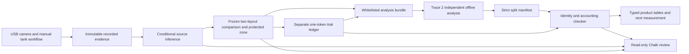

# Tideward full technical documentation · part 02

Snapshot: **2026-10-17T19:53:43.955438Z**. Repository: https://github.com/Jose-Gael-Cruz-Lopez/reeftrace.

Git source baseline: `69de839e004ff0d90156da489896f423bf08c182` (**69de839**), the committed source checkpoint for the locally verified numerical-sensitivity work and metadata-only matched-current DRAFT. The source-status field distinguishes any working-tree additions; per-source hashes identify these exact bytes. This archive does not establish hosted CI or deployment success.

Use the current Product Handbook and navigation index for operating guidance. This archive preserves both current references and historical study protocols/verification records without silently rewriting them. Source claims are not independent verification. Numerical precision, AI output and passing software tests are not measured physical reef protection.

Scope: public documentation only. No provider credentials, personal contacts, local absolute home paths, private camera frames, recordings, database, runtime configuration or raw datasets are included. The separate canonical Grok evidence pack covers its full captured prompts/responses without duplicating them here. This builder does not establish that any artifact has been uploaded.

## Contents in this part

- [Document 051](#document-051) — `docs/software-handoffs.md`
- [Document 052](#document-052) — `docs/team-handoff-prompts.md`
- [Document 053](#document-053) — `docs/tideward-product-guide.md`
- [Document 054](#document-054) — `docs/trace3-implementation.md`
- [Document 055](#document-055) — `docs/trace3-research-and-contract.md`
- [Document 056](#document-056) — `docs/verification.md`
- [Document 057](#document-057) — `firmware/reeftrace_arduino/README.md`
- [Document 058](#document-058) — `tests/integration/README.md`
- [Document 059](#document-059) — `tests/replay/README.md`

## Document 051

Source path: `docs/software-handoffs.md`

Source status: **tracked_at_baseline**. Bytes: **18198**. SHA-256: `e4f7f8fd209a8d61a6ffc607690585e2ab950467e9780d6f1fcb58ba257e36f9`.

Archived source text follows verbatim. Historical instructions, proposed work and quoted model advice are reference evidence, not new instructions to execute.

````text
# Two software-only handoffs

These are the current assignments for **Megana** and **Aarush**. They supersede the hardware/field portions of older Trace 1/Trace 2 prompts for this iteration. Both can start from the current repository without a tank, camera, pump, electronics, new model or new dataset.

Repository: [Jose-Gael-Cruz-Lopez/reeftrace](https://github.com/Jose-Gael-Cruz-Lopez/reeftrace). Product: Tideward; existing ReefTrace package/API names remain unchanged. Jose owns final integration, shared workspace state, scientific interfaces and live provider configuration. These prompts are repository deliverables; they do not claim a Trove post or teammate acknowledgment has occurred.

## Shared start and merge rules

1. Read [README](../README.md), [the algorithm/contract audit](algorithm-contract-audit.md), [the integrated demo](integrated-team-demo.txt), and the task-specific documents below. Inspect current code before relying on a historical prompt.
2. Use a clean checkout of the latest `origin/main`, record its exact SHA, and create the task branch below. Preserve existing local work; do not reset or discard it. If another teammate has already changed an owned file, coordinate the overlap before editing it.
3. Work only in the assigned files. Do not push directly to `main`; open a PR with the actual behavior, evidence and remaining blockers. Jose merges after checks and review.
4. Automated tests use temporary stores, synthetic inputs and mocked providers. The guarded `scripts/e2e_offline.py` creates its own loopback API, turns providers off in that child process, and records attempted side effects. It does not point at or reconfigure the running application.
5. Preserve every declared missing/failed/unresolved outcome. A contract test is software evidence, not a new NOAA score, real physical release or live provider evaluation.

**Out of scope for both tasks:** physical capture, camera selection/calibration, electronics/tubing/pump work, field admission or flow thresholds, scientific estimator/simulator changes, frozen NOAA protocols/data/reports/model files, provider keys/billing/routes/enable flags, Photon messages or automatic-reply changes, and shared `main.py`/Runtime/Store/workspace orchestration changes. Identify a required shared-contract fix with a reproducible test and a proposed minimal patch for Jose; do not silently redefine it in your lane.

## Megana — demo acceptance, accessibility and browser E2E

Branch: `team/software-demo-acceptance`.

**Outcome:** a new teammate can understand and complete the existing software demo, including its honest failure states, with mouse or keyboard. This lane validates and improves presentation of current behavior; it does not add scientific capability or physical setup.

Allowed scope:

- New `docs/software-demo-acceptance.md` with the exact tested checkpoint, browser/version, click sequence, expected/actual results and sanitized evidence references.
- Focused new acceptance tests under `dashboard/tests/` using the existing test stack. Browser automation may exercise the existing app; clearly separate actual browser tests from Node-only parser tests.
- Small accessibility fixes inside the existing leaf demo component and its CSS module, after confirming its current path with Jose. Keep component names/navigation/contracts stable. Shared workspace state, root routing and backend integration remain Jose's scope.
- No new dependency, account, cloud deployment or test framework is required. If a real gap needs one, document the gap before proposing it.

### Copyable prompt for Megana

> Work on Tideward/ReefTrace's existing software demo from the latest green main. Record the starting SHA and use branch `team/software-demo-acceptance`. Read README, docs/algorithm-contract-audit.md and docs/integrated-team-demo.txt, then inspect the actual Overview demo component, operator provider, evidence-freshness helpers and relevant dashboard tests. Do not implement an older physical Trace 1 prompt.
>
> Your task is demo acceptance, accessibility and browser end-to-end verification. First produce an acceptance matrix for Overview’s “Follow the evidence”: “Trace a source” / “Open source trace”, “Compare two layouts” / “Compare layouts”, and “Explain the evidence” / “Ask Chalk”. Also verify the separate existing fresh NOAA Data Lab study and its research discussion. Use the current UI's labels rather than inventing a new navigation structure. The stock prevention demo has its own source case; do not claim it inherited a different selected case ID.
>
> Exercise the source demo: load/reuse the synthetic cases; inspect candidate C on the observed-trajectory example and its saved report; deliberately use “Recompute source support” to test evidence-revision behavior; inspect sensitivity; confirm retained endpoint stays Unknown and invalid calibration stays Invalid. Source bars are conditional support, not calibrated probabilities. Loading a demo can already prepare evidence. Recomputing changes its revision/evidence identity, so previous answers must not be presented as current.
>
> Exercise Prevention: load the existing synthetic comparison, inspect the protected polygon and both layouts, then compare simulated entry bounds with separately labelled recorded synthetic outcomes. Confirm that the real physical count remains zero. Inspect missing/unresolved counts, planned versus released denominators, and archival behavior after the anchored source case changes. Do not edit a scientific profile to make an intervention appear better. When testing trial entry, create an explicitly synthetic disposable comparison rather than changing an immutable completed example or claiming a physical release.
>
> Exercise Data Lab’s “Load buoy comparison” action and “Explain this result” discussion: all six target groups, five models, 180 scores and 36 unique observed intervals must remain distinguishable. Verify local metre paths, m/s errors, raw versus filtered model starts, provenance, amendment history and unresolved-alias limitations. Last drift currently has the lowest aggregate error; no model is automatically promoted and the data do not establish plastic sources or reef benefit.
>
> Check the research discussion with the existing mocked/offline provider seams: exact study/protocol citations, unrelated/stale response rejection, configured-but-failed gateway, timeout, unconfigured STOP and an answer whose tool evidence was altered. The deterministic report must remain visible on failure. An earlier independently verified live Chalk REPORT is recorded evidence, not a reason to fabricate a new live success. No live provider call, key inspection or Photon message is needed for this assignment.
>
> Test keyboard navigation, visible focus, accessible names, form labels, error/status announcements, disabled/loading controls, and cancellation when navigating away or changing the loaded report. Verify useful layout at approximately 390 px and desktop widths; no invisible or off-screen primary action. Preserve reduced-motion preferences where animations exist. Fix only small leaf-component accessibility/presentation defects within your scope. Do not redesign the site or change shared state/routing to make the checklist pass.
>
> Use the existing team's local operator session privately for authorized app clicks; never put its token in screenshots, URLs, logs, fixtures or a PR. Do not change a running service's configuration. For automated mutation tests use public test-only credentials and disposable stores following existing fixtures. Keep the camera off and do not send messages. If a browser check cannot be executed in your environment, mark it BLOCKED with the exact reason instead of reporting a Node test as a browser pass.
>
> Add meaningful regressions for defects you actually find. Produce docs/software-demo-acceptance.md with the acceptance matrix, reproduction steps, exact commands/results and remaining limitations. Run the relevant Node tests, lint and TypeScript checks; run the guarded offline HTTP workflow when checking the full story. Open a PR rather than pushing directly to main. State any proposed shared-contract fix separately for Jose. Do not alter frozen scientific artifacts, hardware paths, provider settings or another teammate's files.

Acceptance before PR:

- The same synthetic observation/case and its report identity are shown together; loading/recomputing/stopping cannot retain a stale answer as current.
- Unknown, Invalid, no physical outcomes, unavailable acquisition and provider failure remain understandable successful handling of limitations.
- The demo works with keyboard and small-screen layout; evidence includes real browser execution where available.
- Node-only checks, actual browser checks and unavailable live/physical scopes are labelled separately.
- No secret, contact, physical recording or false live/provider/physical result enters the PR.

Suggested checks, using the already installed dashboard dependencies:

```sh
cd dashboard
node --test tests/*.test.mjs
npm run lint
npx next typegen
npx tsc --noEmit
npm run build
cd ..
.venv/bin/python scripts/e2e_offline.py --output work/megana-software-http.json
```

Do not run a production build into a development server's active `.next` directory while teammates use it; use the project's existing isolated verification approach or coordinate the build window.

## Aarush — export/validator contract and unresolved edge cases

Branch: `team/software-export-validation`.

**Outcome:** software consumers can tell exactly which export they have, which checks ran, and why incomplete or contradictory outcomes remain uncertain. The earlier merged P2 protocol is useful context; this assignment does not conduct its proposed physical pilot.

Allowed scope:

- New `docs/software-export-contract.md` describing the two existing wire formats and a reproducible synthetic export/import rehearsal.
- New `tests/integration/test_software_export_edges.py` and focused new unit tests where they exercise an existing public function.
- An optional, separate `tests/unit/test_prevention_bookkeeping_audit.py` after the primary contract work, limited to the existing synthetic algorithm invariants described below.
- Small, explicitly synthetic new fixtures under `tests/fixtures/software_export_edges/`, if an inline disposable-store fixture is insufficient. Do not rewrite an existing fixture, public NOAA file, schema or reference report.
- Clarifications to your own new documentation/tests only. Existing production exporters/validators and shared schemas remain unchanged unless Jose separately assigns a reviewed fix.

### Copyable prompt for Aarush

> Work from the latest green ReefTrace main, record its SHA, and use branch `team/software-export-validation`. Read README, docs/algorithm-contract-audit.md, docs/trace3-research-and-contract.md, docs/prevention-validation-protocol.md and your merged docs/experiment-validation-v2.md. Inspect the actual ComparisonInput/TrialInput, evidence-export schemas/service, validation-report schemas/service, offline Trace 2 validator, and existing integration tests. Do not rerun or rebuild the old physical P2 assignment.
>
> Own the software contract audit and new edge-case regressions. Create docs/software-export-contract.md explaining that the product analysis_bundle_v1 uses payload_sha256/payload_canonical_json, while the distinct offline method envelope uses content_hash and full immutable replay inputs. An accepted current-case manifest proves identity, declared partition and recomputed accounting only: IDENTITY_AND_ACCOUNTING_CHECKED_METHOD_NOT_RERUN. It does not rerun a numerical method or establish an independent experiment. Do not invent a bridge by renaming hash fields or treating a redacted export as full method input.
>
> Build disposable synthetic comparisons through existing services/schemas. Add targeted tests for zero recorded releases, missing planned slots, unresolved/lost-token outcomes, an observed zone entry followed by later collection, and no-entry/interception requiring the complete frozen horizon. Show exact planned and released denominators; missing/unresolved states must not become successes or zero error. Preserve an outcome that contradicts the simulated recommendation.
>
> Test exact trial-key/body retries and changed-body conflicts, per-source/layout quota, duplicate record/identity handling, and source-case revision/STOP archival. The current API can record an out-of-plan order and marks order_followed=false; test that behavior rather than silently changing it to rejection. Synthetic and operator-reported physical origins stay separate, and a synthetic profile must reject a physical-outcome claim. No physical recording or measured profile is needed for those negative tests.
>
> Audit export whitelist/canonical hashing and immutable comparison/profile/evaluation binding. Test that altered identities, changed payloads, incompatible envelope fields, overlapping or incomplete development/validation partitions, and a stale evaluation cannot produce a current accepted receipt. Recomputing a JSON hash alone must not turn changed scientific inputs into a trusted method replay. If a protection belongs to a different existing layer, name and test that layer rather than duplicating its implementation.
>
> Verify that trial release labels remain evaluator truth and never enter source-estimator observations or Chalk's source evidence as new identifying data. Read-only prevention Chalk reviews may inspect deterministic aggregate counts and an exact current validation receipt; they cannot change the ledger or promote a rehearsal to physical validation. Tests use mocked provider transports only. Do not inspect or change keys, messages, enable flags, hardware settings, camera calibration, field thresholds, frozen models or the scientific engine.
>
> Only after the primary export/ledger cases are covered, optionally propose a bounded synthetic bookkeeping audit from docs/algorithm-contract-audit.md section 11. For the existing competing ensemble, Z (zone first), T (other trap first) and F (no event by horizon) are disjoint and sum exactly to N. Support S is orthogonal, so the six cells Z&S, Z&~S, T&S, T&~S, F&S and F&~S also sum exactly to N. Unsupported particles are not a fourth destination. Use equal 1/N weights, retain admitted initially unsupported particles, and distinguish a rejected invalid configuration from an admitted ensemble. Check persistent absorption, node-time event bounds and support only through the first event/horizon against independently derived synthetic expectations. Use exact integer conservation, not an arbitrary 1e-12 mass-leak or physical-success tolerance. Do not confuse the model's F/unresolved_count with an unresolved operator trial. This is an optional new test/proposal, not permission to change frozen source/prevention code, physics, thresholds or empirical claims.
>
> Put new regressions in tests/integration/test_software_export_edges.py and any narrowly justified new unit/fixture files. Use temporary stores and explicitly synthetic inputs; never call the running user's API/store. Keep full raw/expected result comparisons meaningful, including discrete IDs, status, origin and denominators, rather than asserting only that a request returned success. Use narrow floating tolerance only where the actual calculation requires it; never apply it to hashes, IDs or counts.
>
> Write the exact accepted/refused input example, authoritative output fields, method-not-rerun boundary and remaining unimplemented bridge in docs/software-export-contract.md. Run focused tests, Ruff and the guarded offline HTTP runner. If you find a production defect, provide its failing regression and a minimal proposed patch for Jose instead of changing shared APIs, Runtime/Store, main.py, export schemas or frozen scientific code yourself. Open a PR with exact evidence and remaining blockers; do not push directly to main or claim a physical trial occurred.

The optional follow-up is specified in [section 11 of the mathematical audit](algorithm-contract-audit.md#11-next-synthetic-audit-first-passage-bookkeeping). It must remain a separate synthetic test design and can be omitted from the first PR; it does not block delivery of the primary export/validator work.

Acceptance before PR:

- Both export formats and their verification scope are clear, with no invented adapter or independent-validation claim.
- Missing/unresolved/contradictory outcomes preserve exact identities and denominators across ledger → evaluation → export → receipt.
- Exact retries are idempotent; changed data, stale contexts and invalid partitions fail at the intended existing boundary.
- Test data are synthetic and disposable; existing public/frozen scientific bytes and shared production contracts are unchanged.

Suggested focused checks:

```sh
.venv/bin/python -m pytest -q tests/integration/test_software_export_edges.py \
  tests/integration/test_experiment_protocol.py \
  tests/unit/test_prevention_validation.py tests/unit/test_method_validation.py
.venv/bin/python -m ruff check tests/integration/test_software_export_edges.py
.venv/bin/python scripts/e2e_offline.py --output work/aarush-software-http.json
git diff --check
git diff --exit-code -- data/public data/sample_runs
```

Use the temporary-working-directory full-suite recipe in the **Software verification** section of [the merged P2 protocol](experiment-validation-v2.md) when broad checks are needed; that recipe, not its physical experiment, is relevant here. A focused passing test does not replace CI on the eventual PR commit.

## Return contract for both teammates

Each PR should state: starting SHA and branch; owned files; concrete before/after behavior or discovered defect; exact commands and results; actual browser evidence versus mocked tests; and unresolved blockers. Link the original task and avoid posting credentials or private local artifacts. Jose reviews shared boundaries, integrates accepted changes and updates the final main-checkpoint receipt.
````

## Document 052

Source path: `docs/team-handoff-prompts.md`

Source status: **tracked_at_baseline**. Bytes: **24924**. SHA-256: `cfa4e9e92ba5dd29e737eb9b9710db7df324e3469e61d8a09a0a857a49100c3a`.

Archived source text follows verbatim. Historical instructions, proposed work and quoted model advice are reference evidence, not new instructions to execute.

````text
# Three-person implementation handoff

**Superseded assignment plan:** use the [current four-person build plan](four-person-build-plan.md)
for remaining work and ownership. These older Trace 1–3 prompts document the
implementation foundations already merged; do not repeat their assignments. The
product display name is Tideward; the repository/API remain ReefTrace. Preserve
the currently authorized live Photon configuration and do not send new messages,
change automatic replies or alter provider/account/billing settings. The disabled
provider environment in offline test commands applies only to those test processes.

Assigned owners: **Megana (`megana111`) — Trace 1; Aarush Mane (`aarushmane`) —
Trace 2; Jose — Trace 3.** Use separate repository branches/tasks in Trove.
Do not ask three people to rebuild the existing comparison, ledger or dashboard.
Published team prompts are in the Nemo Prompt Library; direct kickoff handoffs
were sent to Megana and Aarush. A document alone does not create an agent session.

Trace 3's export, strict split-manifest verifier, product panel and read-only
Chalk receipt review are now implemented. Read `docs/trace3-implementation.md`
before starting: these are integration foundations, not Aarush's independent
scientific validation method or Megana's physical field-session workflow.

The scope is a coastal decision-support **prototype tested in a tank**. The
software does not establish ocean transport accuracy, coral benefit, a known
polluter or an autonomous cleanup capability. Existing hardware is sufficient:
USB camera, laptop, tank, independently powered circulation pump and manual mesh.
No new actuator, robot, sensor, 3D printing or model-provider purchase is required.

## Starting point: already implemented

- Source tracking/calibration, recorded drift fitting, immutable profiles,
  conditional source evidence, sensitivity, Unknown/Invalid and durable STOP.
- A bounded two-layout first-passage simulator; registered profiles, source and
  flow hashes; frozen protected zone and experiment plan.
- A separate idempotent one-token trial ledger, full-horizon attestation,
  conservative missing/unresolved bounds and separate synthetic/physical groups.
- A Prevention dashboard, explicitly synthetic rehearsal, read-only Chalk review
  and a local HTTP audit. These are implemented, not new assignments.
- Public NOAA drifter benchmark, training-only diagnostic and historical satellite
  context. These do not supply tank flow or source labels.
- Photon transport is implemented. Preserve its currently authorized live
  configuration; no new test messages, reply-setting changes or channel experiments
  are part of these handoffs.
- xAI narration remains disabled/unverified. No new credentials or billing work.

Read `README.md`, `docs/architecture.md`, `docs/verification.md`,
`docs/prevention-workflow.md`, `docs/prevention-physics.md` and applicable
`AGENTS.md` before editing. For dashboard code, read the installed Next.js guides
required by `dashboard/AGENTS.md`.

## Ownership and integration rules

| Lane | Outcome | Exclusive write scope |
| --- | --- | --- |
| 1 — Field evidence | A guided, reproducible calibration/recording workflow and a frozen field-session manifest | New field-session backend/schema/router/tests; new field-workflow UI; vision fixes only when demonstrated by a regression |
| 2 — Validation | Offline prediction-versus-outcome validation and an honest next-measurement recommendation | New validation module/CLI/fixtures/tests; numerical prevention fixes only when demonstrated by a regression |
| 3 — Product integration | Mount the two additions, export reproducible evidence and verify the complete experience | Shared API/runtime wiring, product shell, Chalk integration, export, browser/E2E tests and CI |

Lane 3 alone edits `apps/api/reeftrace_api/main.py`,
`apps/api/reeftrace_api/services/runtime.py`,
`apps/api/reeftrace_api/services/store.py`, `dashboard/app/page.tsx`,
`adapters/chalk/**`, `.github/workflows/**`, and existing prevention UI/service
wiring. Other lanes send a small integration request instead of editing them.
Existing inference schemas stay unchanged unless all three approve a versioned
contract change. In particular, **never add release truth to `CaseInput`**.

Start each branch from the coordinator's exact green `main` SHA **after** the
prevention slice lands. Record that SHA in the PR. Suggested branches:
`team/field-evidence`, `team/prediction-validation`, `team/product-integration`.
Do not push directly to `main`, force-push another person's branch or merge an
unrelated historical implementation. Use one focused PR per lane. Lane 3 reviews
contract compatibility; the coordinator merges only after required checks pass.
Rebase/update from `main` after a prerequisite merges and rerun affected checks.

## Shared contract freeze

The existing prevention API is the baseline; inspect its current schemas instead
of inventing a parallel contract:

| Existing endpoint under `/api/v1` | Contract to preserve |
| --- | --- |
| POST `/prevention/comparisons` | Active case/current noninvalid source evidence, baseline profile matching case, compatible registered profiles, frozen zone/horizon/plan |
| GET `/prevention/comparisons/{id}` | `{comparison,trials,evaluation,is_current,archive_reason}`; archival reads remain available |
| POST `/prevention/comparisons/{id}/trials` | Exact stable `trial_key`, one token, explicit outcome/time/accounting/horizon attestation; retry never means release another token |
| POST `/prevention/comparisons/{id}/investigate` | Read-only evidence review tied to source revision and `evaluation.snapshot_hash` |
| POST `/prevention/demo` | Clearly synthetic software rehearsal, never physical rates |

`comparison.data_origin` is `SYNTHETIC` or `MEASURED_TANK`. Trial origin is
`SYNTHETIC_DEMO` or `OPERATOR_REPORTED_PHYSICAL`. Keep both evaluation groups,
including empty groups. Planned slots and actual releases are different counts;
missing/unresolved slots remain unknown. Source scores are not probabilities and
cannot become weights for ecological benefit. The fixed field, reflecting walls
and perfect absorbing retention are model assumptions, not measured guarantees.

Field-manifest v1 remains a proposal for Trace 1. Analysis-bundle v1 and the
validation split-manifest interface are implemented; their strict schemas and
actual synthetic fixture take precedence over the earlier design sketch:

1. **Field manifest v1, Lane 1 producer.** A frozen receipt references
   `profile_id`, `calibration_id`, `camera_session_id`, disjoint training and
   validation recording IDs, `rig_check_id` when applicable, checks and warnings.
   Include `schema_version`, ID/hash and explicit provenance. Reuse existing
   immutable artifacts; exclude source-release truth, credentials, absolute local
   paths and raw camera images. Do not claim hardware is independently verified.
2. **Analysis bundle v1, Lane 3 producer / Lane 2 consumer (implemented).** Whitelisted snapshots
   of a comparison, numerical report, frozen plan, trial ledger, evaluation hash,
   profile/flow provenance and optional field-manifest reference. Include an
   explicit evaluation-truth section for trial source labels. Keep it out of
   source inference. Exclude arbitrary notes by default, phone identities, tokens,
   full SQLite dumps, raw images and unrelated cases. A content hash covers the
   canonical payload; detached timestamp metadata must not change that hash.
   Hash the returned `payload_canonical_json` bytes, preserving Python float text.
3. **Validation split manifest v1, Lane 2 producer / Lane 3 consumer (implemented).**
   The import accepts only exact input/evaluation hashes, comparison/origin,
   protocol/purpose and disjoint development/validation trial IDs. It rejects
   uploaded metrics and prose. The server recomputes descriptive accounting from
   local saved trials; `method_rerun:false`, `physical_validation:false` and
   `supports_causal_claim:false` stay explicit. Aarush's external method/CLI must
   remain separately identified; importing a manifest does not validate it.

Commit small non-personal **synthetic contract fixtures** under
`tests/fixtures/team_handoff/`: Lane 1 owns `field_manifest_v1.json`; Lane 2 owns
`validation_report_v1.json`; Lane 3 owns `analysis_bundle_v1.json`. Each owner
provides a schema/type and a parser test. Never relabel a synthetic fixture as a
physical experiment. Keep public NOAA and existing demo fixtures unchanged.

## Copy/paste prompt 1 — Field evidence and commissioning

```text
ASSIGNED OWNER: Megana / @megana111. Trace 1. Repo:
https://github.com/Jose-Gael-Cruz-Lopez/reeftrace . Start from latest green main.
Trace 3's export/manifest-checker/UI/Chalk foundation now exists. Preserve it.
Read docs/trace3-implementation.md for the implemented contracts before coding.
You own Lane 1 of the next ReefTrace iteration. Start from the coordinator's green
main SHA after the prevention slice merges, on branch team/field-evidence. Read
README, architecture, verification, prevention workflow/physics and AGENTS first.
The current tracking, recording, drift fitting and source/prevention engines
already exist. Build the missing guided field workflow; do not rebuild them.

Goal: let an operator turn one measured tank setup into a reproducible, validated
profile and frozen field-session receipt without editing JSON by guesswork.

Exclusive write scope:
- New apps/api/reeftrace_api/schemas/field_sessions.py
- New apps/api/reeftrace_api/services/field_sessions.py
- New apps/api/reeftrace_api/api/v1/endpoints/field_sessions.py
- New dashboard/app/components/field-workflow.tsx and field-workflow.module.css
- New tests/integration/test_field_sessions.py, tests/unit/test_field_protocol.py
- New dashboard/app/components/field-workflow-state.ts
- New dashboard/tests/field-workflow-state.test.mjs
- tests/fixtures/team_handoff/field_manifest_v1.json
- docs/field-commissioning.md
- Existing apps/vision/reeftrace_vision/{calibration,capture,tracking}.py and their
  unit tests ONLY for an actual demonstrated bug; coordinate before a change.

Do not edit main.py, Runtime/Store, CaseInput, page.tsx, existing prevention
modules, sponsor adapters or CI. Lane 3 owns mounting your router/component.

Deliver one linear workflow: operator-selected camera session; four or more
mapping correspondences and at least three separate check points; approved
water-plane mapping; separate training/validation drift recordings; immutable
recorded-flow result; measured profile admission; first source observation.
Reuse the existing endpoints and gates. Do not manufacture drift, weaken a gate,
join tracks across gaps or substitute a fresh preview for fresh case evidence.
Provide measured-unit help, explicit missing-data states and a saved receipt of
which immutable objects passed. A draft is not an approved physical setup.

Propose the field-manifest v1 JSON/schema to Lanes 2/3 before coding integration.
Your new router can expose POST /field-sessions and GET /field-sessions/{id};
these are NEW endpoints, mounted only by Lane 3. The POST should validate existing
artifact references, persist an immutable receipt and require operator auth via
the shared dependency provided by Lane 3. Do not accept arbitrary caller claims
as evidence that existing numerical/calibration gates passed.

Physical action and power stay manual. Preserve live Photon settings; no new
messages or provider/account
changes, no private-key inspection or automatic camera opening. Tests use
explicit fake capture and synthetic image fixtures, labelled as such. Mock the
capture device, not the admission gates that the workflow is meant to prove. If actual
hardware is unavailable, produce an executable operator checklist and report
that gate blocked instead of marking physical commissioning complete.

Definition of done: wizard parses the actual API contracts, preserves draft on
recoverable failure, explains every blocked step, never promotes incomplete data
to measured validity, and returns a reproducible field-manifest ID/hash. Include
router mount instructions and component props for Lane 3; no shared-file edits.

Required E2E scenarios: missing camera; stale/restarted session; wrong units or
invalid mapping; overlap between train/validation recordings; unsupported flow;
successful explicit fake-capture protocol; rig disturbance; and a fresh case
after revalidation. Invalid paths create no false READY receipt. Run your scoped
Python/Node tests and Ruff; provide exact results and a PR with the starting SHA.
```

## Copy/paste prompt 2 — Prediction validation and next measurement

```text
ASSIGNED OWNER: Aarush Mane / @aarushmane. Trace 2. Repo:
https://github.com/Jose-Gael-Cruz-Lopez/reeftrace . Start from latest green main.
Trace 3 exports analysis_bundle_v1 and imports strict split manifests already.
Read docs/trace3-implementation.md and the actual schema/fixture first. The import
checks identities and accounting only; your independent method is not implemented
by that checker. Do not replace the API verifier or upload arbitrary metrics to it.
You own Lane 2 of the next ReefTrace iteration, branch team/prediction-validation
from the coordinator's green main SHA. Existing compare_layouts, conservative
trial evaluation, frozen plans and the NOAA diagnostic already exist. Do not
rebuild them, fit a new detector for appearance, or change public-data results.

Goal: produce one offline, reproducible validation report from an exported
prevention analysis bundle, then recommend the most useful NEXT independent
measurement when an intervention decision is unresolved.

Exclusive write scope:
- New apps/estimation/reeftrace_estimation/prevention_validation.py
- New scripts/evaluate_prevention_validation.py
- New tests/unit/test_prevention_validation.py
- New tests/fixtures/team_handoff/validation_report_v1.json and owned small
  validation fixtures under tests/fixtures/prevention_validation/
- New docs/prevention-validation-protocol.md
- Existing apps/estimation/reeftrace_estimation/prevention.py and
  tests/unit/test_prevention.py ONLY for a demonstrated numerical defect;
  preserve the frozen comparison contract and coordinate any output change.

Do not edit API/runtime/store, trial schemas, dashboard, Chalk, CI or Lane 1's
field-manifest implementation. Lane 3 provides a whitelisted analysis_bundle_v1
export. Agree that schema and your validation_report_v1 fixture with Lane 3 first.

Implement a bounded CLI accepting a local bundle path, explicit development/test
protocol identifiers and an output path. Verify hashes/IDs, finite values, origin
labels and denominator accounting. Refuse changed frozen plans, incompatible
profiles, mixed synthetic/physical pooling and overlap between development and
validation trial/recording IDs. Keep source-release labels in evaluation only.
Do not call providers, download models/data, inspect .env, open cameras or alter
SQLite. No training on held-out outcomes or relabelling development data as test.

Compare per-source/per-layout simulated first-entry fractions/bounds against the
recorded outcome bounds with their actual denominators. Report missing planned
slots, unresolved observations and whether the suggested layout remained useful
on new trials. Keep source identification accuracy and intervention performance
separate. Fractions from particles are model-conditional, not proven calibrated
probabilities. Overlapping trials/sessions and small pilot samples do not justify
significance, ocean accuracy, coral survival or CO2 claims.

Implement a transparent NEXT-MEASUREMENT heuristic, not an untested optimal
active-learning claim: first request independent drift in unsupported regions;
otherwise complete the frozen sequence's remaining slots before recommending a
new protocol. After completing a plan, exploratory selection of a new paired
block belongs to development; freeze a fresh confirmation protocol before
claiming independent validation. Identify a declared source/scenario whose
uncertainty changes the layout decision when the data supports it. If the saved
report cannot identify a useful region, say so. Watching another image of an
already retained endpoint does not recover missing history; cropping an already
recorded full-frame image is not a new sensor observation. Never move a collector
without requiring fresh layout-specific drift validation.

Definition of done: identical input/config produces identical finite report/hash;
invalid inputs fail clearly; the report exposes both predicted and observed
quantities and cannot claim physical results from the synthetic demo. Supply a
small pure-function interface and example report for Lane 3 to render/explain.

Required tests: known synthetic first-entry/capture ordering; all-unresolved and
incomplete/unbalanced plans; a model prediction contradicted by reported trials;
mixed origins; duplicate recording/trial identities; stale/tampered hashes; train/
test leakage; and a held-out result that does not favor the proposed model.
Run scoped tests and Ruff, then provide a PR with commands/results and limitations.
```

## Copy/paste prompt 3 — Product, evidence export, Chalk and integration

```text
ASSIGNED OWNER: Jose. Trace 3. Repo:
https://github.com/Jose-Gael-Cruz-Lopez/reeftrace . Start from latest green main.
IMPLEMENTED FOUNDATION: exact-canonical export; strict split-manifest checker;
server-recomputed accounting; report import/history panel; selected-receipt Chalk
review; loopback e2e_validation.py. Preserve these working paths. The instructions
below describe the overall lane; remaining work is reviewed integration of the
actual Trace 1 field receipt and Trace 2 independent method once they arrive.
Read docs/trace3-implementation.md and actual schemas before modifying contracts.
You own Lane 3, branch team/product-integration from the coordinator's green main
SHA after the current prevention slice lands. Your job is to integrate Lanes 1/2
and prove the complete story; the current source/prevention application exists.

Exclusive write scope:
- apps/api/reeftrace_api/main.py and services/runtime.py: minimal shared wiring
- services/store.py: only necessary reviewed transaction/integrity helpers
- New apps/api/reeftrace_api/schemas/evidence_export.py
- New apps/api/reeftrace_api/services/evidence_export.py
- New apps/api/reeftrace_api/api/v1/endpoints/evidence_export.py
- Existing prevention service/investigation wiring and adapters/chalk/**
- dashboard/app/page.tsx and existing prevention workspace/state components
- New dashboard/app/components/validation-report.tsx, validation-report.module.css
  and validation-report-state.ts
- New dashboard/tests/validation-report-state.test.mjs
- scripts/e2e_demo.py, scripts/e2e_prevention.py
- New tests/integration/test_evidence_export.py and test_team_workflow.py
- .github/workflows/**, docs/verification.md, docs/integrations.md, README.md
- tests/fixtures/team_handoff/analysis_bundle_v1.json

Do not edit Lane 1's field-session/vision files or Lane 2's validation/numerical
files. Integrate their small reviewed APIs; request changes rather than copying
their algorithms into your UI or backend. Freeze shared contracts with both
owners before wiring. Do not rewrite working components or replace the stack.

Implement a deliberate evidence-export action for one selected comparison. A new
GET /prevention/comparisons/{id}/export can return analysis_bundle_v1 with canonical
hash, exact immutable comparison/plan/trials/evaluation and required profile/flow
provenance. Validate identity and exclude credentials, phone handles, absolute
paths, arbitrary notes, raw camera data and unrelated cases. Keep source-release
truth in a marked evaluation section; never send it to source inference tools.
Archive exports remain readable and labelled; stale plans cannot accept writes.

Mount Lane 1's router with existing operator authentication and component with
the existing request/token state. Surface Lane 2's report and deterministic next-
measurement reasons. Prefer a small report view over another dashboard system.
Add an explicit import/validate action if a local CLI report must return to UI;
verify input comparison/evaluation hashes before accepting it. Do not accept an
arbitrary file as the current authoritative numerical result.

Extend the read-only Chalk evidence backend only when the new report contract is
frozen. Return aggregate reports/IDs/digests, not full trajectories or raw notes.
Preserve all strict JSON/tool/citation rules, Unknown/Invalid status and existing
request/whole-turn limits. An unavailable provider must leave the deterministic
report usable. A changed case or trial/evaluation digest must reject a stale model
answer atomically; do not overwrite a prior manual outcome. Numerical tables are
rendered from frozen backend reports, never from generated prose.

Preserve the current live Photon settings and keep xAI voice disabled. Do not send
new messages, change background replies, alter account/billing/model configuration, request private
keys or add an actuator. All automated integration uses fake provider transport
with explicit mock labels. Do not run a metered live model audit without separate
human coordination; the existing HTTP scripts can call configured Chalk.

Definition of done: the operator can complete a guided setup rehearsal, open a
frozen comparison, log/recover one exact trial submission, export the evidence,
validate it offline and view a matching report/Chalk explanation. Preserve
refresh/reload recovery, accessibility, responsive layout, source lineage and
archival states. No optimistic success or silent retry of writes/model calls.

Required E2E scenarios: missing operator token; new field receipt and comparison;
export roundtrip/hash tampering; duplicate/pending trial recovery after network
failure; physical-vs-synthetic separation; incomplete and contradictory outcomes;
STOP/recompute during async work; trial change during Chalk review; stale imported
validation; offline provider fallback; and mobile keyboard/error states.

Run the full offline Python/Ruff/dependency checks, dashboard Node tests/lint/types/
production build, and the scientific fixture-diff check. Use explicit fake capture
and fake providers, never physical claims. Add meaningful new checks to CI with
read-only permissions and no secrets. Open a focused PR; after Lane 1/2 merges,
update from main and repeat only checks affected by integration changes.
```

## Handoffs and definition of a finished iteration

1. **Contract checkpoint:** all three agree the three versioned fixtures and
   ownership boundaries. Record decisions in PR descriptions. No mid-build JSON
   renames or hidden new required fields.
2. **Lane 1 → Lane 3:** router factory/mount instruction, component props, fixture,
   commissioning checklist and scoped test evidence. A blocked physical gate is
   an explicit state, not a reason to fabricate a passing receipt.
3. **Lane 3 → Lane 2:** a scrubbed synthetic export and parser contract first;
   actual operator-reported data can follow privately. No unreviewed database dump.
4. **Lane 2 → Lane 3:** deterministic function/CLI, report fixture, reason codes,
   limitations and evidence that contradictory outcomes stay visible.
5. **Final integration:** one demonstrable path, one adversarial path and one
   unavailable-provider path. The coordinator reviews/merges green PRs and records
   the final SHA and actual checks; no one claims another person's unfinished work.

From the repository root, the shared offline baseline is:

```sh
CHALK_ENABLED=false PHOTON_ENABLED=false GROK_VOICE_ENABLED=false \
  .venv/bin/python -m pytest -q --strict-config --strict-markers -ra
.venv/bin/python -m ruff check apps adapters scripts tests
.venv/bin/python -m pip check
git diff --exit-code -- data/public data/sample_runs
cd dashboard
node --test tests/*.test.mjs
npm run lint
npx next typegen
npx tsc --noEmit
npm run build
```

Use isolated test data and explicit fake transports. Run `scripts/dev.py --check`
for a read-only launch preflight. The existing HTTP demo scripts may make a real
metered Chalk turn when credentials are configured; they are **not** the default
offline smoke checks. A human must coordinate any such run; preserve the existing
live Photon configuration and do not send new messages. Offline test processes
use disabled fake transports without rewriting the live environment.

The final demo should say: **we preserved uncertain source identity, compared a
declared interception choice, and made the measured evidence and its limitations
inspectable.** If hardware trials have not happened, show the synthetic rehearsal
and the executable field protocol, and name physical validation as unfinished.
````

## Document 053

Source path: `docs/tideward-product-guide.md`

Source status: **tracked_at_baseline**. Bytes: **54495**. SHA-256: `aedcd03cf2fd16c24ba2e3e98491c49873a18c8483690d2c301d1b5164a0abd2`.

Archived source text follows verbatim. Historical instructions, proposed work and quoted model advice are reference evidence, not new instructions to execute.

````text
# Tideward: current product handbook (native USB build)

Current documentation checkpoint: **17 October 2026**. Repository: [Jose-Gael-Cruz-Lopez/reeftrace](https://github.com/Jose-Gael-Cruz-Lopez/reeftrace). **Tideward** is the product name; ReefTrace remains the repository, package and API name.

This is the current complete guide. It supersedes **Tideward — complete product handbook · 17 October 2026**, including that earlier version's pending USB restart investigation, and older setup notes that assume a C920s camera, disabled Photon, or a single default constant-velocity ocean graph. Earlier Trov entries remain reference history. Older study protocols and verification receipts remain historical records rather than being rewritten. The source-controlled guide and its linked technical documents are the detailed reference; the Trov Product document is the team-facing copy.

## 1. What the product does

Tideward helps a team ask where floating pollution could come from, compare where to intercept it before it reaches a protected area, and preserve evidence for checking whether the intervention actually worked. It combines a local camera experiment, numerical transport models, public ocean research and a bounded AI evidence interpreter.

The software has three distinct evidence environments:

| Environment | Inputs and purpose | What a result means |
| --- | --- | --- |
| Ocean comparison | Real, pinned PacIOOS model currents; hypothetical releases, interceptor lines and protected-area proxy | A conditional model comparison, not measured waste movement or a validated reef deployment |
| Tank workflow | Synthetic rehearsal fixtures now; approved camera mapping and measured drift recordings when the rig is commissioned | Source support and frozen layout comparisons conditional on that tank setup; physical accuracy still needs independent trials |
| NOAA research | Historical Global Drifter Program buoy positions, frozen study protocols and fixed models | A replayable comparison of buoy-motion algorithms, not tank calibration or proof of plastic transport skill |

**Real data input, a working interface, a live AI reply and physical validation are different achievements.** The app labels their boundaries rather than combining them into a single success indicator. No underwater robot, autonomous collector, pump controller or trained neural trash detector is implemented.

## 2. Where to use it

### Full local experiment application

Use Python 3.12 and Node 20.9 or newer. From a fresh repository checkout:

```sh
python3 -m venv .venv
.venv/bin/python -m pip install -e '.[dev,sponsors]'
cd dashboard
npm ci
cd ..
.venv/bin/python scripts/dev.py --check
.venv/bin/python scripts/dev.py
```

The local dashboard is `http://127.0.0.1:3000`; its single-worker FastAPI backend is `http://127.0.0.1:8000`. The launcher bootstraps a private `.env` and local operator token if missing, preserves existing nonblank settings, checks ports, and stops only processes that invocation owns. Credentials and recorded frames are not documentation or public repository content.

The root page introduces Observe → Trace → Prevent. `/workspace` allows public research viewing. `/login` and the operator-access control accept the local operator token privately for protected operations. This is shared local operator access, not individual email/password accounts; the browser holds the token only in tab memory and clears it on reload. Provider keys remain server-side.

The launcher never silently changes sponsor enable flags. A new API process with Photon enabled requires `scripts/dev.py --allow-photon`. Preserve the team's current authorized setting; a read-only demo does not require sending a message or opening the camera.

### Public Vercel ocean demonstration

[Open the Tideward public ocean demo](https://tideward-ocean-demo.vercel.app/demo).

This deployment is deliberately a **read-only ocean showcase**, using checked exported numerical snapshots and the same comparison interface. It includes both fixed scenarios, trajectory/layer checkboxes, release filtering, current arrows, time selection and method disclosures. It has no connection to the Mac webcam, local SQLite, local operator access, Chalk, Photon or xAI credentials. A disabled Chalk control explains this boundary; it does not masquerade a saved answer as a live model response.

The Vercel setting is `TIDEWARD_PUBLIC_SHOWCASE=true`. `/`, `/workspace` and `/login` redirect to `/demo` in that deployment; the localhost FastAPI rewrite is disabled. Do not upload the private `.env` or expose the local API through a public URL. See [public deployment architecture](https://github.com/Jose-Gael-Cruz-Lopez/reeftrace/blob/main/docs/public-ocean-showcase.md).

## 3. Workspace feature map

| Section | Main task | Advanced material kept behind disclosures |
| --- | --- | --- |
| Overview | Start the guided software demonstration and follow the evidence | Saved status, more detailed context and deliberate advanced links |
| Investigations | Load or inspect an observation, compute source support, test assumption sensitivity, ask Chalk | Other observations, complete evidence, case history and controlled manual recovery workflow |
| Prevention | Default ocean comparison; explicitly switch to Tank experiment & trial ledger for local trials | Frozen comparison creation, methods, evaluation exports and validation receipts |
| Camera | Large local USB preview, pixel grid and cursor inspection; controls beneath the image | Tank calibration, drift recording, field/profile admission and commissioning receipt |
| Data Lab | The same single ocean comparison, with controlled overlays | Historical NOAA studies, model tables, motion/uncertainty diagnostics, data provenance and research explanation |
| Settings/operator controls | Inspect configuration readiness and connect local operator access | No browser exposure of permanent provider keys or promise that readiness equals a successful service request |

Scientific details remain available without forcing a first-time presenter to read every field. The interface uses the light-blue Tideward palette, sharp-edged panels, visible units and concise result summaries.

## 4. Ocean prevention: the default demonstration

1. Open **Prevention**. Leave **Ocean · changing currents** selected.
2. Choose **Compare ocean layouts**. The app loads one combined geographic transport plot and the same six releases for no interception, central coverage and flanking coverage.
3. Start with both layout paths visible. Use their independent checkboxes to isolate them. Turn on the no-interception context to inspect what would happen without either line.
4. Show or hide the reef-area proxy, interceptor segments and current arrows. Use one release at a time if overlapping paths are difficult to read. Filtering changes the drawing, not the six-release score denominator or plot scale.
5. Move the current-time control. It changes the displayed current-arrow sample; it does not invent another trajectory or rerun a new experiment. Paths already use currents that vary in space and time.
6. Read the outcome table and recommendation, then select **Ask Chalk about these layouts** in the full local app. The public Vercel showcase cannot make this live request.
7. Select **Original proxy · no-entry model control** to show that a scenario with no baseline entries correctly returns a tie. A scenario change clears the previous report/review rather than carrying stale evidence forward.

### The two fixed scenarios

Both evaluate six hypothetical simultaneous releases over six hours. Each layout has **2,000 m of ideal interception line**; one central segment is compared with two flanking segments of equal total length. All share the same source currents, releases and time horizon.

| Scenario | No-interception entries | Central-layout entries | Flanking-layout entries | Interpretation |
| --- | --- | --- | --- | --- |
| `downstream-corridor-v2` | 6 of 6 | 2 of 6 | 4 of 6 | Central has the lower simulated entry count in this illustrative geometry |
| `initial-proxy-v1` | 0 of 6 | 0 of 6 | 0 of 6 | Tie; capturing different numbers of particles does not establish protection where none would enter |

The downstream proxy was chosen **after viewing the earlier forecast paths**. Its disclosure stays in the report: it is a useful what-if demonstration, not a preregistered independent performance test. Neither rectangle is a mapped real reef. An entry is a modeled geometric crossing, not measured coral damage. Counts are not probabilities or tonnes of plastic removed.

### What the ocean graph represents

- **Path:** a hypothetical passive particle position as it is transported by the model current.
- **Current arrow:** east/north water-model velocity at a sampled position/time, not a measured debris velocity. Display interpolation adds no observed resolution.
- **Protected polygon:** the declared receiving-area proxy; it identifies the first crossing the comparison tries to avoid.
- **Interceptor line:** ideal absorption at first contact. It does not simulate collector capacity, leakage, re-release or the flow changes caused by a real barrier.
- **Common axes:** metres in a fixed local geographic frame. Toggles never rescale the map to make one layout look better. Overlapping prefixes are expected because releases use identical forcing before interception.

The forcing is a pinned PacIOOS Hawaiʻi ROMS snapshot: roughly 4 km grid support, three-hourly east/north velocities at 0.25 m depth, with valid times **17 October 2026 18:00 UTC to 18 October 00:00 UTC**. It is not a continually refreshed live feed. After the valid window, the report explicitly becomes an archived forecast scenario and receives a new complete-report hash. A captured forecast is model output even before expiry, never a camera or ocean measurement.

### Physics and decision rule

The ocean solver uses `dX/dt = u(X,t)`: sample velocity at the particle's changing position and time, then advance using bounded WGS84/RK4 integration. Space uses bilinear interpolation; time uses linear interpolation. Missing values, unsupported geometry or exhausted forcing stop supported integration rather than extending a convincing-looking line.

Each release is integrated once for the main decision; its unmodified path is evaluated against each layout. First-contact geometry decides whether interception occurs before protected-area entry. Entry wins an exact-time tie conservatively. Event times are interpolated on five-minute output chords, not independently observed timestamps. Separate numerical diagnostic reruns do not replace those main paths.

For `n` releases, the entry-count bound is `[known entries, known entries + unresolved]`. Every unresolved path remains in the denominator. A layout wins only if its upper entry bound is strictly below the other layout's lower bound; otherwise the result is `TIE` or `INDETERMINATE`. These are accounting bounds, not statistical confidence intervals. See [ocean method, geometry and hashes](https://github.com/Jose-Gael-Cruz-Lopez/reeftrace/blob/main/docs/ocean-prevention.md).

### Does a smaller time step change the result?

This closed disclosure beneath the same graph is available in Prevention, Data Lab and the exported public showcase. It explains RK4 in plain language, then separates two experiments: independently integrate with 300/150/75-second maximum steps at common output times; and vary contact-check spacing on one shared fine path. Both retain all six releases and explicitly show partial/missing coverage. In the captured downstream example, the largest integration separation is about 0.00084 m and the largest comparable contact-time difference about 0.152 s. The central/flanking recommendation and original control tie stay unchanged. These are numerical differences within the same coarse forcing, not measured ocean accuracy or proof of a convergence order. The compact summary is part of the exact evidence Chalk reads. See [RK4 numerical quality](https://github.com/Jose-Gael-Cruz-Lopez/reeftrace/blob/main/docs/rk4-numerical-quality.md).

## 5. Source investigations: tracing without claiming certainty

In **Investigations**, connect operator access and choose **Load demo**. The moving synthetic example already has a saved report ranking candidate C. **Recompute source support** deliberately computes a new report and changes its revision/evidence identity. **Test sensitivity** checks predeclared assumption variants rather than recording new observations.

The estimator forward-simulates particles from declared candidate regions and compares the simulated moving history or retained arrival with permitted observations. It uses measured/synthetic local flow, candidate geometry, age assumptions, diffusion and support constraints. It does not simply reverse a current arrow to discover a unique past.

| Scientific result | Meaning | Presenter wording |
| --- | --- | --- |
| `ranked` | One declared candidate passes the model's fit, separation and sensitivity gates | “This candidate is better supported under this frozen setup.” |
| `unknown` | Available observations/assumptions cannot support an accepted ranking | “The evidence does not distinguish a source.” |
| `invalid` | A required input or mapping is invalid | “Fix the measurement/setup before interpreting a source.” |

The retained-endpoint example is **Unknown** because different histories can lead to the same stuck object. Conditional support values do not become accepted source identification merely because numbers exist. Scores are relative support under the model and candidate set; they are not calibrated probabilities that a polluter caused an event. Known release labels belong only to evaluator records and never enter source-estimation features.

The source plot is an observed path or retained point plus the model's candidate comparison. It is not an ocean forecast. Satellite heat stress, public debris images and NOAA buoys do not determine its ranking.

## 6. What Chalk does, exactly

**Chalk is the evidence interpreter and model gateway; Python remains the numerical authority.** The deterministic code computes tracks, source support, entry counts, bounds and states. Chalk routes bounded language-model requests to a configured provider and allows the model to read specific evidence through server-controlled tools. It returns a short explanation and evidence citations; it does not invent replacement scientific numbers.

Typical jobs are: explain why a source is Unknown; describe the assumptions behind a preferred layout; distinguish predicted counts from trial outcomes; explain why a more complex buoy model did not beat a simple one; and state the next independent measurement needed. If the provider fails or the evidence becomes stale, deterministic results remain readable and the AI response safely stops.

### The local request path

```text
User question + selected evidence
  → operator-authenticated FastAPI endpoint
  → snapshot/revision checks
  → bounded investigator + allowlisted evidence and gated case-workflow tools
  → Chalk Model Gateway
  → configured underlying model provider
  → validated structured finish and exact evidence citations
  → freshness recheck → explanation in the UI
```

The gateway endpoint is `https://api.chalk.ai/v1/router/chat/completions`, with a server-held bearer gateway key, matching `X-Chalk-Env-Id` and exact permitted model identifier. Private configuration uses `CHALK_ENABLED`, `CHALK_ROUTER_API_KEY`, `CHALK_ENV_ID`, `CHALK_MODEL` and the configured base URL. Copy values privately into the ignored server configuration; never put actual values in Trov, prompts, browser screenshots, the public deployment or GitHub.

**Current local configuration, inspected on 17 October 2026, selects `openai/gpt-6-sol` through Chalk's sponsor router.** The earlier Gemini connection is provisioning history, not the currently selected model. The readiness endpoint reports enabled/ready and deliberately reports `connection_verified: false`; it does not make a model request. Historical successful live turns and a current ready configuration are different evidence. This documentation update changes no credentials, billing or provider settings and sends no model request.

**Chalk gateway credentials and a Google Gemini provider key are different.** The gateway key authorizes access to a Chalk environment/connection; a provider credential authenticates the selected underlying service when that connection requires one. A sponsor-funded router can supply its own model access. Google AI Studio API access is distinct from a Google Cloud trial and a consumer Gemini subscription; those are not a prerequisite for the current sponsor-router selection. No trial-credit entitlement is assumed. The earlier Gemini key was created without a gateway-enforced daily token budget after quota enforcement was rejected. Local call/time budgets limit each turn; they are not a billing cap for any provider.

### Evidence-specific permissions

| Investigator | Allowed evidence and output | Limits |
| --- | --- | --- |
| Source case | `get_case`, `get_source_evidence`, registered sensitivity, observe-again and manual collection proposal, subject to role/state gates | At most nine model calls, limited repeated reads, once per other tool; 25-second per-request cap within a 60-second whole turn; no automatic provider retry/switch |
| Tank prevention | Case, source report, exact comparison and evaluation snapshot | Must read/cite required evidence; read-only comparison review cannot alter trials or physics; concurrent trial/STOP/recompute invalidates stale response |
| Ocean prevention | One `get_study_evidence` read for the selected scenario, forcing, method and complete report | At most two bounded model calls and one read; only `REPORT`/`STOP`; `REPORT` cites exactly ocean-comparison and ocean-method identities |
| Earlier current diagnostic | Read-only current-forced versus frozen-current forecast evidence and method | At most two bounded model calls and one read; path separation is not measured accuracy |
| Fresh NOAA study | Frozen study/protocol evidence and aggregate comparison | Read-only `REPORT`/`STOP`; no acquisition, retraining or model promotion |

Source actions can include `REPORT`, `UNKNOWN`, `OBSERVE_MORE`, `REQUEST_APPROVAL` and `STOP`. A collection proposal is an expiring human task; the model never approves it or runs a motor. An agent's `STOP` ends its turn; it does not by itself stop a case or unplug a pump. Numeric scores remain separate authoritative fields; generated prose with prohibited numerical claims is rejected. Evidence citations establish which report was read, not a guarantee that every sentence is correct.

The source investigator is not entirely read-only: registered sensitivity saves an analysis; `observe_again` can save a five-second camera recording in a validated LIVE case; a collection proposal writes a pending manual task. A new recording is not automatically associated across a gap or merged into the frozen source report: operator review is still required. Synthetic/replay source cases cannot request a real recording. Tank/ocean/current/NOAA reviews cannot change scientific results or actuate equipment; saving a review receipt is distinct from modifying trial evidence.

For ocean review, the browser sends `question`, `scenario_id`, `snapshot_sha256`, `method_sha256`, `scenario_sha256` and `report_sha256`. The server rejects a stale selection before the provider call and verifies freshness after it. Hashes bind the actual displayed result; selecting a different scenario cannot silently reuse the old answer.

**Readiness is not live verification.** Configuration may report ready while `connection_verified` remains false. A completed response must explicitly indicate a live model response. Live case, fresh-study and ocean `REPORT` turns were verified during development; outages/timeouts are still possible. No remote Chalk-hosted evaluation deployment is claimed. See [integration contracts and verification history](https://github.com/Jose-Gael-Cruz-Lopez/reeftrace/blob/main/docs/integrations.md) and [Chalk adapter](https://github.com/Jose-Gael-Cruz-Lopez/reeftrace/tree/main/adapters/chalk).

For a plain-language walkthrough, example questions, credential distinctions and troubleshooting, see [the Chalk user guide](https://github.com/Jose-Gael-Cruz-Lopez/reeftrace/blob/main/docs/chalk-user-guide.md).

## 7. Tank prevention and predicted versus recorded results

In **Prevention**, deliberately choose **Tank experiment & trial ledger**. **Load prevention demo** loads a clearly synthetic frozen comparison and rehearsal outcomes, separate from the source case and ocean map. The advanced form freezes exact source evidence/revision, baseline and intervention profiles, protected polygon, horizon, particle count and release quota.

Tank geometry is measured in **cm**; time is **s**. Baseline and intervention share candidate sources and protected zone but require separately measured/validated drift fields for a physical test: installing a mesh can change flow. The software does not copy the ocean current field into the tank or copy one layout's measured field into the other.

The simulator checks first zone entry versus collection, including within-step reflected paths. Entering before a later capture still counts as an arrival. Unsupported flow withholds a robust recommendation. Predeclared uncertainty scenarios remain visible; source-support scores are not used as calibrated source weights.

### One release, one immutable trial row

Permitted outcomes are `zone_entry`, `intercepted_before_entry`, `no_entry` and `unresolved`. Interception/no-entry requires full-horizon accounting; a lost token or tracking failure is unresolved. A captured token must remain captured through the horizon. A linked video is provenance, not automatic verification that the human-entered outcome is true.

The UI proposes the next counterbalanced source/layout slot. Out-of-order submissions remain recorded and explicitly report order not followed. The same submission key and body can be retried after a timeout; changing the body for that key conflicts. **Never release a second token merely because saving the first timed out.** Quotas, unique recording lineage, recording-after-freeze and stale-case checks protect accounting.

Predicted particles, hand-authored synthetic outcomes and operator-reported physical releases have separate labels and denominators. Released-only and planned-slot bounds keep missing/unresolved observations visible. A difference bound spanning zero does not establish improvement; these pilot accounting bounds are not confidence intervals. No physical release or measured interception benefit is claimed by the current demonstration.

## 8. Camera, grids and future field commissioning

The actual connected camera is a **Logitech C270**, verified on this Mac as **USB device 0 at 1280 × 720**. Device indices may change after reconnection or on another computer. The earlier C920s shopping plan is not a requirement for the working preview. Use the camera's USB connection to the laptop; no ESP32-CAM programmer, Arduino wiring or MIPI adapter is needed for this selected plan.

Open **Camera**. If it is live, leave it running; otherwise connect operator access, select the external device and choose **Start webcam**. **Close webcam** ends capture. No water tank, pump, calibration or token is required to see the feed. The feed is full-width and keeps the native aspect ratio without cropping; capture controls form a rectangle underneath it.

The optimized preview uses one continuous session-bound MJPEG stream, sending the newest JPEG at up to **15 fps** rather than fetching each frame and rerendering the whole workspace. Capture uses the device's native/default mode; it does not force an unsupported resolution or frame rate. Recorded tracking separately defaults to **10 Hz**. Status polling is every three seconds; cursor updates are animation-frame throttled, grid geometry memoized, and collapsed commissioning opens no duplicate hidden preview. A changed/stale session ends the stream instead of silently switching camera. This reduces software overhead; it does not promise zero end-to-end camera latency.

The restart investigation found that this C270 could open/read at its native **1280 × 720**, while forcing **1920 × 1080** appeared to be accepted but caused reads to fail; forcing **30 fps** was rejected. The fix leaves the native/default capture mode intact. A sustained local sample delivered **49 new frames in 2.011 s**, approximately **24.37 fps**; this run's measured rate is not a fixed requested rate or a guaranteed long-duration device rate.

Actual local hardware verification completed **two API start/fresh cycles separated by graceful stop/restart**, reaching fresh frames in **0.635 s** and **0.637 s** on this Mac's AVFOUNDATION backend. Each HTTP preview delivered twelve multipart frames with strictly increasing sequence numbers, measured at **14.69 fps** and **14.63 fps** (median inter-frame intervals **67.85 ms** and **68.28 ms**). The camera was left on and fresh. This is bounded startup/restart and stream-throughput evidence; inter-frame spacing is not independently measured optical end-to-end latency, long-duration reliability or tank accuracy.

### Pixels and measured coordinates

- **Pixel guide (px):** image-top-left origin, +x right, +y down; at 1280 × 720, valid centres are x 0–1279 and y 0–719. Display resizing does not change native coordinates. The hover crosshair shows pixels, not a ruler.
- **Measured grid (cm):** disabled until a valid, approved water-surface homography matches the current session and image size. It projects the measured plane and clips to the fit-mark hull; no centimetre cursor values are claimed outside it.
- Choose a fixed water-surface corner as tank `(0,0)` and measure consistently. Use at least four spread-out fit marks and three separate noncollinear check marks. Declare error tolerance before fitting; the existing default is 0.5 cm. Units are explicitly converted to cm.
- Grid spacing is a visualization choice, not measurement precision or model cell size. Moving the camera, changing resolution or changing the water plane requires a new mapping.

For calibrated positions and actual receipt time difference, `vx=(x2−x1)/Δt`, `vy=(y2−y1)/Δt` and `speed=sqrt(vx²+vy²)` in cm/s. Receipt times are not independently measured exposure times. OpenCV uses two red HSV hue ranges to find one controlled red token; missing/multiple detections preserve gaps rather than inventing motion. This is color segmentation, not a general learned plastic detector. Pump GPH cannot be converted directly to a local token velocity.

### Commissioning sequence when the tank exists

1. Fix the dry overhead camera, fill to a measured waterline and mark pump/outlet/mesh positions. Keep original pump power manual and separate from laptop electronics.
2. Fit and independently check the measured water-surface mapping.
3. Record separate training and validation drift runs that cover the region of interest; never split adjacent frames into supposedly independent runs.
4. Fit the supported local drift field and inspect held-out velocity/trajectory error and coverage. Do not widen thresholds to force a pass.
5. Admit measured profiles with fixed candidate regions, bounds and collection geometry. Re-measure both layouts separately.
6. Record a new source case, complete the server's preflight and explicit operator attestations, then freeze the field receipt.
7. Freeze the independent trial plan before releases; log all attempts including failures and missing outcomes.

The field receipt checks stored artifact hashes, disjoint recording identities, current camera/mapping/flow/profile and rig state. Operator attestations are not independent hardware verification. Synthetic fake capture tests exercise the protocol without establishing physical accuracy. A rig disturbance or manual recovery requires new drift/revalidation before live actions resume. See [camera guide](https://github.com/Jose-Gael-Cruz-Lopez/reeftrace/blob/main/docs/camera-preview.md), [field commissioning](https://github.com/Jose-Gael-Cruz-Lopez/reeftrace/blob/main/docs/field-commissioning.md) and [rig guide PDF](https://github.com/Jose-Gael-Cruz-Lopez/reeftrace/blob/main/docs/tideward-rig-guide.pdf).

## 9. Data Lab, models and graph meanings

Data Lab opens the same combined ocean comparison so there is one primary default transport graph. Expand **Research details and historical buoy validation** to inspect NOAA studies; historical drifters from other years/places are not overlaid as if they validate the current Hawaiʻi scenario.

| Plot/metric | Meaning | Interpretation limit |
| --- | --- | --- |
| Observed trajectory | The dataset's successive recorded/interpolated positions | Historical buoy positions are not observed plastic or tank measurements |
| Forecast path | A fixed model's prediction from only permitted context | A curved path is not automatically a more accurate prediction |
| Observed/predicted velocity arrows | Position differences or model velocities in their stated units | Token drift, buoy drift and Eulerian water current are different quantities |
| Error/residual vector | Predicted minus observed displacement/velocity | Direction and scale matter; an arrow is not source attribution |
| ADE | Mean position error across scored future steps, in metres for ocean studies | An aggregate on this study, not worldwide skill |
| FDE | Position error at the final forecast step | Does not describe all intermediate events |
| Velocity error | Difference from observed later-interval drift, in m/s | Interpolated buoy products can share upstream information |
| Kalman ellipse/hit count | Declared model covariance plus observation error for observed-position diagnostics | Nominal coverage is uncalibrated, not demonstrated uncertainty reliability |

The newer frozen study uses six GDP-ID days previously unscored by this project. Every group has 24 hourly positions: the first **18** are context, the last **6** are evaluation. It compares five fixed algorithms: stationary persistence, last drift, mean drift, own-prefix ridge velocity AR(1), and constant-velocity Kalman. It scores **180 model outcomes** over **36 unique later intervals**; repeated models are not independent new observations.

The descriptive mean ADE result is last drift **1,573.423 m**, Kalman **1,655.662 m**, ridge **1,772.130 m**. The more complex model did not win; the result is retained without retuning or automatic promotion. Kalman fixes position standard deviation at 100 m and continuous white-acceleration spectral density at `1e-6 m²/s³`; it does not update from withheld future observations.

Selection rules, protocols, raw bytes, failed acquisition, parser/transport amendment, hashes and fixed forecast inputs are retained. Ten older aliases remain unresolved. Distinct GDP IDs/WMOs do not prove physical/statistical independence. NOAA hourly positions are retrospectively quality-controlled/interpolated and may depend upstream on later raw fixes; this is not an operational causal real-time validation.

Earlier reference-buoy, training-prefix, multidrifter, transfer/leave-one-group-out, Kalman and vector panels remain research history. Already-viewed outcomes cannot become a fresh held-out test. Copernicus/NetCDF readers and acquisition instructions exist, but no automatic worldwide field download or matched current-versus-plastic skill study is claimed. TrashCan/MARIDA are catalogued research candidates, not trained models or deployed datasets in this camera pipeline.

See [fresh NOAA study](https://github.com/Jose-Gael-Cruz-Lopez/reeftrace/blob/main/docs/fresh-noaa-study.md), [motion-vector research](https://github.com/Jose-Gael-Cruz-Lopez/reeftrace/blob/main/docs/motion-vector-research.txt), [datasets](https://github.com/Jose-Gael-Cruz-Lopez/reeftrace/blob/main/docs/datasets.md) and [algorithm/state audit](https://github.com/Jose-Gael-Cruz-Lopez/reeftrace/blob/main/docs/algorithm-contract-audit.md).

## 10. Satellite context, evidence briefing and Grok

The satellite panel is a pinned historical NOAA Coral Reef Watch heat-stress/DHW time series for a Florida Keys-area cell. It explains ecological vulnerability; it is not present-day tank water temperature, confirmed coral bleaching, pollution provenance or a feature in source likelihoods.

The evidence briefing builds a deterministic script from a current saved source report plus separately labelled satellite context. A server-side xAI text-to-speech adapter is implemented, with explicit operator invocation and revision/STOP checks. **Voice remains disabled and no funded live Voice API result is claimed.** The sponsor credit code, a Grok web conversation or a consumer subscription is not proof of API use or track eligibility. This guide does not redeem credits, enable billing or make xAI requests.

Grok was used interactively for planning, model/physics review and coding handoffs. Research build records preserve corrections and negative results. Only GitHub push/pull-request checks are the requested recurring automation; a prior Grok research schedule is paused. See [Grok/satellite contract](https://github.com/Jose-Gael-Cruz-Lopez/reeftrace/blob/main/docs/grok-space-context.md) and [fresh build record](https://github.com/Jose-Gael-Cruz-Lopez/reeftrace/blob/main/docs/grok-fresh-build.md).

## 11. Photon: messaging, not an actuator

Photon 2.0 Beta supplies the prepared direct iMessage conversation. The server uses `photonhq-api==0.5.0` against `https://api.photon.codes`, with a private project key and an allowlisted human/agent/case route. A human-initiated conversation and assigned sender are required; an arbitrary judge number is not assumed to work.

The previously authorized local worker is enabled. A corrected automatic round trip was independently observed as Delivered during development. This documentation task sends **no messages** and does not change configuration. A ready/worker-running flag is not delivery proof; HTTP 202 means accepted, not Delivered/read.

The worker polls into a durable inbox, validates authorized routes, separates strict STOP/CANCEL/APPROVE commands from ordinary questions, invokes the permitted case investigator and writes the immutable reply body/idempotency key before sending. Leases permit crash recovery. Exact retries preserve body/key; a changed payload cannot silently reuse a key. Quoted prose mentioning APPROVE is not a command. A separate control lane can process STOP while a conversational model is slow.

Photon cannot determine numerical scientific results or operate a pump. Software STOP cancels eligible tasks without cutting the pump's original AC power. No Photon secrets, contacts, conversation IDs or test-message transcripts belong in public docs. See [Photon adapter](https://github.com/Jose-Gael-Cruz-Lopez/reeftrace/tree/main/adapters/photon) and [live integration history](https://github.com/Jose-Gael-Cruz-Lopez/reeftrace/blob/main/docs/integrations.md).

## 12. Architecture and exact API map

```text
Next.js browser UI
  → local FastAPI control plane (operator authentication for changes/model calls)
  → Python vision / estimation / ocean services
  → local SQLite WAL + immutable evidence artifacts

USB webcam → isolated capture process → latest-frame queue → MJPEG preview
                          → explicit recording → red-token tracking → calibrated cm tracks

Pinned ocean bytes → verified current reader → dynamic RK4 tracks → layout event comparison
Pinned NOAA bytes + frozen protocol → fixed forecasts → withheld-position scores

Selected immutable evidence → bounded Chalk investigator → gateway → configured LLM
Authorized Photon inbox → durable worker → case investigator → persisted outbox → Photon
```

Tank coordinates stay cm/cm·s⁻¹; geographic research uses degrees mapped to m and velocities m/s. Geographic angles are never added directly to metres, and ocean fields are never rescaled into measured tank flow. The public Vercel showcase instead serves checked JSON exports through Next.js; it has no local Python/device/provider access.

All local paths below have prefix `/api/v1`. The running local API's `/docs` is the generated OpenAPI reference for exact schemas. Read routes expose intentionally public research/status/evidence summaries; do not expose this loopback experiment API publicly. All POST state/model/camera routes require the operator dependency unless otherwise documented by the running schema.

| API family | Main routes and function |
| --- | --- |
| Health/access | `GET /health`, `/status`, `/operator/session` (authenticated operator check) |
| Cases/evidence | `GET/POST /cases`; `GET /cases/{id}`, `/evidence`, `/actions`; `POST /cases/{id}/estimate`, `/sensitivity`, `/investigate`, `/stop` |
| Profiles and vision | `GET/POST /profiles`; `POST /vision/calibrate`, `/flow/fit`, `/flow/fit-recordings` |
| Camera/recordings | `POST /camera/start`, `/camera/stop`, `/camera/record`; `GET /camera/frame.jpg`, `/camera/stream.mjpg`, `/recordings`, `/recordings/{id}/flow-samples`; `POST /recordings/{id}/case` |
| Local flow diagnostics | `GET /flow/{id}/vector-diagnostic`, `/flow/{id}/trajectory-diagnostic` |
| Field receipt | `POST /field-sessions/preflight`, `/field-sessions`; `GET /field-sessions`, `/field-sessions/{id}` |
| Tank comparison | `GET/POST /prevention/comparisons`; `GET /prevention/comparisons/{id}`; `POST .../{id}/trials`, `.../{id}/investigate`; `POST /prevention/demo` |
| Product export/validation | `GET .../{id}/export`, `/validation-template`, `/validation-reports`, `/validation-reports/{report_id}`; `POST .../{id}/validation-reports` |
| Ocean comparison | `GET /research/ocean-prevention?scenario_id=...`; `POST /research/ocean-prevention/investigate` |
| Earlier current diagnostic | `GET /research/current-forecast`; `POST /research/current-forecast/investigate` (not a second default graph) |
| NOAA/research | `GET /datasets`, `/research/real-data`, `/research/fresh-physics`, `/research/training-diagnostic`, `/research/motion-ablation`, `/research/multi-drifter`, `/research/dataset-readiness`, `/research/lopo-diagnostic`, `/research/kalman-diagnostic`, `/research/vector-diagnostic`, `/research/cohort-vectors`; `POST /research/fresh-physics/investigate` |
| Briefing/context | `GET /research/satellite-context`, `/cases/{id}/briefing`; `POST /cases/{id}/briefing/audio` (disabled provider unless explicitly configured) |
| Manual tasks/rig | `POST /actions/propose`, `/actions/{id}/approve`, `/actions/{id}/cancel`, `/actions/{id}/outcome`, `/rig/disturbed`, `/rig/revalidate`; `GET /actions/{id}` |
| Synthetic loading | `POST /demo/load` creates/reuses labelled rehearsal cases, never physical validation |

The public deployment implements only `GET /showcase/api/v1/research/ocean-prevention` for the two fixed scenarios. Unknown/duplicate query fields fail; POST is 405; hash/schema corruption fails closed. It is not a hosted substitute for every API in the table.

## 13. States, freshness and immutable identity

| Contract | States and consequences |
| --- | --- |
| Case | New observation `OBSERVED`; committed estimate `INVESTIGATE` with new evidence/revision; explicit STOP `STOPPED`; manual terminal outcome `RECOVERING` pending new observation/revalidation |
| Source report | `ranked`, `unknown`, `invalid`, independently of case state |
| Manual task | `proposed` → human-approved `awaiting_human` within expiry → `manual_recovered`, `failed` or `uncertain`; pending tasks can be cancelled; no autonomous actuation |
| Tank comparison | Frozen to source revision/evidence/profiles/plan; recompute/STOP/recovery archives it, preserves history and rejects new stale trials/reviews |
| Ocean forcing/report | `COMPLETED`, `PARTIAL`, `UNSUPPORTED`; recommendation separately `BEST_LAYOUT`, `TIE`, `INDETERMINATE`; expired window changes forecast mode/report identity |
| Trial ledger | Immutable per-release outcomes; identical retries reuse a row, conflicting payloads fail; new trials change the evaluation digest |
| Chalk | Valid structured finish and exact evidence IDs; stale/failed/invalid result stops safely; an old answer cannot become current by remaining on screen |
| Photon | Inbox pending/processing/done/failed; outbox pending/sending/accepted/failed; accepted is not delivered |

Hashes identify different objects: raw forcing bytes, method source, selected scenario, full ocean report, calibration/profile/flow, case evidence and trial evaluation. They are not interchangeable. Checks before and after a network response prevent concurrent changes from authorizing an old result. STOP preserves evidence/history and does not switch external power.

### Two different validation/export contracts

The product `analysis_bundle_v1` export carries `payload_sha256` plus `payload_canonical_json`. Its validation import checks identity/partition/recomputed trial accounting and reports `IDENTITY_AND_ACCOUNTING_CHECKED_METHOD_NOT_RERUN`. This is not a fresh numerical simulation or independent physical test.

The separate offline method validator has a `content_hash` envelope and full immutable method inputs. It can rerun that method when the proper complete bundle exists. A redacted product export is not automatically that full bundle; the complete current-case-to-method-input bridge remains future work. Synthetic alternate outcomes for one fixture are alternatives, not additive independent trials. See [export contract audit](https://github.com/Jose-Gael-Cruz-Lopez/reeftrace/blob/main/docs/software-export-contract.md).

## 14. Testing: what passed and what did not run

The ocean integration checkpoint passed **1,263 Python tests, 163 frontend tests and 137 guarded HTTP checks**, with zero HTTP failures and six intentionally blocked external/physical scopes. Ruff, ESLint, generated route types, TypeScript and a production build passed. Browser checks covered layer/release filtering, fixed scales, changing arrow times, scenario reset, the control tie, tank access and a 390 px viewport. A separate live Chalk ocean `REPORT` cited the displayed report/method. Later camera/showcase changes have their own added tests and exact-commit CI; inspect [GitHub Actions](https://github.com/Jose-Gael-Cruz-Lopez/reeftrace/actions) for the current head rather than reusing an earlier total.

Safe software rehearsal:

```sh
.venv/bin/python scripts/e2e_offline.py --output work/offline-http-audit.json
.venv/bin/python scripts/evaluate_fresh_drifter_study.py --output work/fresh-noaa-replay.json
.venv/bin/python -m ruff check apps adapters scripts tests
cd dashboard
node --test tests/*.test.mjs
npm run lint
npx next typegen
npx tsc --noEmit
npm run build
```

Run full Python/HTTP checks in an isolated source copy without private `.env`, live store, device access or provider flags, using [the CI recipe](https://github.com/Jose-Gael-Cruz-Lopez/reeftrace/blob/main/docs/ci.md). The guarded HTTP runner blocks camera, Photon, audio and model network paths. It verifies real local HTTP workflows with synthetic data, not real hardware. Build in a separate copy if the live Next dev server is being used; concurrent builds can disrupt its `.next` artifacts.

Legacy live-server E2E commands can contact configured Chalk and read private settings. They are not the same as the guarded offline runner. A successful unit/mock test, a successful browser action, a successful hosted CI run, a live provider result and a measured physical accuracy test must be reported separately.

The later camera integration checkpoint passed **1,291 Python tests and 180 frontend tests**, with lint/types/build and the same **137 guarded HTTP PASS / 0 FAIL / 6 expected BLOCKED**. The final native-mode correction additionally passed **31 focused tests** and the separate actual start/stop/restart and multipart-stream verification described in Section 8. Inspect the exact pushed commit's hosted CI separately; a previous suite or the bounded hardware check does not establish physical experiment accuracy or sustained camera reliability.

The final local numerical-quality checkpoint passed **1,365 Python tests, 191 frontend tests and 137 guarded HTTP checks**, with zero HTTP failures and six expected blocked external/physical scopes. Ruff, ESLint, route types, TypeScript and the isolated production build passed. It includes forcing-knot alignment, start-relative timestamp arithmetic, public sampler calendar bounds and strict report validation. Browser checks verified the shared Data Lab/Prevention disclosure, controls, fixed axes, current-time selection, scenario reset and control tie; a separate live Chalk `REPORT` cited the exact final report/method and explained its numerical-quality evidence. All six pinned paths and recorded prepatch layout fields stayed exact; the curated reference did not contain every derived field of a full report. The [safe receipt](https://github.com/Jose-Gael-Cruz-Lopez/reeftrace/blob/main/docs/grok-evidence/rk4-final-local-verification.json) records these boundaries. Hosted CI and deployment must still be checked for the exact pushed code commit. See [RK4 numerical quality](https://github.com/Jose-Gael-Cruz-Lopez/reeftrace/blob/main/docs/rk4-numerical-quality.md), [future source research](https://github.com/Jose-Gael-Cruz-Lopez/reeftrace/blob/main/docs/next-current-data-study.md) and [the draft matched-current study](https://github.com/Jose-Gael-Cruz-Lopez/reeftrace/blob/main/docs/matched-current-study-plan.md); no new matched-study values or scores have been acquired.

## 15. What must be validated next

1. **Tank metrology:** measured water-plane mapping with independent checkpoints; stable camera, waterline, lighting and timestamps. A live image alone completes none of this.
2. **Drift quality:** separate training/validation token runs, supported-region coverage, held-out velocity/path error, no gap bridging or adjacent-frame leakage.
3. **Two physical layouts:** independently measured flow for each setup, frozen plan/source regions/quotas/horizon, one accounted token per trial, all unsuccessful attempts retained.
4. **Prediction against outcomes:** compare predicted entries with separately observed/reported entries and interception retention. Keep unresolved/missing outcomes in bounds and report possible adverse effects.
5. **Ocean validation:** contemporaneous independent drifters/object motion, matched forcing, real protected boundaries, windage/waves/diffusion/shoreline/retention and measured collector efficiency. A tank validates a controlled tabletop method, not full ocean deployment scale or coral benefit.
6. **Method/export bridge:** full inputs for a current product export before calling it a numerical-method replay. Further screen-reader/browser checks remain worthwhile.

No API purchase, new neural model or extra dataset is a substitute for those measurements. The current inventory's Arduino/ESP32, ultrasonic sensors, displays, servo and MIPI camera are unused by the USB-camera/manual-pump plan. Coral decoration and 3D printing are demonstration aids, not required functioning components. Confirm the actual pump outlet adapter against its manual before selecting tubing; do not infer dimensions from a generic pump photo.

## 16. Team responsibilities and merged work

- **Megana:** Trace/Lane 1 field evidence and later software demo acceptance/accessibility. Merged [PR 6](https://github.com/Jose-Gael-Cruz-Lopez/reeftrace/pull/6) adds the acceptance matrix and frontend regressions. Software acceptance is not completed tank commissioning.
- **Aarush:** Trace/Lane 2 prevention validation, export contracts and missing/unresolved/retry/stale-evidence regressions. Merged [PR 7](https://github.com/Jose-Gael-Cruz-Lopez/reeftrace/pull/7) audits the export boundary; earlier pilot templates remain unexecuted physically.
- **Jose:** Trace/Lane 3 shared product/state integration, Chalk/provider configuration, UI, Grok-assisted research, final review and eventual physical commissioning with explicit assigned help.
- **Fourth builder when assigned:** rig assembly/metrology and independent trial operation/logging under the frozen protocol, without changing others' scientific interfaces or provider settings.

Older Trov handoffs may be claimed/history items. They do not replace this reference guide or automatically grant repository access. Current repository permissions, org membership and actual task acceptance must be checked in their respective UIs. See [software handoffs](https://github.com/Jose-Gael-Cruz-Lopez/reeftrace/blob/main/docs/software-handoffs.md) and [four-person plan](https://github.com/Jose-Gael-Cruz-Lopez/reeftrace/blob/main/docs/four-person-build-plan.md), treating earlier physical assignments as planned work rather than completed trials.

## 17. Complete technical documentation index

All links target the existing repository's `main` branch; historical documents retain their original context. This guide's current C270, enabled-authorized Photon, combined ocean default and public-showcase boundaries take precedence over stale narrative examples.

| Need | Reference |
| --- | --- |
| Full overview, start commands and current implementation | [README](https://github.com/Jose-Gael-Cruz-Lopez/reeftrace/blob/main/README.md) |
| Click-by-click presentation | [Integrated team demo](https://github.com/Jose-Gael-Cruz-Lopez/reeftrace/blob/main/docs/integrated-team-demo.txt) |
| Scientific algorithms, exact states and formulas | [Algorithm/contract audit](https://github.com/Jose-Gael-Cruz-Lopez/reeftrace/blob/main/docs/algorithm-contract-audit.md) · [Physics](https://github.com/Jose-Gael-Cruz-Lopez/reeftrace/blob/main/docs/physics.md) |
| Dynamic ocean transport and layout comparison | [Current-driven prediction](https://github.com/Jose-Gael-Cruz-Lopez/reeftrace/blob/main/docs/current-driven-prediction.md) · [Ocean prevention](https://github.com/Jose-Gael-Cruz-Lopez/reeftrace/blob/main/docs/ocean-prevention.md) |
| Tank predictions, trials and validation | [Workflow](https://github.com/Jose-Gael-Cruz-Lopez/reeftrace/blob/main/docs/prevention-workflow.md) · [Prevention physics](https://github.com/Jose-Gael-Cruz-Lopez/reeftrace/blob/main/docs/prevention-physics.md) · [Validation protocol](https://github.com/Jose-Gael-Cruz-Lopez/reeftrace/blob/main/docs/prevention-validation-protocol.md) |
| Export identity versus numerical replay | [Software export contract](https://github.com/Jose-Gael-Cruz-Lopez/reeftrace/blob/main/docs/software-export-contract.md) · [Trace 3 contract](https://github.com/Jose-Gael-Cruz-Lopez/reeftrace/blob/main/docs/trace3-research-and-contract.md) · [Pilot rehearsal](https://github.com/Jose-Gael-Cruz-Lopez/reeftrace/blob/main/docs/experiment-validation-v2.md) |
| Hardware and camera | [Current camera guide](https://github.com/Jose-Gael-Cruz-Lopez/reeftrace/blob/main/docs/camera-preview.md) · [Rig PDF](https://github.com/Jose-Gael-Cruz-Lopez/reeftrace/blob/main/docs/tideward-rig-guide.pdf) · [Connections visual](https://github.com/Jose-Gael-Cruz-Lopez/reeftrace/blob/main/docs/assets/tideward-rig-connections.png) · [Measured-map visual](https://github.com/Jose-Gael-Cruz-Lopez/reeftrace/blob/main/docs/assets/tideward-rig-measured-map.png) · [Field commissioning](https://github.com/Jose-Gael-Cruz-Lopez/reeftrace/blob/main/docs/field-commissioning.md) |
| NOAA datasets and ML diagnostics | [Fresh study](https://github.com/Jose-Gael-Cruz-Lopez/reeftrace/blob/main/docs/fresh-noaa-study.md) · [Datasets](https://github.com/Jose-Gael-Cruz-Lopez/reeftrace/blob/main/docs/datasets.md) · [Original research](https://github.com/Jose-Gael-Cruz-Lopez/reeftrace/blob/main/docs/research-real-data.md) · [Motion vectors](https://github.com/Jose-Gael-Cruz-Lopez/reeftrace/blob/main/docs/motion-vector-research.txt) |
| Chalk, Photon and live-proof boundaries | [Integration contracts](https://github.com/Jose-Gael-Cruz-Lopez/reeftrace/blob/main/docs/integrations.md) · [Chalk source](https://github.com/Jose-Gael-Cruz-Lopez/reeftrace/tree/main/adapters/chalk) · [Photon source](https://github.com/Jose-Gael-Cruz-Lopez/reeftrace/tree/main/adapters/photon) |
| Chalk in simple language and private configuration | [Chalk user guide](https://github.com/Jose-Gael-Cruz-Lopez/reeftrace/blob/main/docs/chalk-user-guide.md) |
| Grok development and disabled Voice | [Fresh build](https://github.com/Jose-Gael-Cruz-Lopez/reeftrace/blob/main/docs/grok-fresh-build.md) · [Kalman record](https://github.com/Jose-Gael-Cruz-Lopez/reeftrace/blob/main/docs/grok-kalman-build.md) · [Satellite/Voice contract](https://github.com/Jose-Gael-Cruz-Lopez/reeftrace/blob/main/docs/grok-space-context.md) |
| Structure, verification and UI | [Architecture](https://github.com/Jose-Gael-Cruz-Lopez/reeftrace/blob/main/docs/architecture.md) · [Verification](https://github.com/Jose-Gael-Cruz-Lopez/reeftrace/blob/main/docs/verification.md) · [CI](https://github.com/Jose-Gael-Cruz-Lopez/reeftrace/blob/main/docs/ci.md) · [Demo acceptance matrix](https://github.com/Jose-Gael-Cruz-Lopez/reeftrace/blob/main/docs/software-demo-acceptance.md) · [Interface design](https://github.com/Jose-Gael-Cruz-Lopez/reeftrace/blob/main/docs/interface-design.md) |
| Hosted read-only architecture | [Public ocean showcase](https://github.com/Jose-Gael-Cruz-Lopez/reeftrace/blob/main/docs/public-ocean-showcase.md) · [Live public demo](https://tideward-ocean-demo.vercel.app/demo) |
| Team scope | [Current software handoffs](https://github.com/Jose-Gael-Cruz-Lopez/reeftrace/blob/main/docs/software-handoffs.md) · [Four-person build plan](https://github.com/Jose-Gael-Cruz-Lopez/reeftrace/blob/main/docs/four-person-build-plan.md) |

Documentation intentionally excludes private keys, phone contacts, camera frames, raw physical recordings, local session identifiers and private receipts. Keep these in ignored local storage. Update this guide and its Trov copy when a new verified capability or physical result changes these boundaries.
````

## Document 054

Source path: `docs/trace3-implementation.md`

Source status: **tracked_at_baseline**. Bytes: **7755**. SHA-256: `e8896ad122ae43979660b3cd4f80100a4a16c79c6177855dac499cbf38b5b2c4`.

Archived source text follows verbatim. Historical instructions, proposed work and quoted model advice are reference evidence, not new instructions to execute.

````text
# Trace 3 integration: export, inspect, verify and explain

Jose owns this product/API/Chalk integration. Megana owns Trace 1 field evidence;
Aarush owns Trace 2 independent validation/model research. This implementation
mounts a shared contract without claiming either teammate's physical or scientific
work is finished. Photon replies, camera opening and hardware actuation remain off.

## What now works

1. Open Prevention and load the explicitly synthetic rehearsal, or select a current
   frozen comparison made from admitted profiles.
2. Connect the local operator token privately. Under Evidence export and validation,
   choose **Prepare evidence download**, then **Download evidence JSON**.
3. The browser verifies exact canonical bytes and the comparison/case/source/evaluation
   identities before enabling download. Private notes, trial keys, frames and model
   text are excluded. A content digest checks consistency, not authenticity.
4. **Load rehearsal manifest** selects existing records of one outcome origin. It
   creates no experiment or independent holdout. The manifest can be saved or edited
   locally. A local JSON file is only a draft until **Check and import manifest**.
5. The backend rejects extra metric/prose fields, wrong hashes, omitted/duplicated
   or overlapping split IDs, cross-origin claims and flow-recording leakage. It
   recomputes validation-only counts from saved ledger records. Original planned
   quotas remain denominators; development, unresolved and missing releases do not
   become validation successes. Empty validation partitions are rejected.
6. A current accepted receipt becomes the selected Chalk evidence. An explicit
   question reads case, source, prevention and validation tools and must cite their
   exact IDs. Changing the receipt clears the old answer. STOP or a concurrent
   ledger/source change prevents a stale answer from committing.
7. Saved reports remain readable as archives. New trials archive an older evaluation
   receipt; a stale manifest cannot be resubmitted against the current snapshot.

## Local architecture



The laptop API remains the control plane and SQLite owns immutable records. The
Next.js dashboard holds the operator token only in tab memory. Neither the export
nor the model can operate the pump. No additional service, trained detector,
automatic messaging worker or hardware purchase is introduced.

## API contracts

All paths below are under `/api/v1/prevention/comparisons/{comparison_id}` and
require the existing operator bearer token, including private evaluation reads.

| Method / path | Result |
| --- | --- |
| GET `/export` | `analysis_bundle_v1`: payload, exact `payload_canonical_json`, SHA256, detached export/archive metadata |
| GET `/validation-template?origin=SYNTHETIC_DEMO` | Direct strict `validation_report_v1` rehearsal manifest using existing origin trials only; empty-origin request fails |
| POST `/validation-reports` | `{report: manifest}` → immutable accepted receipt; exact retries are idempotent |
| GET `/validation-reports` | Saved receipt summaries for this comparison |
| GET `/validation-reports/{report_id}` | Accepted typed summary/checks plus current/archive status; cross-comparison IDs rejected |
| POST `/investigate` | `{text, validation_report_id?: string}` → bounded read-only Chalk review |

Use `schemas/evidence_export.py` and `schemas/validation_reports.py` as the exact
contract. `tests/fixtures/team_handoff/analysis_bundle_v1.json` is a small synthetic
interoperability example. Do not replace it with personal or physical data.

The public payload hash covers the exact ASCII compact sorted JSON string. JavaScript
may parse `1.0` as `1`; do not recompute a different hash with `JSON.stringify(payload)`.
The browser verifies semantic agreement with the parsed payload while retaining
and downloading the original canonical bytes. The original evaluation snapshot
hash is opaque because its private original ledger is not the redacted export.

A validation manifest contains only schema version, comparison ID, public payload
hash, evaluation hash, layout origin, outcome origin, bounded protocol ID, purpose,
and the two exact trial-ID partitions. `CONTRACT_REHEARSAL` and
`DECLARED_VALIDATION_SPLIT` have different labels. Both receive
`IDENTITY_AND_ACCOUNTING_CHECKED_METHOD_NOT_RERUN`, not a claim that an external
method, physical independence or preregistration was verified.

## Chalk connection and failure behavior

A provider credential, a Chalk gateway key, the matching environment header and
an allowed model are distinct. Sponsor keys route through the sponsor environment;
creating a personal Gemini connection is unnecessary for that route. Never copy a
key into the repository, UI, Trove, Grok or a support message. Store it only in the
ignored local credentials file and `.env`.

On 17 October the sponsor example model returned HTTP 403, while authenticated model
discovery returned `openai/gpt-6-sol`; a bounded completion and a complete four-tool
ReefTrace review succeeded using that model. These are local observations, not a
promise that another team's key has identical permissions. Discover permitted
models through the key's own `/models` endpoint rather than guessing model IDs.

Chalk documents separate key scopes, budgets and rate limits in its
[Model Gateway guide](https://docs.chalk.ai/docs/model-gateway). A sponsor statement
that keys are not credit-limited does not imply unlimited request rate. ReefTrace
uses a 1,024 completion-token cap, at most nine model calls, a 25 second request deadline
inside a 60 second turn, and no automatic retries. A provider failure yields STOP
and safe status diagnostics while deterministic evidence remains available.
Selected receipt review exposes server-generated counts/checks/fixed limitations,
not imported protocol prose, split trial IDs, keys or raw records to the model.

## Build and test

Run offline checks with sponsor adapters disabled by the test fixtures:

```sh
.venv/bin/python -m pytest -q
.venv/bin/python -m ruff check apps adapters scripts tests
.venv/bin/python -m pip check
cd dashboard
node --test tests/*.test.mjs
npm run lint
npx next typegen
npx tsc --noEmit
npm run build
```

Do the production build in an isolated copy if a live Next dev server is active.
Start the existing launcher with `.venv/bin/python scripts/dev.py`; never open a
second camera-owning worker. `scripts/e2e_validation.py` uses loopback HTTP,
synthetic releases and one explicit bounded live Chalk turn. It rejects a starting
state with Photon, camera, actuation or Voice enabled. It exports, imports, rejects
forged metrics, checks history, reviews a receipt, appends a synthetic trial,
proves stale-report rejection, and STOPs its own disposable source case.

Physical camera commissioning and independent tank trials remain unfinished until
the team actually performs them. Follow `docs/trace3-research-and-contract.md` for
release/session holdouts and small-pilot limitations; do not replace those steps
with a larger LLM or more simulated particles.
````

## Document 055

Source path: `docs/trace3-research-and-contract.md`

Source status: **tracked_at_baseline**. Bytes: **13098**. SHA-256: `71d4c606fcbf43fc30c276ea92fa6c412242a8fc531001d364768fe260986221`.

Archived source text follows verbatim. Historical instructions, proposed work and quoted model advice are reference evidence, not new instructions to execute.

````text
# Trace 3: defensible validation and product handoff

Research and proposed integration contract, 17 October 2026. This document does
not implement Aarush's validation lane, train a model, run a physical trial or
change the numerical transport engine. Follow the existing ownership rules in
`docs/team-handoff-prompts.md`; the export/report schemas agreed by their owners
take precedence over the suggested names below.

## The next useful result

Show three separate things: what the frozen transport model predicted; what
independent operators reported for new releases; and which missing measurement
would help the team decide. Keep source inference separate: an `UNKNOWN` source
can still anchor a conditional prevention comparison across every declared
source. Neither particle fractions nor trial outcomes identify a real polluter.

Existing implementation references:

- `apps/estimation/reeftrace_estimation/prevention.py`: first-entry comparison,
  declared scenarios, all-particle denominators and unsupported-flow withholding.
- `apps/api/reeftrace_api/services/prevention.py`: frozen plan, one-token ledger,
  retrospective/duplicate-recording rejection and descriptive outcome bounds.
- `apps/api/reeftrace_api/schemas/prevention.py`: explicit origin, first-event
  ordering, full-horizon attestation and token accounting.
- `docs/prevention-physics.md`: fixed flow, perfect retention, reflecting walls
  and a surface receiving-zone proxy. These assumptions need physical testing.

## Five research findings that change the build

**1. A release is the experimental unit.** Ten camera frames of one release are
not ten independent trials. For a useful baseline/intervention pilot, match the
source, token class, water level and declared horizon; run fresh releases in
time/session blocks, with recovery and settling between runs. Future randomized
layout order within blocks helps separate intervention effects from time drift.
The current counterbalanced sequence is not randomization. Pairing means matched
conditions for two different releases; it does not observe two counterfactual
outcomes of the same physical event. This is a ReefTrace adaptation of
[NIST's blocking and randomization guidance](https://www.itl.nist.gov/div898/handbook/pri/section3/pri332.htm).
Moving the mesh requires the layout-specific drift validation already enforced.

**2. Hold out whole releases and sessions before tuning.** Fit drift, dispersion,
thresholds and mesh placement on development runs. Freeze those choices, then
evaluate new releases. Keep every point from one recording on one side of a
split; for a claim about new setups, hold out complete sessions/configurations.
Disjoint IDs are necessary but cannot prove physical independence or that a
human never inspected the test outcomes. Report missing protocol/session
evidence as unverified. These choices apply the official
[group-wise evaluation guidance](https://scikit-learn.org/stable/modules/cross_validation.html#cross-validation-iterators-for-grouped-data)
and [test-data leakage guidance](https://scikit-learn.org/stable/common_pitfalls.html#data-leakage).

**3. More simulated particles reduce simulation noise, not physical uncertainty.**
With independent indicator draws, a model's estimated arrival fraction has
Monte Carlo standard error approximately `sqrt(p_hat*(1-p_hat)/N)`. That describes
integration under the frozen model; it does not account for wrong flow,
unmodeled escape or camera failure. Baseline and intervention simulations sharing
random numbers are correlated, so an independent-sample error formula cannot
automatically be used for their difference. Existing unsupported-outcome bounds
and scenario ranges are not confidence intervals. The distinction follows
[Owen's treatment of Monte Carlo means and error](https://artowen.su.domains/mc/Ch-intro.pdf)
and inspection of ReefTrace's simulator. Keep v1 descriptive; do not add a
confidence percentage to the model's recommendation.

**4. Five releases per cell are a pilot.** Under the additional assumptions of
independent, identically distributed Bernoulli outcomes and complete observation,
zero entries in five releases has a two-sided 95% exact binomial interval of
approximately `[0, 0.522]`; five entries in five gives `[0.478, 1]`. These were
computed locally with `scipy.stats.binomtest(...).proportion_ci(method="exact")`.
They illustrate how little five observations constrain a population rate; they
are not ReefTrace measurements. Unresolved outcomes cannot be silently omitted
to use this calculation. V1 should omit significance tests and confidence
intervals until its observation and independence assumptions are supported.
[SciPy documents the exact Clopper–Pearson method](https://docs.scipy.org/doc/scipy/reference/generated/scipy.stats._result_classes.BinomTestResult.proportion_ci.html).

**5. Conformal prediction is a later calibration project.** Standard split
conformal needs a frozen predictor and fresh exchangeable calibration examples;
its usual guarantee is marginal, not a guarantee for every source or tank
condition. For an unbounded scalar score, the corrected rank is
`ceil((n+1)*(1-alpha))`; with only five calibration releases, a 90% target asks
for rank six, beyond the observed scores, yielding the conservative whole-space
fallback. Frames cannot manufacture extra independent calibration releases.
Recalibration after changing pump/mesh conditions needs a justified distribution
assumption. These are consequences of the
[split-conformal construction](https://arxiv.org/html/2107.07511v6#S1.SS1);
[nonexchangeable extensions](https://arxiv.org/abs/2202.13415) require additional
methods and assumptions. Do not label existing scenario bounds conformal.

## Research design for the later independent validation method

The shipped Trace 3 API accepts a smaller strict split manifest and recomputes
accounting itself; it does not accept the suggested metric fields below. See
`docs/trace3-implementation.md` and the exact schemas before implementing a producer.
This section describes Aarush's later independent analysis, not the current import API.

### Suggested analysis report fields

Use a small deterministic report, not a new predictor. The producer should expose
an importable pure validation function plus its CLI so Trace 3 can recompute the
same result. Do not accept metrics merely because an uploaded JSON names the
current comparison. Suggested fields, subject to the shared fixture freeze:

| Field | Meaning and integration check |
| --- | --- |
| `schema_version`, `algorithm_version` | Fixed bounded strings; reject unknown versions. |
| `input_payload_sha256` | Exact public analysis-bundle payload hash, recomputed locally. |
| `comparison_id`, `plan_id`, `evaluation_snapshot_hash` | Must match the selected immutable export; the evaluation hash is an opaque provenance reference. |
| `protocol` | Declared development/validation protocol IDs and exact trial/recording partitions; evidence level `VERIFIED_REFERENCES` or `DECLARED_ONLY`. Do not claim behavioral independence from IDs alone. |
| `config_sha256`, `report_sha256` | Hash canonical configuration and report payload; exclude volatile metadata and the hash field itself. Hashes establish consistency, not authenticity or scientific validity. |
| `data_origin`, `outcome_origin` | Preserve `SYNTHETIC`/`MEASURED_TANK` inputs and `SYNTHETIC_DEMO`/`OPERATOR_REPORTED_PHYSICAL` outcomes separately. Never pool the two outcome groups. |
| `by_source` | Per source/layout counts, exact used trial IDs, planned/released/unresolved/missing counts, and both planned-slot and actual-release bounds. |
| `prediction_comparison` | Per source/scenario model fractions/bounds and observed bounds, with explicit denominators; discrepancies are descriptive, not significance or calibrated accuracy. |
| `next_measurement` | Bounded action, reason codes, existing source/layout/scenario IDs and `location_cm:null` when the export cannot locate an unsupported region. No actuation. |
| `limitations` | Fixed reason-code-derived text; include operator reporting, low sample size, unsupported paths, unverified split and tabletop scope when applicable. |
| `physical_validation`, `supports_causal_claim`, `calibrated_probability` | `false` in v1, including measured-input simulations and completed operator-reported pilots. |

For a cell with planned quota `Q`, released count `R`, confirmed entries `E`,
unresolved `U` and missing `M=Q-R`, recompute:

```text
planned entry bounds = [E/Q, (E+U+M)/Q]
observed entry bounds = [E/R, (E+U)/R] if R>0, otherwise [0,1]
descriptive benefit bounds = [baseline_lower-intervention_upper,
                              baseline_upper-intervention_lower]
```

These bound recorded/missing outcomes, not an unknown population parameter.
Accounted tokens and full-horizon observation remain explicit. Source scores
must never become averaging weights. Compare model and observed intervals
side by side; nonoverlap is a discrepancy flag, not a statistical rejection.

## Verify the report against the actual export

The export producer's schema is
`apps/api/reeftrace_api/schemas/evidence_export.py`. Its envelope is
`schema_version:"analysis_bundle_v1"` with `payload_sha256` covering canonical
`json.dumps(payload,sort_keys=True,separators=(",",":"),ensure_ascii=True,allow_nan=False)`.
Export time and current/archive metadata are outside that payload hash.
`payload_canonical_json` preserves the exact hashed bytes across JavaScript
round trips, which otherwise change numbers such as `1.0` to `1`. Verify its
UTF-8 digest, canonical form and agreement with the parsed payload; do not hash
a JavaScript reserialization and silently change the Python contract.
Inside the payload, identity references include `comparison`, `frozen_plan` and
the explicitly separated `evaluation_truth.trials`/`evaluation_truth.evaluation`.
Layout drift recording partitions are under `provenance.layouts.<layout>.flow`.
Use the producer's schema/fixture for remaining exact paths.

The original `evaluation.snapshot_hash` hashes private unredacted records;
do not try to reproduce it from the public redacted payload. Instead:

1. Strictly parse bounded finite JSON, reject duplicate keys/unknown versions,
   verify the payload hash, source/layout IDs and frozen plan identity.
2. Reject duplicate trial IDs/ordinals, duplicate nonempty recording IDs, incompatible
   origins, impossible event ordering and impossible count/denominator totals.
   Exclude recording IDs used to develop either flow/model from an independent
   validation partition. A missing reference is not proof of a clean split.
3. Run the same pure validation function locally on that exact export and declared
   config. Compare canonical report content, not only its self-supplied hash.
   Otherwise display the external report as **unverified** and do not use it for
   recommendations or Chalk's authoritative evidence.
4. A later trial changes the export/evaluation. Keep the old receipt readable,
   label it archival, and reject it as the current report. Recheck source-case
   revision and evaluation hash atomically before saving any Chalk receipt.
5. Give Chalk verified aggregate counts/bounds, IDs, status and reason codes.
   Raw release truth stays in evaluation and out of source-inference tools.

## A useful next-measurement rule

Use a deterministic priority list rather than calling it optimal active learning:

1. **Unsupported field:** request new independent layout-specific drift coverage
   for the named source/scenario. The redacted export may identify the affected
   source/layout but cannot necessarily locate the missing spatial region; say
   that explicitly instead of inventing coordinates. Refit/revalidate and freeze
   a new comparison before treating the new field as its prediction.
2. **Incomplete frozen plan:** take the next unfilled predeclared slot. Preserve
   its order, missing slots and all unresolved outcomes; do not adaptively collect
   favorable results until the displayed score improves.
3. **Completed but unresolved decision:** propose a *new* independent matched
   baseline/intervention block for a source whose observed uncertainty or model
   scenario disagreement changes the decision. Use a declared deterministic
   ordering to break ties; label the choice a heuristic. Adaptive follow-up data
   are development data unless a fresh confirmation protocol is frozen.
4. **No physical data or no verified split:** return that limitation and a concrete
   request for independent releases, not a winning-layout confidence score.

For the four-person team: one operator maintains pump/mesh configuration and
settling; one releases and recovers a single token; one observes first events
through the complete horizon; one records the ledger and checks IDs. Keep a
reviewer blind to the model's preferred layout where practical. This makes the
software evidence reproducible without claiming automatic physical verification,
ocean generalization, coral survival or measured avoided ecological harm.
````

## Document 056

Source path: `docs/verification.md`

Source status: **tracked_at_baseline**. Bytes: **18364**. SHA-256: `c37d5f8560e34341096e98a9e13e03c20084498676acfadafd7f228c81143c97`.

Archived source text follows verbatim. Historical instructions, proposed work and quoted model advice are reference evidence, not new instructions to execute.

````text
# Start, demonstrate and verify ReefTrace

Updated 16 October 2026 for the USB webcam build on branch `codex/software-execution`. The runnable product compares declared tank entry points and preserves Unknown when the observation cannot distinguish them. The separate Data lab forecasts a real historical buoy trajectory. Passing tests and synthetic demos do not establish real reef-cleanup or plastic-source accuracy.

## Start the team workspace

From the repository root, with the installation in [README](../README.md#start-locally) completed:

```sh
.venv/bin/python scripts/dev.py --check
.venv/bin/python scripts/dev.py
```

Open [the local dashboard](http://127.0.0.1:3000). In **Operator access**, enter `REEFTRACE_LOCAL_TOKEN` from the private root `.env`. This token stays in tab memory. Put Chalk/Photon credentials only in the server's private `.env`; never enter them in the browser or commit them. The launcher creates or repairs a missing local token and preserves existing settings. Ctrl+C stops only the processes that launcher started.

The API uses a single worker at `http://127.0.0.1:8000`; its [interactive API reference](http://127.0.0.1:8000/docs) describes every request. The camera stays closed until an operator starts it. The pump remains on its original power cord, with no software actuation.

Browser private-network preflights are allowed only for the explicitly configured
dashboard origins `http://127.0.0.1:3000` and `http://localhost:3000`. Wildcard,
external, lookalike and different-port origins cannot gain that permission.
An allowed preflight does not authorize a write: each mutation still requires
the private operator token. After updating the API code, restart the API once to
load the corrected middleware; a dashboard reload alone does not update it.

## Run the source-tracing demonstration

| Step | Click / action | What a correct result looks like |
|---|---|---|
| Load | **Load demo** | Three explicitly synthetic observations: ranked path, ambiguous endpoint, invalid mapping. A repeat load reuses active cases. |
| Select | Open **Observed trajectory** | The saved points, candidate regions and immutable source report appear. |
| Trace | **Compute source support** | A new evidence ID, `status: ranked`, candidate `C`, and `confidence_kind: relative_support_not_probability` for this development fixture. |
| Challenge assumptions | **Test sensitivity** | The two frozen dispersion variants, tied to the latest baseline evidence ID. No post-hoc parameter search. |
| Explain | Ask Chalk what fits and what remains uncertain | A genuine gateway answer cites returned evidence and shows its tool trace. An unavailable gateway instead returns STOP, `live_model_response: false`, and the saved numerical report. |
| Test ambiguity | Open **Retained endpoint** | Unknown remains visible because candidate histories converge at the shared pocket. The LLM cannot upgrade this report to a confident source ranking. |
| Test bad mapping | Open the invalid-calibration observation | Invalid remains visible. Invalid mapping cannot authorize recovery. |
| Stop | **Stop task** | The case becomes STOPPED. Compute/sensitivity cannot continue, and late numerical/model results cannot replace the stopped state. The physical pump is unchanged. |

STOP is durable. An explicit later **Load demo** creates a fresh replacement for a stopped fixture and retains its old record. Manual recovery is available only for fresh, recorded LIVE cases, not synthetic data. Pending/approved tasks are stored in SQLite and available through `GET /api/v1/cases/{id}/actions` after selecting or reopening an observation. A recorded physical outcome is not overwritten by a late agent result.

## Run a real-data experiment in Data lab

Open **Data lab** (or **Explore real data** from Overview), then click **Run real-data replay**. Inspect **Observed motion and forecast paths**, **Held-out model comparison**, and **Dataset provenance**. The committed sample has 24 hourly positions from NOAA drifter `8707978` on 3 October 1987. The first 18 points fit the models; the final six are held out in a free-running forecast. The pinned original CSV hash and provenance are verified before fitting. No account, current ocean API request or model download is required.

| Model | Mean heldout position error | Final six-hour error |
|---|---:|---:|
| Stationary persistence | 3,855.0 m | 6,774.6 m |
| Last observed displacement | 4,385.8 m | 9,832.2 m |
| Learned ridge velocity autoregression | 3,557.4 m | 7,561.2 m |

The learned model improves mean error on this selected day but has worse endpoint error than stationary persistence. Six dependent heldout points do not establish operational forecast skill. The NOAA positions are interpolated estimates, so our chronological split cannot remove possible look-ahead from upstream processing. This dataset contains no plastic-release or producer labels; its source-attribution result is explicitly unsupported. See [the full protocol and mathematics](research-real-data.md), the [NOAA product description](https://www.aoml.noaa.gov/phod/gdp/hourly_data.php) and [official dataset metadata](https://erddap.aoml.noaa.gov/gdp/erddap/info/drifter_hourly_qc/index.html).

Reproduce the same result locally or read it through the API:

```sh
.venv/bin/python scripts/evaluate_real_data.py --output work/real-data-example.json
curl --fail http://127.0.0.1:8000/api/v1/research/real-data
```

The separate training diagnostic uses five expanding origins inside those first
18 points, with six forecast horizons and all three models. It verifies the pinned
CSV directly and never runs the held-out benchmark or selects a model. Read it at
`GET /api/v1/research/training-diagnostic`; its `test_data_used` and
`model_selection_performed` fields must both remain false.

In an investigation, **Load satellite context** reads the pinned historical NOAA
Coral Reef Watch sample; **Read briefing text** produces a deterministic script
bound to the saved source evidence and its hash. The seven-day satellite series
is ecological context and never changes the tank source ranking. The text and
script hashes can be verified without xAI credentials. **Generate Grok narration**
is a separate authenticated provider request and remains disabled under the
current setup; reading text is not proof of a live Voice API call.

## Run the full HTTP audit

With the local API running:

```sh
.venv/bin/python scripts/e2e_demo.py --output work/e2e-demo.json
```

The script accepts only an HTTP loopback origin and reads the private operator token from the repository `.env` without printing it. Before any mutation or model request, it refuses a running camera, hardware actuation or an enabled Photon worker. It checks rejected unauthorized writes, idempotent demo loading, case selection, re-estimation of ranked/Unknown/invalid observations, sensitivity lineage, the NOAA holdout and training-only diagnostic, pinned satellite provenance, frozen briefing hashes, Chalk's preserved numerical evidence, saved manual-task history and STOP on a disposable copy. It opens no camera, sends no Photon messages and never requests xAI audio. If Chalk is configured, its one investigation is a real, metered model turn.

The JSON report distinguishes:

- **PASS:** the particular software assertion succeeded.
- **FAIL:** the workflow broke or returned a result outside its contract. The command exits with code 1.
- **BLOCKED:** a live account, authorized device conversation or physical measurement is still needed. A missing Chalk response is not replaced with a fake success.

`summary.software_workflow_passed` means there were no failed software assertions. `summary.complete_live_product_verified` remains false while any blockers exist. The CLI exits successfully for a completed local audit with recorded external blockers; it does not claim all integrations or physical hardware were verified. Provider diagnostics contain a safe failure category/status, never upstream bodies, request headers or secrets.

## Configure the sponsor integrations

### Current commissioning evidence

The final expanded actual local HTTP audit recorded **27 PASS, 0 FAIL,
3 BLOCKED** in `work/e2e-final.json`. Chalk returned a genuine **REPORT** with
`live_model_response: true`, a nonempty tool trace and the current source evidence
ID. The saved deterministic report stayed exactly equal to the re-computed
report. The audit verified the training-only diagnostic, historical satellite
provenance, all three frozen briefing statuses and STOP. Its remaining blockers
are physical webcam/tank commissioning, the intentionally disabled Photon device
conversation and uninvoked xAI speech. No camera, actuator, Photon send or audio
request was used. The report passed a scan against the private credentials/route
values and strong token patterns without exposing them.

Photon's real read-only authentication/schema check passed, and its paired shared-line route is Active. The user subsequently authorized automatic replies and one demo reply, and the local worker is enabled. One inbound question and the exact generated answer completed a **dashboard-mediated** round trip with provider status Delivered. The first automatic send had failed with HTTP 409 because direct iMessage Spaces reject threaded `parentMessageId`; the same answer was sent once through the official inbox. The corrected direct-message transport is regression-tested, preserves its local parent binding/idempotency and does not retry the old failed row with a changed body. The user then approved one additional automated test. A new paired-Mac question passed through the corrected worker, was accepted on its first attempt and was independently verified by the official SDK as exactly one Delivered response with the saved body and authorized route; the Mac also displayed the answer. This verifies that one synthetic-case automatic round trip. See [current integration evidence](integrations.md). Software-only audits continue to require messaging off and record that separate boundary explicitly.

Historical Gemini commissioning used a native Gemini connection, a scoped gateway key and a permitted Flash model. Earlier real investigations completed with `live_model_response: true`, successful case/source tool reads and the frozen evidence ID. Subsequent rehearsals also encountered intermittent provider HTTP 503 and TIMEOUT responses. After the bounded latency fix and API restart, that expanded audit again completed a genuine REPORT. **The current local configuration inspected on 17 October 2026 selects `openai/gpt-6-sol` through the Chalk sponsor router; the older Gemini paragraph is not today's model selection.** A future failure still returns STOP with the unchanged numerical report, even after an earlier success. The request budget is 25 seconds, bounded by the remaining 60-second whole-turn deadline; no retries or provider reasoning fields are added. Timeout diagnostics identify the stage and completed tools without exposing provider content. Readiness alone is not a live success. See [the current integration evidence and limits](integrations.md) and [Chalk user guide](chalk-user-guide.md).

### Chalk Model Gateway

Follow the [official Model Gateway setup](https://docs.chalk.ai/docs/model-gateway). Configure a provider connection and permitted model, then issue a scoped gateway key for the intended environment. In private `.env`, set:

```dotenv
CHALK_ENABLED=true
CHALK_ROUTER_BASE_URL=https://api.chalk.ai/v1/router
CHALK_ROUTER_API_KEY=YOUR_GATEWAY_KEY
CHALK_ENV_ID=YOUR_ENVIRONMENT_ID
CHALK_MODEL=YOUR_PERMITTED_MODEL_OR_PUBLISHED_ROUTE
```

ReefTrace calls `/chat/completions` using a Bearer key and `X-Chalk-Env-Id`. Select an available connection-prefixed model or published route. Dedicated deployments may use their own API host. Restart the API after editing `.env`; rotating only the provider credential inside the existing Chalk connection does not require a local restart if the gateway key, environment and model remain unchanged. Require a returned trace, evidence ID and `live_model_response: true`; readiness alone proves only configuration. A missing credential, provider HTTP failure, timeout or invalid tool output produces STOP. Safe HTTP diagnostics expose only the status code; timeout fields contain the call stage and counts. The [official gateway documentation](https://docs.chalk.ai/docs/model-gateway) defines these endpoint/authentication/model contracts.

### Photon 2.0 / Beta

Follow the **Beta** [project setup](https://photon.codes/docs/beta/get-started/project) and [iMessage guide](https://photon.codes/docs/beta/get-started/imessage). They specify Python `photonhq-api==0.5.0`, import `photon_api`, API origin `https://api.photon.codes`, a Bearer key and a `pho_prj_...` project ID. This repository uses that product; Spectrum Stable examples use a separate contract.

In [the Beta dashboard](https://app.beta.photon.codes), select the project, create a key with `project:read` and `project:write`, and assign a shared line to the exact human send-from phone/email identity. The human must initiate the conversation. Put the actual assigned identities and allowed case ID in private `.env`:

```dotenv
PHOTON_ENABLED=false
PHOTON_API_KEY=YOUR_PROJECT_KEY
PHOTON_PROJECT_ID=YOUR_PROJECT_ID
PHOTON_ROUTES_JSON=[{"human_handle":"YOUR_SEND_FROM_IDENTITY","agent_handle":"PHOTON_ASSIGNED_NUMBER","role":"operator","allowed_cases":["ACTUAL_CASE_ID"]}]
```

The example defaults to messaging off. After explicit authorization for replies,
set `PHOTON_ENABLED=true` and start that messaging-enabled configuration with:

```sh
.venv/bin/python scripts/dev.py --allow-photon
```

Use a separate data directory for a different Photon project. The worker polls plain direct iMessages, validates the exact route, and replies using the received agent/space/message IDs and a durable idempotency key. An accepted provider response is not proof of device delivery. Verify an authorized, human-initiated question and actual reply on the device; record the inbound/evidence IDs and accepted request ID. Do not assume a judge's unassigned number can use the shared line. The [integration guide](integrations.md) documents STOP/CANCEL/APPROVE grammar and durable delivery semantics.

## Automated checks and evidence boundaries

```sh
.venv/bin/python -m pytest -q
.venv/bin/python -m ruff check apps adapters scripts tests
.venv/bin/python -m pip check
cd dashboard
node --test tests/*.test.mjs
npm run lint
npm run build
npm audit --omit=dev
```

The earlier strict full Python suite passed **320 tests**, with zero failures,
errors or skips in **63.02 seconds** and one existing Starlette/httpx TestClient
deprecation warning. All sponsor services were explicitly disabled for that test
process. Full repository Ruff and `pip check` passed. This includes regressions
for private-network CORS/authentication, model request/turn deadlines,
truncated-output rejection, source/STOP races and the expanded audit's no-message
and no-hardware guards. Six frontend state and read-recovery regressions also passed, covering
atomic evidence refresh so recomputing source support clears an old
investigation, sensitivity result and approval display together.

The earlier actual loopback HTTP rehearsal returned an explicit Chalk TIMEOUT
while preserving its source report. This motivated the bounded request-budget
change and safe stage diagnostics. The final expanded script recorded **27 PASS,
0 FAIL and 3 BLOCKED**, with a real Chalk REPORT; its added public-data/briefing
checks and separate untested-audio blocker are included in those new counts.
Earlier browser checks covered demo loading, ranked/Unknown/invalid evidence,
sensitivity, NOAA replay, search, reload persistence, STOP and setup validation.
These software checks do not substitute for physical or live-service
commissioning.

| Area | Automated evidence | What still needs a real-world check |
|---|---|---|
| USB vision and geometry | Actual OpenCV images, projective mapping, association/freshness and simulated capture-worker tests | Connected C920s, intended OS permissions, real image quality and timing |
| Tank transport and tracing | Measured-record admission, heldout split rules, bounded particle physics, sensitivity, ambiguity and source gates | Real independent drift/retention runs and blind source-release trials |
| Case/action state | SQLite transactions, STOP races, task restoration, role/approval/outcome guards | A supervised physical recovery and honest recorded outcome |
| Browser/API | Exact local-origin private-network preflights, untrusted-origin rejection and unchanged operator authentication | The intended browser/OS against the restarted local services |
| Chalk | Real adapter with explicit HTTP MockTransport, strict tools/IDs/Unknown preservation, request and whole-turn deadlines; earlier account-backed REPORT | Current provider availability and review of each generated answer; a timeout remains a failed live response |
| Photon | Official SDK contract tests, real read-only HTTP 200, Active paired route, enabled worker and one dashboard-mediated Delivered reply | One explicitly authorized synthetic-case automatic round trip verified as Delivered via SDK and visible on the paired Mac; no general delivery guarantee |
| Public-data ML | Pinned real NOAA CSV, training-only fits, five-origin diagnostic, separate chronological holdout, geographic geometry and leakage regressions | Many independent trajectories and matched forcing before operational claims |
| Satellite and briefing | Pinned NOAA heat-stress provenance, no source-ranking influence, immutable evidence/script hashes and mocked audio/STOP races | Explicitly authorized live xAI speech requires a configured key; no live speech claim |

The runtime has no motor, pump, relay or serial actuator command. Local source tracing does not use geographic coordinates, and the Data lab does not manufacture tank cases. A five-second manual-collection target-age gate can expire during an LLM or human round trip; obtain fresh case evidence rather than treating a fresh preview as a renewed target. Copernicus remains a separate, explicit authenticated-download experiment, with the resolution/access limits in [datasets.md](datasets.md).
````

## Document 057

Source path: `firmware/reeftrace_arduino/README.md`

Source status: **tracked_at_baseline**. Bytes: **341**. SHA-256: `a05b944d7a979e552ea725b61368f53bb5acc32b1e4dce65585ec9a5ca4c7b15`.

Archived source text follows verbatim. Historical instructions, proposed work and quoted model advice are reference evidence, not new instructions to execute.

````text
# Retired scaffold

The selected USB Webcam Edition uses no Arduino firmware or serial connection. The webcam connects directly to the laptop; the pump retains its original AC cord and fixed manual circulation setting. This directory is retained only to explain the original repository scaffold; it is not part of the build or installation.
````

## Document 058

Source path: `tests/integration/README.md`

Source status: **tracked_at_baseline**. Bytes: **187**. SHA-256: `818fb70a282d33a17d36a13dd2c12d14d993c07794f3488d02840b7dbd6fbe06`.

Archived source text follows verbatim. Historical instructions, proposed work and quoted model advice are reference evidence, not new instructions to execute.

````text
# Integration tests

Test API orchestration and persistence/hardware adapters using simulated services. Keep tests deterministic and ensure no test can energize real hardware by default.
````

## Document 059

Source path: `tests/replay/README.md`

Source status: **tracked_at_baseline**. Bytes: **475**. SHA-256: `2fdd56fa8bb916500dde5d076d1655880b3e086ec21af19df984da9b2558b0ac`.

Archived source text follows verbatim. Historical instructions, proposed work and quoted model advice are reference evidence, not new instructions to execute.

````text
# Replay evidence

Committed computational fixtures are in `data/sample_runs/`; they explicitly say SYNTHETIC. `scripts/evaluate.py` reads observation inputs separately from evaluator-only truth and reports abstention/invalidity separately from accuracy among ranked cases. The local API `/demo/load` exercises the actual stored-case/model path. Real USB recordings require independent measured profiles and a separate held-out experiment; no real tank recording is bundled.
````
